<p align="center">
  <a href="docs/media/hero.svg">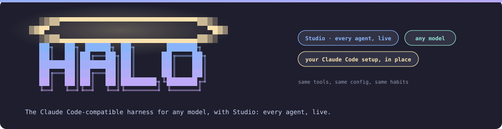</a>
</p>

<p align="center">
  <a href="https://github.com/roloVibes/Halo-Harness/releases"></a>
  <a href="https://github.com/roloVibes/Halo-Harness/actions/workflows/suites.yml"></a>
  
  
  <a href="LICENSE"></a>
</p>

<h3 align="center">The Claude Code-compatible harness for any model.</h3>

<p align="center">
DeepSeek, GLM, Kimi, Qwen and Claude get the same tools, the same configuration and the same working habits as Claude Code.<br>
Halo reads your <code>~/.claude</code> setup in place, so nothing is configured twice, and <code>/model</code> swaps the model mid-conversation.
</p>

<p align="center">
  <a href="#install">Install</a> ·
  <a href="#what-halo-is">What Halo is</a> ·
  <a href="#your-subscription-your-call">Subscriptions</a> ·
  <a href="#what-it-feels-like">What it feels like</a> ·
  <a href="#the-levels">The levels</a> ·
  <a href="#how-halo-compares">Compare</a> ·
  <a href="#features">Features</a> ·
  <a href="#documentation">Docs</a>
</p>

<details>
<summary>The same wordmark as text (what <code>halo --version</code> prints)</summary>

```text
    ░▒▓▓▀▀▀▀▀▀▀▀▀▀▀▀▀▀▀▀▀▀▀▀▀▀▀▀▀▀▀▓▓▒░
  ▒▓█▀                               ▀█▓▒
    ░▒▓▓▄▄▄▄▄▄▄▄▄▄▄▄▄▄▄▄▄▄▄▄▄▄▄▄▄▄▄▓▓▒░
    ██╗  ██╗ █████╗ ██╗      ██████╗
    ██║  ██║██╔══██╗██║     ██╔═══██╗
    ███████║███████║██║     ██║   ██║
    ██╔══██║██╔══██║██║     ██║   ██║
    ██║  ██║██║  ██║███████╗╚██████╔╝
    ╚═╝  ╚═╝╚═╝  ╚═╝╚══════╝ ╚═════╝
```

</details>

## Install

```sh
curl -fsSL https://raw.githubusercontent.com/roloVibes/Halo-Harness/v2.0.10/scripts/install-halo.sh | bash
halo init        # the wizard: provider, model, permission mode, theme, lineup
halo             # the full-screen TUI, from any directory
```

Windows:

```powershell
powershell -ExecutionPolicy ByPass -c "irm https://raw.githubusercontent.com/roloVibes/Halo-Harness/v2.0.10/scripts/install-halo.ps1 | iex"
```

The installer is fetched from a release tag, never a moving branch, and installs the
newest tag; `--ref <tag>` (`-Ref` on Windows) pins another. No installer at all:
`uv tool install git+https://github.com/roloVibes/Halo-Harness` or
`pipx install git+https://github.com/roloVibes/Halo-Harness`. Update with `halo update`
or `/update` inside the TUI. Offline work boxes, PEP 668 and reproducible installs are
covered in [docs/INSTALL.md](docs/INSTALL.md).

**Your first minute.** `halo init` asks for a provider key, a default model and a
permission mode, then `halo` opens the session. Type a request, watch the phase line
count up, and steer by typing while the model works. `halo doctor` explains anything
that is not right and ends each warning with its fix.

## What Halo is

Halo is a standalone coding agent for the terminal. It runs the same loop Claude Code
runs (a prompt, tool calls, permission rules, hooks, MCP servers, skills, sub-agents,
sessions) against the model you choose, over the route you choose: OpenRouter,
Databricks, the Anthropic API, the OpenAI API, Ollama, Hugging Face, any
OpenAI-compatible server you host, or your own Claude Code or Codex subscription.

It is built for three kinds of people:

- **You already use Claude Code** and want the same tools and habits with a cheaper, a
  local, or a different model, without rebuilding your setup. Halo reads
  `~/.claude` settings, `CLAUDE.md`, skills, commands, agents, MCP servers and memory
  where they already are.
- **You run models yourself** (Ollama, a GPU box on the LAN, Hugging Face) and want a
  harness that treats a local model as a first-class route, with calibration and
  honest capability checks instead of guesswork.
- **You put agents to work in teams**: a lineup assigns a model to each role, an
  organization is a tree of those roles working one goal, and every role shows its
  state, tools and cost while it runs.

Auto mode allows everything except your own deny and ask rules and your hooks. There
is no built-in safety classifier, no protected-path heuristic, no refusal layer. Rules
use Claude Code's own grammar, in the same files.

## Your subscription, your call

> [!WARNING]
> **You can run Halo on your Claude Code or Codex subscription, and that may violate the
> provider's terms.** The `cc:` and `cx:` routes drive the official `claude` and `codex`
> binaries in their documented headless modes under your own personal account, from a
> third-party harness that is not the provider's product. The provider's terms govern
> your account, and there have been public reports of accounts restricted for using
> subscription tokens this way. Halo never reads either tool's stored credentials.
> Both routes are **off until you accept** a one-time notice: `halo subscriptions
> accept`, or `/subscriptions` in the TUI. The notice, the exact behaviour and the
> consent record are described in
> [docs/MODELS.md](docs/MODELS.md#subscription-routes-consent-halo-207-round-7b).

## What it feels like

Every picture below is a real render of the TUI over mock data (a fixed clock, no
network, no real keys or paths), regenerated by `tools/capture_screens.py` and checked
byte for byte in CI; see [docs/MEDIA.md](docs/MEDIA.md). Click any picture for the
full-size version.

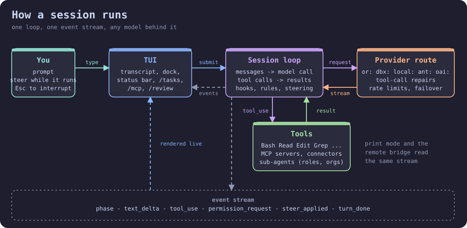

### Auto mode that never interrupts

A turn that edits, runs the tests and finishes simply does. The status bar says `auto`,
and nothing waits for you unless you wrote a rule that says it should.

<a href="docs/media/auto-mode.png">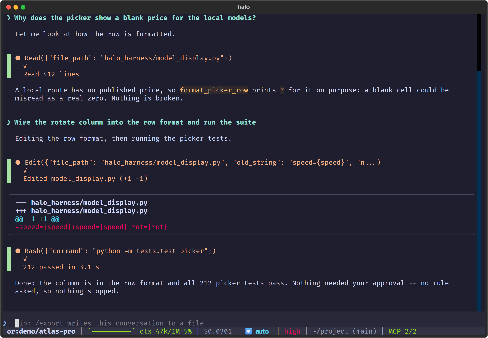</a>

### Steering a running turn

Type while a turn runs and the steer reaches the work. Your words show up at once as a
real message, a running command moves to the background instead of dying, and
sub-agents get your words forwarded into them. Nothing is lost.


### Watching a model think

The line under your message is alive: *Sending request*, then *Thinking* with tenths of
a second and a running reasoning-token count, then *Writing*, then a *Thought for 18 s*
summary. A stalled stream says so (`quiet 7 s`, `no data for 30 s, Esc interrupts,
typing steers`) instead of looking frozen.


### The dock that cannot hide

A permission ask, a question or a plan review docks directly above the prompt. The
transcript keeps a marker where it happened, a second ask queues behind the first, and
the status bar counts what is waiting on you.

<a href="docs/media/pending-dock.png">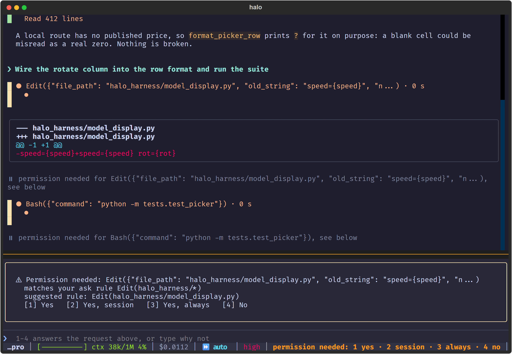</a>

### One session across providers

`or:` `dbx:` `local:` `cc:` `cx:` `oai:` `ant:` `ol:` `hf:` in one session, with `/model`
swapping the lane while the history, tools and rules come along. The picker shows price,
context window and speed for every route (`?` when unknown, never a blank that reads as
zero).

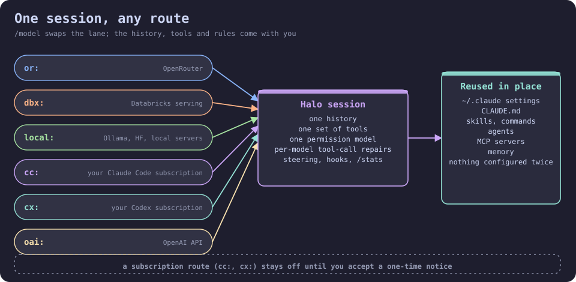

<a href="docs/media/model-picker.png">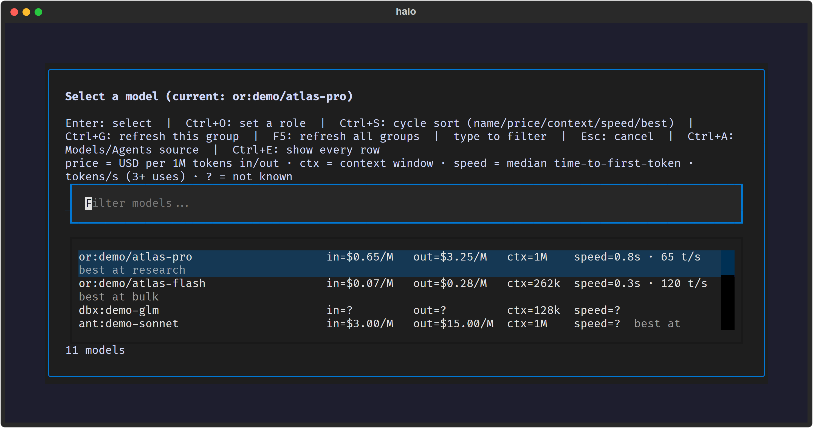</a>

### Roles and organizations

A lineup assigns a model to each role; an organization is a tree of those roles working
one goal. The flow that builds Halo itself ships as the `halo-dev-cycle` template. Each
role is a sub-agent on its own model, visible in `/tasks` with its state, tools and cost.

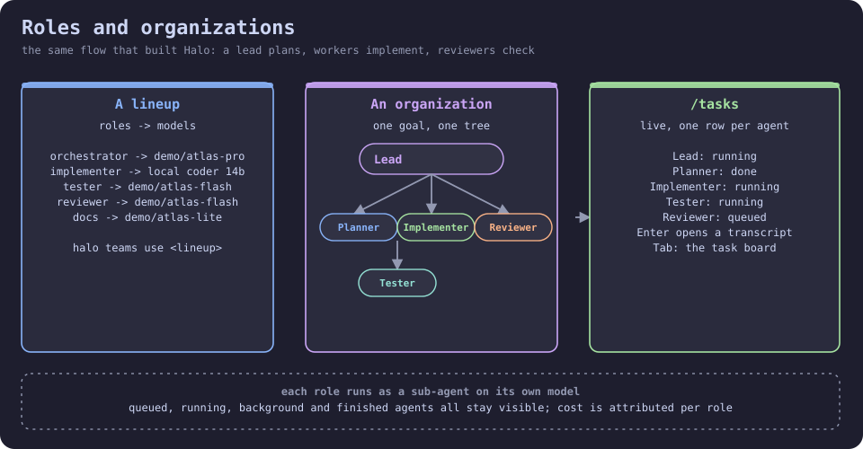

<a href="docs/media/tasks-org-tree.png">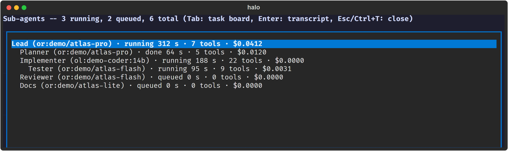</a>

### See your agents: Halo Studio

`halo studio` opens the active lineup as a graph in your browser: one card per
assignment with the model that resolves for it, its price and context; delegation,
reporting and pipeline edges; drag a bio onto the canvas to add it. The inspector
edits the assignment, the bio behind it and the lineup's sections, with the YAML
both ways, and Validate / Save / Apply run the same checks `halo teams` does.
See [docs/STUDIO.md](docs/STUDIO.md).

<a href="docs/media/studio.png">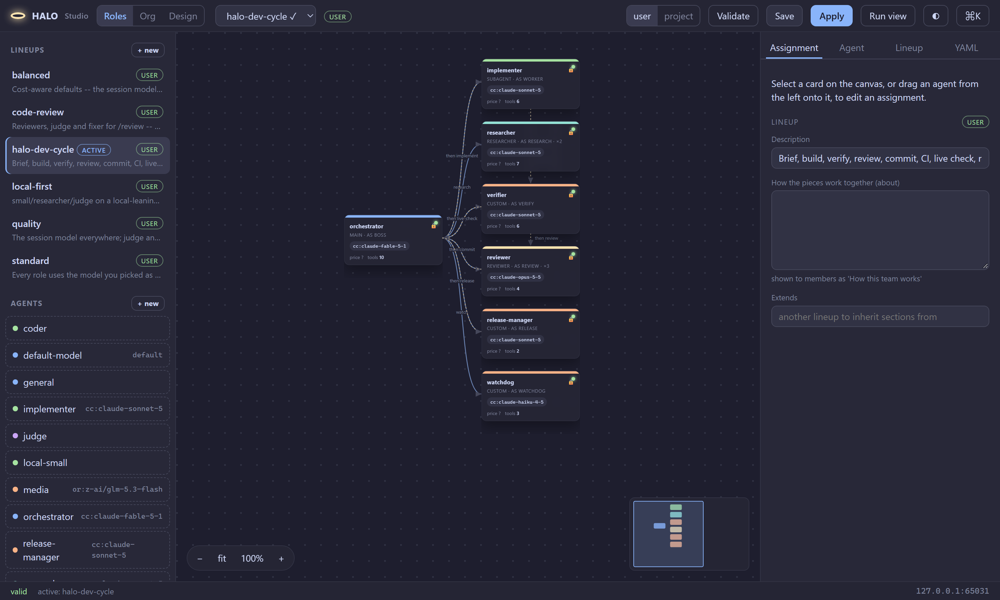</a>

### Your company, in Paperclip

Flip Studio to **Org** and the same canvas shows your company in
[Paperclip](https://github.com/paperclipai/paperclip), the open-source control plane
for agent teams: titles, reporting lines, budgets, issues and heartbeats. One command
turns a lineup into a company (`halo paperclip sync halo-dev-cycle --new Halo`), each
agent runs `halo paperclip-run` on its heartbeat on the model its bio names, and the
reply lands on the issue. See [docs/PAPERCLIP.md](docs/PAPERCLIP.md).

<a href="docs/media/studio-org.png"></a>

### Connectors: Claude Docs from a non-Claude model

Your claude.ai connectors (Claude Docs, a calendar, a drive) appear as tools to whatever
model is driving Halo. The sign-in stays in `claude`; Halo never reads its credentials
file. `/mcp` shows each server's state and *why* one failed, with a deep-dive action.

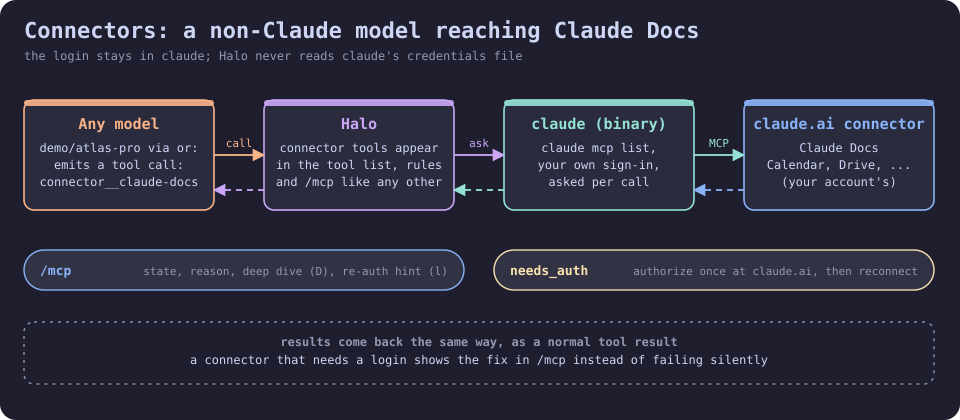

<a href="docs/media/mcp-connectors.png">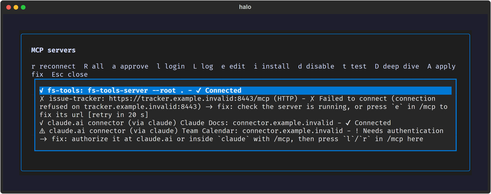</a>

### Code review with a judge

`/review` runs read-only reviewers per dimension (correctness, security, performance,
tests, docs), a judge confirms or dismisses every finding, and the result is ranked cards
with clickable `file:line` and an optional `--fix` pass. See [docs/REVIEW.md](docs/REVIEW.md).

<a href="docs/media/review-cards.png">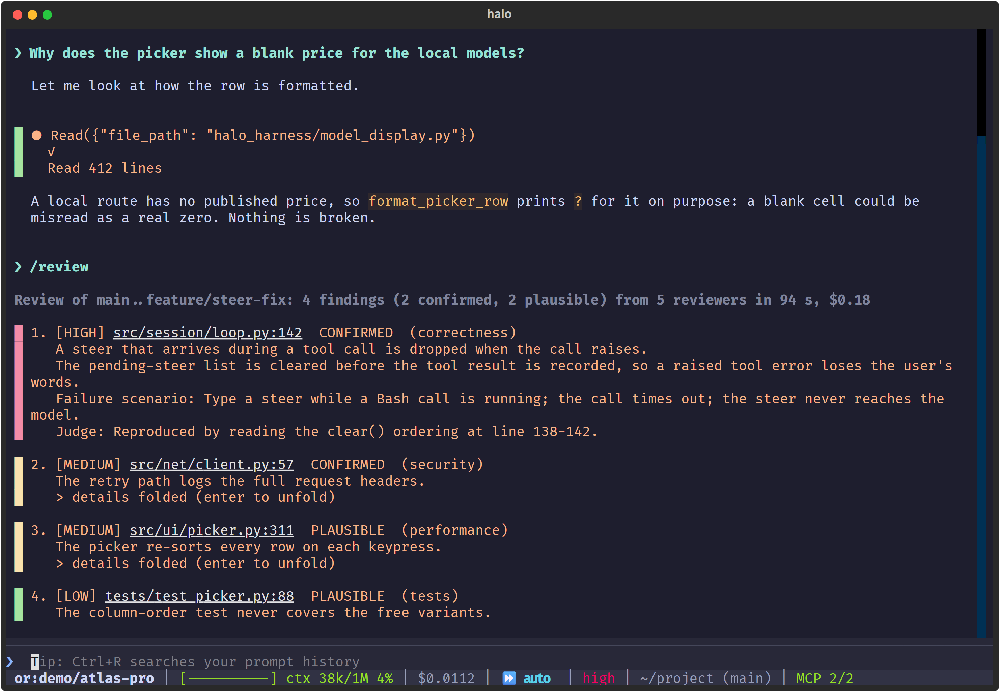</a>

### Remote control from Signal

Message a number and drive a session from your phone: prompts, streamed replies,
permission cards answered by number. Contact-request pairing, HMAC-signed commands, a
kill switch, a `/remote` dialog and a status chip. See [docs/REMOTE.md](docs/REMOTE.md).

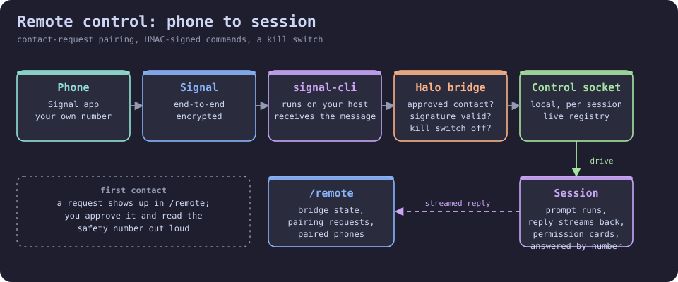

<a href="docs/media/remote-contact-request.png">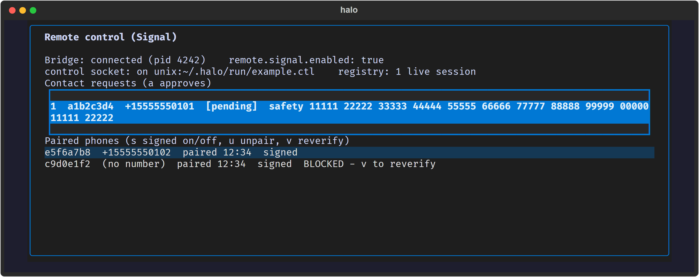</a>

### One paste instead of screenshots

`halo bugreport` (or `/bugreport` in a session) writes a redacted diagnostic report:
version, environment, provider and route state, MCP servers, the last turn's timeline,
every secret-shaped value stripped. `--copy` puts it on the clipboard.

## The levels

Three game themes, each a full skin: a palette, a HUD status bar whose face follows the
phase of the turn, and a level that lives directly above the prompt. The hero runs and
the scenery scrolls while the model writes; an enemy crosses while it thinks; a finished
sub-agent or background job drops a pickup beside the hero. `/doom`, `/metroid` and
`/mario` toggle a theme, `/level` toggles the band. All of the art is original, drawn
for Halo in the spirit of the 8-bit era.

**Mario.** A plumber in a red cap, warp pipes, brick rows with a question block, clouds,
a winged turtle gliding by; a 1-UP mushroom when a sub-agent finishes. Two palettes:
`/mario bros` and `/mario world`.


**Metroid.** A hunter in a power suit with an arm cannon, rock pillars, hatches and
stalactites; a floating alien drifts in while the model thinks and latches on when a turn
errors. Five areas, each with its own ground: `/metroid norfair` is lava, `maridia` is
water.


**DOOM.** A marine in green armour, a shotgun that flashes while the model writes, steel
pillars, barrels and a sealed door; an imp stalks in while the model thinks.


## How Halo compares

Facts about Halo come from this repository. The right-hand column summarizes what other
coding harnesses commonly document, not a measurement of any one of them. It varies by
tool, so check each tool's own docs.

| Point | Halo | Other harnesses (varies by tool) |
|---|---|---|
| Config reuse | Reads your Claude Code setup in place: `~/.claude` settings, CLAUDE.md, skills, commands, agents, MCP servers, memory | Commonly their own config files and instruction files |
| Models | DeepSeek, GLM, Kimi, Qwen, Claude and more, over nine route kinds; `/model` swaps mid-conversation | Often one vendor's models, or one provider list per tool |
| Steering | Type during a turn; the steer shows at once and reaches the work, background commands survive, sub-agents get it | Commonly a queued message or an interrupt |
| Liveness | A live phase line (seconds, token counts, `quiet`/`no data` counters) plus a status-bar word and timer | Commonly a spinner |
| Permissions | Auto mode allows everything except your own deny/ask rules and hooks; asks dock above the prompt and queue | Commonly a built-in approval policy of the tool's own |
| MCP | stdio/HTTP/SSE from every Claude Code scope, `/mcp` with failure reasons and a deep dive, claude.ai connectors as tools | MCP support is common; diagnosis and connector bridging vary |
| Agents | Lineups with a model per role, per-role cost, `/tasks`, and Studio, a visual editor for lineups and bios | Sub-agents are common; a model per role, cost attribution and a visual editor vary |
| Sessions | Resume, rewind, `/tasks`, per-role cost attribution, `halo bugreport` | Resume is common; the rest varies |
| Remote control | From a phone over Signal, with pairing, signed commands and a kill switch | Rare in a terminal harness |
| Review | `/review` with parallel reviewers, a judge and ranked cards | Varies |

## Features

| | |
|---|---|
| **Routes** | `or:` `dbx:` `ant:` `oai:` `ol:` `hf:` `local:` `cc:` `cx:` -- one session, any of them, and `/model` swaps the lane without losing context. |
| **Your Claude Code setup, in place** | `~/.claude` settings, CLAUDE.md, skills, commands, agents, MCP servers and memory are read where they are. Nothing is configured twice. |
| **Steering** | Type while a turn runs: the steer shows at once and reaches the work, a running command moves to the background instead of dying, sub-agents get your words forwarded into them. |
| **A model per role** | YAML agent bios and lineups assign a model to each job: GLM can orchestrate while a local Qwen implements and a cheap flash model reviews. Pick one in the wizard, with `halo teams apply <lineup>`, or in Studio. |
| **Halo Studio** | `halo studio`: your lineups and bios as an editable graph in the browser, served from a loopback-only server with a per-launch token; Org mode shows the same team as a Paperclip company. |
| **Paperclip** | `halo paperclip sync <lineup>` makes a company of agents that run Halo on their heartbeats; `halo paperclip-run` is the adapter. |
| **Per-model tool-call repairs** | Fourteen model families' quirks are repaired on the fly: Kimi's `functions.{name}:{idx}` ids, GLM's always-on thinking, Qwen's system-message rules, DeepSeek's reasoning echoes. Gateway quirks are learned once per model and remembered (`halo rules`). |
| **Measured, not guessed** | `/stats` per model and per tool, price/context/speed columns in the picker, per-role cost attribution, and `halo preflight` canaries each lane before a long run. |
| **Filter-aware routing** | A provider content filter is not an answer: a filtered reply never persists as one, and the request reroutes to a fallback lane you choose. |
| **Permissions without a nanny** | Auto mode allows everything except *your own* deny/ask rules. Rules use Claude Code's own grammar, in the same files. |
| **The wizard** | `halo init`: provider, model, permission mode, theme, lineup, orgs. Every step explains itself and `halo doctor` ends each warning with its fix. |
| **MCP deep dive** | stdio/HTTP/SSE servers from every Claude Code scope, `D` diagnoses a failing server end to end, claude.ai connectors bridge through as tools. |
| **Balances and picker columns** | Per-provider balances in the status bar (remaining first); free variants sit beside their paid rows in the picker. |
| **Remote control from Signal** | Prompts, streamed replies, permission cards answered by number, pairing, signed commands, a kill switch. |
| **Code review** | `/review` and `halo review`: parallel reviewers, a judge, ranked cards or `--json`, an optional `--fix` pass. |
| **Themes with levels** | DOOM, Metroid and Mario: a palette, a HUD with a face that follows the turn, and an animated level above the prompt. |
| **Privacy audit** | `halo audit privacy` scans the tree for real paths, hosts and key-shaped strings; the release refuses to ship one red line. |
| **CI and release script** | Every push runs the three suites on Linux and Windows; `scripts/release.py` versions, tags, pushes and refreshes both installs. |

## Documentation

| Document | What it covers |
|---|---|
| [docs/INSTALL.md](docs/INSTALL.md) | One-page install, upgrade and update guide |
| [docs/HANDBOOK.md](docs/HANDBOOK.md) | The long-form guide: configuration, providers, permissions, steering, hooks, skills, MCP, sessions, themes, telemetry |
| [docs/COMMANDS.md](docs/COMMANDS.md) | Every CLI command and flag |
| [docs/SLASH-COMMANDS.md](docs/SLASH-COMMANDS.md) | Every slash command in the TUI |
| [docs/CONFIG.md](docs/CONFIG.md) | Config keys, paths and environment variables |
| [docs/MODELS.md](docs/MODELS.md) | Model families, effort levels, per-route rules and the subscription consent |
| [docs/LOCAL-MODELS.md](docs/LOCAL-MODELS.md) | Ollama, Hugging Face, the OpenAI API and Codex, end to end |
| [docs/DATABRICKS.md](docs/DATABRICKS.md) | Databricks endpoints, API types and the work matrix |
| [docs/AGENTS.md](docs/AGENTS.md) | Agent bios and lineups: the 90-second version, then the field reference |
| [docs/STUDIO.md](docs/STUDIO.md) | Halo Studio, the visual editor for lineups and bios, and its Org mode |
| [docs/PAPERCLIP.md](docs/PAPERCLIP.md) | Paperclip: your lineups as a company of agents |
| [docs/ROLES.md](docs/ROLES.md) | Roles and the role table |
| [docs/GOVERNOR.md](docs/GOVERNOR.md) | The Governor: shared per-host rate limiting, failover and lanes |
| [docs/REVIEW.md](docs/REVIEW.md) | `/review` and `halo review` |
| [docs/REMOTE.md](docs/REMOTE.md) | Remote control over Signal |
| [docs/TROUBLESHOOTING.md](docs/TROUBLESHOOTING.md) | "Is it frozen?", GLM pauses, copy and paste, connect timeouts |
| [docs/ARCHITECTURE.md](docs/ARCHITECTURE.md) | How the pieces fit together |
| [docs/MEDIA.md](docs/MEDIA.md) | How the front-page pictures are made and regenerated |
| [SECURITY.md](SECURITY.md) | The security model and how to report a problem |
| [CHANGELOG.md](CHANGELOG.md) | Every release, with what changed and why |

## Tests

Three hermetic, exit-code-gated suites run on Windows, WSL and a Kali VM before every
commit, and in CI on every push: `python test_bridge.py` (the proxy), `python
tests/run_all.py` (the harness) and `python test_tui.py` (the TUI, through Textual's
headless pilot). Mock servers stand in for every provider, a fake `claude` stands in for
the subscription route, and guards fail the run if a test touches the real `~/.halo` or
`~/.claude`. See [docs/DEVELOPMENT.md](docs/DEVELOPMENT.md).

## Contributing and security

Pull requests are welcome; [docs/CONTRIBUTING.md](docs/CONTRIBUTING.md) has the house
rules and how to run the suites. Security reports go through
[SECURITY.md](SECURITY.md).

## Licence

MIT. See [LICENSE](LICENSE).
