<p align="center">
  <a href="docs/media/hero.png">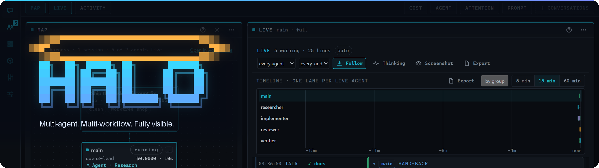</a>
</p>

<p align="center">
  <a href="https://github.com/roloVibes/Halo-Harness/releases"></a>
  <a href="https://github.com/roloVibes/Halo-Harness/actions/workflows/suites.yml"></a>
  
  
  <a href="LICENSE"></a>
</p>

[](https://m8ven.ai/mcp/rolovibes-halo-harness-b6hvi0?s=readme)

<h3 align="center">Multi-model agent harness with orchestration, Claude Code compatibility, local LLM support, and live agent monitoring.</h3>

<p align="center">
Halo Harness is an open source, multi-model agent harness and orchestration platform that brings Claude Code-style tooling to the models you choose.<br>
Run agents across OpenRouter, Databricks, Anthropic, Ollama, Hugging Face, LM Studio and OpenAI-compatible endpoints while reusing your existing Claude Code configuration, skills and MCP servers: Halo reads your <code>~/.claude</code> setup in place, and <code>/model</code> swaps the model mid-conversation.<br>
Assign specialized agents different models and responsibilities, coordinate parallel work, and manage execution through a shared runtime.<br>
<code>halo studio</code> is the visual interface where you watch agents work, track tool calls and costs, manage teams, and steer sessions across machines. Built for developers who want to choose their models without rebuilding their workflow.
</p>

<p align="center">
  <a href="#install">Install</a> ·
  <a href="#update">Update</a> ·
  <a href="#what-halo-is">What Halo is</a> ·
  <a href="#halo-studio">Studio</a> ·
  <a href="#session-the-dashboard">Session</a> ·
  <a href="#agents-your-lineup-its-runs-what-runs-now">Agents</a> ·
  <a href="#workflows-saved-orchestrations-as-squares">Workflows</a> ·
  <a href="#live-on-the-fleet-every-harness-one-goal">Fleet</a> ·
  <a href="#what-it-feels-like">What it feels like</a> ·
  <a href="#how-halo-compares">Compare</a> ·
  <a href="#features">Features</a> ·
  <a href="#documentation">Docs</a>
</p>

<details>
<summary>The same wordmark as text (what <code>halo --version</code> prints)</summary>

```text
    ░▒▓▓▀▀▀▀▀▀▀▀▀▀▀▀▀▀▀▀▀▀▀▀▀▀▀▀▀▀▀▓▓▒░
  ▒▓█▀                               ▀█▓▒
    ░▒▓▓▄▄▄▄▄▄▄▄▄▄▄▄▄▄▄▄▄▄▄▄▄▄▄▄▄▄▄▓▓▒░
    ██╗  ██╗ █████╗ ██╗      ██████╗
    ██║  ██║██╔══██╗██║     ██╔═══██╗
    ███████║███████║██║     ██║   ██║
    ██╔══██║██╔══██║██║     ██║   ██║
    ██║  ██║██║  ██║███████╗╚██████╔╝
    ╚═╝  ╚═╝╚═╝  ╚═╝╚══════╝ ╚═════╝
```

</details>

## Install

Install, then `halo init`:

```sh
curl -fsSL https://raw.githubusercontent.com/roloVibes/Halo-Harness/v3.3.17.0/scripts/install-halo.sh | bash
halo init        # opens Halo Studio on Setup: provider, model, permission mode, theme, lineup, checks
```

Windows:

```powershell
powershell -ExecutionPolicy ByPass -c "irm https://raw.githubusercontent.com/roloVibes/Halo-Harness/v3.3.17.0/scripts/install-halo.ps1 | iex"
```

<a href="docs/media/studio-setup.png">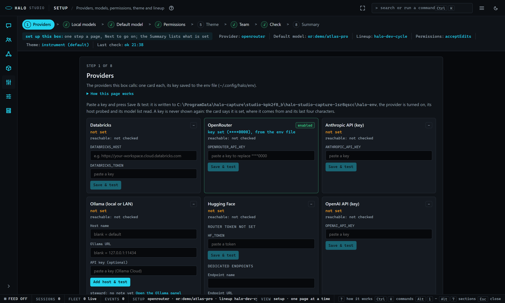</a>

The first thing after install: `halo init` opens Studio on **Setup**, the page above. It goes one page at a
time in order (Back / Next, a Summary last), each block with its own Save; the rail on top says what is set. Over SSH or on a box with no
browser it prints the URL (with the port-forward line) and asks the essentials line by line (a provider and its key,
the default model, the permission mode, doctor); `halo init --terminal` asks them anywhere.

The installer is fetched from a release tag, never a moving branch, and installs the
newest tag; `--ref <tag>` (`-Ref` on Windows) pins another. The installer may run
`uv tool update-shell`, which adds `~/.local/bin` to your shell startup file (the user PATH on
Windows): it asks first, shows what uv changed, and `--no-modify-path` (`-NoModifyPath`, or
`HALO_NO_MODIFY_PATH=1`) skips it. No installer at all:
`uv tool install git+https://github.com/roloVibes/Halo-Harness --constraints https://raw.githubusercontent.com/roloVibes/Halo-Harness/master/requirements.lock`
(the constraints file pins dependency versions; without it the latest versions resolve) or
`pipx install git+https://github.com/roloVibes/Halo-Harness`. Offline work boxes, PEP 668
and reproducible installs are covered in [docs/INSTALL.md](docs/INSTALL.md).

**Your first run.** In Setup (or `halo init --terminal`) you paste a provider key, pick a default model
and a permission mode; its Check block lists the checks it can run (doctor, the model catalog and one
hello call ticked; the quick gym off), each with what it does,
costs and takes, and you tick the ones to run (`halo check` runs the same list later).
The guided first run (`halo start`: one real Orchestra run that rehearses your lineup on a sample repo) is
the first-run pack since 3.4.0.0 (`halo pack install first-run`, then `halo pack enable first-run --grant-all`); see [its README](halo_harness/templates/packs/first-run/README.md). `halo explain <word>` says what any word means
([docs/GLOSSARY.md](docs/GLOSSARY.md)). Then `halo` opens the full-screen TUI from any
directory: type a request, watch the phase line count up, and steer by typing while the
model works; `/studio` opens Studio's dashboard on that session. `halo doctor` explains anything that is not right and ends each warning with
its fix.

## Update

`halo update` in a shell, or `/update` inside the TUI. It finds the newest release, stops the Halo processes that hold the install (Windows cannot replace a file in use), reinstalls the same way you installed and prints the new version; `halo update --check` only says what it would do.

If an older install stops at `invalid peer certificate: UnknownIssuer`: uv checked the network's certificate against its own bundled roots, and a network that re-signs traffic (or a CA that only your system store has) fails that. 3.3.16.0 fixed the updater and both installers, but an older install cannot update itself past it. This line repairs it once:

```sh
UV_SYSTEM_CERTS=1 UV_NATIVE_TLS=1 uv tool install --reinstall git+https://github.com/roloVibes/Halo-Harness
```

```powershell
$env:UV_SYSTEM_CERTS='1'; $env:UV_NATIVE_TLS='1'; uv tool install --reinstall git+https://github.com/roloVibes/Halo-Harness
```

Append `@v<version>` to the address to pin a release. Running the installer one-liner again does the same: the installers now retry on the system store.

## What Halo is

Halo is a Claude Code-compatible harness on your own models: it runs the loop Claude
Code runs (a prompt, tool calls, permission rules, hooks, MCP servers, skills,
sub-agents, sessions) on the model you choose, and reads your `~/.claude` settings,
`CLAUDE.md`, skills, commands, agents, MCP servers and memory where they already are.
Halo Studio is the browser console where you watch and steer every agent: what each one
thinks, which tool it runs and for how long, what it hands back and what it asks you.
One session works across providers (OpenRouter, Databricks, the Anthropic API, the
OpenAI API, Ollama, Hugging Face, your work's Microsoft 365 Copilot as `cp:work`
([PROVIDERS-copilot.md](docs/PROVIDERS-copilot.md)), or any OpenAI-compatible server you host), and
`/model` swaps the model mid-conversation. The local half is built to run on your own
machines: the Ollama steward watches every local server and plans what fits, the **Local**
section shows the machines and their models, `halo host` runs on the machine that serves
them, the pool puts one model across several machines' GPUs, and Voice lets you talk to a
session and hear it answer, all locally.

## Halo Studio

`halo studio` opens Studio in your browser. It is one window with six sections under one header, and two of them are where you watch your agents: **Session**, the dashboard of everything working right now, and **Agents**, your lineup as cards that light up as their agents work, its runs and what runs now on every machine.

### Session: the dashboard

<a href="docs/media/studio-session.gif"></a>

Press `Alt+1`, or type `/studio` in a terminal session (`halo studio --session` from a shell). The whole right side is **Live**: one column of everything every agent of this harness does, in the order it happens.

- What each agent thinks and writes.
- Each tool call as one row: the tool, what it runs on, its time ticking while it runs,
  then the first line of its result.
- What an agent hands back, and its last words when it finishes.
- What it asks you, as an amber card you answer with `A`, `R`, `S` or `O`.

Each line carries the fleet log's columns, the time and the kind (`TOOL`, `TEXT`, `STATE`, `ASK`, `YOU`), then its agent's tag: its own colour, its name and its state; a timeline lane per live agent sits on top, with an agent pick and a kind pick beside Follow. Follow is on: scroll up and it pauses, **↓ N new** brings you back. The Steer box is always at the bottom, with Pause and Stop beside it: it talks to the session's main agent, or to the one you pin (click its tag, or hover any tag or map node and click **steer**); `Esc` shows everyone again.

<a href="docs/media/studio-session-live.png">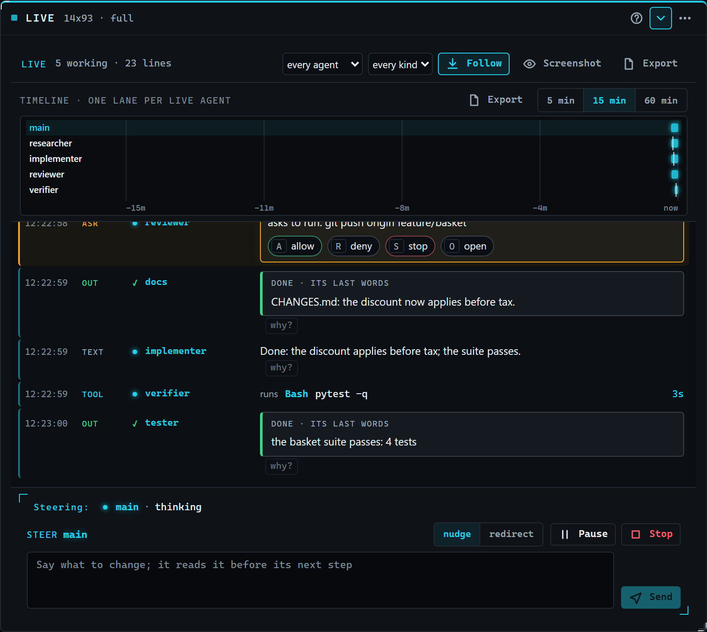</a>

On the left, the **map** (Agents -> Live's tree, narrowed to this harness) draws its agents as a tree: each agent under the one that spawned it, its children fanned out side by side. A node shows its model, what it has cost and, while a tool runs, the tool and its time (`Bash 12s`). The state shows on the node and on the edge into it: working pulses cyan, waiting is amber, done is green that fades over ten seconds, failed is red and stays. Hover a line in Live and its node lights up.

Under the map, **Cost** ticks the spend beside its sparkline and fills a context bar with what the model holds (amber past 80 %, red past 95 %), then the tokens in and out, the turns, the cost per turn and each agent's share of the spend. Agent, Activity and Attention wait as strips under it, one click each. See [Session](docs/STUDIO-sections.md#session).

### Agents: your lineup, its runs, what runs now

<a href="docs/media/studio-roles-live.gif"></a>

Press `Alt+2` (or `/roles` in a session). Agents has four views on one switch (3.3.16.0): **Cast**, the lineup and its bios; **Runs**, a goal for the lineup; **Live**, what runs now; **Workflows**, the saved squares main may hand work to. On Cast the open lineup is a canvas of cards in tier boxes, one card per slot: an agent bio in a role, with the model that resolves for it, its price and its context. Main sits alone in tier 0, and a member spawns only into the next tier down. Drag a card into another box to move it to that tier; the lineup saves. Since 3.3.16.3 the tiers and the enabled squares are **blocks** on that one canvas: a tier says its purpose ("the workers, picked per task"), a square block opens to show the agents inside it on their models, and a click on a block puts its summary (purpose, agents, budget, limits, its file) in the inspector. On **Live**, the sub-agents one step started are one box titled by their task, with main's line into the box, the counts of who is working, and Auto's pick in plain words.

While a session runs, the cards whose agents work glow in their agent's state, and the glow comes and goes with what the agent does:

| State | Colour | What you see | When it goes |
|---|---|---|---|
| working | cyan | a light flows along the card's top while the agent types, one pulse per tool call, the tool on its badge | comes on with the agent's first running state; a queued agent shows only its badge |
| waiting on you | amber | three pulses, then a steady amber edge and a diamond badge | when you answer (a question, a permission, a plan, a pause) |
| done | green | the card turns green | fades out over the ten seconds after it finished |
| failed | red | the card turns red, the badge says failed | stays until you click the card |

Hover a card's state glyph or its badge and the card explains its own glow. A tier box takes the strongest state of its cards, and the edge into a card takes that card's colour. The other edges are the lineup's routing: delegation from main (select a card and its routing words show) and the pipeline's stage order.

<a href="docs/media/studio-roles.png"></a>

Click a card. The Inspector's **MODEL** strip says what it runs on and changes it with one pick (it saves at once), and its **Live** tab shows what the agent types and runs, with Steer, Pause and Stop. The Inspector also edits the card's slot, its bio and every section of the lineup, with the YAML both ways. Problems checks every edit as you make it; Save writes the lineup's YAML and Apply makes it the lineup new sessions use. See [Agents](docs/STUDIO-sections.md#agents) and [the canvas](docs/STUDIO-agents.md#cast-the-lineup-and-its-bios).

### Workflows: saved orchestrations as squares

A **square** is a saved workflow with a contract: what it does, what it takes, what it gives, which needs it covers, its lineup, its engine, its budget and its limits. Main hands a task to a square with the `Workflow` tool when the task needs something its own model cannot do: a text-only model hands a PDF to the `media` square, which reads it on a model that can. That is when no role of your lineup reads PDFs: a role that does (a media member) takes it first, unless you gave the square its own when. One line says why (`handing the PDF to media: your model takes text only`) and a receipt lands in the transcript. A square works only when your lineup has it enabled, and its depth, turns, time and spend are capped.

Five squares ship: `media` (on by default), `plan`, `code`, `review` and `research`. Yours go in `~/.halo/workflows/`, a pack's come with the pack.

```sh
halo workflows list                       # every square, and which are enabled
halo workflows show media                 # its contract
halo workflows enable plan | disable plan # for the active lineup
halo workflows test media                 # check the file
halo workflows new my-media --from media  # a copy of yours to change
halo workflows enable review --when words=review,audit   # when main hands it work
halo blocks add thinking                  # a block to start from: three reasoning models
```

Each square has a **when**: the rule for when main hands it work. By default it is what the square covers, and you can narrow it to some needs (only PDFs), to words the task says ("review", "audit"), to only when main names it, or to always first. The order is explicit before implicit: a square named, then a square whose when fires, then a role of the lineup that covers the need, then a square's plain covers. Blocks you can start from ship as templates (`thinking`, `media`, `review-panel`, `local-workers`): each adds a square of yours or a tier, every agent on an `auto` model, so nothing names a provider you did not set up.

<a href="docs/media/studio-workflows.png"></a>

In Studio you compose it on Agents -> Cast (`Alt+2`): open the library, drag a workflow or a block template onto the canvas, drag an agent into a block or out of it, and drag a block by its title bar. Each drop says what it adds, costs and writes before it happens, says what changed in one line after, and Undo walks it back. The line from main to a block carries its when as a label; click it to change the rule on one page. A block with no line is dashed, and Problems says main never uses it. The Workflows view (`W`) is the squares alone. See [docs/STUDIO-blocks.md](docs/STUDIO-blocks.md) and [docs/WORKFLOWS-squares.md](docs/WORKFLOWS-squares.md).

### Six sections, one window

<a href="docs/media/studio-modes.png">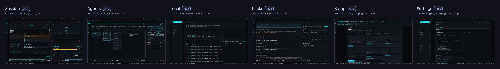</a>

**Session** (`Alt+1`), **Agents** (`Alt+2`) and **Local** (`Alt+3`) come first; Agents took in Team, Roles and Orchestra in 3.3.16.0 (`?mode=roles`, `orchestra` and `team` still open it), and the Fleet section's pieces went where they belong: a machine's agents to Agents -> Live, its pairing to Setup -> Machines, its models to Local (`?mode=fleet` still opens Live on the fleet). Each section opens on a Start view that says what it is for, its panels sit in labelled group boxes you move and resize, `Ctrl`/`Cmd`+`K` opens the command palette and `?` opens "How this works". `halo studio` serves it on loopback only, with a per-launch token: no account, no CDN, no fonts fetched, no analytics.

The fourth, **Packs** (`Alt+4`), is the Pack Manager: it lists the packs in the places you trust (the folders and git urls of `packs.sources`, and the packs Halo ships: Documentation Review, Concord and Design), shows what each brings and asks for, and installs, grants, enables, sets up, updates and removes them through the same code as `halo pack`. An enabled pack's own section comes after the core sections (the first pack section takes `Alt+7`). See [docs/STUDIO-packs.md](docs/STUDIO-packs.md) and [docs/PACKS.md](docs/PACKS.md).

The fifth, **Setup** (`Alt+5`, 3.3.0.0), is this box's setup on one page: the blocks (the providers, local models, the default model, the permission mode, the terminal theme, the lineup, the Linux fixes when a box needs them, the five checks, and the machines you pair) as forms you fill in any order, each saving the key `halo init --terminal` and `halo config set` write; `halo init` opens it, and so does a home with no provider set up. See [docs/STUDIO-setup.md](docs/STUDIO-setup.md).

The sixth, **Settings** (`Alt+6`, 3.3.3.0), is every key of `~/.halo/config.json` on one page per group: each key a row with its help line, its value against its default, Reset to default and the exact `halo config set` line; a change saves at once and says when it takes effect, and a search finds a key across every group. `halo settings fleet` opens its Fleet page. See [docs/CONFIG.md](docs/CONFIG.md).

The third, **Local** (`Alt+3`, 3.3.5.0), is the machines that serve your local models and the models they serve: this machine's GPU, VRAM, RAM and CPU live, every call to a local server as it happens, every host Halo knows with Load, Unload and Make it fit, and every installed model with its card, its fit meter and an intent filter (code, chat, long documents, images, embed). `halo local` opens it. See [docs/STUDIO-local.md](docs/STUDIO-local.md). On the machine that serves the models, `halo host` (3.3.7.0) watches them with no session open and lets a laptop with no GPU read that card, its models' fit, their profiles and the server log, no ssh: [docs/HOST.md](docs/HOST.md). A bench (3.3.8.1) runs from any halo, over the LAN, on a host that has no `halo host`; the card says it includes the link.

**The pool** (3.3.8.0) is one model across the GPUs of several of your machines, over llama.cpp RPC: `halo pool`, or Local -> Pool, which shows each member's free VRAM, whether the model fits and the split, then warms or stops it. It buys capacity, not speed. See [docs/POOL.md](docs/POOL.md). **Voice** (3.3.9.0) is a session you talk to and hear, with the speech models on your own machines: `halo voice`, `/voice`, or Local -> Voice with Talk from the browser's microphone, the speech servers running on this machine or through a `halo host`. See [docs/VOICE.md](docs/VOICE.md).

The pictures here are headless-Chrome renders of Studio over fixture data (`tools/capture_studio.py`, and `tools/capture_session_anim.py` for the animated ones, rendered again for each release). [docs/STUDIO.md](docs/STUDIO.md) has every panel and shortcut, and [Over SSH](docs/STUDIO-security.md#over-ssh) covers a box you reach remotely.

### Live on the fleet: every harness, one goal

The fleet is the shipped `fleet` pack since 3.4.0.0: `halo pack install fleet`, then `halo pack enable fleet --grant-all` (a halo that had a fleet gets it on by itself). Press `Alt+2` (Agents), then `L`, and switch Live's scope to **fleet** (`F` on the canvas, or open `?mode=fleet`): every Halo harness you run or joined is live on one canvas, each machine a box, each session a card, its agents a tree under it. Another machine joins with a pair code (Setup -> Machines, or `halo fleet join`). The **Attention** chip (`A`) is one queue of everything that waits on you on any harness (a question, a permission, a gate, a paused agent, a spend cap, a file conflict), one key each. Click any agent to read what it thinks and runs, then steer, pause, stop, take it over or hand it to another harness. A **mission** is a run of the whole fleet: the hub's lead splits one goal into parts by what each harness can do, you drag a part into another machine's box, approve and run, and the report says who did what and what it cost. See [docs/FLEET.md](docs/FLEET.md) and [docs/MISSIONS.md](docs/MISSIONS.md).

<a href="docs/media/studio-fleet.png"> Live on the fleet: two machines as boxes with their sessions and agents, the glance in the inspector with the machines, what waits on you and today's spend" src="docs/media/studio-fleet.png" width="100%"></a>

### Runs: agents writing the same files

Press `Alt+2`, then `R` (Agents -> Runs, Orchestra before 3.3.16.0). Several agents write to the same files at once and nothing is lost: a lead splits your goal into lanes, one worker per lane writes its part in its own git worktree, and code owns the claims, the merge order, the tests and the gate; a model judges only when two pieces conflict. With **Review the plan before it runs**, the lead's lanes open on the plan canvas first: drag a lane into another layer to change what it runs after, edit its claims, bio and model, then **Approve and run**. The console draws the lanes, the claimed regions, the merge gate and the report, and with the coach pack on, its **Coach** panel reads a finished run and suggests what to change (a bio's prompt or model, a lane's order), each card with its evidence. Each lane says what it owns (its claims). See [docs/ORCHESTRA.md](docs/ORCHESTRA.md) and [docs/STUDIO-agents.md](docs/STUDIO-agents.md).

<a href="docs/media/studio-orchestra.png">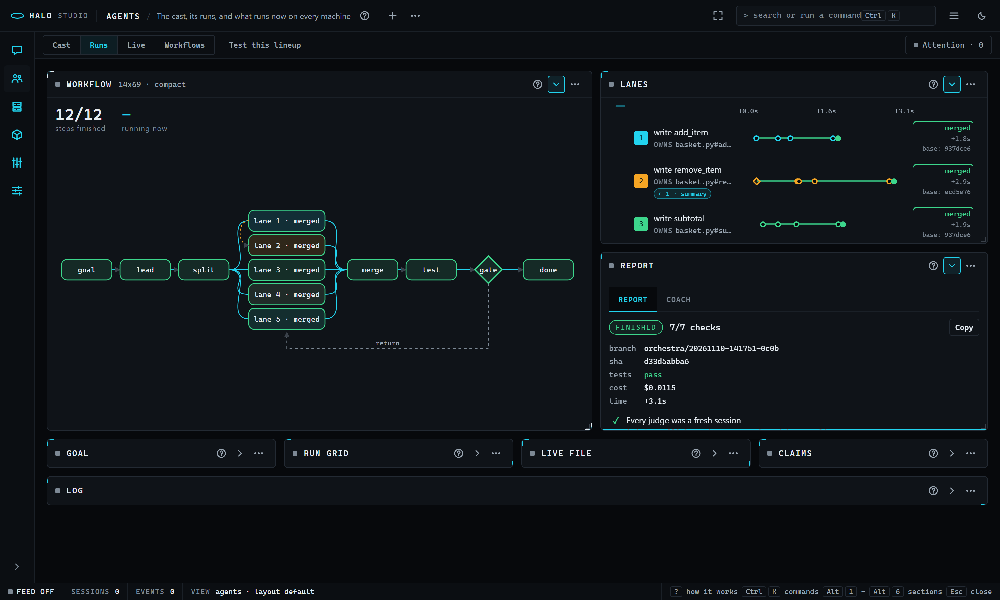</a>

### Team files, from a terminal

Team's board left Studio in 3.3.16.0: who owns what is each lane's owns line in Agents -> Runs. The team file and `halo team` left in 3.4.0.0: a lineup's tiers and blocks (Agents -> Cast) and a run's lanes with their owns lines (Agents -> Runs) do its job.

### Design: a pack Halo ships

Design is the **design pack** since 3.3.13.0: `halo pack install design`, then `halo pack enable design --grant-all`, and the design pack's section (the first pack section, `Alt+7`, or `/design`) holds artboards: prototypes, pages, decks and logos made by a real Halo turn, with the [ArtCraft](https://getartcraft.com/apps) apps on your machine as its tools when they are registered, and a new version on every turn. Refine by chat, pinned comments, direct text edits and knobs; export a folder, HTML, PNG, SVG or PDF, or hand it off to the next session. See [the design pack](halo_harness/templates/packs/design/README.md).

<a href="docs/media/studio-design.png">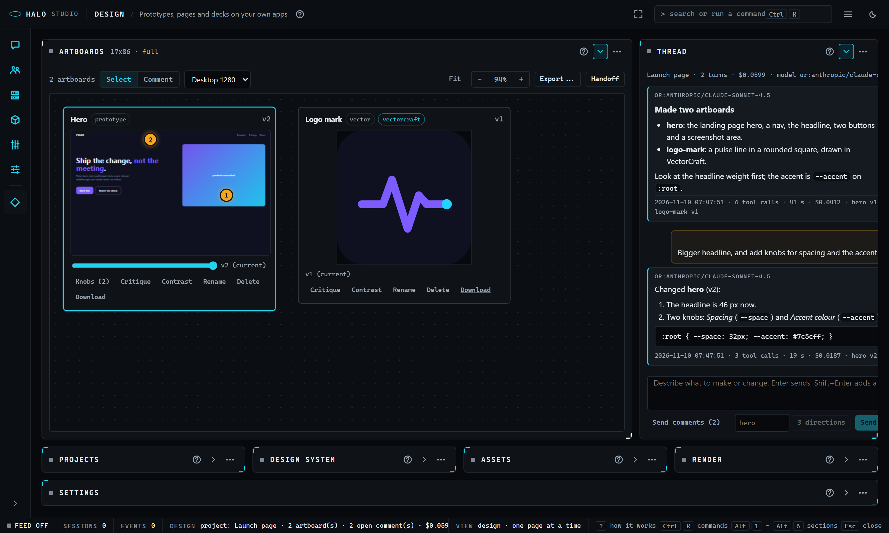</a>

## What it feels like

The pictures here are Studio's, over fixture data (no real keys or paths); the terminal does the same, and each part
names its key or command. How they are made: [docs/MEDIA.md](docs/MEDIA.md).

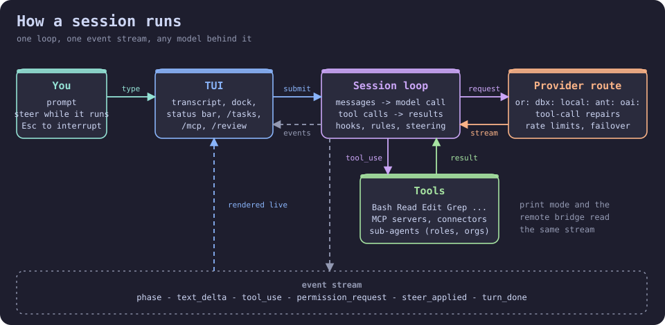

### Auto mode that never interrupts

A turn that edits, runs the tests and finishes simply does. Nothing waits for you unless you wrote a
rule that says it should. Auto is the mode you pick in Setup (`permission_mode`); in the terminal the status bar says `auto`.

<a href="docs/media/studio-auto.png">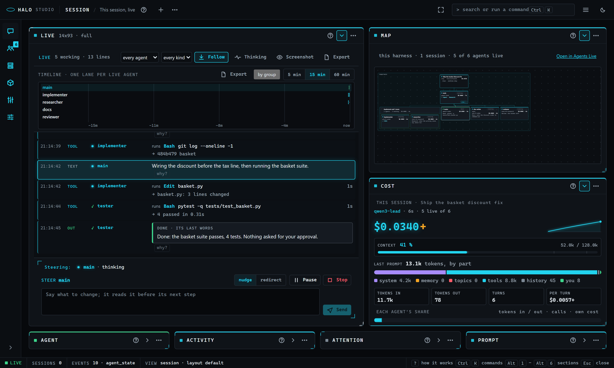</a>

### One session across providers

`or:` `dbx:` `local:` `oai:` `ant:` `ol:` `hf:` in one session. In Studio you pick a model for a role with one
click: Agents -> Cast, a bio's model, and the picker lists every route. Each row says what the model takes
(text, vision, audio, video, pdf, image, tools, think), what it costs in and out, its context window and what it is
best at; point at a row and its line shows under the list. `?` when unknown, never a blank that reads as zero.
`/model` does the same swap in the terminal, and the history, tools and rules come along.

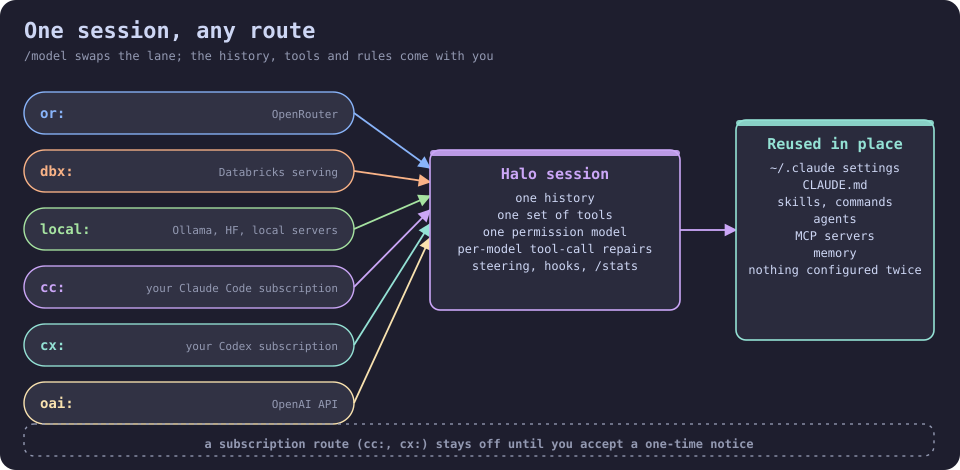

<a href="docs/media/studio-model-picker.png">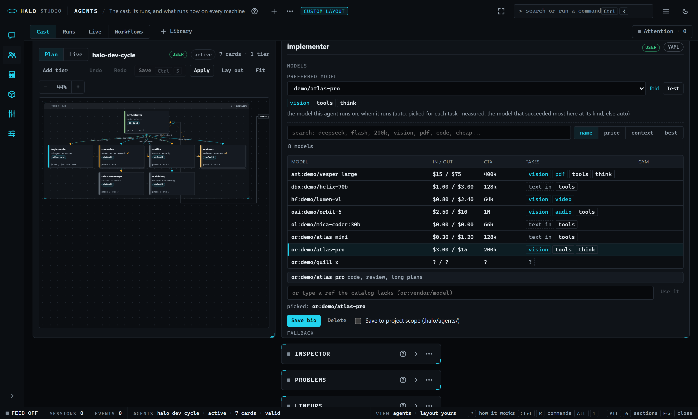</a>

### Steering a running turn

In Studio, click any row in Session's Live column and that row's agent becomes the steer's target: the line above the box names it (`implementer`, was `main`), and the box says `STEER implementer`. Type, then nudge or redirect it; Pause and Stop sit beside the box. Your words show at once, a running command moves to the background instead of dying, and a sub-agent gets your words forwarded into it.

<a href="docs/media/studio-steer.png">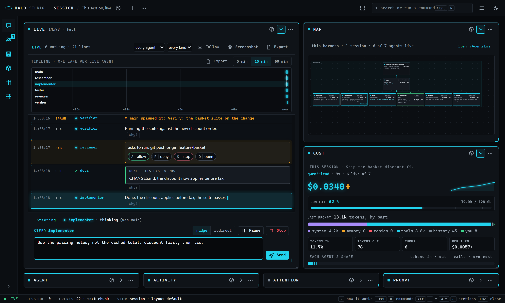</a>

In the terminal, type while the turn runs.

### Watching a model think

In Studio's Live, a model's thinking is its own row, THINK, one row per thought. It grows as the model thinks, four lines at first with show all for the rest, then says how long it thought and how many tokens it took. Each thought says what it led to, `then ran Edit basket.py`, and why? on that Edit opens the thought behind it. Thinking, beside Follow, shows only the thoughts and what each one did, and the timeline above draws every agent's minutes as thinking, tools, writing, waiting and idle.

<a href="docs/media/studio-thinking.png"></a>

When agents talk to each other, that is its own row too, TALK: main handing the researcher a task, the researcher handing back, a hand-off to a workflow square. The Conversations panel (the + menu) shows each pair as a thread.

<a href="docs/media/studio-talk.png"></a>

In the terminal the line under your message counts the same phases (*Thinking*, *Writing*, *Thought for 18 s*), and a stalled stream says `quiet 7 s`.

### Roles and lineups

A lineup gives each role its own agent bio and model; the lineup that builds Halo itself
ships as `halo-dev-cycle`. You see and edit it on Agents -> Cast, and watch it work in [Agents](#agents-your-lineup-its-runs-what-runs-now) and
[Session](#session-the-dashboard) above; `/tasks` lists it in the terminal.

### Connectors: Claude Docs from a non-Claude model

Your claude.ai connectors (Claude Docs, a calendar, a drive) appear as tools to whatever
model drives Halo. The sign-in stays in `claude`, Halo never reads its credentials file,
and `/mcp` shows each server's state and why one failed.

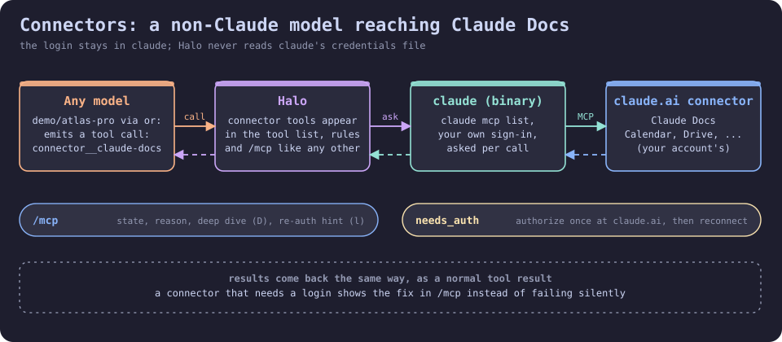

## How Halo compares

Facts about Halo come from this repository. The right-hand column summarizes what other
coding harnesses commonly document, not a measurement of any one of them. It varies by
tool, so check each tool's own docs.

| Point | Halo | Other harnesses (varies by tool) |
|---|---|---|
| Watching agents | Studio's Session: every agent's thinking, tool calls with their time and result, hand-backs and asks in one live column, beside a tree of who spawned whom with each agent's model and cost | Commonly the terminal transcript, one agent at a time |
| Seeing your lineup | Studio's Agents: the lineup as cards in tier boxes, each glowing in its agent's state while a session runs; drag a card to another tier | Sub-agents are common; a visual editor and a live state per role vary |
| Every machine at once | Studio's Agents -> Live on the fleet: every harness on one canvas, one queue of what waits on you, missions that split one goal across harnesses | Varies |
| Config reuse | Reads your Claude Code setup in place: `~/.claude` settings, CLAUDE.md, skills, commands, agents, MCP servers, memory | Commonly their own config files and instruction files |
| Models | DeepSeek, GLM, Kimi, Qwen, Claude and more, over OpenRouter, Databricks, the Anthropic and OpenAI APIs, Ollama, Hugging Face and local servers; `/model` swaps mid-conversation | Often one vendor's models, or one provider list per tool |
| Local models | A steward that watches every local server and plans the fit, a host per machine, a pool across machines, voice on your own hardware, all in Studio's Local section | Commonly a base URL for a local server; fit, load and diagnosis are left to you |
| Agents | Lineups with a model per role, per-role cost, `/tasks`, and Studio as the editor for lineups and bios | Sub-agents are common; a model per role, cost attribution and a visual editor vary |
| Steering | Type during a turn; the steer shows at once and reaches the work, background commands survive, sub-agents get it | Commonly a queued message or an interrupt |
| Liveness | A live phase line (seconds, token counts, `quiet`/`no data` counters) plus a status-bar word and timer | Commonly a spinner |
| Permissions | Auto mode allows everything except your own deny/ask rules and hooks | Commonly a built-in approval policy of the tool's own |
| MCP | stdio/HTTP/SSE from every Claude Code scope, `/mcp` with failure reasons and a deep dive, claude.ai connectors as tools | MCP support is common; diagnosis and connector bridging vary |
| Sessions | Resume, rewind, `/tasks`, per-role cost attribution | Resume is common; the rest varies |
| Design | The design pack (`halo pack install design`): artboards made by a Halo turn, with the ArtCraft apps as the model's tools | Not a thing most harnesses do |

## Features

| | |
|---|---|
| **The core, and the packs Halo ships** | The core is the agent loop and its tools, permissions and policy, the providers, all the local-model work, lineups and blocks, Studio's Session, Agents, Local, Packs, Setup and Settings, and the pack system. Everything else is a pack Halo ships, off until you turn it on (`halo pack install <id>`): design, first-run, coach, signal, concord, doc-review. |
| **Halo Studio** | `halo studio`, or `/studio` in a session: the browser console, six sections under one header. Loopback only, a per-launch token, no CDN. |
| **The Session dashboard** | One live column of every agent's thinking, tool calls (what each runs on, its time, its result), hand-backs and asks; the map of who spawned whom with each agent's model, cost and running tool; the context bar, the spend and each agent's share. |
| **The Agents glow** | Your lineup as cards in tier boxes. While a session runs, a card glows in its agent's state: working cyan, waiting amber, done green that fades over ten seconds, failed red until you click it. Hover the card and it explains its glow. |
| **Fleet and missions** (the `fleet` pack) | Agents -> Live on the fleet: every harness on one map, one attention queue across all of them, and one goal split into parts by what each harness can do. |
| **Workflow squares** | Saved workflows with a contract. Main hands a task a text-only model cannot read (a PDF, an image) to the `media` square when no role of the lineup reads it, with a one-line reason and a receipt; five ship, `halo workflows` manages them, Agents -> Workflows is the board. |
| **Runs (Orchestra)** | Several agents write the same files at once: lanes in their own git worktrees, a plan you can review on a canvas, a gate that runs your test, a supervisor that replans and verified outcomes. |
| **Packs** | An extension contract and `halo pack`: a pack adds bios, lineups, skills, commands, hooks and MCP servers through a manifest, with grants you set, and Studio's Pack Manager (`Alt+4`) installs, enables and removes them. |
| **The Ollama steward** | A cheap model you pick watches the traffic of every local server across your halos, explains a failed call, plans what fits the card and makes Halo-side fixes only; a server change comes as the exact line to set. |
| **Local, measured** | A probe battery per model per host, the speed card, tuning with a revert for every change, and a three-way search of the library (what a model declares, what is expected, what was verified here). |
| **The host** | `halo host serve` on the machine that serves the models: peers read its card, models and log with no ssh and act through grants, one resident model per card, an off-hours refresh. |
| **The pool** | One model across the GPUs of several machines over llama.cpp RPC: `halo pool`, a fit verdict before any download, warm and stop from Local -> Pool. |
| **Voice** | `halo voice` and `/voice`: talk to a session and hear it, speech-to-text and text-to-speech on your own machines, barge-in, a latency card per turn. |
| **Routes** | `or:` `dbx:` `ant:` `oai:` `ol:` `hf:` `local:` -- one session, any of them, and `/model` swaps the lane without losing context. |
| **Your Claude Code setup, in place** | `~/.claude` settings, CLAUDE.md, skills, commands, agents, MCP servers and memory are read where they are. Nothing is configured twice. |
| **Steering** | Type while a turn runs: the steer shows at once and reaches the work, a running command moves to the background instead of dying, sub-agents get your words forwarded into them. |
| **A model per role** | YAML agent bios and lineups assign a model to each job: GLM can orchestrate while a local Qwen implements and a cheap flash model reviews. Pick one in Studio (Agents -> Cast), with `halo teams apply <lineup>`. |
| **The design pack** | Studio's Design section as a pack Halo ships (3.3.13.0): a design project on disk, a turn with the craft apps as tools, knobs without a model call. |
| **The first-run pack** | The guided first run as a pack Halo ships (3.4.0.0): `halo start`, one real Orchestra run that rehearses your lineup on a sample repo, its card first. |
| **The coach pack** | The post-run coach as a pack Halo ships (3.4.0.0): `halo coach` reads a finished run and suggests what to change, Apply after one confirm, probes, the improvement library, `halo improve`. |
| **Per-model tool-call repairs** | Fourteen model families' quirks are repaired on the fly: Kimi's `functions.{name}:{idx}` ids, GLM's always-on thinking, Qwen's system-message rules, DeepSeek's reasoning echoes. Gateway quirks are learned once per model and remembered (`halo rules`). |
| **Measured, not guessed** | `/stats` per model and per tool, price/context/speed columns in the picker, per-role cost attribution, and `halo preflight` canaries each lane before a long run. |
| **Filter-aware routing** | A provider content filter is not an answer: a filtered reply never persists as one, and the request reroutes to a fallback lane you choose. |
| **Permissions without a nanny** | Auto mode allows everything except *your own* deny/ask rules. Rules use Claude Code's own grammar, in the same files. |
| **Setup** | `halo init` opens Studio's Setup (`--terminal`: the essentials line by line in the terminal): provider, model, permission mode, theme, lineup. Every step explains itself and `halo doctor` ends each warning with its fix. |
| **MCP deep dive** | stdio/HTTP/SSE servers from every Claude Code scope, `D` diagnoses a failing server end to end, claude.ai connectors bridge through as tools. |
| **Balances and picker columns** | Per-provider balances in the status bar (remaining first); free variants sit beside their paid rows in the picker. |
| **Privacy audit** | `halo audit privacy` scans the tree (or, with `--history`, every commit) for real paths, hosts and key-shaped strings, one line per finding. |
| **CI and release script** | Every push runs the three suites on Linux and Windows, in four shards per platform, with the flake rules as tests; `scripts/release.py` versions, tags, pushes and refreshes both installs. |

## Documentation

[docs/README.md](docs/README.md) is the map: every doc, grouped by what you want to do, with one
line on when to read it. The longest docs are split by task; their entry pages below link the parts.

| Document | What it covers |
|---|---|
| [docs/INSTALL.md](docs/INSTALL.md) | One-page install, upgrade and update guide, with the one-line repair when `halo update` stops at a certificate error |
| [docs/STUDIO.md](docs/STUDIO.md) | Halo Studio, the browser console: its sections, the security model, SSH, every shortcut |
| [docs/STUDIO-sections.md](docs/STUDIO-sections.md) | How each Studio section works: Session's Live column, map and Cost; Agents' Cast canvas and its glow |
| [docs/STUDIO-agents.md](docs/STUDIO-agents.md) | The Agents section: Cast, Runs, Live and Workflows, and where Team, Roles, Orchestra and Fleet went |
| [docs/FLEET.md](docs/FLEET.md) | Fleet: what each session and agent exposes to Studio, and the controls |
| [docs/MISSIONS.md](docs/MISSIONS.md) | One goal for the whole fleet, and following its parts |
| [docs/ORCHESTRA.md](docs/ORCHESTRA.md) | Several agents writing the same files: the plan, the lanes, the gate (the coach is a pack) |
| [docs/WORKFLOWS-squares.md](docs/WORKFLOWS-squares.md) | Workflow squares: the contract, the router, the five that ship, receipts and the Workflows board; [docs/WORKFLOWS.md](docs/WORKFLOWS.md) is the workflow file itself |
| [docs/HANDBOOK.md](docs/HANDBOOK.md) | The long-form guide: configuration, providers, permissions, steering, hooks, skills, MCP, sessions, themes, telemetry |
| [docs/GLOSSARY.md](docs/GLOSSARY.md) | Every word Halo uses, one paragraph each (`halo explain <word>`) |
| [docs/COMMANDS.md](docs/COMMANDS.md) | Every CLI command and flag |
| [docs/SLASH-COMMANDS.md](docs/SLASH-COMMANDS.md) | Every slash command in the TUI |
| [docs/CONFIG.md](docs/CONFIG.md) | Config keys, paths and environment variables |
| [docs/MODELS.md](docs/MODELS.md) | Model families, effort levels and per-route rules |
| [docs/LOCAL-MODELS.md](docs/LOCAL-MODELS.md) | Ollama, Hugging Face and the OpenAI API, end to end; `halo ollama discover` finds the Ollama servers on this machine and the network, adds them and measures their models |
| [docs/MODELS-ollama-steward.md](docs/MODELS-ollama-steward.md) | The Ollama steward: what it knows, records, finds and changes across your halos and local servers |
| [docs/STUDIO-local.md](docs/STUDIO-local.md) | Studio's Local section: the machines that serve your models, live resources and traffic, every host and model with its fit |
| [docs/HOST.md](docs/HOST.md) | `halo host`: a machine that serves models lets every harness on the LAN read its card, models, log and profiles, no ssh |
| [docs/POOL.md](docs/POOL.md) | The pool: one model across the GPUs of several machines, what it can and cannot do |
| [docs/VOICE.md](docs/VOICE.md) | Voice: talk to a session and hear it locally; its parts cover [the glasses](docs/VOICE-glasses.md) and [a box with no GPU](docs/VOICE-cpu.md) |
| [docs/DATABRICKS.md](docs/DATABRICKS.md) | Databricks endpoints, API types and the work matrix |
| [docs/AGENTS.md](docs/AGENTS.md) | Agent bios and lineups: the 90-second version, then the field reference |
| [the design pack](halo_harness/templates/packs/design/README.md) | Design: the project on disk, a design turn, the craft apps, knobs, systems, exports, the handoff (its docs/DESIGN.md) |
| [the first-run pack](halo_harness/templates/packs/first-run/README.md) | The guided first run: `halo start`, `/start`, its Setup check row and its First run panel in Studio |
| [the coach pack](halo_harness/templates/packs/coach/README.md) | The coach: `halo coach`, `halo improve`, `/coach`, `/improve`, its Coach panel in Studio, its Settings and doctor rows |
| [docs/ROLES.md](docs/ROLES.md) | Roles and the role table |
| [docs/PACKS.md](docs/PACKS.md) | Packs: add bios, lineups, skills, commands, hooks and MCP servers to Halo, or take them out again |
| [docs/EXTENSION_API.md](docs/EXTENSION_API.md) | The extension API: the pack manifest, the lifecycle and what a pack may import |
| [docs/GOVERNOR.md](docs/GOVERNOR.md) | The Governor: shared per-host rate limiting, failover and lanes |
| [docs/REMOTE.md](docs/REMOTE.md) | The per-session control socket and its agent-level commands |
| [docs/TROUBLESHOOTING.md](docs/TROUBLESHOOTING.md) | "Is it frozen?", GLM pauses, copy and paste, connect timeouts, `halo update` and certificate errors |
| [docs/ARCHITECTURE.md](docs/ARCHITECTURE.md) | How the pieces fit together |
| [docs/MEDIA.md](docs/MEDIA.md) | How the front-page pictures are made and regenerated |
| [SECURITY.md](SECURITY.md) | The security model and how to report a problem |
| [CHANGELOG.md](CHANGELOG.md) | Every release, with what changed and why |

## Tests

Three hermetic, exit-code-gated suites run on Windows, WSL and a Kali VM before every
commit, and in CI on every push: `python test_bridge.py` (the proxy), `python
tests/run_all.py` (the harness) and `python test_tui.py` (the TUI, through Textual's
headless pilot). Studio is tested in headless Chrome over fixture data (the full tier of
`tests/run_all.py`), and CI rebuilds its bundle and fails on a stale one. Mock servers
stand in for every provider, a fake `claude` stands in for the claude.ai connectors
bridge, and guards fail the run if a test touches the real `~/.halo` or `~/.claude`. See
[docs/DEVELOPMENT.md](docs/DEVELOPMENT.md).

## Contributing and security

Pull requests are welcome; [docs/CONTRIBUTING.md](docs/CONTRIBUTING.md) has the house
rules and how to run the suites. Security reports go through
[SECURITY.md](SECURITY.md).

## Licence

MIT. See [LICENSE](LICENSE).
