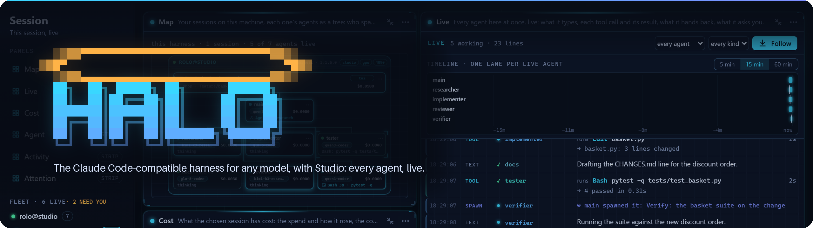
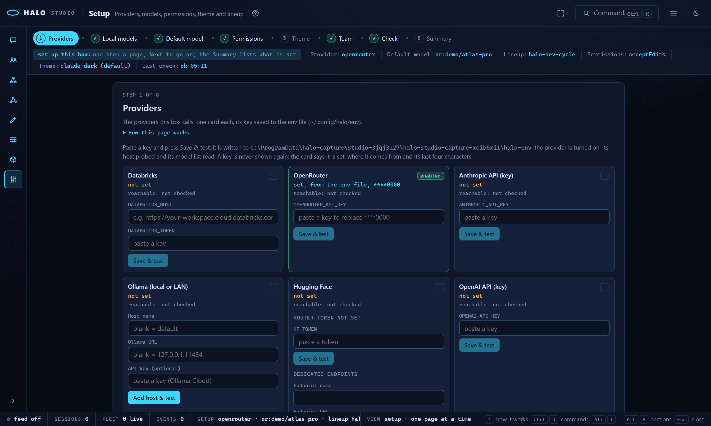

<p align="center">
  <a href="docs/media/hero.png"></a>
</p>

<p align="center">
  <a href="https://github.com/roloVibes/Halo-Harness/releases"></a>
  <a href="https://github.com/roloVibes/Halo-Harness/actions/workflows/suites.yml"></a>
  
  
  <a href="LICENSE"></a>
</p>

[](https://m8ven.ai/mcp/rolovibes-halo-harness-b6hvi0?s=readme)

<h3 align="center">Multi-model agent harness with orchestration, Claude Code compatibility, local LLM support, and live agent monitoring.</h3>

<p align="center">
Halo Harness is an open source, multi-model agent harness and orchestration platform that brings Claude Code-style tooling to the models you choose.<br>
Run agents across OpenRouter, Databricks, Anthropic, Ollama, Hugging Face, LM Studio and OpenAI-compatible endpoints while reusing your existing Claude Code configuration, skills and MCP servers: Halo reads your <code>~/.claude</code> setup in place, and <code>/model</code> swaps the model mid-conversation.<br>
Assign specialized agents different models and responsibilities, coordinate parallel work, and manage execution through a shared runtime.<br>
<code>halo studio</code> is the visual interface where you watch agents work, track tool calls and costs, manage teams, and steer sessions across machines. Built for developers who want to choose their models without rebuilding their workflow.
</p>

<p align="center">
  <a href="#install">Install</a> ·
  <a href="#what-halo-is">What Halo is</a> ·
  <a href="#halo-studio">Studio</a> ·
  <a href="#session-the-dashboard">Session</a> ·
  <a href="#roles-see-your-agents">Roles</a> ·
  <a href="#fleet-every-harness-one-goal">Fleet</a> ·
  <a href="#what-it-feels-like">What it feels like</a> ·
  <a href="#how-halo-compares">Compare</a> ·
  <a href="#features">Features</a> ·
  <a href="#documentation">Docs</a>
</p>

<details>
<summary>The same wordmark as text (what <code>halo --version</code> prints)</summary>

```text
    ░▒▓▓▀▀▀▀▀▀▀▀▀▀▀▀▀▀▀▀▀▀▀▀▀▀▀▀▀▀▀▓▓▒░
  ▒▓█▀                               ▀█▓▒
    ░▒▓▓▄▄▄▄▄▄▄▄▄▄▄▄▄▄▄▄▄▄▄▄▄▄▄▄▄▄▄▓▓▒░
    ██╗  ██╗ █████╗ ██╗      ██████╗
    ██║  ██║██╔══██╗██║     ██╔═══██╗
    ███████║███████║██║     ██║   ██║
    ██╔══██║██╔══██║██║     ██║   ██║
    ██║  ██║██║  ██║███████╗╚██████╔╝
    ╚═╝  ╚═╝╚═╝  ╚═╝╚══════╝ ╚═════╝
```

</details>

## Install

Install, then `halo start`:

```sh
curl -fsSL https://raw.githubusercontent.com/roloVibes/Halo-Harness/v3.2.2.0/scripts/install-halo.sh | bash
halo init        # opens Halo Studio on Setup: provider, model, permission mode, theme, lineup, checks
halo start       # the guided first run: its card (models, cost, time, what it writes), then one real Orchestra run
```

Windows:

```powershell
powershell -ExecutionPolicy ByPass -c "irm https://raw.githubusercontent.com/roloVibes/Halo-Harness/v3.2.2.0/scripts/install-halo.ps1 | iex"
```

<a href="docs/media/studio-setup.png"></a>

The first thing after install: `halo init` opens Studio on **Setup**, the page above. Each block is a form
with its own Save, filled in any order; the strip on top says what is set. Over SSH or on a box with no
browser it prints the URL (with the port-forward line) and runs the terminal wizard; `halo init --terminal`
asks for that wizard anywhere.

The installer is fetched from a release tag, never a moving branch, and installs the
newest tag; `--ref <tag>` (`-Ref` on Windows) pins another. The installer may run
`uv tool update-shell`, which adds `~/.local/bin` to your shell startup file (the user PATH on
Windows): it asks first, shows what uv changed, and `--no-modify-path` (`-NoModifyPath`, or
`HALO_NO_MODIFY_PATH=1`) skips it. No installer at all:
`uv tool install git+https://github.com/roloVibes/Halo-Harness --constraints https://raw.githubusercontent.com/roloVibes/Halo-Harness/master/requirements.lock`
(the constraints file pins dependency versions; without it the latest versions resolve) or
`pipx install git+https://github.com/roloVibes/Halo-Harness`. Update with `halo update`
or `/update` inside the TUI. Offline work boxes, PEP 668 and reproducible installs are
covered in [docs/INSTALL.md](docs/INSTALL.md).

**Your first run.** In Setup (or the terminal wizard) you paste a provider key, pick a default model
and a permission mode; its Check block lists the checks it can run (doctor, the model catalog and one
hello call ticked; the quick gym and the guided first run off), each with what it does,
costs and takes, and you tick the ones to run (`halo check` runs the same list later).
`halo start`, the guided first run, opens on a card: the models it will call, an estimated
cost, the time and what it writes (`halo start --explain` prints only the card). Then it walks
one real piece of work on your models, one screen per step: it copies a shipped lineup into one of yours,
writes a small sample repo, gives your agents one Orchestra goal, shows the lead's plan
for you to approve (or change on Studio's plan canvas), runs the lanes, and ends on the
report, the coach and where to go next. `halo explain <word>` says what any word means
([docs/GLOSSARY.md](docs/GLOSSARY.md)). Then `halo` opens the full-screen TUI from any
directory: type a request, watch the phase line count up, and steer by typing while the
model works; `/studio` opens Studio's dashboard on that session. `halo doctor` explains anything that is not right and ends each warning with
its fix.

## What Halo is

Halo is a Claude Code-compatible harness on your own models: it runs the loop Claude
Code runs (a prompt, tool calls, permission rules, hooks, MCP servers, skills,
sub-agents, sessions) on the model you choose, and reads your `~/.claude` settings,
`CLAUDE.md`, skills, commands, agents, MCP servers and memory where they already are.
Halo Studio is the browser console where you watch and steer every agent: what each one
thinks, which tool it runs and for how long, what it hands back and what it asks you.
One session works across providers (OpenRouter, Databricks, the Anthropic API, the
OpenAI API, Ollama, Hugging Face, or any OpenAI-compatible server you host), and
`/model` swaps the model mid-conversation.

## Halo Studio

`halo studio` opens Studio in your browser. It is one window with eight sections under one
header, and two of them are where you watch your agents: **Session**, the dashboard of everything working
right now, and **Roles**, your lineup as cards that light up as their agents work.

### Session: the dashboard

<a href="docs/media/studio-session.gif"></a>

Press `Alt+1`, or type `/studio` in a terminal session (`halo studio --session` from a
shell). The whole right side is **Live**: one column of everything every agent of this
harness does, in the order it happens.

- What each agent thinks and writes.
- Each tool call as one row: the tool, what it runs on, its time ticking while it runs,
  then the first line of its result.
- What an agent hands back, and its last words when it finishes.
- What it asks you, as an amber card you answer with `A`, `R`, `S` or `O`.

Each line carries Fleet's columns, the time and the kind (`TOOL`, `TEXT`, `STATE`, `ASK`,
`YOU`), then its agent's tag: its own colour, its name and its state; a timeline lane per
live agent sits on top, with an agent pick and a kind pick beside Follow. Follow is on:
scroll up and it pauses, **↓ N new** brings you back. The Steer box is always at the
bottom, with Pause and Stop beside it: it talks to the session's main agent, or to the one
you pin (click its tag, or hover any tag or map node and click **steer**); `Esc` shows
everyone again.

<a href="docs/media/studio-session-live.png"></a>

On the left, the **map** (Fleet's map, narrowed to this harness) draws its agents as a
tree: each agent under the one that spawned it, its children fanned out side by side. A node shows its model, what it
has cost and, while a tool runs, the tool and its time (`Bash 12s`). The state shows on
the node and on the edge into it: working pulses cyan, waiting is amber, done is green
that fades over ten seconds, failed is red and stays. Hover a line in Live and its node
lights up.

Under the map, **Cost** ticks the spend beside its sparkline and fills a context bar
with what the model holds (amber past 80 %, red past 95 %), then the tokens in and out,
the turns, the cost per turn and each agent's share of the spend. Agent, Activity and
Attention wait as strips under it, one click each. See
[Session](docs/STUDIO-sections.md#session).

### Roles: see your agents

<a href="docs/media/studio-roles-live.gif"></a>

Press `Alt+3` (or `/roles` in a session). The open lineup is a canvas of cards in tier
boxes, one card per slot: an agent bio in a role, with the model that resolves for it,
its price and its context. Main sits alone in tier 0, and a member spawns only into the
next tier down. Drag a card into another box to move it to that tier; the lineup saves.

While a session runs, the cards whose agents work glow in their agent's state, and the
glow comes and goes with what the agent does:

| State | Colour | What you see | When it goes |
|---|---|---|---|
| working | cyan | a light flows along the card's top while the agent types, one pulse per tool call, the tool on its badge | comes on with the agent's first running state; a queued agent shows only its badge |
| waiting on you | amber | three pulses, then a steady amber edge and a diamond badge | when you answer (a question, a permission, a plan, a pause) |
| done | green | the card turns green | fades out over the ten seconds after it finished |
| failed | red | the card turns red, the badge says failed | stays until you click the card |

Hover a card's state glyph or its badge and the card explains its own glow. A tier box
takes the strongest state of its cards, and the edge into a card takes that card's
colour. The other edges are the lineup's routing: delegation from main (select a card
and its routing words show) and the pipeline's stage order.

<a href="docs/media/studio-roles.png"></a>

Click a card. The Inspector's **MODEL** strip says what it runs on and changes it with
one pick (it saves at once), and its **Live** tab shows what the agent types and runs,
with Steer, Pause and Stop. The Inspector also edits the card's slot, its bio and every
section of the lineup, with the YAML both ways. Problems checks every edit as you make
it; Save writes the lineup's YAML and Apply makes it the lineup new sessions use. See
[Roles](docs/STUDIO-sections.md#roles) and
[the canvas](docs/STUDIO-team-roles.md#what-you-see-roles).

### Six sections, one window

<a href="docs/media/studio-modes.png"></a>

`Alt+1` to `Alt+6` switch between **Session**, **Team**, **Roles**, **Fleet**,
**Design** and **Orchestra**. Each section opens on a Start view that says what it is for,
its panels sit in labelled group boxes you move and resize, `Ctrl`/`Cmd`+`K` opens the
command palette and `?` opens "How this works". `halo studio` serves it on loopback only,
with a per-launch token: no account, no CDN, no fonts fetched, no analytics.

The seventh, **Packs** (`Alt+7`), is the Pack Manager: it lists the packs in the places
you trust (the folders and git urls of `packs.sources`, and the Documentation Review pack
Halo ships), shows what each brings and asks for, and installs, grants, enables, sets up,
updates and removes them through the same code as `halo pack`. An enabled pack's own
section comes after the core sections. See [docs/STUDIO-packs.md](docs/STUDIO-packs.md) and
[docs/PACKS.md](docs/PACKS.md).

The eighth, **Setup** (`Alt+8`, 3.3.0.0), is this box's setup on one page: the terminal wizard's blocks
(the providers, local models, the default model, the permission mode, the terminal theme, the lineup,
the Linux fixes when a box needs them, and the five checks) as forms you fill in any order, each saving the
key `halo init --terminal` and `halo config set` write; `halo init` opens it, and so does a home with no provider set up. See [docs/STUDIO-setup.md](docs/STUDIO-setup.md).

The pictures here are headless-Chrome renders of Studio over fixture data
(`tools/capture_studio.py`, and `tools/capture_session_anim.py` for the animated ones).
[docs/STUDIO.md](docs/STUDIO.md) has every panel and shortcut, and
[Over SSH](docs/STUDIO-security.md#over-ssh) covers a box you reach remotely.

### Fleet: every harness, one goal

Press `Alt+4` and every Halo harness you run or joined is live on one map: each session a
card, its agents a tree under it. Another machine joins with a pair code
(`halo fleet join`). **Attention** is one queue of everything that waits on you on any
harness (a question, a permission, a gate, a paused agent, a spend cap, a file conflict),
one key each. Click any agent to read what it thinks and runs, then steer, pause, stop,
take it over or hand it to another harness. A **mission** gives the whole fleet one goal:
the hub's lead splits it into parts by what each harness can do, you drag a part to
another harness on the map, approve and run, and the report says who did what and what
it cost. See [docs/FLEET.md](docs/FLEET.md) and [docs/MISSIONS.md](docs/MISSIONS.md).

<a href="docs/media/studio-fleet.png"></a>

### Orchestra: agents writing the same files

Press `Alt+6`. Several agents write to the same files at once and nothing is lost: a lead
splits your goal into lanes, one worker per lane writes its part in its own git worktree,
and code owns the claims, the merge order, the tests and the gate; a model judges only
when two pieces conflict. With **Review the plan before it runs**, the lead's lanes open
on the plan canvas first: drag a lane into another layer to change what it runs after,
edit its claims, bio and model, then **Approve and run**. The console draws the lanes, the
claimed regions, the merge gate and the report, and the report's **Coach** tab reads the
run and suggests what to change (a bio's prompt or model, a lane's order), each card with
its evidence. See [docs/ORCHESTRA.md](docs/ORCHESTRA.md).

<a href="docs/media/studio-orchestra.png"></a>

### Team: people, blocks and stages

Press `Alt+2` and the project's team file is one board: members as columns, stages as boxes
that pulse while they run and turn amber at a gate you accept, redo or stop, and the blocks
underneath with who holds which part and what changed. See [docs/TEAM.md](docs/TEAM.md).

<a href="docs/media/studio-team.png"></a>

### Design: on your own apps

Press `Alt+5` (or run `halo design`) and the canvas holds artboards: prototypes, pages,
decks and logos made by a real Halo turn, with the [ArtCraft](https://getartcraft.com/apps)
apps on your machine as its tools when they are registered, and a new version on every
turn. Refine by chat, pinned comments, direct text edits and knobs; export a folder,
HTML, PNG, SVG or PDF, or hand it off to the next session. See
[docs/DESIGN.md](docs/DESIGN.md).

<a href="docs/media/studio-design.png"></a>

## What it feels like

The pictures in this part are real renders of the TUI over mock data (a fixed clock, no
network, no real keys or paths), regenerated by `tools/capture_screens.py` and checked
byte for byte in CI; see [docs/MEDIA.md](docs/MEDIA.md).


### Auto mode that never interrupts

A turn that edits, runs the tests and finishes simply does. The status bar says `auto`,
and nothing waits for you unless you wrote a rule that says it should.

<a href="docs/media/auto-mode.png"></a>

### One session across providers

`or:` `dbx:` `local:` `oai:` `ant:` `ol:` `hf:` in one session, with `/model`
swapping the lane while the history, tools and rules come along. The picker shows price,
context window and speed for every route (`?` when unknown, never a blank that reads as
zero).


<a href="docs/media/model-picker.png"></a>

### Steering a running turn

Type while a turn runs and the steer reaches the work: your words show at once, a running
command moves to the background instead of dying, and sub-agents get your words
forwarded into them.


### Watching a model think

The line under your message counts up: *Thinking* with tenths of a second and a
reasoning-token count, then *Writing*, then a *Thought for 18 s* summary. A stalled
stream says so (`quiet 7 s`) instead of looking frozen.

### Roles and lineups

A lineup gives each role its own agent bio and model; the lineup that builds Halo itself
ships as `halo-dev-cycle`. You watch it work in [Roles](#roles-see-your-agents) and
[Session](#session-the-dashboard) above, and in `/tasks` in the terminal.

### Connectors: Claude Docs from a non-Claude model

Your claude.ai connectors (Claude Docs, a calendar, a drive) appear as tools to whatever
model drives Halo. The sign-in stays in `claude`, Halo never reads its credentials file,
and `/mcp` shows each server's state and why one failed.


## How Halo compares

Facts about Halo come from this repository. The right-hand column summarizes what other
coding harnesses commonly document, not a measurement of any one of them. It varies by
tool, so check each tool's own docs.

| Point | Halo | Other harnesses (varies by tool) |
|---|---|---|
| Watching agents | Studio's Session: every agent's thinking, tool calls with their time and result, hand-backs and asks in one live column, beside a tree of who spawned whom with each agent's model and cost | Commonly the terminal transcript, one agent at a time |
| Seeing your lineup | Studio's Roles: the lineup as cards in tier boxes, each glowing in its agent's state while a session runs; drag a card to another tier | Sub-agents are common; a visual editor and a live state per role vary |
| Every machine at once | Studio's Fleet: every harness on one map, one queue of what waits on you, missions that split one goal across harnesses | Varies |
| Config reuse | Reads your Claude Code setup in place: `~/.claude` settings, CLAUDE.md, skills, commands, agents, MCP servers, memory | Commonly their own config files and instruction files |
| Models | DeepSeek, GLM, Kimi, Qwen, Claude and more, over OpenRouter, Databricks, the Anthropic and OpenAI APIs, Ollama, Hugging Face and local servers; `/model` swaps mid-conversation | Often one vendor's models, or one provider list per tool |
| Agents | Lineups with a model per role, per-role cost, `/tasks`, and Studio as the editor for lineups and bios | Sub-agents are common; a model per role, cost attribution and a visual editor vary |
| Steering | Type during a turn; the steer shows at once and reaches the work, background commands survive, sub-agents get it | Commonly a queued message or an interrupt |
| Liveness | A live phase line (seconds, token counts, `quiet`/`no data` counters) plus a status-bar word and timer | Commonly a spinner |
| Permissions | Auto mode allows everything except your own deny/ask rules and hooks | Commonly a built-in approval policy of the tool's own |
| MCP | stdio/HTTP/SSE from every Claude Code scope, `/mcp` with failure reasons and a deep dive, claude.ai connectors as tools | MCP support is common; diagnosis and connector bridging vary |
| Sessions | Resume, rewind, `/tasks`, per-role cost attribution | Resume is common; the rest varies |
| Design | `halo design` and Studio's Design section: artboards made by a Halo turn, with the ArtCraft apps as the model's tools | Not a thing most harnesses do |

## Features

| | |
|---|---|
| **Halo Studio** | `halo studio`, or `/studio` in a session: the browser console, eight sections under one header. Loopback only, a per-launch token, no CDN. |
| **The Session dashboard** | One live column of every agent's thinking, tool calls (what each runs on, its time, its result), hand-backs and asks; the map of who spawned whom with each agent's model, cost and running tool; the context bar, the spend and each agent's share. |
| **The Roles glow** | Your lineup as cards in tier boxes. While a session runs, a card glows in its agent's state: working cyan, waiting amber, done green that fades over ten seconds, failed red until you click it. Hover the card and it explains its glow. |
| **Fleet and missions** | Every harness on one map, one attention queue across all of them, and one goal split into parts by what each harness can do. |
| **Orchestra** | Several agents write the same files at once: lanes in their own git worktrees, a plan you can review on a canvas, a gate that runs your test, and a coach that reads the run. |
| **Routes** | `or:` `dbx:` `ant:` `oai:` `ol:` `hf:` `local:` -- one session, any of them, and `/model` swaps the lane without losing context. |
| **Your Claude Code setup, in place** | `~/.claude` settings, CLAUDE.md, skills, commands, agents, MCP servers and memory are read where they are. Nothing is configured twice. |
| **Steering** | Type while a turn runs: the steer shows at once and reaches the work, a running command moves to the background instead of dying, sub-agents get your words forwarded into them. |
| **A model per role** | YAML agent bios and lineups assign a model to each job: GLM can orchestrate while a local Qwen implements and a cheap flash model reviews. Pick one in the wizard, with `halo teams apply <lineup>`, or in Studio. |
| **Halo Design** | `halo design` and Studio's Design section: a design project on disk, a turn with the craft apps as tools, knobs without a model call. |
| **Per-model tool-call repairs** | Fourteen model families' quirks are repaired on the fly: Kimi's `functions.{name}:{idx}` ids, GLM's always-on thinking, Qwen's system-message rules, DeepSeek's reasoning echoes. Gateway quirks are learned once per model and remembered (`halo rules`). |
| **Measured, not guessed** | `/stats` per model and per tool, price/context/speed columns in the picker, per-role cost attribution, and `halo preflight` canaries each lane before a long run. |
| **Filter-aware routing** | A provider content filter is not an answer: a filtered reply never persists as one, and the request reroutes to a fallback lane you choose. |
| **Permissions without a nanny** | Auto mode allows everything except *your own* deny/ask rules. Rules use Claude Code's own grammar, in the same files. |
| **The wizard** | `halo init`: provider, model, permission mode, theme, lineup. Every step explains itself and `halo doctor` ends each warning with its fix. |
| **MCP deep dive** | stdio/HTTP/SSE servers from every Claude Code scope, `D` diagnoses a failing server end to end, claude.ai connectors bridge through as tools. |
| **Balances and picker columns** | Per-provider balances in the status bar (remaining first); free variants sit beside their paid rows in the picker. |
| **Privacy audit** | `halo audit privacy` scans the tree (or, with `--history`, every commit) for real paths, hosts and key-shaped strings, one line per finding. |
| **CI and release script** | Every push runs the three suites on Linux and Windows; `scripts/release.py` versions, tags, pushes and refreshes both installs. |

## Documentation

[docs/README.md](docs/README.md) is the map: every doc, grouped by what you want to do, with one
line on when to read it. The longest docs are split by task; their entry pages below link the parts.

| Document | What it covers |
|---|---|
| [docs/INSTALL.md](docs/INSTALL.md) | One-page install, upgrade and update guide |
| [docs/STUDIO.md](docs/STUDIO.md) | Halo Studio, the browser console: its sections, the security model, SSH, every shortcut |
| [docs/STUDIO-sections.md](docs/STUDIO-sections.md) | How each Studio section works: Session's Live column, map and Cost; the Roles canvas and its glow |
| [docs/FLEET.md](docs/FLEET.md) | Fleet: what each session and agent exposes to Studio, and the controls |
| [docs/MISSIONS.md](docs/MISSIONS.md) | One goal for the whole fleet, and following its parts |
| [docs/ORCHESTRA.md](docs/ORCHESTRA.md) | Several agents writing the same files: the plan, the lanes, the gate and the coach |
| [docs/TEAM.md](docs/TEAM.md) | A team file: who works on a repo, where their work lands and in which order |
| [docs/HANDBOOK.md](docs/HANDBOOK.md) | The long-form guide: configuration, providers, permissions, steering, hooks, skills, MCP, sessions, themes, telemetry |
| [docs/GLOSSARY.md](docs/GLOSSARY.md) | Every word Halo uses, one paragraph each (`halo explain <word>`) |
| [docs/COMMANDS.md](docs/COMMANDS.md) | Every CLI command and flag |
| [docs/SLASH-COMMANDS.md](docs/SLASH-COMMANDS.md) | Every slash command in the TUI |
| [docs/CONFIG.md](docs/CONFIG.md) | Config keys, paths and environment variables |
| [docs/MODELS.md](docs/MODELS.md) | Model families, effort levels and per-route rules |
| [docs/LOCAL-MODELS.md](docs/LOCAL-MODELS.md) | Ollama, Hugging Face and the OpenAI API, end to end; `halo ollama discover` finds the Ollama servers on this machine and the network, adds them and measures their models |
| [docs/DATABRICKS.md](docs/DATABRICKS.md) | Databricks endpoints, API types and the work matrix |
| [docs/AGENTS.md](docs/AGENTS.md) | Agent bios and lineups: the 90-second version, then the field reference |
| [docs/DESIGN.md](docs/DESIGN.md) | Halo Design: the project on disk, a design turn, the craft apps, knobs, systems, exports, the handoff |
| [docs/ROLES.md](docs/ROLES.md) | Roles and the role table |
| [docs/GOVERNOR.md](docs/GOVERNOR.md) | The Governor: shared per-host rate limiting, failover and lanes |
| [docs/REMOTE.md](docs/REMOTE.md) | The per-session control socket and its agent-level commands |
| [docs/TROUBLESHOOTING.md](docs/TROUBLESHOOTING.md) | "Is it frozen?", GLM pauses, copy and paste, connect timeouts |
| [docs/ARCHITECTURE.md](docs/ARCHITECTURE.md) | How the pieces fit together |
| [docs/MEDIA.md](docs/MEDIA.md) | How the front-page pictures are made and regenerated |
| [SECURITY.md](SECURITY.md) | The security model and how to report a problem |
| [CHANGELOG.md](CHANGELOG.md) | Every release, with what changed and why |

## Tests

Three hermetic, exit-code-gated suites run on Windows, WSL and a Kali VM before every
commit, and in CI on every push: `python test_bridge.py` (the proxy), `python
tests/run_all.py` (the harness) and `python test_tui.py` (the TUI, through Textual's
headless pilot). Studio is tested in headless Chrome over fixture data (the full tier of
`tests/run_all.py`), and CI rebuilds its bundle and fails on a stale one. Mock servers
stand in for every provider, a fake `claude` stands in for the claude.ai connectors
bridge, and guards fail the run if a test touches the real `~/.halo` or `~/.claude`. See
[docs/DEVELOPMENT.md](docs/DEVELOPMENT.md).

## Contributing and security

Pull requests are welcome; [docs/CONTRIBUTING.md](docs/CONTRIBUTING.md) has the house
rules and how to run the suites. Security reports go through
[SECURITY.md](SECURITY.md).

## Licence

MIT. See [LICENSE](LICENSE).
