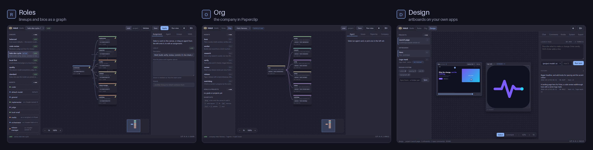

<p align="center">
  <a href="docs/media/hero.svg"></a>
</p>

<p align="center">
  <a href="https://github.com/roloVibes/Halo-Harness/releases"></a>
  <a href="https://github.com/roloVibes/Halo-Harness/actions/workflows/suites.yml"></a>
  
  
  <a href="LICENSE"></a>
</p>

[](https://m8ven.ai/mcp/rolovibes-halo-harness-b6hvi0?s=readme)

<h3 align="center">The Claude Code-compatible harness for any model.</h3>

<p align="center">
DeepSeek, GLM, Kimi, Qwen and Claude get the same tools, the same configuration and the same working habits as Claude Code.<br>
Halo reads your <code>~/.claude</code> setup in place, so nothing is configured twice, and <code>/model</code> swaps the model mid-conversation.<br>
<code>halo studio</code> is the browser GUI: your agents as a graph, your company in Paperclip, your designs on artboards.
</p>

<p align="center">
  <a href="#install">Install</a> ·
  <a href="#what-halo-is">What Halo is</a> ·
  <a href="#your-subscription-your-call">Subscriptions</a> ·
  <a href="#what-it-feels-like">What it feels like</a> ·
  <a href="#halo-studio">Studio</a> ·
  <a href="#the-levels">The levels</a> ·
  <a href="#how-halo-compares">Compare</a> ·
  <a href="#features">Features</a> ·
  <a href="#documentation">Docs</a>
</p>

<details>
<summary>The same wordmark as text (what <code>halo --version</code> prints)</summary>

```text
    ░▒▓▓▀▀▀▀▀▀▀▀▀▀▀▀▀▀▀▀▀▀▀▀▀▀▀▀▀▀▀▓▓▒░
  ▒▓█▀                               ▀█▓▒
    ░▒▓▓▄▄▄▄▄▄▄▄▄▄▄▄▄▄▄▄▄▄▄▄▄▄▄▄▄▄▄▓▓▒░
    ██╗  ██╗ █████╗ ██╗      ██████╗
    ██║  ██║██╔══██╗██║     ██╔═══██╗
    ███████║███████║██║     ██║   ██║
    ██╔══██║██╔══██║██║     ██║   ██║
    ██║  ██║██║  ██║███████╗╚██████╔╝
    ╚═╝  ╚═╝╚═╝  ╚═╝╚══════╝ ╚═════╝
```

</details>

## Install

```sh
curl -fsSL https://raw.githubusercontent.com/roloVibes/Halo-Harness/v3.0.5.0/scripts/install-halo.sh | bash
halo init        # the wizard: provider, model, permission mode, theme, lineup
halo             # the full-screen TUI, from any directory
```

Windows:

```powershell
powershell -ExecutionPolicy ByPass -c "irm https://raw.githubusercontent.com/roloVibes/Halo-Harness/v3.0.5.0/scripts/install-halo.ps1 | iex"
```

The installer is fetched from a release tag, never a moving branch, and installs the
newest tag; `--ref <tag>` (`-Ref` on Windows) pins another. The installer may run
`uv tool update-shell`, which adds `~/.local/bin` to your shell startup file (the user PATH on
Windows): it asks first, shows what uv changed, and `--no-modify-path` (`-NoModifyPath`, or
`HALO_NO_MODIFY_PATH=1`) skips it. No installer at all:
`uv tool install git+https://github.com/roloVibes/Halo-Harness --constraints https://raw.githubusercontent.com/roloVibes/Halo-Harness/master/requirements.lock`
(the constraints file pins dependency versions; without it the latest versions resolve) or
`pipx install git+https://github.com/roloVibes/Halo-Harness`. Update with `halo update`
or `/update` inside the TUI. Offline work boxes, PEP 668 and reproducible installs are
covered in [docs/INSTALL.md](docs/INSTALL.md).

**Your first minute.** `halo init` asks for a provider key, a default model and a
permission mode, then `halo` opens the session. Type a request, watch the phase line
count up, and steer by typing while the model works. `halo doctor` explains anything
that is not right and ends each warning with its fix.

## What Halo is

Halo is a standalone coding agent for the terminal. It runs the same loop Claude Code
runs (a prompt, tool calls, permission rules, hooks, MCP servers, skills, sub-agents,
sessions) against the model you choose, over the route you choose: OpenRouter,
Databricks, the Anthropic API, the OpenAI API, Ollama, Hugging Face, any
OpenAI-compatible server you host, or your own Claude Code or Codex subscription.

It is built for three kinds of people:

- **You already use Claude Code** and want the same tools and habits with a cheaper, a
  local, or a different model, without rebuilding your setup. Halo reads
  `~/.claude` settings, `CLAUDE.md`, skills, commands, agents, MCP servers and memory
  where they already are.
- **You run models yourself** (Ollama, a GPU box on the LAN, Hugging Face) and want a
  harness that treats a local model as a first-class route, with calibration and
  honest capability checks instead of guesswork.
- **You put agents to work in teams**: a lineup assigns a model to each role, an
  organization is a tree of those roles working one goal, and every role shows its
  state, tools and cost while it runs.
- **You want to see it, not just type it**: Halo Studio draws the lineups, the company
  and the designs in your browser, on a canvas you edit with the mouse, served from a
  loopback-only server with no account and nothing fetched from a CDN.

Auto mode allows everything except your own deny and ask rules and your hooks. There
is no built-in safety classifier, no protected-path heuristic, no refusal layer. Rules
use Claude Code's own grammar, in the same files.

## Your subscription, your call

> [!WARNING]
> **You can run Halo on your Claude Code or Codex subscription, and that may violate the
> provider's terms.** The `cc:` and `cx:` routes drive the official `claude` and `codex`
> binaries in their documented headless modes under your own personal account, from a
> third-party harness that is not the provider's product. The provider's terms govern
> your account, and there have been public reports of accounts restricted for using
> subscription tokens this way. Halo never reads either tool's stored credentials.
> Both routes are **off until you accept** a one-time notice: `halo subscriptions
> accept`, or `/subscriptions` in the TUI. The notice, the exact behaviour and the
> consent record are described in
> [docs/MODELS.md](docs/MODELS.md#subscription-routes-consent-halo-207-round-7b).

## What it feels like

Every picture below is a real render of the TUI over mock data (a fixed clock, no
network, no real keys or paths), regenerated by `tools/capture_screens.py` and checked
byte for byte in CI; see [docs/MEDIA.md](docs/MEDIA.md). Click any picture for the
full-size version.


### Auto mode that never interrupts

A turn that edits, runs the tests and finishes simply does. The status bar says `auto`,
and nothing waits for you unless you wrote a rule that says it should.

<a href="docs/media/auto-mode.png"></a>

### Steering a running turn

Type while a turn runs and the steer reaches the work. Your words show up at once as a
real message, a running command moves to the background instead of dying, and
sub-agents get your words forwarded into them. Nothing is lost.


### Watching a model think

The line under your message is alive: *Sending request*, then *Thinking* with tenths of
a second and a running reasoning-token count, then *Writing*, then a *Thought for 18 s*
summary. A stalled stream says so (`quiet 7 s`, `no data for 30 s, Esc interrupts,
typing steers`) instead of looking frozen.


### The dock that cannot hide

A permission ask, a question or a plan review docks directly above the prompt. The
transcript keeps a marker where it happened, a second ask queues behind the first, and
the status bar counts what is waiting on you.

<a href="docs/media/pending-dock.png"></a>

### One session across providers

`or:` `dbx:` `local:` `cc:` `cx:` `oai:` `ant:` `ol:` `hf:` in one session, with `/model`
swapping the lane while the history, tools and rules come along. The picker shows price,
context window and speed for every route (`?` when unknown, never a blank that reads as
zero).


<a href="docs/media/model-picker.png"></a>

### Roles and organizations

A lineup assigns a model to each role; an organization is a tree of those roles working
one goal. The flow that builds Halo itself ships as the `halo-dev-cycle` template. Each
role is a sub-agent on its own model, visible in `/tasks` with its state, tools and cost.


<a href="docs/media/tasks-org-tree.png"></a>

### Connectors: Claude Docs from a non-Claude model

Your claude.ai connectors (Claude Docs, a calendar, a drive) appear as tools to whatever
model is driving Halo. The sign-in stays in `claude`; Halo never reads its credentials
file. `/mcp` shows each server's state and *why* one failed, with a deep-dive action.


<a href="docs/media/mcp-connectors.png"></a>

### Code review with a judge

`/review` runs read-only reviewers per dimension (correctness, security, performance,
tests, docs), a judge confirms or dismisses every finding, and the result is ranked cards
with clickable `file:line` and an optional `--fix` pass. See [docs/REVIEW.md](docs/REVIEW.md).

<a href="docs/media/review-cards.png"></a>

### Remote control from Signal

Message a number and drive a session from your phone: prompts, streamed replies,
permission cards answered by number. Contact-request pairing, HMAC-signed commands, a
kill switch, a `/remote` dialog and a status chip. See [docs/REMOTE.md](docs/REMOTE.md).


<a href="docs/media/remote-contact-request.png"></a>

### One paste instead of screenshots

`halo bugreport` (or `/bugreport` in a session) writes a redacted diagnostic report:
version, environment, provider and route state, MCP servers, the last turn's timeline,
every secret-shaped value stripped. `--copy` puts it on the clipboard.

## Halo Studio

Halo has a GUI. `halo studio` starts a loopback-only server with a per-launch token,
opens your browser, and shows one window with five sections and one header:
**Orchestra** (`Alt+1`), **Roles** (`Alt+2`), **Org** (`Alt+3`), **Design** (`Alt+4`) and
**Flow** (`Alt+5`). Each section opens on a Start view that says what it is for, and its
panels sit in labelled group boxes you can move and resize. In the TUI, `/roles`, `/org`
and `/design` open it straight into that section; `Ctrl`/`Cmd`+`K` opens the command
palette and `?` opens "How this works". Nothing leaves your machine: no account, no CDN,
no fonts fetched, no analytics.

<a href="docs/media/studio-modes.png"></a>

The pictures below are headless-Chrome renders of Studio over fixture data
(`tools/capture_studio.py`), the same way the TUI pictures are made. See
[docs/STUDIO.md](docs/STUDIO.md) for every panel and shortcut, and the
[Over SSH](docs/STUDIO.md#over-ssh) recipe when Halo runs on a box you reach remotely.

### Orchestra: agents writing the same files

Press `Alt+1`. Several agents write to the same files at the same time and nothing is
lost: code owns the claims, the merge order, the tests and the gate, and a model judges
only when two pieces conflict. The run console shows the lanes, the claimed regions, the
merge gate and the report as a graph, and the Start view sets a goal and begins a run.
See [docs/ORCHESTRA.md](docs/ORCHESTRA.md).

<a href="docs/media/studio-orchestra.png"></a>

### Roles: see your agents

Press `Alt+2`. `halo studio` shows the active lineup as a graph in your browser: one card per
assignment with the model that resolves for it, its price and context; delegation,
reporting and pipeline edges; drag a bio onto the canvas to add it. The inspector
edits the assignment, the bio behind it and the lineup's sections, with the YAML
both ways, and Validate / Save / Apply run the same checks `halo teams` does.
See [docs/STUDIO.md](docs/STUDIO.md).

<a href="docs/media/studio-roles.png"></a>

### Org: your company, in Paperclip

Press `Alt+3` and the section shows your company in
[Paperclip](https://github.com/paperclipai/paperclip), the open-source control plane
for agent teams: titles, reporting lines, budgets, issues and heartbeats. One command
turns a lineup into a company (`halo paperclip sync halo-dev-cycle --new Halo`), each
agent runs `halo paperclip-run` on its heartbeat on the model its bio names, and the
reply lands on the issue. Org mode is off until you turn it on (the header button,
`/org on`, `halo paperclip on`, or the wizard): until then only your own session
orchestrates anything. See [docs/PAPERCLIP.md](docs/PAPERCLIP.md).

<a href="docs/media/studio-org.png"></a>

### Design: on your own apps

Press `Alt+4` (or run `halo design`) and the canvas holds artboards: HTML
prototypes in sandboxed frames, logos and pages rendered by the creative apps already on
your machine. A design turn is a real Halo turn in the project folder with the seven
ArtCraft apps (DesignCraft, VectorCraft, PhotoCraft, LightCraft, EffectCraft, FilmCraft,
PdfCraft) as its tools, on any model you pick from the `design` ranking. Refine by chat,
pinned comments, direct text edits and knobs that move spacing or a colour live without a
model call; every turn versions what changed; sync a design system from your codebase or a
URL; export a folder, HTML, PNG, SVG or PDF; hand off a bundle the next session continues
from. See [docs/DESIGN.md](docs/DESIGN.md).

**The craft apps are optional, and they are the point.** Without them, Design is a model
writing HTML, CSS and SVG by hand, and Studio still shows, versions, comments and exports
it. With them, the model drives the real engine through its MCP server: it asks the app
for its command list, executes with undo, inspects the document mid-turn and fixes it, and
leaves a real file on disk that opens in the app afterwards. The render Studio shows is the
app's own. Each app that is registered adds one kind of deliverable; each that is missing
is simply left out of the turn. The [ArtCraft](https://getartcraft.com/apps) apps are
open source, run headless on your machine, and nothing but the model call leaves the box.

| App | What Design gets from it |
|---|---|
| DesignCraft | pages, one-pagers, posters and decks laid out in frames, rendered to PNG and PDF |
| VectorCraft | logos, icons and illustrations as true vector paths, exported SVG and PNG |
| PhotoCraft | compositing, retouching and raster mockups, exported PNG |
| LightCraft | RAW photos developed and batch-exported into the project's assets |
| EffectCraft | motion graphics and animated titles, rendered frames |
| FilmCraft | video cuts and product clips, preview renders |
| PdfCraft | assembled, signed, form-filled and accessibility-checked PDFs |


<a href="docs/media/studio-design.png"></a>

### Flow: from an input to a post

Press `Alt+5`. A flow takes an input, runs it through agents in roles, hands the result to
an org, passes the image prompt to [ComfyUI](docs/COMFYUI.md), shows you the render, and on
your yes writes the posts and starts the metrics; every artifact lands in a design
project. The section draws the run as a graph with its confirm gate, and the Media panels
(status, models, workflows, render) show the ComfyUI server, its models and each render.
See [docs/FLOWS.md](docs/FLOWS.md) and [docs/COMFYUI.md](docs/COMFYUI.md).

<a href="docs/media/studio-flow.png"></a>

## The levels

Five game themes, each a full skin: a palette, themed borders and input frames, and a
level that lives directly above the prompt, eight rows tall, sixteen pixels of sky to
floor at eight frames a second. Each level has its own sky gradient, five or more
layers of parallax scenery, 13-pixel heroes with six-frame strides and three-tone
shading, ambient particles (dust, embers, spores, steam, sparks), projectiles with
gravity, lamps that breathe light, and short animations for the moments that matter.
The hero runs and the scenery scrolls while the model writes; an enemy crosses while it
thinks; an error and a needs-you state each have a pose; a finished sub-agent or
background job plays a pickup beside the hero. And it is a fight: every hero attacks
while the model writes (fireballs, the charge beam, the shotgun, conjured sparks, the
flamethrower), four hits bring an enemy down, and an enemy that reaches the hero kills
them, who pops up, falls through the floor and blinks back in place. `/doom`, `/metroid`, `/mario`,
`/beetlejuice` and `/alien` toggle a theme, `/level` toggles the band. The status bar
stays the ordinary one under every theme. All of the art is original, drawn for Halo in
the spirit of the 16-bit era.

**Mario.** A bright overworld: far mountains and hills drift, clouds pass, bushes, warp
pipes and a brick row with a flashing question block scroll by, coins spin. The plumber
runs a six-frame stride with dust at his heels and hops every couple of seconds while a
shroom walker trundles by; a winged turtle flaps past and he looks up with a `?` while the
model thinks; he flattens on an error and waves when it needs you. A mushroom pops out of
a block when a sub-agent finishes, a coin spins up when a job completes. Two palettes:
`/mario bros` and `/mario world`.


**Metroid.** A cavern that darkens toward the floor: far wall silhouettes, stalactites
that drip, spores that drift up and glow, rock columns and blue hatches. The hunter fires
charge-beam bolts that light the rock while the model writes as a spiny crawler scuttles
by; the arm cannon charges with a pulsing glow while the model thinks and a floating alien
drifts in; it latches onto the helmet on an error; the visor beacon lights when it needs
you. Five areas, each with its own sky and floor: `/metroid norfair` runs on animated
lava, `maridia` under water.



**DOOM.** A tech base with a hell-red glow at the floor and embers rising through it: far
arches, ceiling lamps that breathe light onto the grating, pipes along the top, blinking
panels, barrels, steel pillars and a rusted door. The marine fires the shotgun every half
second while the model writes, with a muzzle flash that lights the walls, a recoil and a
shell casing arcing back over his shoulder, as a hunched husk shambles by; he pumps the
shotgun while the model thinks and an imp stalks in throwing fireballs; one lands on an
error. The imp collapses when a sub-agent finishes, a health bonus bobs when a job
completes.


**Beetlejuice.** A haunted hillside under a dusk-purple sky: a yellow moon far back, a
crooked house and dead trees, tombstones and fog, green sparkles drifting. The trickster
in the striped suit struts with his arms out while the model writes as a giant striped
sandworm surfaces and crosses; he conjures a ball of green sparks while the model thinks
and a bat flaps by; his head shrinks on an error; he holds up a sign when it needs you. A
baby sandworm pops up when a sub-agent finishes, a waiting-room ticket flutters when a
job completes. Two places: `/beetlejuice house` and `/beetlejuice saturn` (the striped
sand of the afterlife desert).



**Alien.** The ribbed corridor of a deep-space freighter: far bulkheads, chains, consoles
that blink green, steam from the floor vents, an airlock and eggs on the floor. The
officer torches the dark with a flamethrower while the model writes, jets of flame
lighting the ribs, as a facehugger scuttles by; the creature stalks the corridor behind her; the motion tracker pings in
her hand while the model thinks; the facehugger latches on in an error; the
flashlight comes on when it needs you. Acid splashes when a sub-agent finishes, the ship's
cat sits down when a job completes. Two decks: `/alien nostromo` and `/alien hive`.



## How Halo compares

Facts about Halo come from this repository. The right-hand column summarizes what other
coding harnesses commonly document, not a measurement of any one of them. It varies by
tool, so check each tool's own docs.

| Point | Halo | Other harnesses (varies by tool) |
|---|---|---|
| Config reuse | Reads your Claude Code setup in place: `~/.claude` settings, CLAUDE.md, skills, commands, agents, MCP servers, memory | Commonly their own config files and instruction files |
| Models | DeepSeek, GLM, Kimi, Qwen, Claude and more, over nine route kinds; `/model` swaps mid-conversation | Often one vendor's models, or one provider list per tool |
| Steering | Type during a turn; the steer shows at once and reaches the work, background commands survive, sub-agents get it | Commonly a queued message or an interrupt |
| Liveness | A live phase line (seconds, token counts, `quiet`/`no data` counters) plus a status-bar word and timer | Commonly a spinner |
| Permissions | Auto mode allows everything except your own deny/ask rules and hooks; asks dock above the prompt and queue | Commonly a built-in approval policy of the tool's own |
| MCP | stdio/HTTP/SSE from every Claude Code scope, `/mcp` with failure reasons and a deep dive, claude.ai connectors as tools | MCP support is common; diagnosis and connector bridging vary |
| Agents | Lineups with a model per role, per-role cost, `/tasks`, and Studio, a visual editor for lineups and bios | Sub-agents are common; a model per role, cost attribution and a visual editor vary |
| Sessions | Resume, rewind, `/tasks`, per-role cost attribution, `halo bugreport` | Resume is common; the rest varies |
| Remote control | From a phone over Signal, with pairing, signed commands and a kill switch | Rare in a terminal harness |
| Review | `/review` with parallel reviewers, a judge and ranked cards | Varies |
| Design | `halo design` and Studio's Design mode: artboards, versions, comments, knobs, a design system from your code, exports and a handoff, with the ArtCraft apps as the model's tools | Not a thing most harnesses do |

## Features

| | |
|---|---|
| **Routes** | `or:` `dbx:` `ant:` `oai:` `ol:` `hf:` `local:` `cc:` `cx:` -- one session, any of them, and `/model` swaps the lane without losing context. |
| **Your Claude Code setup, in place** | `~/.claude` settings, CLAUDE.md, skills, commands, agents, MCP servers and memory are read where they are. Nothing is configured twice. |
| **Steering** | Type while a turn runs: the steer shows at once and reaches the work, a running command moves to the background instead of dying, sub-agents get your words forwarded into them. |
| **A model per role** | YAML agent bios and lineups assign a model to each job: GLM can orchestrate while a local Qwen implements and a cheap flash model reviews. Pick one in the wizard, with `halo teams apply <lineup>`, or in Studio. |
| **Halo Studio** | `halo studio`: the browser GUI with three modes on one canvas. Roles edits lineups and bios as a graph, Org shows the same team as a Paperclip company, Design works artboards with the craft apps. Loopback only, per-launch token, no CDN. |
| **Paperclip** | `halo paperclip sync <lineup>` makes a company of agents that run Halo on their heartbeats; `halo paperclip-run` is the adapter. |
| **Halo Design** | `halo design new|run|sync|export|handoff` and Studio's Design mode: a design project on disk, a turn with the craft apps as tools, knobs without a model call, `halo models --best-for design`. |
| **Per-model tool-call repairs** | Fourteen model families' quirks are repaired on the fly: Kimi's `functions.{name}:{idx}` ids, GLM's always-on thinking, Qwen's system-message rules, DeepSeek's reasoning echoes. Gateway quirks are learned once per model and remembered (`halo rules`). |
| **Measured, not guessed** | `/stats` per model and per tool, price/context/speed columns in the picker, per-role cost attribution, and `halo preflight` canaries each lane before a long run. |
| **Filter-aware routing** | A provider content filter is not an answer: a filtered reply never persists as one, and the request reroutes to a fallback lane you choose. |
| **Permissions without a nanny** | Auto mode allows everything except *your own* deny/ask rules. Rules use Claude Code's own grammar, in the same files. |
| **The wizard** | `halo init`: provider, model, permission mode, theme, lineup, orgs. Every step explains itself and `halo doctor` ends each warning with its fix. |
| **MCP deep dive** | stdio/HTTP/SSE servers from every Claude Code scope, `D` diagnoses a failing server end to end, claude.ai connectors bridge through as tools. |
| **Balances and picker columns** | Per-provider balances in the status bar (remaining first); free variants sit beside their paid rows in the picker. |
| **Remote control from Signal** | Prompts, streamed replies, permission cards answered by number, pairing, signed commands, a kill switch. |
| **Code review** | `/review` and `halo review`: parallel reviewers, a judge, ranked cards or `--json`, an optional `--fix` pass. |
| **Themes with levels** | DOOM, Metroid and Mario: a palette, themed borders and an animated level above the prompt; the status bar stays the plain one, so model and cost are always in view. |
| **Privacy audit** | `halo audit privacy` scans the tree for real paths, hosts and key-shaped strings; the release refuses to ship one red line. |
| **CI and release script** | Every push runs the three suites on Linux and Windows; `scripts/release.py` versions, tags, pushes and refreshes both installs. |

## Documentation

| Document | What it covers |
|---|---|
| [docs/INSTALL.md](docs/INSTALL.md) | One-page install, upgrade and update guide |
| [docs/HANDBOOK.md](docs/HANDBOOK.md) | The long-form guide: configuration, providers, permissions, steering, hooks, skills, MCP, sessions, themes, telemetry |
| [docs/COMMANDS.md](docs/COMMANDS.md) | Every CLI command and flag |
| [docs/SLASH-COMMANDS.md](docs/SLASH-COMMANDS.md) | Every slash command in the TUI |
| [docs/CONFIG.md](docs/CONFIG.md) | Config keys, paths and environment variables |
| [docs/MODELS.md](docs/MODELS.md) | Model families, effort levels, per-route rules and the subscription consent |
| [docs/LOCAL-MODELS.md](docs/LOCAL-MODELS.md) | Ollama, Hugging Face, the OpenAI API and Codex, end to end |
| [docs/DATABRICKS.md](docs/DATABRICKS.md) | Databricks endpoints, API types and the work matrix |
| [docs/AGENTS.md](docs/AGENTS.md) | Agent bios and lineups: the 90-second version, then the field reference |
| [docs/STUDIO.md](docs/STUDIO.md) | Halo Studio, the browser GUI: Roles, Org and Design modes, the security model, SSH, every shortcut |
| [docs/DESIGN.md](docs/DESIGN.md) | Halo Design: the project on disk, a design turn, the craft apps, knobs, systems, exports, the handoff |
| [docs/PAPERCLIP.md](docs/PAPERCLIP.md) | Paperclip: your lineups as a company of agents |
| [docs/ROLES.md](docs/ROLES.md) | Roles and the role table |
| [docs/GOVERNOR.md](docs/GOVERNOR.md) | The Governor: shared per-host rate limiting, failover and lanes |
| [docs/REVIEW.md](docs/REVIEW.md) | `/review` and `halo review` |
| [docs/REMOTE.md](docs/REMOTE.md) | The per-session control socket, its agent-level commands, and remote control over Signal |
| [docs/FLEET.md](docs/FLEET.md) | Fleet (3.0.5.0): what each session and agent exposes to Studio, and the controls |
| [docs/TROUBLESHOOTING.md](docs/TROUBLESHOOTING.md) | "Is it frozen?", GLM pauses, copy and paste, connect timeouts |
| [docs/ARCHITECTURE.md](docs/ARCHITECTURE.md) | How the pieces fit together |
| [docs/MEDIA.md](docs/MEDIA.md) | How the front-page pictures are made and regenerated |
| [SECURITY.md](SECURITY.md) | The security model and how to report a problem |
| [CHANGELOG.md](CHANGELOG.md) | Every release, with what changed and why |

## Tests

Three hermetic, exit-code-gated suites run on Windows, WSL and a Kali VM before every
commit, and in CI on every push: `python test_bridge.py` (the proxy), `python
tests/run_all.py` (the harness) and `python test_tui.py` (the TUI, through Textual's
headless pilot). Mock servers stand in for every provider, a fake `claude` stands in for
the subscription route, and guards fail the run if a test touches the real `~/.halo` or
`~/.claude`. See [docs/DEVELOPMENT.md](docs/DEVELOPMENT.md).

## Contributing and security

Pull requests are welcome; [docs/CONTRIBUTING.md](docs/CONTRIBUTING.md) has the house
rules and how to run the suites. Security reports go through
[SECURITY.md](SECURITY.md).

## Licence

MIT. See [LICENSE](LICENSE).
