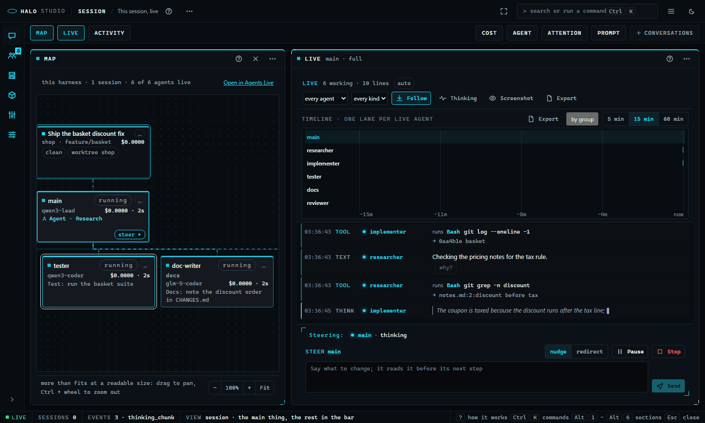
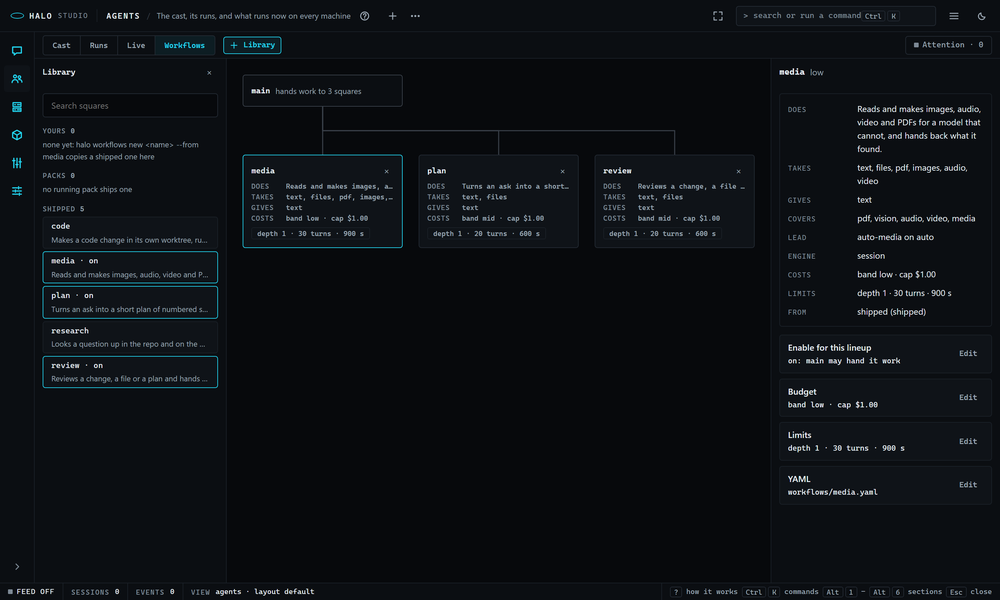
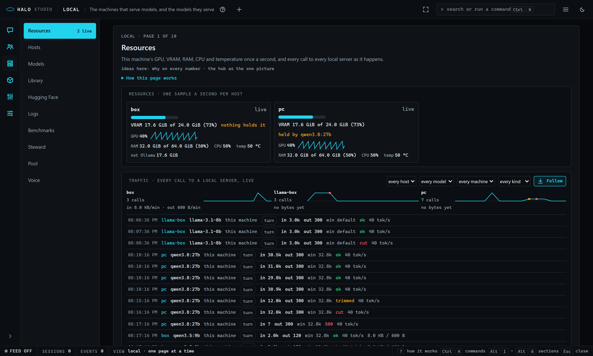

<p align="center">
  <a href="docs/media/hero.png"></a>
</p>

<p align="center">
  <a href="https://github.com/roloVibes/Halo-Harness/releases"></a>
  <a href="https://github.com/roloVibes/Halo-Harness/actions/workflows/suites.yml"></a>
  
  
  <a href="LICENSE"></a>
</p>

[](https://m8ven.ai/mcp/rolovibes-halo-harness-b6hvi0?s=readme)

<h3 align="center">Multi-agent. Multi-workflow. Fully visible.</h3>

<p align="center">
The multi-agent, multi-workflow harness you can watch: every model's thinking, hand-offs and cost, live, and yours to steer.
</p>

See, shape and steer multi-model agent work, on any model, including your own. Halo runs the agent loop (a prompt,
tool calls, permission rules, hooks, MCP servers, skills, sub-agents, sessions) on the models you choose, and Halo
Studio, a page in your browser, is where you watch it and change it.

<p align="center">
  <a href="#see">See</a> ·
  <a href="#shape">Shape</a> ·
  <a href="#mix">Mix</a> ·
  <a href="#local">Local</a> ·
  <a href="#start">Start</a> ·
  <a href="#install">Install</a> ·
  <a href="#everything-else-is-a-pack">Packs</a> ·
  <a href="#links">Docs</a>
</p>

<details>
<summary>The same wordmark as text (what <code>halo --version</code> prints)</summary>

```text
    ░▒▓▓▀▀▀▀▀▀▀▀▀▀▀▀▀▀▀▀▀▀▀▀▀▀▀▀▀▀▀▓▓▒░
  ▒▓█▀                               ▀█▓▒
    ░▒▓▓▄▄▄▄▄▄▄▄▄▄▄▄▄▄▄▄▄▄▄▄▄▄▄▄▄▄▄▓▓▒░
    ██╗  ██╗ █████╗ ██╗      ██████╗
    ██║  ██║██╔══██╗██║     ██╔═══██╗
    ███████║███████║██║     ██║   ██║
    ██╔══██║██╔══██║██║     ██║   ██║
    ██║  ██║██║  ██║███████╗╚██████╔╝
    ╚═╝  ╚═╝╚═╝  ╚═╝╚══════╝ ╚═════╝
```

</details>

## See

<a href="docs/media/studio-session.gif"></a>

Every agent of a session in one live column: what it thinks (THINK), what it says to another agent (TALK), each tool
call with its time and result, and what each agent costs, beside a tree of who spawned whom. Agents -> Live is the
living canvas: only what runs now, the plan lighting up under it, what each agent waits on, and one sentence that says
what is going on. A finished run moves to History, with its report and a replay.

**How:** `halo studio`, then Session (`Alt+1`) or Agents -> Live (`Alt+2`, `L`); `/studio` from a terminal session.
[Session](docs/STUDIO-sections.md#session) · [the living canvas](docs/STUDIO-live.md)

## Shape

<a href="docs/media/studio-workflows.png"></a>

Your lineup is a canvas of blocks: tiers of agents, and workflows (squares) that main hands work to, each line labelled
with its `when` (a need such as a PDF, words the task says, or always first). Drag a block or an agent from the library;
each drop says what it adds and costs before it happens. Steer a running turn from Session's Steer box (main, or the
agent you pin), and run a goal (several agents writing the same files, each in its own git worktree) from Live's
**Run a goal**.

**How:** Agents -> Cast (`Alt+2`, `C`); `halo workflows`, `halo blocks add thinking`.
[Agents](docs/STUDIO-agents.md) · [blocks](docs/STUDIO-blocks.md) · [steering](docs/STUDIO-session.md) · [goal runs](docs/ORCHESTRA.md)

## Mix

<a href="docs/media/studio-model-picker.png"></a>

One job, many models: each role of a lineup runs on its own model, across OpenRouter, Databricks, Anthropic, OpenAI,
Ollama, Hugging Face, your work's Microsoft 365 Copilot or any OpenAI-compatible server. The `auto` lineup picks a model
for each task and learns from what succeeded here. `/model` swaps the model mid-session; the history, tools and rules
come along.

**How:** Agents -> Cast, a card's MODEL strip; `halo teams apply <lineup>`; `/model` in a session.
[Models](docs/MODELS.md) · [the auto lineup](docs/ROLES.md#the-auto-lineup-halo-3190) · [providers](docs/MODELS-references.md)

## Local

<a href="docs/media/studio-local.png"></a>

Your own models are first-class. The steward, a small model you pick, watches every local server, explains a failed
call and plans what fits the card. Each model carries a fit badge per host, and benchmarks measure what it does there.
`halo host serve` lets every harness on your network read a machine's models and log, the pool runs one model across
the GPUs of several machines, Halo finds the Ollama servers on your network, and it starts local servers for
Hugging Face models.

**How:** Local (`Alt+3`, or `halo local`); `halo host serve`, `halo pool`, `halo ollama discover`.
[Local](docs/STUDIO-local.md) · [the steward](docs/MODELS-ollama-steward.md) · [host](docs/HOST.md) · [pool](docs/POOL.md)

## Start

<a href="docs/media/studio-setup.png"></a>

Setup is a page in Studio: one step at a time, Back and Next, a Summary last. If you already use Claude Code, Halo
reads that setup where it is (settings, CLAUDE.md, skills, agents, commands, MCP servers) and Setup never writes to it.
No Claude Code? Halo needs none: pick a provider and a model, and start.

**How:** `halo init` (Setup is `Alt+5` later; `halo init --terminal` asks the essentials in a console).
[Setup](docs/STUDIO-setup.md) · [install](docs/INSTALL.md)

## Honest about what it knows

Halo records what each agent's work showed (its tests, commands, files) and routes by it; a hand-off to a workflow
leaves a receipt; a price or a context it cannot know is shown as `?`, and a cost it cannot price is unknown, never
`$0`. [Verified outcomes](docs/OUTCOMES.md) · [receipts](docs/WORKFLOWS-squares.md)

## Claude Code compatible

The on-ramp: Halo reads `~/.claude` settings, `CLAUDE.md`, skills, commands, agents, hooks, MCP servers and memory in
place, permission rules use Claude Code's grammar, and your claude.ai connectors reach whatever model drives Halo.
[Handbook](docs/HANDBOOK.md)

## Install

```sh
curl -fsSL https://raw.githubusercontent.com/roloVibes/Halo-Harness/v3.5.0.0/scripts/install-halo.sh | bash
```

Windows:

```powershell
powershell -ExecutionPolicy ByPass -c "irm https://raw.githubusercontent.com/roloVibes/Halo-Harness/v3.5.0.0/scripts/install-halo.ps1 | iex"
```

The installer is fetched from a release tag and installs the newest tag; `--ref <tag>` (`-Ref` on Windows) pins
another. It may run `uv tool update-shell` to put `~/.local/bin` on your PATH: it asks first, and `--no-modify-path`
(`-NoModifyPath`, or `HALO_NO_MODIFY_PATH=1`) skips it. No installer:
`uv tool install git+https://github.com/roloVibes/Halo-Harness --constraints https://raw.githubusercontent.com/roloVibes/Halo-Harness/master/requirements.lock`
or `pipx install git+https://github.com/roloVibes/Halo-Harness`. Offline boxes and PEP 668: [docs/INSTALL.md](docs/INSTALL.md).

**Update:** `halo update` (or `/update` in a session); `halo update --check` says what it would do. An install older
than 3.3.16.0 that stops at `invalid peer certificate: UnknownIssuer` cannot update itself past it; this line repairs it
once (`$env:UV_SYSTEM_CERTS='1'; $env:UV_NATIVE_TLS='1'; uv tool install ...` in PowerShell,
[docs/INSTALL.md](docs/INSTALL.md) has both):

```sh
UV_SYSTEM_CERTS=1 UV_NATIVE_TLS=1 uv tool install --reinstall git+https://github.com/roloVibes/Halo-Harness
```

**Your first run:**

1. `halo init` opens Studio on Setup: paste a provider key, pick a default model and a permission mode.
2. `halo` in any folder starts a session; type a request, and type again while it works to steer it.
3. `/studio` (or `halo studio`) opens the dashboard on that session; `halo doctor` explains anything that is not right.

## Everything else is a pack

The core is what the five above need. The rest ships as packs, off until you turn one on:
`halo pack install <id>`, then `halo pack enable <id> --grant-all` (or Studio's Packs, `Alt+4`).

| Pack | What it adds |
|---|---|
| `first-run` | The guided first run: `halo start`, one real goal run that rehearses your lineup on a sample repo |
| `coach` | The post-run coach: suggestions from a finished run, Apply after one confirm, `halo improve` |
| `design` | Prototypes, pages, decks and logos on artboards in Studio, made by a Halo turn |
| `signal` | Halo on your phone as a chat: a text message starts or continues a session (it runs signal-cli) |
| `concord` | Joins a repo's Concord workspace, so a session claims work and trades messages with other agents |
| `doc-review` | Reviews a repo's Markdown documents with a reviewer and a writer, and a typed review report |

Write your own: `halo pack new <id>` starts one, [docs/PACKS.md](docs/PACKS.md) says how a pack plugs in, and the
template repo [halo-pack-template](https://github.com/roloVibes/halo-pack-template) is a ready GitHub starting point.

## Links

- [The docs map](docs/README.md): every doc, by what you want to do.
- [CHANGELOG.md](CHANGELOG.md): every release, what changed and why.
- [docs/CONTRIBUTING.md](docs/CONTRIBUTING.md) and [SECURITY.md](SECURITY.md): sending a change, reporting a problem.
- Licence: MIT, see [LICENSE](LICENSE).
