<p align="center">
  
</p>

<details>
<summary>The same wordmark as plain text (what <code>halo --version</code> prints)</summary>

```
 _   _      _      _        ___
| | | |    / \    | |      / _ \
| |_| |   / _ \   | |     | | | |
|  _  |  / ___ \  | |___  | |_| |
|_| |_| /_/   \_\ |_____|  \___/
```

</details>

**The Claude Code-compatible harness for people who'd rather not be
locked into one AI coding ecosystem.**

Halo gives DeepSeek, GLM, Kimi, Qwen and Claude the same tools, the same
configuration and the same working habits as Claude Code -- over OpenRouter,
Databricks, the Anthropic API, the OpenAI API, your Claude Code or Codex
subscription, Ollama, Hugging Face, or any OpenAI-compatible server you
host -- and it reads your existing Claude Code setup in place
(`~/.claude` settings, CLAUDE.md, skills, commands, agents, MCP servers,
memory), so nothing is configured twice. Switch models mid-conversation
with `/model`; the session context comes with you.

<p align="center">
  
  
  
  
</p>

## Install

```sh
curl -fsSL https://raw.githubusercontent.com/roloVibes/Halo-Harness/v2.0.10/scripts/install-halo.sh | bash
halo init        # the wizard: provider, model, permission mode, theme, roles
halo             # the full-screen TUI, from any directory
```

The script comes from a release tag (not a moving branch) and installs the newest tag; `--ref <tag>` picks another
(`bash install-halo.sh --ref v2.0.7`), and it prints the tag and commit it installs.
Windows: `powershell -ExecutionPolicy ByPass -c "irm https://raw.githubusercontent.com/roloVibes/Halo-Harness/v2.0.10/scripts/install-halo.ps1 | iex"` (`-Ref <tag>` there).
No installer at all: `uv tool install git+https://github.com/roloVibes/Halo-Harness`
(or `pipx install git+https://github.com/roloVibes/Halo-Harness`). Updates:
`halo update`, or `/update` inside the TUI.
The full walkthrough -- offline work boxes, PEP 668, reproducible installs --
is [docs/INSTALL.md](docs/INSTALL.md).

> **Using your Claude Code or Codex subscription through Halo.** The
> `cc:`/`cx:` routes drive the official `claude`/`codex` binaries under
> your own personal subscription, through a third-party harness that is
> not the provider's own product -- the provider's own terms govern your
> account, and there have been public reports of account restrictions for
> tools that use subscription tokens this way. Halo never reads either
> tool's stored credentials, and these two routes are **off until you
> accept** a one-time notice (`halo subscriptions accept`, or
> `/subscriptions` in the TUI) -- see
> [docs/MODELS.md](docs/MODELS.md#subscription-routes-consent-halo-207-round-7b).

## What makes Halo stand out

Every picture below is a real render of the TUI over mock data (fixed clock,
no network, no real keys or paths), regenerated by `tools/capture_screens.py`
-- see [docs/MEDIA.md](docs/MEDIA.md). One loop, one event stream, any model
behind it:


### Auto mode that never interrupts

Auto mode allows everything except *your own* deny and ask rules and your
hooks: no built-in safety classifier, no protected-path heuristics, no
refusal layer. Rules use Claude Code's own grammar, in the same files. A turn
that edits, runs the tests and finishes simply does -- the status bar says
`auto`, and nothing waits for you unless you wrote a rule that says it should.


### Steering a running turn

Type while a turn runs and the steer reaches the work. Your words show up at
once as a real message (not after the tool call that was hiding them), a
running command moves to the background instead of dying, and sub-agents get
your words forwarded into them. Nothing is lost.


### Watching a model think

The line under your message is alive: *Sending request*, then *Thinking* with
tenths of a second and a running reasoning-token count, then *Writing*, then
a *Thought for 18 s* summary. A stalled stream says so (`quiet 7 s`, `no data
for 30 s, Esc interrupts, typing steers`) instead of looking frozen, and the
status bar carries the same word and timer.


### The dock that cannot hide

A permission ask, a question or a plan review is never off-screen: it docks
directly above the prompt, the transcript keeps a marker where it happened,
and a second ask queues behind the first instead of replacing it. The status
bar counts what is waiting on you.


### One session across providers

`or:` `dbx:` `local:` `cc:` `cx:` `oai:` (and `ant:` `ol:` `hf:`) -- any of
them, in one session, with `/model` swapping the lane and the history, tools
and rules coming along. The picker shows price, context window and speed for
every route (`?` when unknown, never a blank that reads as zero).


### Roles and organizations

A lineup assigns a model to each role; an organization is a tree of those
roles working one goal -- the same flow that built Halo itself
(`halo-dev-cycle` ships as a template). Each role is a sub-agent on its own
model, visible in `/tasks` with its state, tools and cost.


### Connectors: Claude Docs from a non-Claude model

Your claude.ai connectors (Claude Docs, a calendar, a drive) appear as tools
to whatever model is driving Halo. The sign-in stays in `claude`; Halo never
reads its credentials file. `/mcp` shows each server's state and *why* one
failed, with a deep-dive action.


### `halo bugreport`

One paste instead of screenshots. `halo bugreport` (or `/bugreport` in a live
session) writes a redacted diagnostic report -- version, environment,
provider and route state, MCP servers, the last turn's timeline -- with every
secret-shaped value stripped; `--copy` puts it on the clipboard.

```sh
halo bugreport --copy
```

### `/review`

Parallel read-only reviewers per dimension (correctness, security,
performance, tests, docs), a judge that confirms or dismisses every finding,
ranked cards with clickable `file:line`, and an optional `--fix` pass -- see
[docs/REVIEW.md](docs/REVIEW.md).


### Remote control from Signal

Message a number, drive a session from your phone: prompts, streamed
replies, permission cards answered by number. Contact-request pairing,
HMAC-signed commands, a kill switch, a `/remote` dialog and a status chip --
see [docs/REMOTE.md](docs/REMOTE.md).


### The game HUDs

Three status-bar skins, each with a face that follows the phase of the turn:
DOOM, Metroid (here in Norfair) and Mario. `/doom`, `/metroid`, `/mario` toggle them.

<p align="center">
  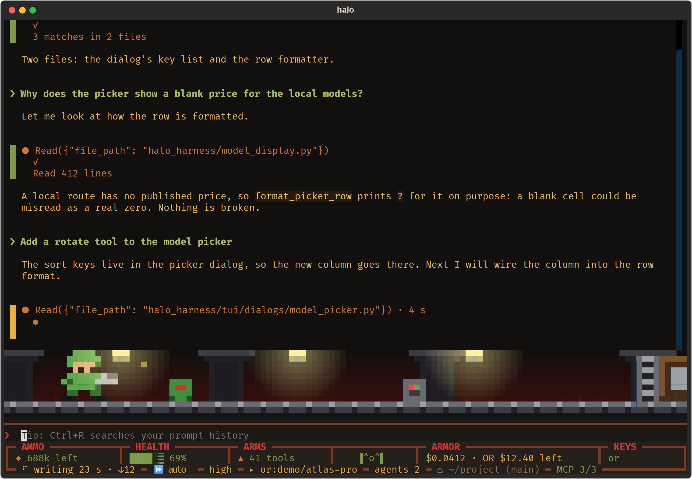
  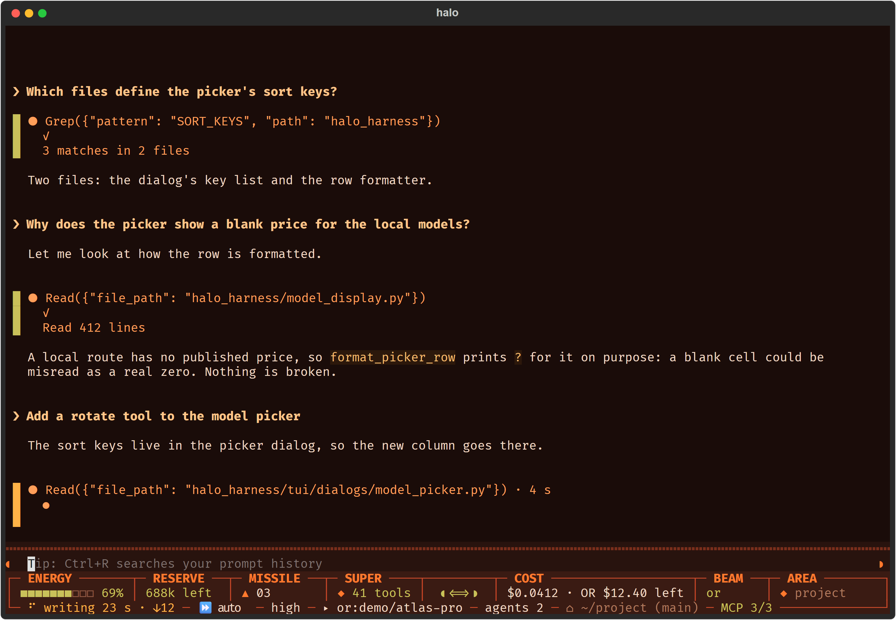
  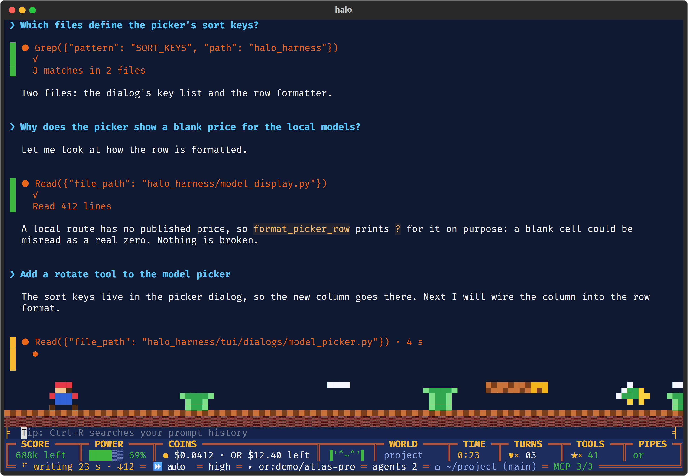
</p>

## How Halo compares

Facts about Halo come from this repository. The right-hand column is a
summary of what other coding harnesses commonly document, not a measurement
of any one of them -- it varies by tool, so check each tool's own docs.

| Point | Halo | Other harnesses (varies by tool) |
|---|---|---|
| Config reuse | Reads your Claude Code setup in place: `~/.claude` settings, CLAUDE.md, skills, commands, agents, MCP servers, memory | Commonly their own config files and instruction files |
| Models | DeepSeek, GLM, Kimi, Qwen, Claude and more, over nine route kinds; `/model` swaps mid-conversation | Often one vendor's models, or one provider list per tool |
| Steering | Type during a turn; the steer shows at once and reaches the work, background commands survive, sub-agents get it | Commonly a queued message or an interrupt |
| Liveness | A live phase line (seconds, token counts, `quiet`/`no data` counters) plus a status-bar word and timer | Commonly a spinner |
| Permissions | Auto mode allows everything except your own deny/ask rules and hooks; asks dock above the prompt and queue | Commonly a built-in approval policy of the tool's own |
| MCP | stdio/HTTP/SSE from every Claude Code scope, `/mcp` with failure reasons and a deep dive, claude.ai connectors as tools | MCP support is common; diagnosis and connector bridging vary |
| Sessions | Resume, rewind, `/tasks`, per-role cost attribution, `halo bugreport` | Resume is common; the rest varies |
| Remote control | From a phone over Signal, with pairing, signed commands and a kill switch | Rare in a terminal harness |

## What it looks like

The reproducible TUI gallery, produced by `scripts/screenshots.py` -- Textual
pilots over fixture data with a fixed clock, so a rerun is byte-identical
(`python scripts/screenshots.py && git diff` shows nothing).

| Scene | What it shows |
|---|---|
| 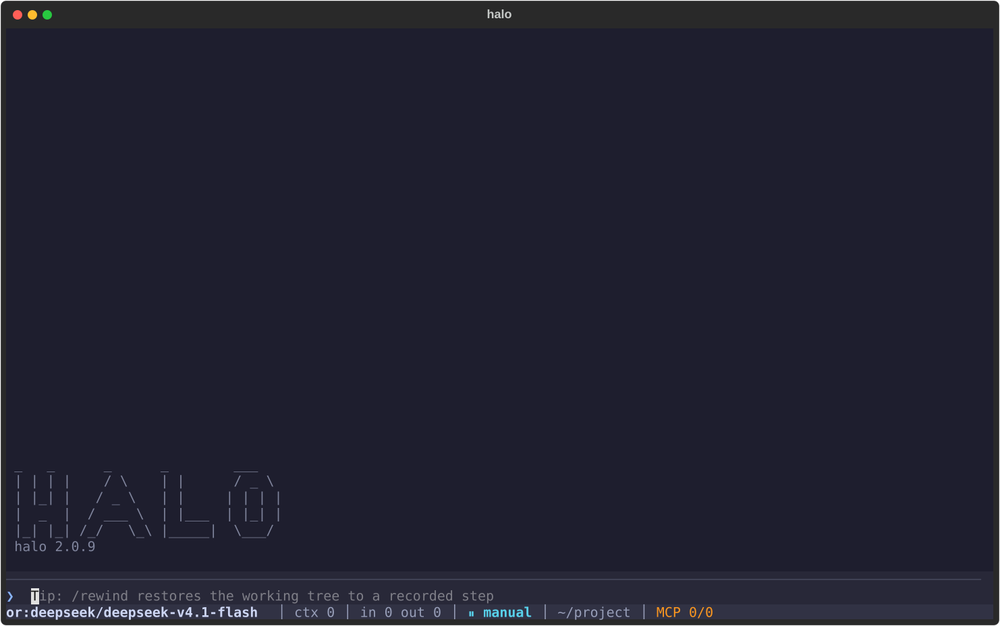 | First paint: the banner intro line, the prompt, the status bar. |
| 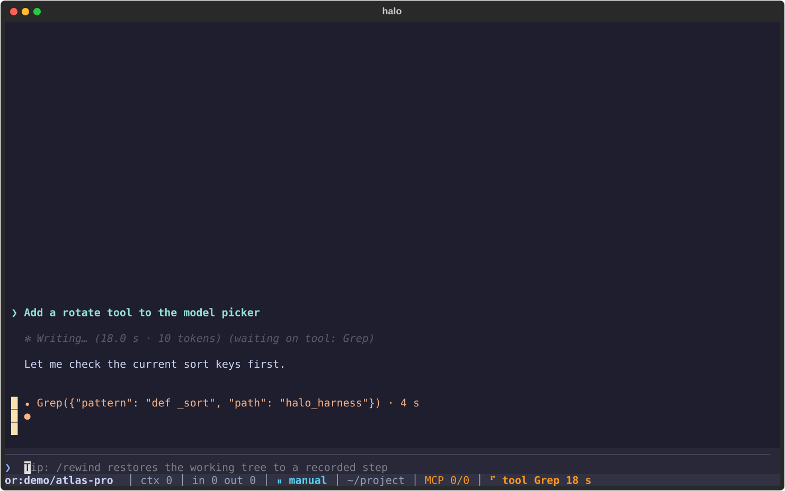 | A reply mid-turn: the phase line, a running tool card, live counters. |
| 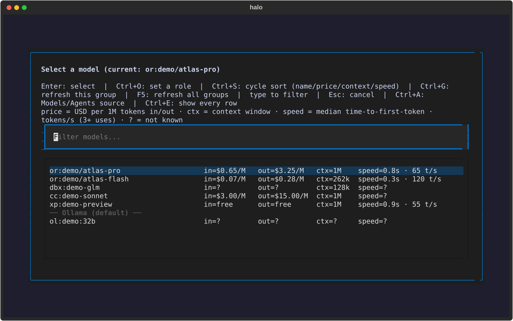 | The model picker: price, context and speed columns for every route. |
| 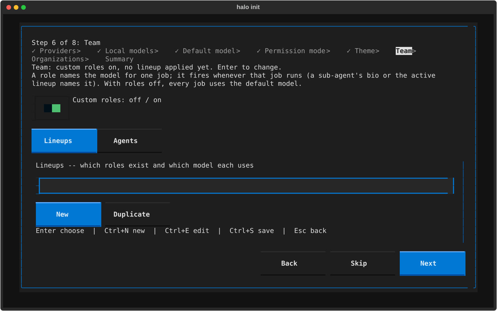 | The wizard's Team step: custom roles on, the lineups pane (one pane at a time, roles explained as you go). |
| 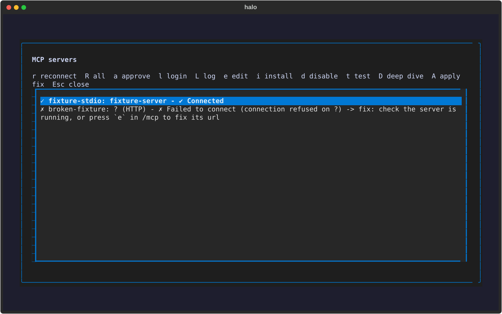 | The `/mcp` dialog: one failing server, its reason, the deep-dive action. |
| 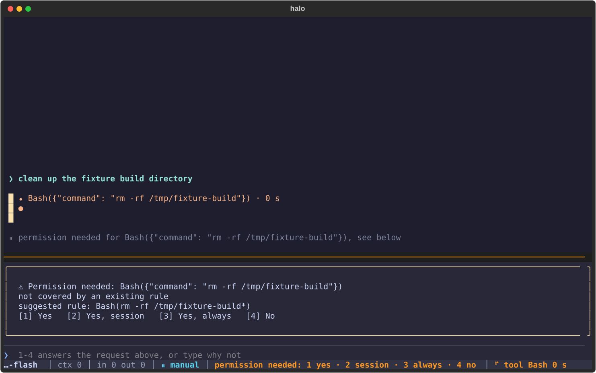 | A permission card docked above the prompt with its suggested rule. |
| 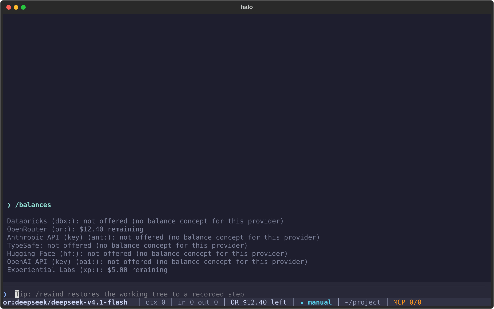 | The balances chip in the status bar and the `/balances` table. |
|  | The `/remote` dialog: the Signal bridge's state, contact requests, paired phones, a pairing code just issued. |

## Features

| | |
|---|---|
| **Switch models mid-conversation** | `/model` swaps the lane without losing session context -- prompt, tools and history come with you. |
| **A provider per role** | YAML agent bios and lineups assign a model to each job: GLM can orchestrate while a local Qwen implements and a cheap flash model reviews. `halo teams use <lineup>` applies one. |
| **Steering** | Type while a turn runs and the steer reaches the work: a running command moves to the background instead of dying, sub-agents get your words forwarded into them, nothing is lost. |
| **Per-model tool-call repairs** | Fourteen model families' quirks are repaired on the fly -- Kimi's `functions.{name}:{idx}` ids, GLM's always-on thinking, Qwen's system-message rules, DeepSeek's reasoning echoes. Gateway quirks are learned once per model and remembered (`halo rules`). |
| **Measured, not guessed** | `/stats` per model and per tool, price/context/speed columns in the picker, per-role cost attribution, and `halo preflight` canaries each lane before a long run (a tool call the model must actually emit, an image a "vision" model must actually accept). |
| **Filter-aware routing** | A provider content filter is not an answer: a filtered reply never persists as one, and the request reroutes to a fallback lane you choose. |
| **Permissions without a nanny** | Auto mode allows everything except *your own* deny/ask rules -- no built-in safety classifier, no protected-path heuristics, no refusal layer. Rules use Claude Code's own grammar, in the same files. |
| **Routes** | `dbx:` `or:` `ant:` `cc:` `cx:` `oai:` `ol:` `hf:` `local:` -- one session, any of them. |
| **The wizard** | `halo init`: provider, model, permission mode, theme, roles, orgs -- every step explains itself and `halo doctor` ends each warning with its fix. |
| **MCP deep dive** | stdio/HTTP/SSE servers from every Claude Code scope, `D` diagnoses a failing server end to end, claude.ai connectors bridge through as tools. |
| **Balances and picker columns** | Per-provider balances in the status bar (remaining first); free variants sit beside their paid rows in the picker. |
| **Remote control from Signal** | Message a number, drive a session from your phone: prompts, streamed replies, permission cards answered by number. Contact-request pairing, HMAC-signed commands, a kill switch, a `/remote` dialog and a status chip -- see [docs/REMOTE.md](docs/REMOTE.md). |
| **Code review** | `/review` and `halo review`: parallel read-only reviewers per dimension (correctness, security, performance, tests, docs), a judge that confirms or dismisses every finding, ranked cards or `--json`, and an optional `--fix` pass -- see [docs/REVIEW.md](docs/REVIEW.md). |
| **Privacy audit** | `halo audit privacy` scans the tree for real paths, hosts and key-shaped strings; the release refuses to ship one red line. |
| **CI and release script** | Every push runs the three suites on Linux and Windows; `scripts/release.py` versions, tags, pushes and refreshes both installs. |

## Themes

The gallery above is the default theme. The 2.0.8 theme pack adds three game
themes, each with its own toggle (`/doom`, `/metroid`, `/mario`: run it again
and your previous theme comes back) and a one-line entry in the wizard's
Theme step; `/theme <name>` is the explicit form.

| Theme | Render |
|---|---|
| `doom` (`/doom`) -- a three-row bottom-HUD status bar: ammo, health, arms, a face that follows the phase, armor, keys | 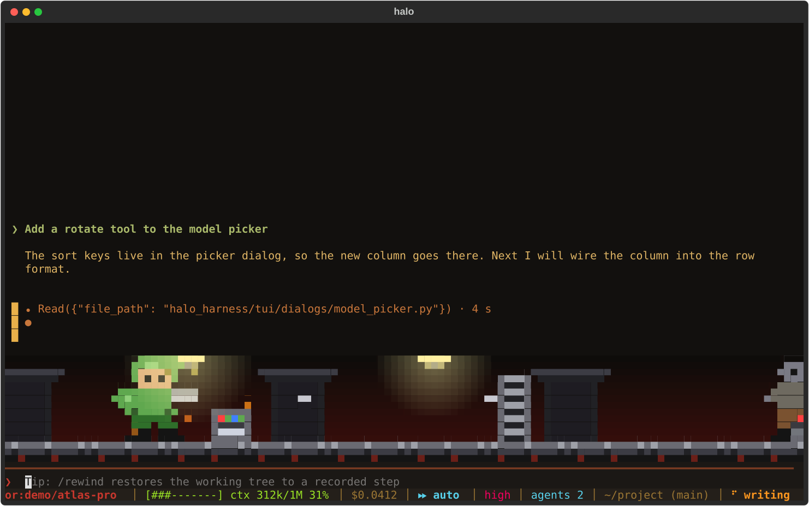 |
| `metroid` (`/metroid [area]`) -- a suit-HUD status bar: ten energy tanks for the context left, reserve, missile and super counters, a visor face, the area panel; five area palettes (Crateria, Brinstar, Norfair, Maridia, Tourian), dashed map-grid cards and a visor-framed input line | 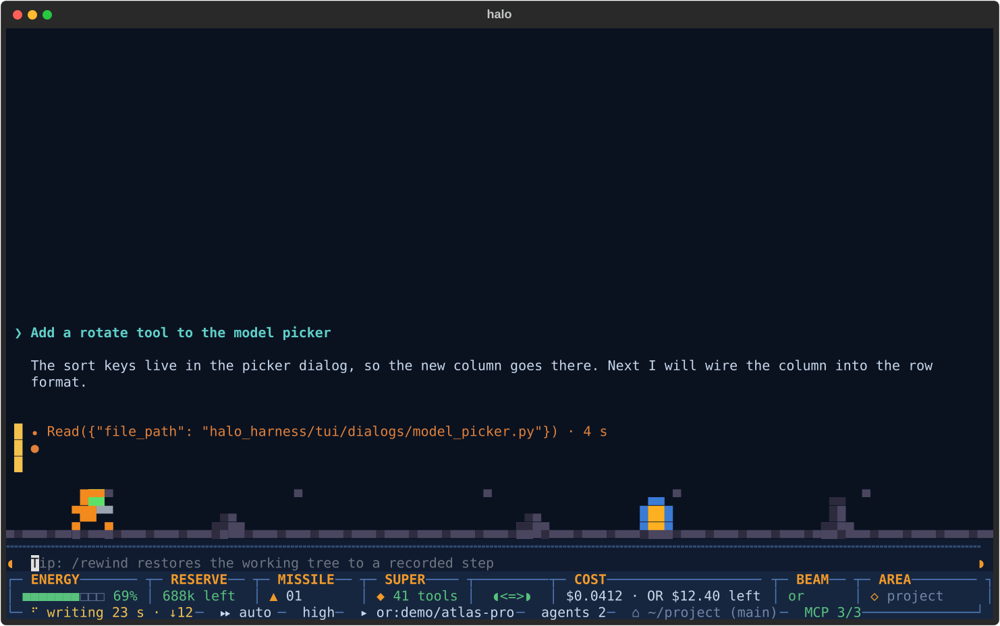 |
| `mario` (`/mario [variant]`) -- a top-bar status bar: coins for the cost, a turn timer, the world and level for the cwd and branch, a score for the tokens left, lives counters, a cap-and-moustache face; two palettes (`bros`, `world`), brick-pattern cards, a pipe-framed input line and a 1-UP flash when a sub-agent finishes | 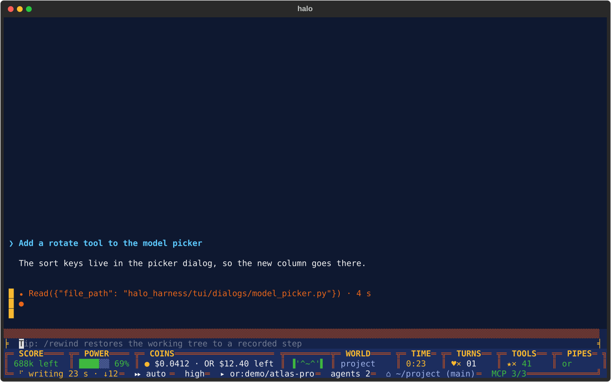 |

## Documentation

| Document | What it covers |
|---|---|
| [docs/INSTALL.md](docs/INSTALL.md) | One-page install, upgrade and update guide |
| [docs/HANDBOOK.md](docs/HANDBOOK.md) | The long-form guide: configuration, providers, permissions, steering, hooks, skills, MCP, sessions, telemetry |
| [docs/COMMANDS.md](docs/COMMANDS.md) | Every CLI command and flag |
| [docs/SLASH-COMMANDS.md](docs/SLASH-COMMANDS.md) | Every slash command in the TUI |
| [docs/CONFIG.md](docs/CONFIG.md) | Config keys, paths and environment variables |
| [docs/MODELS.md](docs/MODELS.md) | Model families, effort levels and per-route rules |
| [docs/LOCAL-MODELS.md](docs/LOCAL-MODELS.md) | Ollama, Hugging Face, the OpenAI API and Codex -- end to end |
| [docs/DATABRICKS.md](docs/DATABRICKS.md) | Databricks endpoints, API types and the work matrix |
| [docs/ROLES.md](docs/ROLES.md) | Roles, agent bios and lineups |
| [docs/GOVERNOR.md](docs/GOVERNOR.md) | The Governor: shared per-host rate limiting, failover and lanes |
| [docs/TROUBLESHOOTING.md](docs/TROUBLESHOOTING.md) | "Is it frozen?", GLM pauses, copy and paste, connect timeouts |
| [docs/ARCHITECTURE.md](docs/ARCHITECTURE.md) | How the pieces fit together |
| [docs/MEDIA.md](docs/MEDIA.md) | How the front-page pictures are made and regenerated |
| [docs/harness/README.md](docs/harness/README.md) | Design briefs, review findings, acceptance records |
| [CHANGELOG.md](CHANGELOG.md) | Every release, with what changed and why |

## Tests

Three hermetic, exit-code-gated suites run on Windows, WSL and a Kali VM
before every commit, and in CI on every push: `python test_bridge.py` (the
proxy), `python tests/run_all.py` (the harness) and `python test_tui.py`
(the TUI, through Textual's headless pilot). Mock servers stand in for every
provider, a fake `claude` stands in for the subscription route, and guards
fail the run if a test touches the real `~/.halo` or `~/.claude`. See
[docs/DEVELOPMENT.md](docs/DEVELOPMENT.md).

## Licence

See [LICENSE](LICENSE).
