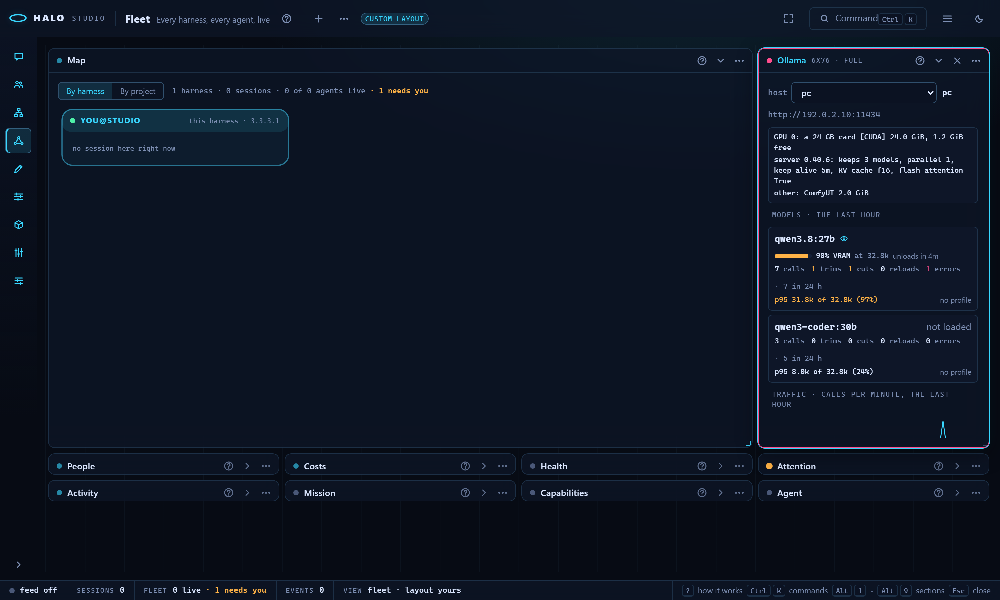

# Models: the Ollama steward

Read this when you want to know what the Ollama steward knows, records, finds and changes across your halos and model servers.

Part of [Models](MODELS.md), which lists every part.

## The steward (3.3.4.0)

The Ollama steward watches the traffic of every halo to an Ollama server,
knows the card it runs on, and adjusts Halo's side of the calls; it never
writes to a server or changes a model there, and it recommends a server
change with the exact line to set and what it costs. Round R1 ships the
two things the later rounds read:

- **The knowledge**: `halo_harness/ollama_steward/knowledge/*.md`, shipped
  with the package. `scheduler.md` (the server settings and their
  defaults, how a load places layers, eviction, a request during a load,
  the server's own prompt truncation), `log-vocabulary.md` (every
  server.log line Halo acts on, with a real example, and where the log is
  per OS), `memory.md` (weights by quantization, the KV cache by type and
  model shape, the compute buffer, the margins, Windows WDDM and Apple's
  unified memory, worked examples for qwen3-coder:30b, qwen3.8:27b and
  qwen3.5:9b checked against Halo's own fit arithmetic), `local-servers.md`
  (llama-server, mlx_lm.server, LM Studio, vLLM) and `symptoms.md` (each
  alert kind: symptom, cause, the Halo-side change, the server-side line).
  Every claim ends in a `[S<n>]` tag naming a row of `SOURCES.md` (title,
  URL, version or commit, date read); `tests/test_steward_knowledge.py`
  keeps the tags, the rows and the worked examples in step.
- **The hardware card**: `halo ollama hardware [--host NAME] [--json]`
  ([COMMANDS-ollama.md](COMMANDS-ollama.md)) reads each host's GPUs and
  their memory, the server's own settings (its log's startup env dump:
  models kept loaded, parallel slots, keep-alive, KV cache type, flash
  attention, GPU overhead), what is loaded (`/api/ps`) and what else holds
  the card (`nvidia-smi`'s compute processes), every field empty when
  unknown, each reader that found nothing named on a "not read" line.

What the research found that Halo's own fit gets wrong (input for R3):
the Qwen 3.5 / 3.8 models keep a KV cache in one layer of four, so the
estimate is 4 times too large for them; the server's KV cache type is in
its startup log, not only in the host entry's `kv_cache_type` hint; the
compute buffer, the hybrid models' fixed state, the per-device minimum
and llama.cpp's fit margin are not in the estimate; and a 24 GB card on
Windows reports 22.5 GiB, under the server's 23 GiB line for its 32,768
default window.

R2, every call leaves a record:

- **The ledger**: every call to a local model server -- an `ol:` host
  that is not Ollama's own cloud (native, or an entry with `dialect:
  openai`), an `hf:local/*` / `hf:mlx/*` server -- appends one JSON line
  to `~/.halo/ollama/traffic.jsonl`, written where the loop dispatches
  every call (turns, compaction, small-model calls, tool repairs) and by
  each calibration load: `at`, `host` (the entry's name and url),
  `model`, `ref`, `dialect`, `kind` (`turn`, `compaction`, `small`,
  `repair`, `calibrate`), `num_ctx_sent` and `window_source` (the window
  rule's own source, `trim resend` for a re-send at a raised window),
  `estimate_tokens`, `prompt_eval_count`, `eval_count`, `done_reason`,
  `total_ms`, `load_ms`, `prompt_eval_ms`, `eval_ms`, `eval_tok_s`,
  `trimmed` (Ollama read under 70 % of the prompt, or answered "no user
  query"), `status` (200, 400, 499, 500, 503, `timeout`, `connection`),
  `error` (the server's one line), `retry` (0 for a first send, then 1, 2
  for the re-sends that follow a failed or trimmed call in the same
  turn), `session`, `turn`, `tools_count`, `images`, `from` (this
  machine's fleet name while it has joined a hub) and, from 3.3.5.0,
  `switched_from` (the previous turn or compaction call's model in the
  session, when it differs) and `fitted` (a switch step ran before the
  call: [MODELS-switching.md](MODELS-switching.md)) and `body_flags`
  (`{think, tools, images}`: the think value the body sent, None when none,
  and whether it carried a tool catalog and images), and from 3.3.5.0 R1
  `bytes_in` / `bytes_out` (the request body as sent, the reply as it
  streamed), and from 3.3.5.0 R4 the prompt budget's fields
  ([MODELS-prompt-budget.md](MODELS-prompt-budget.md)): `composition`
  (`{system, memory, topic_index, tools_schema, history, user, total}`, the
  request's parts in tokens), `prefix_tokens` and `prefix_changed` (the
  system message and the tools, and whether they differ from the session's
  previous call), `preflight` (the preflight's decision before this call:
  "compact", "switch" or "sent"; None when the request fitted), `warming`
  (the first call after a load, `load_ms` over 2 s: never counted as a speed)
  and `cache_reused_pct` (the share of the prompt Ollama did not read again).
  Every line written is published at once
  (`ollama_steward/ledger_tap.py`) for Studio's Local tab. The OpenAI dialect
  fills the counts from `usage` and `done_reason` from `finish_reason`.
  The file rotates to `traffic.1.jsonl` at 20 MB; `ollama.ledger: false`
  turns it off. A fleet member sends its lines to the hub
  (`fleet.ollama.share`, [CONFIG.md](CONFIG.md)): by default the calls
  to a host it does not serve itself, so the machine that serves the
  models holds every halo's calls to it. `halo ollama traffic`
  ([COMMANDS-ollama.md](COMMANDS-ollama.md)) prints the rollups; each
  model's row ends with its window and the window's source ("window
  32,768 (learned cap)", `agent/model_window.window_of`), the same column
  the Ollama panel's model rows show.
- **The events**: `halo ollama events` reads the local server's log
  read-only (a rotation followed, journald on Linux) and, with `--watch`,
  polls `/api/version` and `/api/ps` every 20 s; each rule below becomes
  an event `{kind, severity, say, evidence, at, model, data}` in
  `~/.halo/ollama/events.jsonl`. Every event is written; `notify` marks
  the first of a kind in 10 minutes, the only ones a notice shows. What
  each kind means and what to change is in
  `ollama_steward/knowledge/symptoms.md`; the lines themselves in
  `log-vocabulary.md`.

| Kind | Read from |
|------|-----------|
| `prompt-trimmed` | "truncating input prompt limit=L ... keep=K": the window sent is 2L - K (2,050 is 4,096): a bigger window, not only compaction |
| `reply-cut` | "stop processing: ... truncated = 1" |
| `window-full` | "failed to find a memory slot" |
| `no-user-query` | "chat prompt error ... no user query found" (its own 500 is part of it) |
| `cancel-task` | a 500 within 25 lines of "srv stop: cancel task": the client went away while the prompt was read |
| `http-500` | any other `\| 500 \|` request line |
| `retry-loop` | three or more 500s in 3 minutes for one model |
| `client-gave-up` | `\| 499 \|`, with "aborting load" when it ended a load (and the "Load failed ... context canceled" beside it) |
| `load-failed` | "Load failed" for any other reason |
| `cpu-spill` | "offloaded a/b layers" with a under b, "N overflowing", `/api/ps` `size_vram` under `size` |
| `gpu-memory` | "out of memory", "cudaMalloc failed", "CUDA error", "runtime OOM detected" |
| `queue-full` | `\| 503 \|` |
| `slow-load` | "llama-server started in" over 180 s, or a load still running after 3 minutes |
| `stall` | a request with no progress line for 5 minutes (while watching) |
| `server-down` | `/api/version` unanswered three times in a row |
| `other-error` | any other `level=ERROR` line |
| `no-prompt-cache` | "forcing full prompt re-processing due to lack of cache data" (3.3.5.0 R4): the model keeps no prompt cache; its card gains the quirk "re-reads the whole prompt every turn" |
| `loaded`, `unloaded`, `reloaded` | `/api/ps` from one poll to the next; `reloaded` is one model at another window |
| `startup` | a new "server config" block: the hardware card is read again |

R3, the steward judges, plans the fit, adjusts:

- **The corrected fit**: the memory estimate counts only the layers that
  hold a KV cache (one in four for Qwen 3.5 / 3.8), times the server's
  parallel slots, plus the hybrid models' recurrent state, the draft
  layer, the compute buffer, the vision projector, Ollama's per-card
  minimum and, for a client that leaves the layers to llama.cpp, its fit
  margin; the KV cache type comes from the host entry's hint, else from
  the server's own startup log (details in
  [MODELS-ollama-tuning.md](MODELS-ollama-tuning.md)).
- **The findings**: `halo ollama steward findings [--host H] [--since 24h]
  [--json]` ([COMMANDS-ollama.md](COMMANDS-ollama.md)) reads the ledger
  (every member's lines on a hub), the events, the hardware card and the
  learned caps per host and model. A window too small (trims, cut replies,
  a p95 prompt within 10 % of it; a 4,096 or 8,192 window asked for is its
  own finding), too large (prompts far under it, with reloads or a spill),
  two windows for one model, replies cut, a session past 80 % of its
  window that never compacted, a cut reply resent, a slow box, two models
  thrashing one card. Each finding says what it saw (the ledger lines'
  `at`, the events, the numbers) and proposes at most one profile change,
  or a server line only to show.
- **A switch without a fit** (3.3.5.0): a call whose model differs from
  the previous call's in the same session, with `fitted` false on its
  ledger line, is the finding below.

- **The plan**: `halo ollama steward plan` fits what the halos ask for to
  the card: a window per model, one model at a time (`keep_alive` 0 on the
  second), the second model on another configured host, a tuned twin, a
  smaller quantization, the server's KV cache at q8_0; every option says
  what you lose, and only the first three are Halo-side.
- **The profiles**: `ollama.profiles["<host>|<model>"]` ([CONFIG.md](CONFIG.md))
  is read before every call to that model on every halo: its window is the
  one sent (never over the learned cap or `max_ctx`), its `num_predict`
  the least room the reply keeps (the prompt compacts first), then
  `keep_alive`, `tools_max`, `host_for` and `compact_at`. The hub hands its
  profiles to every member in the answer to the member's ledger push, keyed
  by the member's own name for the host, so the Mac's next call uses what
  the PC learned; a member's own `by: "user"` entry is never overwritten.
- **The modes**: `halo ollama steward run [--once]` applies the findings'
  changes per `ollama.steward.apply`: `auto` (applies them and says one
  line; a session's next call to that model shows the note), `review`
  (proposals, then `halo ollama steward apply <id>`), `off`. Every change
  is one line in `~/.halo/ollama/steward.jsonl` (what, why, the evidence,
  the plan); at most one per host and model in ten minutes, never above a
  measured cap, and a change followed by worse calls (more trims, cuts and
  errors in the next 10 calls than in the 10 before) is rolled back on its
  own. `halo ollama steward undo` reverts the newest change.
- **Two session fixes**: a request whose prompt passes `compact_at` of the
  most its window can be compacts before it is sent, and a reply that used
  up the room the window left it counts as cut (compacted and re-sent,
  never kept or sent again).

R4, the steward's agent, selectable and cheap, and the job that runs it:

- **The job**: one per state dir. It starts with Studio (`halo studio`)
  and with the fleet hub, whichever is first, and `halo ollama steward
  --watch` runs it in the foreground on the machine that serves the models
  (each line printed; Ctrl+C stops it). It owns the server-log tail and the
  `/api/ps` poll for the host this machine serves (`halo ollama events
  --watch` reads the same), and a timer: every `ollama.steward.every_s`
  (300 s) while calls flow (a ledger line in the last 15 minutes), and at
  once when a warning or error event passes its quiet period, it runs the
  rules, applies the changes per `ollama.steward.apply` and asks the model
  for a note. A second job on the same state dir (another Studio, a hub
  in another process, a second `--watch`) does not start and names the holder
  (a lock file, `~/.halo/ollama/steward-job.lock`). `halo ollama steward
  status` says whether one runs, where (studio, hub, watch), since when,
  the last run's counts, the model and the last note. `ollama.steward.job:
  false` starts none with Studio or the hub; `ollama.steward.apply: off`
  keeps the findings and the notes and applies nothing.
- **The model**: `ollama.steward.model` (any model ref), else the
  configured `compactionModel` when it is a local model, else the smallest
  local model this machine lists (by its size on disk), else none: then the
  job runs the rules alone and `status` says "no steward model: set
  ollama.steward.model". `none` (3.3.4.0 R5) turns the notes off on
  purpose; the rules still run. A cloud model is used only when
  `ollama.steward.model` names one. It is called once per note, only when a
  run found something the last note did not name, made a change, or saw a
  server alert, and at most once per `ollama.steward.note_every_s` (600 s).
- **What it reads**: a guide built once from the knowledge files (each
  alert kind's meaning, cause, Halo-side change and server-side line from
  `symptoms.md`, and its rule that a smaller window answers a spill, never
  an outgrown conversation; under 2,100 tokens), then the hardware card of
  each host involved, the ledger's rollups per model, the last 20 events,
  the findings, the fit plans, the changes this run made and the machines
  that called.
- **The note**: at most 6 lines in plain words. The first line stands
  alone (the TUI status line, the attention row): what went wrong on which
  machine, or what changed. The rest explains the chain (what holds the
  card, what spilled, which call then was cut or timed out, on which
  machine) and what changed or what to run, a server line copied as the
  finding gives it. The last line names the model and the cost: "local,
  free", or the tokens and the dollars when the model is priced.
- **Its proposals**: the model may add a fenced `proposals` block,
  `[{key, field, to, why}]`, for a change the rules did not make. Each is
  checked before it lands: a host and model the steward read, a profile
  field and a value of its type, a window never above the measured cap or
  the card's fit and never smaller than the window sent for a model whose
  prompts were trimmed or cut, a reply room at most half the window, and
  the ten-minute rule. Then the mode: `auto` applies it (one line in
  `steward.jsonl`, `undo` reverts it), `review` writes a proposal for
  `halo ollama steward apply <id>`, `off` only reports it. One that fails
  a check is dropped and says why.
- **Where notes go**: every line the job says is a `note` line in
  `~/.halo/ollama/steward.jsonl` (`{id, at, kind: "note", stage: finding |
  change | note | idle, say, lines, cost, attention, model, data, where}`).
  A TUI on that state dir shows each new note or change in its status bar
  for 30 s and as one line in the transcript. A note whose findings carry
  an `error`, or any change, raises the Fleet attention row
  `ollama_steward` (set aside, or open Ollama). Studio's live feed gets a
  `steward` frame `{stage, say, data}` for every line. A fleet member gets
  the hub's newest note with the hub's profiles (the answer to its ledger
  push) and its TUI shows "steward on <hub>: <first line>".
- **`halo ollama explain [<kind> | <topic>] [--sources]`** answers from
  the knowledge files with no model: an alert kind prints its
  `symptoms.md` row (an event kind or a rule name without a row of its own
  answers with the row it belongs to: `reloaded` and `two-windows` with
  `thrash`, `window-small` with `prompt-trimmed`, ...), a topic the
  matching file (`scheduler`, `memory`, `log`, `local-servers`), section
  (`kv-cache`, `margin`, `eviction`) or the lines that mention it
  (`parallel`, `keep-alive`); no argument lists both; `--sources` adds the
  `SOURCES.md` rows the answer cites.

### switch-without-fit

`switch-without-fit` (a warning, no profile change): "N calls to qwen3.5:9b followed a call to qwen3.8:27b in the
same session with no switch step before them: the window, the tools and the history were the old model's". The switch
step ([MODELS-switching.md](MODELS-switching.md)) is the fix; `halo ollama explain switch-without-fit` prints its row.

### A chosen cut, and warming calls (3.3.5.0 R4)

A trim the user chose -- the preflight's "send anyway", the ledger's
`preflight: "sent"` -- is not a finding: `window-small` and
`window-asked-small` leave the call out, and a `prompt-trimmed` server line
within two minutes of such a call too. A call tagged `warming` never counts
toward a speed: the p50 the rules read, `slow-box` and `halo ollama
traffic`'s tok/s leave it out.

### called-wrong

`called-wrong` (3.3.5.0 R0b, a warning, no profile change; `rules_card.py`):
"2 calls to qwen3-coder:30b sent a think value and a tool catalog, which its
card says it cannot take (it does not think; it has no tool calling here):
call it the card's way -- no think field (the model does not think); no
tools: answers only (tool turns in the history go as text)". Each ledger
line's `body_flags` is held against the model's card
([MODELS-cards.md](MODELS-cards.md)), built from the host's catalog row and the
tool-call probe; the fix is the card's own `how` lines, so the steward's note
says how the model should be called. A model with no catalog row is not
judged.

## The battery on new models (3.3.6.0)

The job (`ollama_steward/probe_new.py`) runs the battery ([MODELS-cards.md](MODELS-cards.md#the-profile-what-the-battery-measured-3360))
on one model of a host this machine serves with no profile for its digest and Ollama version, one at a time, only after
3 minutes with no call in the ledger, asking the host at most every 5 minutes (`ollama.steward.probe_new: false`: off).
A server event on a probed model ends in its fix ([MODELS-cards.md](MODELS-cards.md#when-a-local-model-fails-the-line-says-why-3360)).

## Crash fingerprints (3.3.6.0 R2)

Each crash event the job records (`gpu-memory`, a CUDA illegal memory access, `llama runner terminated` / exit
`0xc0000409`, a failed load; a client closing the connection is none) leaves one fingerprint in
`<state>/ollama/fingerprints.jsonl`; the lines of one crash within two minutes are one. `halo ollama crashes` lists
them, the Library greys the model, a member's ride its ledger push. 3.3.6.0 R3 adds the load it died in, `--why`, the
fix a repeated crash proposes, remote logs over `ssh:` and the log status: [MODELS-ollama-logs.md](MODELS-ollama-logs.md).

## Scopes: when a change goes back (3.3.6.0 R5)

Every Halo-side change to a profile is a row in `<state>/ollama/changes.jsonl` with a scope
(`ollama_steward/changes.py`): `session` (put back when the session that made it ends), `until-restart` (when the halo
process that made it exits: atexit and the TUI's quit; a halo that was killed is caught by the next one's exit or
session end) or `keep`. The steward's auto changes and its model's proposals land `until-restart`, the ledger's dialect
refinements too; a pass you run yourself (`halo ollama steward run --once`, Studio's Run) and an Apply of a proposal
keep; your own change from the tuning report, the KV dial or Settings keeps unless you pick another; a bench's trial
settings are `session`. The steward's undo and rollback mark the row reverted; Revert puts `before` back and says it
("put num_ctx back to 32,768 on pc|qwen3-coder:30b (the session ended)"), and leaves a field changed again since as it
is. A switch to another local or a cloud model stays the session's model until `/model`. The bench never times the
first call after a load (warming). `halo local changes`, `halo local revert <id> | --all [--scope S]`.

## In Studio

Round R5 shows the steward in Studio, the TUI and Setup.

**Fleet's Ollama panel.** An optional panel: the header's **+** adds it,
the steward's attention row opens it with **O**, and so does the
palette's "Fleet: Ollama". Pick a host when there is more than one; a
Hugging Face local server is a host here too. Each host shows:

- **The card line**: the GPUs and their free memory, the server's own
  settings (how many models it keeps, parallel, keep-alive, the KV cache
  type, flash attention) and what else holds the card.
- **The models**: one row per model with calls in the last 24 h, loaded
  now, or holding a profile. Each row shows:
  - loaded now: its VRAM share as a bar (amber when part of it runs on the
    CPU), the window it loaded at and when it unloads;
  - the last hour: calls, trims, cuts, reloads and errors;
  - the p95 prompt against the window sent (amber from 90 %);
  - (3.3.5.0) the model's window here and where the number came from
    ("window 32,768 (learned cap)"), the window a switch to it fits to;
  - the profile's window, reply reserve and keep-alive, with who set them
    (by steward, by the hub, by you);
  - an eye for a model that reads images.
- **Traffic**: the last hour's calls per minute as a sparkline, with each
  trim, cut and error marked on its minute.
- **The steward block**:
  - the job's status lines: where it runs, since when, its model, the last
    run;
  - the last note, its cost line muted, and on a member the hub's note;
  - the findings: severity, the line, the change, the evidence numbers.
    In `review` mode a finding has **Apply** (the profile change, through
    the same guards as `halo ollama steward apply`); in `auto` mode the
    changes in place are listed with **Undo** on the newest;
  - **Dismiss** keeps a finding quiet for 24 hours. It writes a `dismissed`
    line in `steward.jsonl`, which the rules read, so the CLI, the job and
    `/ollama` stop showing it too.
  - **Run now** runs the rules once. It never calls a model.
- **The fit plan**: whether the models the halos ask for fit the card
  together, and each option with what you lose. An option with profile
  changes has **Apply**. A server-side change (`OLLAMA_KV_CACHE_TYPE=q8_0`,
  a smaller quant's pull line, a tuned twin) has **Copy**, which copies the
  exact line. Halo never sets it on the server.

A Hugging Face local server shows its rows from the ledger's OpenAI-dialect
lines. The window and reply-reserve rules apply to it. The rest of Hugging
Face moves to Local -> Hugging Face (3.3.5.0).

**The panel is the short form of Local (3.3.5.0 R1).** Studio's Local
section (`Alt+0`, [STUDIO-local.md](STUDIO-local.md)) holds the same hosts at
full size: a live strip per host, every call as it happens, every host
with Load / Unload / Make it fit, every model with its card. Each model row
here has **open in Local**, which opens Local -> Models on that host. The
panel and Local read each host's catalog through one cache keyed by its
`/api/tags` (the per-model `/api/show` calls run again only when a model
changed); before, the panel read every host's whole catalog each minute.

How it stays live: a refetch every 30 s while open; a `steward` frame from a job in this Studio refreshes it too (a
job in another process, the hub or `--watch`, sends none: the refetch covers it).

The routes behind the panel (`studio/ollama_steward_api.py`, under
`/api/ollama/`) never call a model and never write to a server:

| Route | What it does |
|---|---|
| `GET steward` | the job's status, the notes, the mode and the pending proposals |
| `GET hosts` | per host the card (read at most once a minute), the rollups, the models, the findings and the plan |
| `GET timeline?host=&since=1h` | the ledger bucketed per minute |
| `POST steward/apply {id}` or `{key, field, to}` | applies a finding's or a plan option's change |
| `POST steward/dismiss {id}` | keeps the finding quiet for 24 hours |
| `POST steward/undo` | reverts the newest change in place |
| `POST steward/run` | runs the rules once |

A pass, an apply and an undo take the steward's profile lock between
reading the ten-minute mark and writing. Two passes at once (the job's
timer and a hand `run`) can no longer land the same change twice.

**Settings -> Ollama.** Above the group's rows sits the steward's block: its status lines; the model that writes the
notes (automatic: the key unset, none: no notes while the rules still run, or one of this machine's local models,
`ollama.steward.model`); the mode, auto, review or off (`ollama.steward.apply`); the job switch (`ollama.steward.job`,
the next launch); **Open the Ollama panel**. Settings -> Local lists the changes with their scopes and Revert.

`every_s`, `note_every_s`, `slow_tok_s`, `ledger` and `fleet.ollama.share` stay ordinary rows.

**Setup -> Providers.** The Ollama card has one muted line, "steward: <the first line of its last note>" (or "no note yet"), and a link to the panel.

**`/ollama` in the TUI and `-p`** prints the steward's view in the transcript: the mode and the job's status lines;
the last note (on a member the hub's too); per host its card line, the last hour's rollups (`halo ollama traffic
--since 1h`) and its profiles; the local servers' lines; the review-mode proposals, each with `halo ollama steward
apply <id>`.

`--host NAME` narrows it to one host. `/ollama findings`, `/ollama plan`
and `/ollama explain <kind>` print what the CLI prints. `/ollama hosts
[--host NAME] [--refresh]` is the per-host analysis it used to be, and in
the TUI it opens that dialog.

