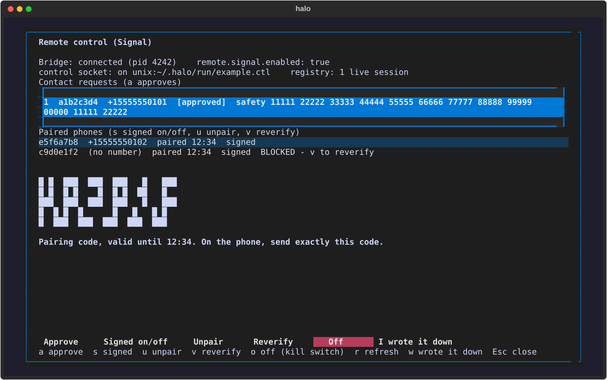

# Remote control

Halo 2.0.9 adds remote control of a running session. This page covers the
per-session **control socket**, the **sessions registry**, and the **Signal
bridge** that sits on top of them (pairing a phone, relaying prompts and
permission cards), then how to set it up (`halo remote signal ...`, the TUI
`/remote` dialog and status chip, `halo doctor`) and how to check it live.

Contents: [the control socket](#what-the-control-socket-is) |
[the Signal bridge](#the-signal-bridge) (threat model, setting up, pairing,
signing, chat commands) | [running it](#running-the-bridge) |
[the TUI](#in-the-tui-remote-and-the-status-chip) |
[command line](#command-line-reference) | [doctor](#doctor) |
[live verification](#live-verification) | [config keys](#config-keys)

## What the control socket is

With `remote.enabled` set, every interactive `halo` session and every
`halo -p` run (including `--bg` runs, which re-run the same invocation)
opens one local socket and lists itself in the registry. A program that can
reach that socket can do what the keyboard does: send a prompt (or steer the
turn in flight), interrupt, switch mode / model / effort, run a slash
command, answer a permission card, a question, a plan review or an approval
gate, read the status, read the tail of the conversation, and watch the
session's events as they happen. It is the same set of calls the TUI itself
makes on the `Controller`; the socket never injects raw commands into the
agent loop.

Off by default. Turn it on with:

```sh
halo config set remote.enabled true
```

It takes effect for sessions started afterwards. In the TUI, `/remote` says
whether this session's socket is on (and where) and how many live sessions
the registry holds.

## Where it listens

| Platform | Endpoint | Auth |
|---|---|---|
| Linux / macOS | Unix socket `~/.halo/run/<session_id>.ctl`, mode 0600, directory 0700 | the file mode |
| Windows | loopback TCP `127.0.0.1:<port>` (OS-assigned) | a random 16-byte hex token; the first line of a connection must be `{"token": "..."}` within 5 seconds or the connection is closed. Connections still in that handshake sit in a separate pool of 16 (the oldest is closed for a new one) and only authenticated ones count against the 32 slots; at most 16 connections hold an event feed |

Nothing ever listens on a non-loopback address. The token is never logged or
printed by `halo remote sessions`; on Windows it is stored in the registry
entry (a 0600 file in your own state directory).

An endpoint is written as `unix:<path>` or `tcp:127.0.0.1:<port>`.

## The wire

One JSON object per line, both ways.

```
request   {"id": 1, "cmd": "submit", "text": "run the tests"}
response  {"id": 1, "ok": true,  "result": {"steered": false}}
          {"id": 1, "ok": false, "error": "empty prompt"}
event     {"event": "permission_request", "data": {...}, "turn": 3, "agent_id": null, "ts": 1791699334.1}
```

| `cmd` | Fields | Result |
|---|---|---|
| `ping` | | `{pong, session_id}` |
| `status` | | the status payload (phase, model, context, cost, `permission_mode`, effort), plus `session_id`, `cwd`, `title`, `busy`, `kind` (`tui` or `print`), `pid`, and `pending` (the ids of unanswered permission / question / plan / approval cards) |
| `submit`, `steer` | `text` | `{steered}`; while a turn runs the text steers it, otherwise it starts the next turn. In `halo -p` the next turn is queued only for `--input-format stream-json` runs |
| `interrupt` | | `{interrupted}` |
| `answer` | `kind` = `permission`, `request_id`, `action` (`allow` / `deny`), optional `scope` (`once` / `session` / `always`), `message`, `rule` | `{resolved}`. With `allow`, `session` / `always` learn the card's suggested rule (or `rule`), as the TUI's buttons do; a `deny` learns nothing whatever its `scope` |
| `answer` | `kind` = `question`, `request_id`, `answer` | `{resolved}` |
| `answer` | `kind` = `plan`, `approved`, optional `feedback`, `mode_after` | `{resolved}` |
| `answer` | `kind` = `approval`, `request_id`, `action` (`accept` / `edit` / `stop`), optional `instruction` | `{resolved}` |
| `mode` | `mode` | `{mode}` |
| `model` | `ref` | `{model}`; an unresolvable ref is `ok: false` with the resolver's sentence |
| `effort` | `level` | `{effort, message}` |
| `slash` | `name` and `args`, or `line` (`"/cost"`) | `{output}` |
| `tail` | `n` (default 20, at most 200) | `{markdown}`: the last n user / assistant messages |
| `subscribe` | optional `kinds` (a list; default all) | `{subscribed: true}`; event frames follow on this connection |
| `unsubscribe` | | `{subscribed: false}` |
| `note` | `name` = `remote.attached`, `peer` (an id prefix), `attached` (true or false) | `{attached: <count>}`; the Signal bridge announcing that a phone attached or detached (drives the status chip). A connection that closes takes its phones with it |

An `answer` for a card that is no longer waiting is `ok: false`. A request
that is not valid JSON gets `{"id": null, "ok": false, "error": "invalid JSON"}`
and the connection stays open.

Several clients may connect at once; a subscription belongs to its
connection. Commands that arrive over the socket show up in the TUI transcript
as a `(remote) ...` note, never as a message typed by you.

## The event feed

After `subscribe`, a connection receives the session's events (the kinds in
`halo_harness/events.py`, payloads untouched) as they are produced, with two
changes: consecutive `text_delta`s are merged into one `text_chunk` frame
(`{"event": "text_chunk", "data": {"text": ...}}`) every 2 seconds or 1800
bytes, flushed early whenever another event arrives so order is kept, and
`thinking_delta` is not sent. The feed is a copy taken where the session emits
events; the TUI's own queue is untouched.

Each subscriber has a queue of 256 frames. A client that stops reading is
dropped (its connection is closed) when the queue fills; the session and the
other clients carry on.

## The sessions registry

`~/.halo/run/sessions.json` lists the live sessions that opened a control
socket:

```json
{"version": 1, "sessions": [
  {"session_id": "...", "cwd": "...", "pid": 1234, "endpoint": "unix:<state dir>/run/<session_id>.ctl",
   "token_env": null, "started": 1791699000.0, "title": "Fix the flaky test", "mode": "default", "kind": "tui"}
]}
```

It is written atomically (temp file and replace, under a best-effort lock),
the title follows the session's auto-title or `/rename`, and `mode` follows
mode changes. Entries whose process is gone or whose endpoint refuses a
connection are dropped the next time anything lists the registry, and a
session removes its own entry when it quits (every quit path, including the
Ctrl+C card, plus a process-exit hook for a crash).

```sh
halo remote sessions
```

lists the live sessions (id prefix, pid, kind, mode, age, cwd, endpoint,
title). `halo_harness.remote.client.ControlClient` is a small stdlib client
for scripts and tests.

## The Signal bridge

The bridge is a daemon (`halo_harness.remote.bridge`) that sits between
Signal and the control sockets above. It runs `signal-cli` as a child process
(`signal-cli -a ACCOUNT --trust-new-identities never --scrub-log -d
~/.halo/remote/signal-cli jsonRpc ...`, newline JSON-RPC over stdio: no port,
no socket file), reads what the paired phone sends, and drives the attached
session with it. It relays the session's answers, permission cards,
questions and plan reviews back to the phone. Set it up with `halo remote
signal ...` or the TUI `/remote` dialog (both below).

Two things are fixed by how signal-cli works. Messages are end-to-end
encrypted between the phone and the Halo number; a stranger's first message
cannot be decrypted under `--trust-new-identities never`, which is what makes
the contact-request pairing below possible. The bridge answers nobody it has
not paired.

### Threat model

The bridge lets a phone do what the keyboard does, so it is built in six
layers. Each one is listed with what it stops and what it does not.

| # | Layer | Stops | Does not stop |
|---|---|---|---|
| 1 | **Signal's end-to-end encryption** between the phone and the Halo number (forward secrecy; the Halo side runs signal-cli) | anyone watching the network, Signal's servers reading message text | a compromised phone or computer; the traffic still crosses Signal's servers and the Halo number is registered with Signal |
| 2 | **Pairing and identity pinning**: a stranger is never answered; its contact request needs your approval on the computer, then a one-time code typed on the phone; the peer is pinned on its Signal account id (ACI), not its phone number, with the safety number recorded | a stranger who only knows the number; a swapped or reinstalled phone (the safety number changes and the peer is blocked until you `reverify`) | someone sitting at your unlocked computer during the pairing window; an owner who approves the wrong request, so compare the safety number on the phone |
| 3 | **Command signing**: every command after pairing ends `#<counter>:<mac>`, an HMAC only the paired phone can make, with a strictly rising counter and a 5-minute window | a device someone else linked to your Signal account (it shares your ACI but not the signing secret); a replayed or delayed message; a thief with the phone unlocked but not the secret | anyone holding both the phone and the secret; a compromised computer, where the secret is stored; it does not hide content (layer 1 does) |
| 4 | **At rest**: `~/.halo/remote/` is 0700 and its files 0600; the bridge keeps no message text (the audit line is `sha256` of the command, 16 hex characters); signal-cli runs with `--scrub-log` and its stderr is discarded; a downloaded attachment is deleted as soon as it is read; long replies go out as a `data:` attachment, never a file | another account on the same machine reading your files; a log or backup that leaks conversation text | root, or anyone who can read your account's files (signal-cli's data directory holds the Signal keys, and the signing secret sits in `peers.json`); there is no OS keyring in this release |
| 5 | **The local control socket**: a Unix socket in a 0700 directory with mode 0600, or on Windows loopback TCP plus a random 16-byte token; nothing listens on a non-loopback address | another machine, or another user on the same machine | another process running as you, which can already do what you do |
| 6 | **Rate limiting and the kill switch**: `remote.rate_per_minute` commands per peer per minute (30), spent only by commands that passed the signature check (unsigned or bad-MAC messages have their own stricter counter, so they cannot lock the real phone out), and `halo remote signal off` / `/remote` Off | a paired phone that floods the session; a bridge you want gone now | an authenticated owner. There is no content filter anywhere: a paired, signed phone can do everything the keyboard can, including answering a permission card with `3` (always allow) |

Treat a paired phone like your keyboard. Unpair a phone you lose
(`halo remote signal unpair <id>` on the computer, or `/remote unpair` from
the phone itself); the signing secret is deleted with the pairing.

### Setting up

`halo remote signal setup` asks which identity model you want, finds or
downloads the pinned signal-cli (**0.14.9**, released 2026-10-07), and writes
`~/.halo/remote/signal.json`. Nothing is installed system-wide, and nothing is
downloaded without a yes (`--yes` answers it).

**Two identity models**

| | Dedicated number (recommended) | Linked device |
|---|---|---|
| What Halo is | its own Signal account on a number of its own | a secondary device of your Signal account |
| You message it from | your normal Signal, to the Halo number | "Note to Self" on your own account |
| Needs | a number that can receive one SMS or voice call: a second SIM or eSIM (a VoIP number may or may not work; untested) | nothing beyond your phone |
| Setup | `setup`, then `register`, then `run`, then `pair` | `setup`, then `link` (scan the QR code), then `run`, then `pair` |
| What it sees | only messages sent to the Halo number | your account's whole message stream; Halo keeps only your own Note-to-Self messages, drops everything else unread and never stores it |
| Watch out | Registering a number deactivates it on any phone that held it; keep the registration-lock PIN | linked devices share your account id, so command signing is the layer that tells you from anyone who links another device to your account; leave it on |

Dedicated number, step by step:

```sh
halo remote signal setup --model dedicated --yes
halo remote signal register +15555550123        # prints the captcha page to open
halo remote signal register +15555550123 --captcha 'signalcaptcha://...'
halo remote signal register +15555550123 --code 123456
halo config set remote.enabled true             # sessions open a control socket
halo remote signal run                          # the bridge, in its own terminal
```

`register` prints `https://signalcaptchas.org/registration/generate.html`;
solve the captcha in a browser on the same network and pass the
`signalcaptcha://` link it ends in. Signal then sends an SMS; `--code` completes
the registration and sets a **registration-lock PIN** (8 digits, kept in
`~/.halo/remote/registration-pin`, mode 0600; keep a copy elsewhere, because a
forgotten PIN can lock the number for up to 7 days). `--voice` asks for a call
instead, and only works after an SMS was requested for that number. A Signal
rate limit (`-5`) prints `retryAfterSeconds`; wait that long.

The registration-lock PIN does not go on a command line: `setPin` (and `verify
--pin`, when your signal-cli offers it over JSON-RPC) is sent through a
short-lived `signal-cli jsonRpc` child's stdin, so it never shows in `ps`.
signal-cli 0.14.9 has no JSON-RPC `verify`, so for a number that already has a
lock `--pin` is passed to `verify` as an argument as a last resort, and the
command tells you that the PIN is visible to other local accounts for that one
call. The SMS code itself is single-use and short-lived and stays on argv.

Linked device, step by step:

```sh
halo remote signal setup --model linked --yes
halo remote signal link          # prints sgnl://linkdevice?... and a QR code
```

In Signal on the phone: Settings, Linked devices, Link new device, scan. When
signal-cli reports the account, Halo stores it (and your account id as
`own_aci`, when signal-cli offers it) in `signal.json`.

**Per OS**

| Host | signal-cli build | Needs | Notes |
|---|---|---|---|
| Linux x86-64 (Kali, Debian, Ubuntu) | native tarball (`...-Linux-native.tar.gz`) | nothing else | the default path; service: systemd user unit |
| Linux arm64 | none from upstream | JRE 25 and a libsignal library you supply | not set up automatically; see signal-cli's wiki |
| Windows x86-64 | JVM tarball (`bin/signal-cli.bat`) | JRE 25 | Halo's Python has no Unix sockets there, so the default `stdio` transport (Halo starts signal-cli itself) is the one to use; for a separately running signal-cli use `"transport": "tcp"` and `"tcp": "127.0.0.1:7583"` in `signal.json`, never `--socket`; service: Task Scheduler |
| macOS (Intel or Apple silicon) | JVM tarball | JRE 25 | service: launchd |

The JVM build is picked automatically wherever the native one does not exist;
`setup --jvm` forces it on Linux x86-64. If `java -version` is older than 25,
setup says so and `halo doctor` keeps warning until it is fixed.

What setup verifies, in this order. (1) The SHA-256 of the downloaded archive
against the digest pinned in `halo_harness/remote/signal_install.py` for that
exact asset (the digests GitHub publishes for the 0.14.9 release); a mismatch,
or an asset with no pinned digest, stops the install and deletes the download
before anything is unpacked. (2) The unpacking: device, FIFO, link, absolute
and `..` members are rejected. (3) When `gpg` is installed and the release
key's fingerprint is pinned (`RELEASE_KEY_FINGERPRINT`, empty until you fill it
in from a source you trust), the `.asc` must be a good signature made by that
exact key; a good signature by any other key, or a BAD one, stops the install.
While the fingerprint is empty gpg is not consulted and the result reads
`digest-only`. Halo never downloads or imports a key.

**A VM behind a proxy.** signal-cli has no proxy flag; it asks the JVM for the
proxy that applies to an `https://` URL. Use the JVM build (`setup --jvm`; the
native build was not tested with these properties) and give the JVM its proxy
through the environment:

```sh
export JAVA_TOOL_OPTIONS="-Dhttps.proxyHost=proxy.example.invalid -Dhttps.proxyPort=3128"
# SOCKS instead: -DsocksProxyHost=... -DsocksProxyPort=...  (no proxy credentials)
halo remote signal run
```

The proxy must allow `chat.signal.org`, `cdn.signal.org`, `cdn2.signal.org`,
`cdn3.signal.org`, `storage.signal.org`, `cdsi.signal.org` and `svr2.signal.org`
on TCP 443, and must pass WebSockets. No inbound port is needed. `halo doctor`
lists these hosts when a proxy is configured, and the service files carry
`JAVA_TOOL_OPTIONS` from the environment that wrote them.

### signal.json

`~/.halo/remote/signal.json` holds the signal-cli settings (written by the
setup command; every key is optional except `account`):

| Key | Default | Meaning |
|---|---|---|
| `binary` | `signal-cli` | path of signal-cli, or a list of argv words that start it |
| `account` | | the account signal-cli runs as (a number, or an ACI for a numberless linked account) |
| `identity_model` | `dedicated` | `dedicated` (a number of its own) or `linked` (a secondary device of your account, driven through Note to Self) |
| `own_aci` | | the account's own ACI; required for `linked` |
| `transport` | `stdio` | `stdio` (spawn `signal-cli jsonRpc`), `socket` (client of `daemon --socket`, POSIX) or `tcp` (client of `daemon --tcp 127.0.0.1:PORT`) |
| `socket`, `tcp` | | the daemon endpoint for those two transports |
| `receive_mode` | `manual` | `manual` (the bridge calls `subscribeReceive`, so messages wait on Signal's server while it is down; a refused call is retried a few times, then the bridge reads `starting` and leaves a notice naming signal-cli's error, and no reply at all reconnects), `on-start` or `on-connection` |
| `data_dir` | `~/.halo/remote/signal-cli` | signal-cli's `-d` directory |
| `extra_args` | `[]` | more global flags, placed before the subcommand |

If signal-cli exits, or answers a request with a network error (`-3`), the
bridge respawns or reconnects it with a growing delay (1, 2, 4, 8, 15, 30 s).
Other signal-cli errors are told apart by their JSON-RPC code, never by their
text: `-4` an untrusted or changed key (the peer is blocked, below), `-5` a
server rate limit (sending pauses for `retryAfterSeconds` and the captcha
token is shown to you as a notice), `-1` a user error, `-6` a rejected captcha.

### How pairing works

Pairing is a contact request that you approve on the computer, followed by a
one-time code typed on the phone. Nobody is answered before it finishes.

1. On the phone, open a chat with the Halo number and send any message
   (for example `hi`). Nothing comes back; that is expected.
2. On the computer, the bridge shows a contact request: the sender's ACI
   (and number, when Signal gave one) and the safety number signal-cli holds
   for that key. Compare the safety number with the one on your phone
   (Signal: the chat's name, then View safety number).
3. Approve the request on the computer. The bridge then tells signal-cli to
   trust that key with exactly that safety number, and shows you a six-digit
   code that is good for ten minutes.
4. On the phone, send that code as the next message, nothing else. The
   bridge replies once with "Paired. Your signing phrase is on the Halo screen."
   and nothing else: the 32-word signing phrase and the `halo-remote://pair?...`
   link (see Signing) are shown only on the computer, never in the chat. The
   phone is now stored in `peers.json` under its ACI.

Chatter before the code is ignored. Three wrong six-digit codes, or ten
minutes, drop the request, and a new message starts a new one. In `linked`
mode the "phone" is your own account writing to Note to Self; the trust step
is skipped and only that conversation is read.

If a paired phone's safety number changes (a new phone, a reinstall), signal-cli reports an untrusted
identity. The bridge marks the peer blocked, tells you, and ignores its
messages until you confirm the new safety number with `reverify`. A peer is
removed with `unpair` (from the computer, or `/remote unpair` from the
phone). Each peer may send `remote.rate_per_minute` commands a minute
(default 30); over that, commands are dropped and the phone is told once. The
limit counts only commands that passed the signature check; messages that fail
it (unsigned, bad MAC, stale, replayed) have their own counter of at most 10 a
minute, after which they are dropped with one notice and not audited line by
line. Pending contact requests are capped at 32 (the oldest unapproved one is
dropped for a new one).

### Pairing walkthrough

With the bridge running (`halo remote signal run`) and `remote.enabled` on:

1. **On the phone**, open a chat with the Halo number and send any message,
   for example `hi`. Nothing comes back; that is expected.
2. **On the computer**, either run `halo remote signal pair` or open `/remote`
   in the TUI. Both list the contact request with the sender's ACI prefix, its
   number when Signal gave one, and the **safety number** signal-cli holds for
   that key.
3. **Compare the safety number** with the phone (Signal: the chat's name, then
   View safety number). If it differs, do not approve.
4. **Approve**: `halo remote signal pair --approve 1` or press `a` in the
   dialog. The bridge tells signal-cli to trust that key with exactly that
   safety number, and a six-digit code is shown (large, in the dialog), valid
   for ten minutes (`remote.pair_code_ttl_s`).
5. **On the phone**, send the code as the next message, nothing else. The
   bridge replies once with "Paired. Your signing phrase is on the Halo screen."
   The computer shows the 32-word phrase and the `halo-remote://pair?...` link
   (the CLI also draws the link as a QR code; the dialog keeps it until you
   press `w`, "I wrote it down"). The chat never carries the secret, so a device
   someone links to your account later cannot read it from the history.
6. **Set up the signing app on the phone** with the phrase or link (any
   HMAC-SHA256 tool works; see Signing), and send `/status #1:<mac>` as the
   first command.



The dialog above shows what step 4 looks like: the bridge state and the
control-socket line at the top, the open contact requests and the paired
phones as two lists, the pairing code, and the keys along the bottom.

### Signing

After pairing, every command carries a signature that only your phone can
make. The bridge creates a random 256-bit secret per peer and shows it once on
the computer, as a link and as 32 words (one of 256 words per byte;
`phrase_to_secret` reverses it and accepts exactly 32 words, and the link
parser exactly 64 hex characters; anything else is an error, never a short
key). A command is the text, a space, and `#<counter>:<mac>`:

```
/status #1:9ef2aa6c
```

* `mac` is the first 8 lowercase hex characters of `HMAC-SHA256(key = the 32
  secret bytes, data = UTF-8 of "<counter>|<text>")`. `<counter>` is a
  decimal number with no leading zeros and `<text>` is the command exactly as
  typed, without the trailer or the space before it.
* The counter must be strictly greater than the last accepted one (gaps are
  fine), and the message's own timestamp must be within 5 minutes
  (`remote.stale_window_s`) of the computer's clock. A repeat or a lower
  counter is refused with a notice. A correctly signed command that arrives
  outside the window is refused too and DOES use up its counter (the
  timestamp is not part of the MAC, so the same bytes re-sent later would
  otherwise pass): sign it again with a higher counter. A message whose
  signature does not match uses up nothing.
* Any HMAC tool on the phone can compute it. Worked example (a test vector,
  never a real secret): with the secret bytes `00 01 02 ... 1f`
  (hex `000102030405060708090a0b0c0d0e0f101112131415161718191a1b1c1d1e1f`),
  `/status` with counter 1 signs as `/status #1:9ef2aa6c`, and
  `run the tests` with counter 7 as `run the tests #7:e3173adf`.
* `signed: false` on a peer in `peers.json` turns the check off for that
  peer, leaving the pairing and the Signal encryption in place. It is the only
  unsigned path: a peer that is `signed: true` (the default) but whose stored
  secret is missing or not 64 hex characters refuses every command with a
  "pair it again" notice (and a notice on the computer); it is never checked
  against an empty key.

### Chat commands

A permission card on the phone shows the whole command the model wrote (spacing
and newlines kept; a very long one goes out as its own message or attachment,
then the choices follow) and labels `3` with the exact rule it will write, for
example `3 always allow (saves rule: Bash(sudo:*))`, or says that nothing is
saved when no rule was suggested.

Plain text is a prompt (or a steer while a turn is running). The first
command attaches the most recently started live session.

| Message | What it does |
|---|---|
| `/sessions` | numbered live sessions (title, folder, phase); `*` marks the attached one |
| `/attach <n>` | attach session number n |
| `/status` | model, mode, effort, context, cost, cards waiting on you |
| `/stop` | interrupt the running turn |
| `/mode <name>`, `/model <ref>`, `/effort <level>` | switch them in the attached session |
| `/quiet`, `/loud` | relay only cards, errors and the closing line / also the session's text |
| `/tail <n>` | the last n messages of the conversation |
| `/remote pair`, `/remote unpair`, `/remote status` | add another phone (instructions), remove this phone, show this pairing |
| any other `/x` | run as a Halo slash command in the session |

While a card is open: permission `1` allow once, `2` allow for the session,
`3` always allow, `4` deny (`4 <reason>` tells the model why); a question is
answered with its letter (`b`, or `a,c`) or by typing the answer; a plan
review with `approve` or `feedback <notes>`; an approval gate with `accept`,
`edit <instruction>` or `stop`. Replies are plain text: Markdown is flattened,
code keeps its lines and is marked monospace, a message holds at most 1800
bytes (long output is split on spaces), and an answer longer than four
messages arrives as one short message plus `reply.txt`. A running turn shows
Signal's typing indicator, and each finished turn ends with a `Done.` line
carrying the cost. A long prompt typed on the phone arrives as an attachment;
the bridge reads it, then deletes the downloaded file.

### What is stored where

All under `~/.halo/remote/` (directory 0700, files 0600):

| File | Holds |
|---|---|
| `signal.json` | the signal-cli settings above |
| `signal-cli/` | signal-cli's own data (keys, account database) |
| `peers.json` | per paired phone: ACI, number, safety number, paired time, signing secret and counter, `signed`, blocked state |
| `pending.json` | open contact requests (the pairing code only as a salted hash), queued trust steps, notices for the computer |
| `bridge.json`, `stop` | the bridge's pulse (pid, the process's start record so a reused pid never reads as a running bridge, state) and the stop file `off` creates |
| `registration-pin`, `register.json` | the registration-lock PIN of the dedicated number (0600); the last SMS request (number and time) so `--voice` knows one happened |
| `signal-cli/dist/<version>/` | the signal-cli build `setup` downloaded (beside signal-cli's own `data/`) |
| `halo-remote.service`, `dev.halo.remote.plist`, `halo-remote-task.xml` | service-manager files written by `run --daemon` (never enabled by Halo) |
| `audit.jsonl` | one line per command (and per pairing-code attempt: paired, wrong, dropped or expired, the code itself never kept; and per refused `subscribeReceive`): time, the first 8 characters of the ACI, `sha256("<aci>\|<counter>\|<text>")` truncated to 16 hex, kind and outcome; rotates at 5 MB into `audit.jsonl.1` (one previous file is kept) |

No message text, reply or attachment is written by the bridge, logged, or
kept: the audit hash cannot be reversed, `signal-cli` runs with `--scrub-log`
and its stderr is discarded, replies leave as a `data:` URI attachment rather
than a file, and a downloaded attachment is deleted as soon as it is read.

## Running the bridge

`halo remote signal run` runs the bridge in the foreground; Ctrl+C stops it.
A second copy is not started: if a bridge is already running the command
names its pid. It writes a small pulse file (`~/.halo/remote/bridge.json`:
pid, start time, state `starting`, `connected` or `rate-limited`, and the end
of a rate-limit pause), which is what `status`, `/remote` and `halo doctor`
read. A pulse whose pid now belongs to another process (the bridge was
killed, or the machine rebooted) reads as stopped, so `run` starts again. It does nothing while `remote.signal.enabled` is false; `setup` sets it
to true, `halo remote signal off` sets it to false, `halo remote signal on`
sets it back.

**As a service.** `halo remote signal run --daemon` writes one file for the OS
you are on under `~/.halo/remote/` and prints the one command that enables it.
Halo never enables it itself. `--os linux|macos|windows` writes the file for
another OS.

| OS | File | Enable it with |
|---|---|---|
| Linux | `halo-remote.service` (systemd user unit, `Restart=on-failure`) | `systemctl --user link ~/.halo/remote/halo-remote.service && systemctl --user enable --now halo-remote.service` |
| macOS | `dev.halo.remote.plist` (launchd agent, `RunAtLoad`, restart on failure only: `KeepAlive` with `SuccessfulExit` false) | `launchctl bootstrap gui/$(id -u) ~/.halo/remote/dev.halo.remote.plist` |
| Windows | `halo-remote-task.xml` (Task Scheduler, at logon) | `schtasks /Create /TN "Halo Remote" /XML "%USERPROFILE%\.halo\remote\halo-remote-task.xml"` |

The command runs `halo remote signal run` (the `halo` on your PATH, else this
Python with `-m halo_harness`); the bridge starts signal-cli itself over stdio,
so there is no second service. A separately managed signal-cli daemon
(`"transport": "socket"` or `"tcp"` in `signal.json`) is also supported when
you want signal-cli to outlive the bridge; start that daemon with `-a <account>`
(the bridge names the account in `subscribeReceive`, which a multi-account
daemon requires). Under a service manager, signal-cli's own output is discarded.

**The kill switch.** `halo remote signal off` (or `o` in the `/remote` dialog)
creates `~/.halo/remote/stop`, which a running bridge polls about four times a
second; the bridge detaches every phone and exits, and the command waits a few
seconds for it. It also sets `remote.signal.enabled` to false so a service
manager does not bring it back: all three service files restart the bridge
only when it fails, and a clean exit stays down. After `halo remote signal on`,
start the service copy again yourself (`systemctl --user start halo-remote`,
`launchctl kickstart -k gui/$(id -u)/dev.halo.remote`, or the Task Scheduler
task); `launchctl bootout gui/$(id -u)/dev.halo.remote` removes the macOS agent.
A run that finds no account, or a bridge already running, exits 1, so a
service manager retries it on its own schedule until that changes. Nothing else on your machine is touched: sessions
keep their control sockets (turn those off with `remote.enabled`).

## In the TUI: `/remote` and the status chip

Bare `/remote` opens the dialog (see the screenshot above). The bridge is never
started inside the TUI process: the dialog shows its state (`off`, `starting`,
`connected`, `rate-limited` or `stopped`) and, when it is not running, tells you
to run `halo remote signal run` in another terminal. Everything the dialog does
to files runs on a worker thread.

| Key | Does |
|---|---|
| `a` | approve the highlighted contact request; shows the one-time code large, then (once the phone has sent it) the signing phrase and link |
| `s` | turn command signing on or off for the highlighted phone |
| `u` | unpair the highlighted phone |
| `v` | reverify it (trust its new safety number) |
| `o` | Off: stop the bridge and set `remote.signal.enabled` to false |
| `r` | refresh (it also refreshes every two seconds) |
| `w` | "I wrote it down": hides the signing phrase, which is shown once |
| Tab | switch between the two lists |
| Esc | close (while the phrase is showing, the first Esc reminds you of `w`) |

The same actions exist as buttons. The argument forms print text in the
transcript instead of opening the dialog:

| Command | Does |
|---|---|
| `/remote status` | the control-socket line, the bridge state, the paired phones |
| `/remote pair` | list the contact requests with their safety numbers |
| `/remote pair <N>` | approve request N and print the one-time code |
| `/remote off` | the kill switch |

The bridge's notices (a changed safety number, a Signal rate limit with its
captcha token, an expired pairing code, a failed trust step) are shown as TUI
notifications and cleared, whether or not the dialog is open (checked every
five seconds while `remote.enabled` is on).

**The status chip.** While a phone is attached to *this* session the status bar
shows `⇄ remote 1` (`<> remote 1` where the terminal has no truecolor), with the
number of attached phones; the three game skins (`/doom`, `/metroid`, `/mario`)
carry it in their ticker as the `remote` slot. The bridge announces an attach
or detach with the control socket's `note` command (below); a bridge that dies
takes its phones with it, because the session forgets a connection's phones
when it closes. Commands from the phone appear in the transcript tagged
`(remote)`.

## Command line reference

Every verb takes `--json` (one JSON object on stdout; no secrets in it except
the pairing code and, once paired, the signing phrase and link that `pair
--approve` exists to show). Exit codes: 0 done, 1 could not do it (the reason is
on stderr, or in the JSON), 2 usage.

| Verb | Does |
|---|---|
| `halo remote sessions` | live sessions that opened a control socket |
| `halo remote signal setup [--model dedicated\|linked] [--yes] [--no-download] [--binary PATH] [--jvm]` | choose the model; find or download signal-cli 0.14.9; write `signal.json`; set `remote.signal.enabled` |
| `halo remote signal register <number> [--captcha TOKEN] [--voice] [--code CODE] [--pin PIN]` | register the dedicated number (captcha, SMS or voice, code, registration lock) |
| `halo remote signal link [--name NAME] [--ascii] [--timeout S]` | link as a device of your account: prints the `sgnl://linkdevice` URI and a QR code |
| `halo remote signal run [--daemon] [--os NAME]` | run the bridge; `--daemon` writes the service file and prints the enable command |
| `halo remote signal pair [--approve N] [--wait S] [--ascii]` | list contact requests and notices; approve one, print the code, and (waiting up to `--wait` seconds, default 600) show the phrase, link and QR once the phone has paired |
| `halo remote signal peers` | paired phones: ACI prefix, number, paired time, signed, blocked |
| `halo remote signal unpair <aci-prefix>` | remove a phone and its secret |
| `halo remote signal reverify <aci-prefix>` | trust a blocked phone's new safety number |
| `halo remote signal status` | bridge pid and state, signal-cli version vs the pin, account, phones, last command time |
| `halo remote signal off` / `on` | stop the bridge and disable it / enable it |

`<aci-prefix>` is the first characters of the id that `peers` prints (unique
prefix). QR codes are drawn with half-block characters and fall back to `#`
automatically on a terminal that cannot show them (`--ascii` forces it).
Completion (`halo completion bash|zsh|powershell`) offers every verb.

**The control socket's `note` command.** One line was added to the wire this
round: `{"cmd": "note", "name": "remote.attached", "peer": "<id prefix>",
"attached": true}` tells the session a phone attached or detached
(`{"ok": true, "result": {"attached": <count>}}`). The `status` payload gained
`remote_attached`, the count. Any other note name is an error.

## Doctor

`halo doctor` (and `/doctor`, `halo doctor --json`) gain these checks, in the
same `[OK]` / `[WARN]` vocabulary with a `-> fix:` or `-> see:` ending:

| id | Checks |
|---|---|
| `remote` | `remote.enabled` and the number of live sessions in the registry; one quiet line when remote control is not in use |
| `remote_bridge` | the bridge's state and pid, `remote.signal.enabled` |
| `remote_signal_cli` | signal-cli present and runnable; its version against the 0.14.9 pin; a **warning at 90 days** from the pinned release date (2026-10-07), since builds older than about three months can stop working |
| `remote_jre` | a JRE 25 or newer, only when the JVM build is in use |
| `remote_dir` | `~/.halo/remote/` is 0700 and its files 0600 (not checked on Windows) |
| `remote_egress` | only when a proxy is configured: the seven `*.signal.org` hosts to allow, and that the JVM build needs `JAVA_TOOL_OPTIONS` |

Doctor writes nothing: it does not create `~/.halo/remote/` or prune the
registry. `halo preflight` is unchanged.

## Live verification

The tests drive a fake signal-cli, so the first run with a real number is the
real check. With a dedicated test number (or a linked test account), in this
order:

1. `halo config set remote.enabled true`, then start `halo` in a project
   folder (the session that will be controlled) and leave it idle.
2. In a second terminal: `halo remote signal setup --yes`, then `register` (or
   `link`), then `halo remote signal run`. `halo remote signal status` should
   say `connected`, and `halo doctor` should show the remote checks green.
3. **Pair from the phone**: message the Halo number, approve the request
   (`halo remote signal pair --approve 1` or `/remote`, `a`) after comparing
   the safety number, send the six-digit code, and receive `Paired.` with the
   phrase. The TUI should not freeze while you do this.
4. Send `/sessions` (signed: `/sessions #1:<mac>`). The TUI session is listed.
5. `/attach 1`. The status bar shows `⇄ remote 1`.
6. Send a short prompt. The reply streams back as messages, with the typing
   indicator while the turn runs and a `Done.` line with the cost at the end;
   the prompt appears in the TUI transcript tagged `(remote)`.
7. Ask for something that needs permission (for example a shell command).
   The phone gets a numbered card; answer `1`. The session continues.
8. Start a long turn and send `/stop`. The turn is interrupted.
9. `halo remote signal unpair <aci-prefix>`. The phone is ignored from then on
   and the chip is gone.
10. **A second phone** (or another Signal account) messages the Halo number:
    nothing is ever sent back. It appears only as a contact request on the
    computer.
11. `halo remote signal off`: the bridge exits, `status` says `stopped`.

**Confirm on the first live run.** These came out of
[docs/harness/SIGNAL-RESEARCH.md](harness/SIGNAL-RESEARCH.md) as unresolved,
and the code is written to cope with either answer:

- *Redelivery after `trust`.* Does the first message from a new contact arrive
  again once the bridge has trusted the key? The code does not depend on it
  (the phone sends the code as the next message).
- *Messages while the bridge is down.* With `receive_mode: manual` messages
  should wait on Signal's server until the bridge subscribes; if they are
  dropped instead, commands sent while the bridge was down are lost (the
  5-minute window would reject stale ones anyway).
- *Typing and read receipts to Note to Self* (linked mode): whether they show
  on your own phone.
- *A VoIP number.* Whether the dedicated number registers at all; the
  registration attempt is the test.
- *Attachment size limits* above 100 MB, and the native binary honouring the
  JVM proxy properties; neither matters until you hit them.
- *`listAccounts` in 0.14.9* naming your account id, which `link` uses for
  `own_aci`; if it does not, add `"own_aci"` to `signal.json` by hand.
- *The download itself:* the archive is checked against a pinned SHA-256
  before it is unpacked (see "What setup verifies"). The GPG key for the `.asc`
  is not shipped with Halo and its fingerprint is not pinned yet, so gpg adds
  nothing until you fill in `RELEASE_KEY_FINGERPRINT` and import that key
  yourself.

## Config keys

| Key | Default | Meaning |
|---|---|---|
| `remote.enabled` | `false` | open a control socket and registry entry for each session |
| `remote.signal.enabled` | `false` | whether the Signal bridge may run: `setup` and `halo remote signal on` set it to true, `off` (or `o` in `/remote`) to false; `run` does nothing while it is false |
| `remote.rate_per_minute` | `30` | commands per minute per paired phone; over it the bridge drops them and tells the phone once |
| `remote.verbosity` | `loud` | what a newly attached phone is sent: `loud` (the session's text, cards, errors) or `quiet` (cards, errors, the closing line); `/quiet` and `/loud` change it per phone |
| `remote.stale_window_s` | `300` | a signed command whose message timestamp is further than this from the computer's clock is refused |
| `remote.pair_code_ttl_s` | `600` | how long the one-time pairing code stays valid |
