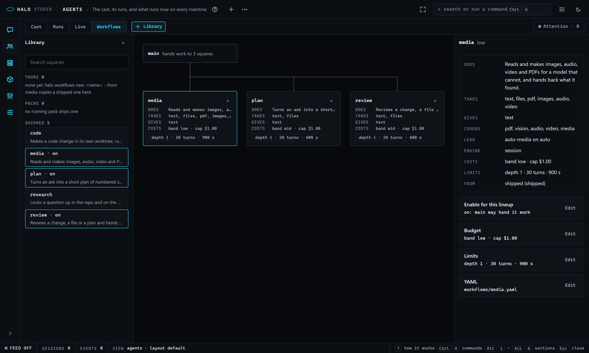

# Studio: Agents

Read this when you work with your agents in Studio's Agents section: the lineup and its bios (Cast), what runs now and what ran (Live, a goal run on it, History), the board of squares (Workflows), and the doors the old Team, Roles, Orchestra, Runs and Fleet left.

Part of [Halo Studio](STUDIO.md), which lists every part.

## One section, its views (3.3.16.0 R1; 3.4.0.0 D: Runs went)

The owner, 2026-11-09: "what does teams even give us? ... roles and orchestration are almost the same ... all rolled
into the new agents". Team, Roles and Orchestra are one Studio section, **Agents** (`Alt+2`, "The cast, what runs now on
every machine (a goal run too), and what ran"), with its views on one switch, first on its bar:

| View | Key | What it is | It was |
|---|---|---|---|
| **Cast** | `C` | the lineup and its bios: the canvas with its tiers, Lineups, Bios, the Inspector (Assignment, Lineup), Problems, Models; the model picker, the glow and its legend, drop and sync (3.4.1.0: replay moved to Live's scrubber) | Roles |
| **Live** | `L` | what runs now and nothing past (3.3.18.0, [STUDIO-live.md](STUDIO-live.md): History, the plan under it, what waits, the zoom levels; 3.4.1.0 the scrubber under the canvas takes it back in time, History compares two runs and each row's Report opens its report card, [REPLAY.md](REPLAY.md)): the session's agents, a goal run as a job (3.4.0.0 D, [STUDIO-orchestra.md](STUDIO-orchestra.md): Run a goal on its bar, its lead and lanes, the plan review, its report in History); on the **fleet** scope every machine's (3.3.16.0 R2) | Roles Live, Runs, Fleet |
| **Workflows** | `W` | the board of squares main may hand work to, their library and contracts (3.3.16.0 R3, below) | new |

Agents opens on **Live** with nothing else open (3.3.18.0: what runs now, or one sentence: [STUDIO-live.md](STUDIO-live.md)). `C`, `L`
and `W` switch the views outside a text field (`L` on Live goes back to Cast, as Roles' `L` toggled Plan | Live; `R`,
Runs' key, lands on Live); the palette has **Agents: Cast**, **Agents: Live** and **Agents: Workflows**, every Roles line
and the goal run's lines (**Agents: Run a goal**, **stop the run**, **review the plan**, **lane N**, **History: run <id>**)
in its Agents group. Cast and Live draw Roles' workspace (its layout, its panels, its status line); a view's panels mount
the first time it shows and stay mounted, as a visited section does.

**Runs went (3.4.0.0 D, "the runs fold").** Agents' third view, Runs, was the Orchestra console: a Start screen with the
goal form, the plan canvas, eight panels and the runs list. The owner: "I always see unused older versions of
orchestrations ... I'd love to see what is actually happening." One place shows what runs now (Live), one place what ran
(History). The engine is unchanged. Where each of Runs' parts went is [STUDIO-orchestra.md](STUDIO-orchestra.md)'s and
the CHANGELOG's `### D` "Removed" list.

### The doors

Every old door still opens, on the right view; each terminal answer names the new door once:

| Door | Lands on |
|---|---|
| `Alt+2`, `?mode=agents`, `halo studio --mode agents`, `/studio agents` | Live (3.3.18.0; Cast before) |
| `?mode=agents&run=<id>` (3.4.0.0 D) | that run: its lead on Live while it runs or waits on you, its report in History once it ended |
| `?mode=agents&view=cast`, `live` or `workflows`; a `focus` frame `{mode: "agents", view}` | that view (`runs`: Live, 3.4.0.0 D) |
| `?mode=roles`, `halo studio --mode roles`, `/studio roles`, `/roles` (bare, in the TUI) | Cast |
| `?mode=roles&view=live[&session=<id>]`, the Session Map's **Open in Agents Live** | Live |
| `?mode=orchestra`, `halo studio --mode orchestra`, `/studio orchestra`, `R` | Live, with "Runs is gone: ..." the first time in this browser (3.4.0.0 D; Runs before) |
| `?mode=team`, `halo studio --mode team`, `/studio team`, `halo studio --edit team` | Live, with "Team's board is gone; a run on Live shows who owns what" the first time in this browser |
| `halo studio --edit bio:<name>` / `lineup:<name>` (`?mode=agents&view=cast&edit=...`) | Cast, the bio's form / the lineup's inspector |
| `?mode=fleet`, `halo studio --mode fleet`, `/studio fleet`, the rail's away dot (3.3.16.0 R2) | Live on the fleet, with "Fleet is in Agents -> Live now" the first time |
| `?mode=fleet&mission=<id>`, a mission part row's `o`, `M` | Live, the Mission panel on that mission (3.4.0.0 D; Runs before) |
| an Attention row's `o` (an Orchestra gate, a supervisor decision) | the run: on Live while it runs ("open the plan": the plan review), its report in History once it ended |

A saved section of an older Studio (`roles`, `orchestra`, `team`) opens Agents, and a pack's panel or route declared
for those words lands on Agents' workspace (Cast and Live; 3.4.0.0 D: `orchestra` and `team` too).

### What Team's board became

The board (members as columns, stages as boxes, blocks underneath) is gone, and so is the TEAM cell of the status bar.
What it showed that a run needs is a lane detail of a goal run on **Live**: who owns what. 3.4.0.0: the team file and `halo team` left the core too, with
its Attention rows and every `/api/team/...` route (they answer 404 now).

### Who owns what: the owns line

Each lane says what it owns -- the claim ledger's keys for that lane, `basket.py#add_item` -- on its box on Live (the
**OWNS** row, `lane-owns`: the keys its holder claimed, else the units the plan gave it; the whole list in its tooltip)
and on its card in the plan review (`plan-owns`). Click a lane and its **Claims** page lists the ledger's rows
(`lane-claims`): key, holder (`lane:<n>` until its worker joins, then the worker) and state (claimed, writing, written),
with Release and Steal while the run is live; the plan inspector shows the same rows as **CLAIM LEDGER**. They are the
run's ClaimLog as `GET orchestra/<run>` carries it (`claims`); nothing new is stored.

### Test this lineup (the first-run pack)

"Test this lineup" on Runs' bar left with the guided first run in 3.4.0.0 (and Runs itself in 3.4.0.0 D): it is the first-run pack's **First run**
panel in this section now (the card, Run on your active lineup, the seven steps, Stop), shown while that pack is
enabled ([its README](../halo_harness/templates/packs/first-run/README.md)).

### Live draws a run (3.4.0.0 D: a goal run is a job on Live)

While a goal run of Studio's repo runs or waits for its plan, Live draws it beside the session's agents: the run's
**lead** (`agents-live-lead`) and its **lanes** (`agents-live-lane`) in the run's block, each lane its number in the lane's
colour, a row per fact (state, model, cost, owns), its worktree badge (`orchestra/<run>-worker-<n>`) and what it waits
on. A click is its summary in Live's inspector, then its pages; **Run a goal** on the bar starts one; History holds a
finished one. All of it: [STUDIO-orchestra.md](STUDIO-orchestra.md).

### Live: this halo or the fleet (3.3.16.0 R2)

The Fleet section folded in here ([STUDIO-fleet.md](STUDIO-fleet.md) has the whole story). Live's bar has a scope
switch, **this halo | fleet** (`F`, Shift+F, on the canvas; `f` still fits): **this halo** is the tree above; **fleet**
is every machine you run or joined, one box per machine (name, Halo version chip, capability chips), its sessions as
cards (git chips, mission and conflict chips) and each session's agents as a tree under it; a mission's parts sit in
their machines' boxes, dashed while planned, and drag between boxes to move. `?mode=fleet` lands here on the fleet.

**The inspector follows the pick**, summary first: nothing picked is the **glance** (while you were away, the machines,
the agents working, what waits on you, today's spend against the cap, one row per machine); a machine is its
**summary** (who, health, spend today, and an Edit row per block: Specs and who can..., Spend caps, Sharing and
control), one block at a time with Back; an agent is the one agent inspector (its streams, Pause, Stop, Steer, Take
over, Hand to..., Record; the same one Session's strip and Cast's Live tab draw); a mission part is its card (machine,
owns, waits for, state, Open the part's agent).

**Attention** is a chip in Agents' bar on every view: the count of decisions that wait on you across the fleet, amber
when there are any; a click or `A` opens the queue over the page (one key per row: `A` / `R` / `S` / `O`), `A` or Esc
closes it; the palette has **Agents: Attention**. **Activity** (the timeline and the merged live log) is an optional
panel of Live, closed on load (the header's **+**, the palette). **Missions**: `M` opens the Mission panel on Live
(3.4.0.0 D; Runs' before), the goal panel offers **Run it across the fleet** when more than one harness is here, a
running mission's parts draw on the fleet scope and a finished one is a row of History.

### Workflows: the board of squares (3.3.16.0 R3)

A square is a workflow with a contract that main may hand a task to ([WORKFLOWS-squares.md](WORKFLOWS-squares.md)). The
board shows the ones the active lineup has enabled and is built by these rules (the ROADMAP's "Clean and clear"):

- **Nothing opens on load.** The empty board is one sentence, "No workflows enabled: drag one from the library, or
  `halo workflows enable media`", and a **Library** button.
- **One square per enabled workflow**, one card size (240 x 140 px) on the 12 px grid, never overlapping: the name, then
  four mono lines, DOES / TAKES / GIVES / COSTS, and a limits chip; nothing else. Every card states its band and limits.
- **Select shows the contract in the inspector** (3.3.16.1: hover shows the square's hover card), summary first (a `dl`: does, takes, gives, covers, lead,
  engine, costs, limits, from), then one Edit row per block: **Enable for this lineup**, **Budget**, **Limits**, each
  its own page with Back, and **YAML** for the file. A shipped or a pack's square is read-only: its Budget and Limits
  pages say how to copy it to yours (`halo workflows new my-media --from media`).
- **The library** is a side panel (`+ Library` on Agents' bar, the board's Library button, or `/`, which focuses its
  search): a search box and three groups, yours, packs and shipped, one row per square with its DOES line. **Dragging a
  row onto the board is the only way a square gets on it**: one confirm card first, stating WHAT (main may hand it
  work), COST (nothing now; each hand-off's band and cap), TIME and WRITES (config `workflows.enabled`, or the lineup's
  file). The card's `x` is the only way off. Both say what changed in one line at the top of the board.
- **Main's lines to the squares are the allow-list**, drawn as the Instrument's edges: still at rest; a moving dash only
  toward the square at work, which glows; one glowing square at a time; no other motion. Main's node shows the working
  square's cost.
- **The router never opens a dialog**: a hand-off is a receipt; a square that cannot start says so in one line.

Keys on the board: the arrows move the selection, **Enter** opens the inspector, **Delete** asks in the inspector (its
remove page, never a pop-up), `/` focuses the library's search, **Esc** clears. 3.3.16.1: hovering a square shows its
hover card (below), and the inspector opens on a click; with `studio.hover_cards` off, hover shows the inspector as before.

### Hover and click (3.3.16.1)

The owner, 2026-11-10: "hovering over gives a solid summary, if we click one we get that other panel with all the
detail about the selected box". Every box in Agents has a **hover card**: rest the pointer on it for about 350 ms, or
give it the keyboard (Tab to a Cast card or a Live node; the arrows on the Workflows board), and one card appears beside
it -- right of it, else left, else below, else above, wholly inside the window, never over the box. It goes when the
pointer leaves the box and the card, on Esc, a scroll, a press on the box (it never sits over a click or a drag) and when
the box's "..." menu opens; one card at a time on the page. The pointer may move onto it to select text; it holds no
buttons. On a small control inside a box (the "..." button, a chip) the control's own tooltip shows instead.

A card is a title, one sentence of what the box is, at most eight rows (a fact that is not known is left out), a NOW
block while the box is doing something, and one faint line saying what a click does. What each kind says:

| Box | Rows | NOW | A click |
|---|---|---|---|
| Cast card | bio, used for, model (where it comes from, what it takes), price and context, tools, limits, instances, tier | its agent's state, what it runs, its cost | the card's summary in the inspector (its Live tab while an agent runs) |
| Live agent | agent and bio, state and for how long, model and what it takes, cost (tokens, turns), started by, has started, picked because, owns | the running tool and its time, else its last line | the agent in the inspector |
| Session | where (project, branch, clean / dirty, ahead / behind, worktree), kind (when not the terminal's), model, cost, agents live of all, waits on you, started | | its main agent in the inspector |
| Machine | host, this halo or its presence, Halo version (a mismatch in words), sessions and live agents, spent today and its cap, every capability, GPU and memory (once its spec card is loaded) | | its summary in the inspector |
| Run lead / lane | the lead: run, state, lanes, lead and worker models, cost, done when; a lane: owns, state, machine, worker, worktree, waits for, cost | | its summary in Live's inspector, then its pages (3.4.0.0 D; Runs before) |
| Mission part | owns, state, machine, worker, waits for, kind, cost, why here | | its card in the inspector |
| Workflow square | takes, gives, covers, runs on (the lead, its model, the engine in words), costs, limits, from (and its file), last run (when, cost, how it ended, how many) | who called it, the need, for how long | the board's card: its contract in the inspector; a library row: nothing (it is dragged onto the board) |

The card reads what the page already has (no request on hover). `studio.hover_cards` (Settings -> Studio, on by
default) turns the cards off: the boxes keep their plain tooltips. Session's Map keeps its tooltips either way. In **Live**, a square's agent is a node
with the square's name in mono and the lane colour of its engine, its cost beside the session's; the Session's Cost
panel shows a `squares` line when any ran.

### Blocks and Live's groups (3.3.16.3)

The tiers and the enabled squares are blocks on Cast's one canvas, and Live boxes the agents of one task. Part 2:
main's line into a block carries its **when** (a label; a click opens the When page), the library opens on Cast too with
three kinds (Workflows, Blocks you can start from, Agents), and four drags compose the board -- a workflow or a template
onto the canvas, an agent into a block, an agent out of one, a block by its title bar -- each asking first, saying what
changed in one line, and walked back by Undo. See [Studio: blocks and groups](STUDIO-blocks.md).

## Cast: the lineup and its bios

**Roles follows the disk (3.2.2.0).** When a lineup's file changes (your
session's model edited it, `halo teams apply`, another Studio saved it) the
canvas and the Inspector show the new version within two seconds; a bio
saved from the terminal updates the Bios panel, the bio form and the cards'
model pills; a moved layout file moves the cards (unless a move of yours is
still being saved); `config.json` moves the **active** mark and the default
model. An unsaved draft is never overwritten: the lineup's edits (the
Inspector's fields, its YAML, a card moved between tiers) or the bio form's
keep what you typed, and a line over the Inspector or the bio form says
"<name> changed on disk" with **Reload** (the file's version, your edits
dropped) and **Keep mine** (Save writes yours over the file). A lineup or bio
deleted on disk leaves the list; the open one closes with "<name> was
deleted on disk. Pick another ... from the list", or, with unsaved edits,
stays open with **Keep mine** (Save puts it back) and **Close it**.

Cast (Roles, 3.0.7.0 R2) is six panels; until you have a lineup of your
own (only the shipped ones, none active) it is one **Start view** instead:
what a lineup is, the steps, and **Make my first lineup** (a copy of a
shipped one, opened on the canvas); "open the panels anyway" (or
`?view=workspace`) goes straight to the panels.

**Roles Live: what really runs (3.3.11.0 R2).** The owner: "the roles page doesn't adjust to what the main agent
creates for workflows during auto mode ... the mapping in roles isn't 1:1". The canvas bar starts with **Plan | Live**
(`L`, the palette's "Roles: Live" / "Roles: Plan", `?mode=roles&view=live[&session=<id>]`, the Session Map's **Open in
Agents Live**; 3.3.16.0 R1: Agents' Cast | Runs | Live switch says the same, `?mode=agents&view=live`). Plan is the lineup; Live (`routes/roles/LiveMap.tsx`) is the session's real agent tree on the whole
canvas, read through the work record adapter (`ui/src/lib/work/record.ts`: the session as `{id, agents: [{id, parent,
name, role, model, state, reason, started, ended, ...}], edges}`, the only file that changes when the shared work
record lands): one node per agent, live or finished and still in the frames, parent -> child edges, nothing dropped --
an agent whose parent is not in the session hangs under one "unknown parent" node. The card-matching rule above
(alias, bio, a unique role, main) is informational here: the card a node matches is drawn as a faint dashed group
behind its nodes, and an agent Auto spawned that matches no card is still a node. An `auto` pick's reason is on its
node ("picked at spawn: coder on <model> -- <why>", the words the terminal's `/agents live` prints under the agent).
The layout is the Session Map's (`routes/fleet/layoutTree.ts` `forestOf` / `placeForest`, shared) with bigger nodes,
spread or compact; zoom, Fit and the first draw's fit; a click selects the agent and the Inspector's Live tab follows
it (a finished one too); `J` / `K` hop the working agents; a node's `steer` and `...` are the Map's.

**The default lineup (3.1.9.0).** While no `team:` is set, new sessions run
the shipped `auto` lineup ([ROLES.md](ROLES.md#the-auto-lineup-halo-3190)):
the Start view says so ("In use now: auto (the default)") with **Open auto**
beside Make my first lineup; once the panels show, it opens on the canvas,
the toolbar's chip reads **active (default)**, the Lineups glance **ACTIVE ·
auto (default)** and the status bar `active: auto (default)`. Its pool's
cards read **auto** on their model pill ("picked when it spawns, for its
task" on hover). While a member runs, its card's pill names the model it was
picked for, with "auto: <model> -- <reason>" on hover; the Inspector's **Live**
tab prints the same line under the agent's head (`roles-live-reason`), and
the Session section's Live column writes the spawn as "main spawned coder on
<model>: <reason>". A lineup with no `auto` card shows nothing new. Apply
another lineup to replace it. 3.1.8.0 R3: a card whose bio says `measured`
reads **measured** on its pill ("picked when it spawns, by what succeeded
here at its kind, else as auto" on hover); once its pick used the numbers,
the reason on hover and in the Live tab ends "(measured 4/5 code)", and the
model picker's best-at line says "measured: code 4/5"
([OUTCOMES.md](OUTCOMES.md)). 3.1.9.0 R3 ([Auto learns](ROLES.md#auto-learns-halo-3190)):
when what was learned moved an `auto` pick, the pill's hover, the Live tab
line and the spawn line end "(learned: code 1/4 on <model>, so <picked>
instead)" (and "(code 5/5 here)" when the numbers confirmed it).

| Panel | What it holds |
|---|---|
| **Lineups** (`roles-lineups`) | every lineup (shipped, user, project; the active one marked, the open one highlighted); **New** and **Duplicate** ask for a name on a card, **Delete** asks first (a shipped lineup stays), **Apply** asks first, showing the role table it writes; **user / project** says where New, Save and Delete write |
| **Canvas** (`roles-graph`, the drawn canvas `roles-canvas`) | the open lineup: one card per assignment, in one labelled column box per tier; the edges; the toolbar (scope, unsaved, Add tier, Undo, Redo, Save, Apply, Lay out, Fit, zoom) (3.4.1.0: a replay plays on Live's scrubber) |
| **Inspector** (`roles-inspector`) | **Assignment** (a card's summary: role, bio, model with what it takes, price and context, instances, the words that route to it; Edit rows for its Slot and Model override, Edit bio, Duplicate, Remove; with no card: the lineup's summary), **Lineup** (the lineup's summary, then one Edit row per block; Edit opens that block alone on its page, with its **YAML** toggle and enforcement badge), **Live** (the agents on the card now, or its last runs) |
| **Problems** (`roles-problems`) | everything wrong with the lineup as it stands in the editor, saved or not, in **Blocks** and **Warns**, each with its fix; a click selects its card; **Not connected** (3.3.16.3) lists each square block main never uses, a click opens its When page; **Config** lists what `halo doctor --config` finds in the files behind the lineup |
| **Bios** (`roles-bios`) | every bio (drag one onto the canvas to add a card); a click opens the **bio form** (`bio-form`): models first (3.1.4.0: the preferred model in the **model select**, the **model picker table** folded under **more...**, fallback, effort up to xhigh and max, thinking, the context budget); description, kind, tags, extends; tools (allow and deny from the real registry, `GET /api/tools`, MCP servers, permission mode, the rules); context (files, skills, the memory namespace, prompt notes); limits; output; environment (own worktree, offline); acceptance; the schedule (cron or every, its prompt and model) and the triggers (file change, event, message); a **YAML** toggle for the whole bio (hooks and any key without a field); **Save bio** (with **Save to project scope**), New, Duplicate, Delete |
| **Models** (`roles-models`) | the catalog: its row count, each provider (enabled, key, models cached), why it is empty when it is (every provider looked at and why it lists nothing), **Refresh** (`POST /api/models/refresh`: every provider at once, each time-boxed, one line each: `ok, N models` or the reason, and "refreshed <when>"), **Analyze** (3.1.9.0, `POST /api/models/analyze`, what `halo models analyze` does: rebuilds what each model is good at and shows how many models per kind and each kind's strongest, the cheapest beside it when it differs), and **Test a model** by any ref |

- **A card** shows the agent, its role and alias, the **instances stack** (a slot with `instances: 3` is
  three stacked cards and `×3`), the **model pill** with the price in / out
  per 1M tokens and the context from the catalog, the **gym score** when
  `halo gym` measured that model on this machine (`GET /api/gym`), and a
  **warnings badge** with the count of its problems (hover reads them). Its
  band is its role's colour, kept clear of the state colours amber, green and red
  so the glow reads (tier 0 is cyan). Since 3.2.2.0 the card carries no
  scope badge: the bio's scope (shipped, user, project, a pack) is in the
  Lineups and Bios lists and in the Inspector's Assignment header (a
  shipped bio is read-only, Duplicate it in Bios for your copy).
- **The tier boxes.** One labelled column box per tier from the lineup's
  `tiers:` (tier 0 on the left, holding the main agent alone; the implicit
  last tier dashed; a lineup without tiers is one box, `all`). The strip
  says `Tier N · name`, the count, `max_parallel` and whether it is
  implicit; a click on it collapses the box to its strip (the cards hide)
  or expands it. Drag a card into another box: the alias moves to that
  tier's `members` and the lineup saves at once (`PUT /api/lineup/<name>`;
  a shipped lineup saves as your copy). The main agent cannot leave tier 0
  and nothing else may join it: that drop snaps back with a toast naming
  the rule. Positions and each box's collapsed state go to `PUT
  /api/layout/<name>` (`{nodes, tiers}`) 500 ms after the last move; a
  layout saved before the boxes existed is laid out once.
- **A drop makes room (3.2.2.0).** The card you drop keeps its spot; every
  card it lands on steps aside inside its own tier box (sideways first,
  then it takes the dropped card's old spot, then down; the box grows
  around it), live while you drag, so no card ever covers another. A drop
  into another tier's box is the tier move above and lands beside the card
  it hits, never on it. A collapsed tier is not a drop target: hold a card
  over its strip for a moment (600 ms) and the tier opens; drop it there
  while it is still collapsed and the card stays where it was ("tier
  <name> is collapsed; it stays where it was"). A drop into another tier
  is one write (3.3.0.0): the card shows in its new tier at once, its spot
  clamped into that tier's box as the canvas has it when you let go (a
  tier the hold opened is the target while the pointer stays over it), and
  the lineup save carries the positions (`PUT /api/lineup/<name>` with a
  `layout` body, written in the same request; a move waiting on its 500 ms
  save goes with it, and no layout save races it); a refused move puts the
  card and its tier back. The selected card and the
  one you dropped last are drawn on top of the others, and the canvas
  grows with a drag so the card never scrolls out of view. A card's id is
  its alias (else its role, else its agent) plus an ordinal only among the
  cards with that same name (`reviewer#0`, `reviewer#1`), so removing a
  card keeps every other card's id and its saved spot; a layout saved with
  the older index ids (`worker#2`) reads with today's ids when its cards
  are the lineup's.
- **Tiers on the canvas (3.1.6.0).** **Add tier** on the toolbar opens a
  name field; Enter adds the tier as a new, empty box after the last one
  ("Drag cards here" in its brackets; with no tiers declared yet it first
  puts the main card alone in tier 0, `top`), and the boxes lay themselves
  out in columns again when they would overlap. Drag cards in; double-click
  a box's name to rename it in place (Enter keeps it, Escape drops it). The
  palette's **Roles: add tier** opens the same field. The box head's `...`
  opens its own menu, in Live's node vocabulary:

  | Item | What it does |
  |---|---|
  | **Rename** | the name in the head becomes a field |
  | **Model...** | the model select bound to `tiers[i].model`; its first option, "the session's", clears it |
  | **Trigger...** | starts on (none, schedule, file_change, event, message), its one field (every or cron, paths, the event, from) and the prompt the tier's lead starts on; none clears it |
  | **Max parallel...** | how many of the tier's members run at once (blank: no cap) |
  | **Delete** | removes the tier; its cards fall to the implicit last tier (off for tier 0) |

  Each is one edit and a save (Ctrl+Z undoes it). A tier that names a
  model or a trigger shows a second head row: the **model pill** and the
  **trigger chip** (`⚡ every 30m`, `⚡ on file src/`); a click on either
  opens that form. A card in that tier whose bio says `default` runs on
  the tier's model: its pill shows it and its title says where the model
  comes from (this card's own, its bio's, its tier's, the session's); the
  Inspector's MODEL strip names the tier as what the card inherits. The
  rules (the model order, the trigger and what its lead may spawn) are in
  [ROLES.md](ROLES.md#tiers-halo-3070).
- **The edges**: **delegation** from main (cyan) and **pipeline** stage
  order (amber, dotted, `then <stage>`). 3.1.6.0: each label sits along its
  edge, offset by its place among the edges leaving the same card, so a
  one-tier fan reads as a tree; the selected card's labels are placed
  first and full strength, the others dimmed, and a label that would still
  overlap another is left off: no two labels ever overlap.
- **The inspector says one thing at a time (3.3.16.0 R1b).** With a lineup open the Lineup tab is a **summary**
  (`roles-summary`), not a form: what the lineup does, the main model (its price and the band an `auto` pick uses),
  who is on it ("7 cards: boss, worker, research x2 ..."), where workers run, spend ("budget $20 cap, 400 turns" or
  "no cap: Halo stops at the bio budgets") and "9 sections: 3 set, 6 at Halo's default". Under it one **Edit** row
  per block -- Description and how it works, Where workers run (isolation, secrets, tool capabilities), Schedule and
  warm set, then the nine sections -- each with its state in mono ("mode by-skill, 2 at once") or "not set = Halo
  does: ..." (`roles-block-<name>`, `roles-edit-<name>`). Edit opens that block alone (`roles-page-<name>`): Back
  (or Esc) returns to the summary, the block's title, its enforcement badge, its YAML toggle and its `?` (that
  block's field lines only); one sentence of what it does; when it is not set, **not set = Halo does ...**
  (`roles-page-default`), the real default read from the code that applies the section (`field_help.py`
  `LINEUP_DEFAULTS`, served as `lineup_defaults`; the terminal's lineup view prints the same words under each unset
  section); then the form. Edits stay in the draft (Save / Revert as before). A selected card opens on its own
  summary the same way: role, bio, its model with the takes tags, price and context, instances, the words that
  route to it, then Edit rows for its **Slot** and **Model override** (one page each) and **Edit bio**.
  `halo studio --edit lineup:<name>` opens the summary; `lineup:<name>:<block>` opens that block's page.
- **One editor (3.1.1.0).** Studio is where bios and lineups are edited:
  every field the terminal's read-only bio and lineup views show is in the
  bio form and the Inspector (the field-by-field table is in
  [AGENTS.md](AGENTS.md#editing-bios-and-lineups-studio-is-the-editor-halo-3110)),
  and each carries the same one plain line the terminal shows, from
  `GET /api/field-help` (`halo_harness/field_help.py`; the bundle carries no
  copy). `halo studio --edit bio:<name>` / `lineup:<name>` opens this section
  on that bio's form or that lineup's Lineup tab (see
  [STUDIO-shell.md](STUDIO-shell.md#opening-studio-on-a-bio-a-lineup-or-the-team-halo-studio---edit)).
- **Where the model is chosen (3.1.4.0).** The Inspector's **MODEL** strip,
  above its tabs, says what the selected card runs on (or the main card's,
  with none selected) and holds the **model select** for that card's own
  model (it saves at once; its first option keeps the bio's own), with
  **change the bio's model** beside it; the card's model pill (or Enter on a
  selected card) jumps there. The same select is the Assignment tab's Model
  override and the bio form's first field: the catalog grouped by provider,
  then the refs your config, bios and lineups already name and, while
  OpenRouter has no live list, Halo's shipped list (both marked "not
  verified"), **more...** for the whole table and **Test** for the probe.
- **The catalog resolves providers as a session does (3.1.4.0):** the env
  file, the shell and the settings.json `env` chain
  (`studio/catalog_env.py`), so a Databricks or OpenRouter key kept in
  settings.json lists its models here too; with no live list the select
  says why, per provider, and offers Refresh (`studio/models_refresh.py`,
  each provider asked at once and given 6 s).
- **The model picker table** (in the bio form): every catalog row with its
  price in / out, context, **best at** (3.1.9.0: the kinds it is good at as
  chips -- visual, audio, video, image, design, pdf, code, research, bulk,
  fast, local -- and its one honest line under them, the whole line on
  hover; `GET /api/models` rows carry `best_at {line, kinds}`, `GET
  /api/models/best-for` the kinds; see
  [MODELS-references.md](MODELS-references.md#what-each-model-is-good-at-halo-3190))
  and gym score; 3.1.9.0 R3: under the line, a **learned** chip per task
  kind this Halo measured the model at (`code 4/5`: first-time passes of
  the checked tasks in the last 30 days; muted while under 3 tasks, struck
  through when the model is dropped for that kind, the numbers and the
  auto pick's weight on hover; `GET /api/models` rows carry `learned`), and
  a **learned for** select that narrows the chips to one kind and strikes
  the rows of the models dropped for it
  ([ROLES.md](ROLES.md#auto-learns-halo-3190)); sort by name, price, context or best (the most kinds
  first), search across all of it, the line's words included; the table
  scrolls sideways in a narrow panel; a click picks the row; a ref the catalog lacks can be typed below. **Test this model**
  (`POST /api/models/test {ref}`) sends one short request and shows `ok in
  N ms`, or the error, right under it, never a dialog.
- **Problems** come from `POST /api/validate` 250 ms after every edit (and
  from `GET /api/lineup/<name>` on open): `findings` merges the validator's
  lines (blocks: Save answers 422 for these), the run-start preflight on
  the edited mapping (a model id its catalog does not know, a dead fallback,
  a bio with `tools.allow: []`, aliases in no tier), three tiers or more
  without the `delegation.max_depth` to reach the bottom one, and each
  card's own warnings (`studio/roles_findings.py`). The **Config** group
  comes from `GET /api/doctor/config?lineup=<name>` when the lineup opens and
  after each save: the `halo doctor --config` findings about its own file,
  the lineups it extends, config.json's `team:` naming it, and a team
  file naming it (`studio/doctor_config_api.py`).
- **Undo and redo.** Every edit (a field, a drop, a removed card, a YAML
  apply) joins a history of 50; `Ctrl+Z` undoes, `Ctrl+Shift+Z` (or
  `Ctrl+Y`) redoes; inside a text box the box keeps its own undo. A save
  that answers 422 lists the validator's lines in the Inspector and keeps
  your edit.
- **The palette's Roles group**: Roles: new lineup, Roles: apply lineup,
  Roles: new bio, Roles: test model (the open bio's model, or the selected
  card's), Roles: save lineup, Roles: undo / redo, and every lineup and bio
  by name.
- **No browser dialogs**: names, confirmations (delete, apply, remove a card,
  leave unsaved edits) and results are cards and toasts inside Studio.
