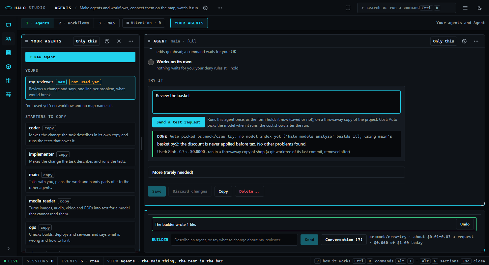
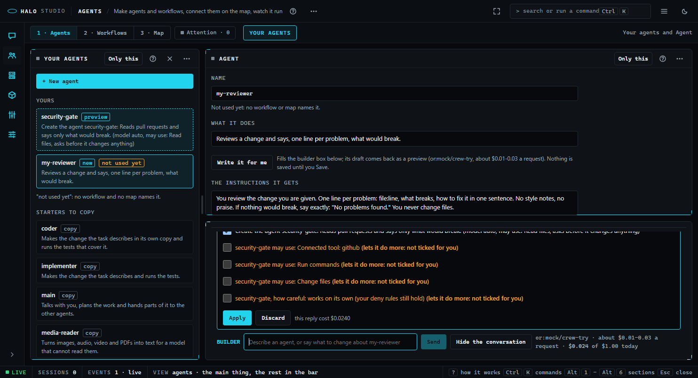

# Studio: Agents -> 1 · Agents and the builder (3.6.0.0)

Read this when you make or change an agent in Studio's Agents tab, ask the builder box to do it for you, try an agent once before you use it, or want to know what the builder can and cannot change, what it costs and how Undo works.

Part of [Halo Studio](STUDIO.md), which lists every part; the section's other views are [Studio: Agents](STUDIO-agents.md).

## The tab

`Alt+2` opens Agents on **1 · Agents** -- on **3 · Map** instead while a session runs here, and on the tab you used last after that; `1` from anywhere in the section. The old
views (**Cast**, **Live** and **Board**) went in 3.6.0.0 R5; a link or
door that names one, such as `?mode=roles` or `&view=live`, lands on the Map. `?mode=agents&view=crew` opens this tab.
3.6.0.0 R2: **2 · Workflows** (the `2` key) is the second tab: [Workflows and the step runner](STUDIO-workflows.md).

- **The list** (a drawer on the left, open with the tab): **+ New agent**, then **Yours** (yours and this project's;
  `new` when made in the last day, `not used yet` when no workflow or map names it, `problem` when the file has one),
  then **Starters to copy**: a click copies a starter into the form as yours, not saved yet.
- **The form**: name (and where it is used), **what it does**, **Write it for me**, the instructions it gets, the
  **model** (the shared picker; **Auto** is its first row), **what it may use** (a switch per kind of tool, each with
  what it can do on and what it cannot off), **how careful**, **Try it**, **More** (fallback model, effort, thinking,
  turns, minutes and dollars a task, files it always reads, its own worktree, offline, its check) and the save bar:
  **Save**, **Discard changes**, **Copy**, **Delete...** (it asks on the page; while a workflow or map names the
  agent it says which, and nothing is deleted). Nothing is written until Save.

## Try it

A test request runs the agent **once, as the form holds it now** (saved or not), as a real agent:

1. Before you send, the line under the box says what one typical task costs on its model (about 20k tokens in and 2k
   out at the catalog's price; with Auto, the model is picked when it runs and the cost shows after).
2. The run is `halo -p` as that agent (`--agents` with its definition, `--agent <name>`) in a **throwaway copy**: a
   detached git worktree of the project's last commit in a temp folder (an empty temp folder when the project is not
   a git repo), removed when the run ends. Your working tree is never touched.
3. Its **careful** mode is the run's permission mode. A print run cannot wait for you, so an ask is answered no and
   listed under the result ("asked: Bash ... answered no"); `own` runs it.
4. **Stop** ends it. The result shows in the tab: the reply, the tools it used, its time and cost, where it ran.
5. A run that ends while you are not looking (another section, another tab) is an **Attention** row ("Try it
   finished: <agent>"): open takes you to the agent and its result; set aside, or seeing it in the tab, clears it.

## The builder

The box docked at the foot of the tab. Type what you want ("make a security reviewer that reads pull requests on
GitHub"; "make it stricter"; "write the instructions for security-reviewer") and press Enter. Its conversation opens
above it after your first request and never by itself; the browser keeps it (the last 40 lines).

**What it can change: your agents' and workflows' files, nothing else.** Its tools are `agent_make`, `agent_change`,
`agent_copy`, `agent_remove` and `agent_draft_instructions` (halo_harness/crew/tools.py); 3.6.0.0 R2 adds the workflow
and step tools and `try_agent` / `try_workflow` (crew/tools_flow.py, crew/tools_try.py; [the Workflows
tab](STUDIO-workflows.md#the-builder-on-this-tab)). It has no tool to run a command, read or change a project file, or
reach the web; asked for one, it says what it would need instead (paste the text into the box). Each tab keeps its own
conversation; one request may touch agents, workflows and maps, in one preview. 3.6.0.0 R3 adds the map tools and
`studio_show` ([on the Map tab](#on-the-map-tab)) and offers the same tools to main in a session ([in a
session](#in-a-session)).

**Preview, Apply, Undo.**

- A reply that would change something is a **preview**: one line per change, each with a tick, and a new agent shown
  as a dashed row in the list.
- A line that **lets an agent do more** is amber and **never ticked for you**: a tool beyond reading (change files,
  run commands, the web, a skill, a connected tool), a less careful mode, a higher or no money cap, offline turned off.
  The server marks it so, and Apply writes only the lines you sent ticked, so a description, a pasted page or the
  model's own words cannot tick one.
- **Apply** writes the ticked lines (each result is checked against the agent format first; nothing is written when
  one fails) and a receipt line offers **Undo**, which puts every file it touched back byte for byte (a file it made
  goes). The last 20 applies can be undone (`~/.halo/crew/.undo/`). **Discard** drops the preview.
- **Write it for me** fills the box with "Write the instructions for <name> from what it does". For a saved agent the
  draft is a change line; for one not saved yet it goes into the form when you Apply (still nothing saved).
- A question it cannot settle comes as two or three choices, its recommendation first.

**Its model and its cap.** Settings -> Studio -> Builder: `studio.builder.model` (unset: the strongest reasoning model
your model index names, else your main model) and `studio.builder.cap_usd`, what it may spend in a day (default
$1.00). The line beside the box shows the model, "about $0.01-0.03 a request" and today's spend against the cap. The
cap is kept by the server: a request past it answers with one line on how to raise it, and a turn that reaches it
stops there. A call with no catalog price counts at $3 / $15 per million tokens; a local model at nothing.

## On the Map tab

3.6.0.0 R3 (crew/tools_map.py, crew/tools_show.py):

| Tool | Does (nothing is written until Apply) |
|---|---|
| `map_box_add {map?, kind: agent or workflow, ref}` | a box (it waits under Not connected yet until a line reaches it) |
| `map_box_remove {map?, box}` | the box and every line that touches it |
| `map_line_add {map?, from, to, when?}` | a line, `from` / `to` a box or the name it holds; a circle is refused in one sentence |
| `map_line_change {map?, from, to, when}` / `map_line_remove {map?, from, to}` | a line's When; take a line out |
| `map_use {map}` | config `crew.map`: what new sessions run on. A map whose agents may do more than the map in use says so in its line, amber and unticked |
| `studio_show {what: map, lists, connections or run, name?}` | read-only: the map in words, the lists, where a thing is used, the last hand-offs from the session records ("why did reviewer run?"); no change lines |

`map` is the map open on the tab (else the one in use, else `starter`). A map that is not yours yet is copied as yours
first: one create line, then the change lines. A map line widens nothing by itself (what an agent may do is in its own
file). The page draws each map line where it lands: a dashed ghost box, a dashed line with its When.

## In a session

The same tools are offered to main in the terminal and in Studio's sessions (not in print mode), as one tool,
`Builder` (tools/builder_tool.py; the work is crew/tools.py through crew/session_tool.py): `{tool, args}`, or
`{changes: [...]}` for several in one card, or `{undo: <id>}`. Nothing is written without the person's card -- the
question round trip, shown in the terminal and in Studio's ask card:

- one question for the lines that let no agent do more ("Apply them" / "Leave them");
- one question per widening line, its own choice, "No (leave this line out)" first.

Only what the person picks is written (the format checked first, the before-image kept); the result names the files and
the undo id; Studio follows the files. Dismissed: nothing is written. With no one to answer (print mode), the tool
previews and writes nothing. `studio_show` answers at once. The permission engine lets the tool through in every mode
but dontAsk (it asks on its own card). Tests: `tests/test_builder_session_parity.py` (the same request through main's
tool and through `/api/builder` writes byte-identical files; the widening line never ticked for them).

## Routes

Every write is owner-only (the owner proof, [the shell](STUDIO-shell.md)).

| Route | What |
|---|---|
| `GET crew/agents` | `{agents, starters}`: name, does, model, uses, careful, scope, new, used, problems |
| `GET / POST / PUT / DELETE crew/agent/<name>` | read, make, save, delete one of yours (422 with the problem lines; 409 for a starter or a name in use) |
| `GET crew/maps`, `GET / PUT / DELETE crew/map/<name>`, `POST crew/map/<name>/use` | the Map tab's: [its routes](STUDIO-map.md#routes); workflows: [their routes](STUDIO-workflows.md#routes) |
| `GET crew/estimate?model=<ref>` | `{usd, line}` before a Try it |
| `POST crew/try {kind: agent \| workflow, body, request}` | starts a run: `{try}`; `crew` frames on `/api/events` (a workflow's: [Try it](STUDIO-workflows.md#try-it)) |
| `GET crew/try/<id>`, `POST crew/try/<id>/stop`, `POST crew/try/<id>/seen` | the run's record, Stop, seen |
| `GET builder` | its model, the typical cost, today's spend, the cap |
| `POST builder/ask {tab, selection, text, conversation_id, history}` | one turn (`tab`: agents, workflows or map): `{reply, question?, changes, cost_usd, meta, tries?}`; 429 past the cap |
| `POST builder/apply {conversation_id, change_ids}` | writes the ticked ids: `{undo_id, wrote, removed, skipped, filled}` |
| `POST builder/undo {undo_id}` | `{restored}` |

The files: [Crew files](CREW-FORMATS.md). Tests: `tests/test_crew_formats.py`, `tests/test_builder_flows.py`,
`tests/test_builder_injection.py`, `tests/test_crew_try.py`, `tests/test_studio_crew.py` (Chrome), and the room rules
over this tab in `tests/test_studio_room.py`; 3.6.0.0 R3: `tests/test_builder_map.py`, `tests/test_builder_session_parity.py`.
