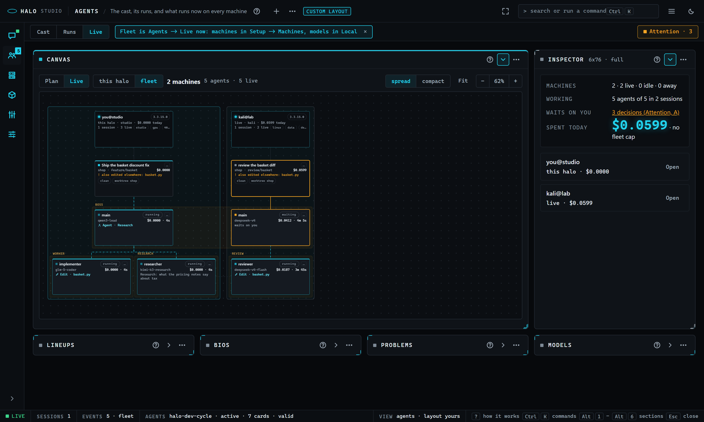
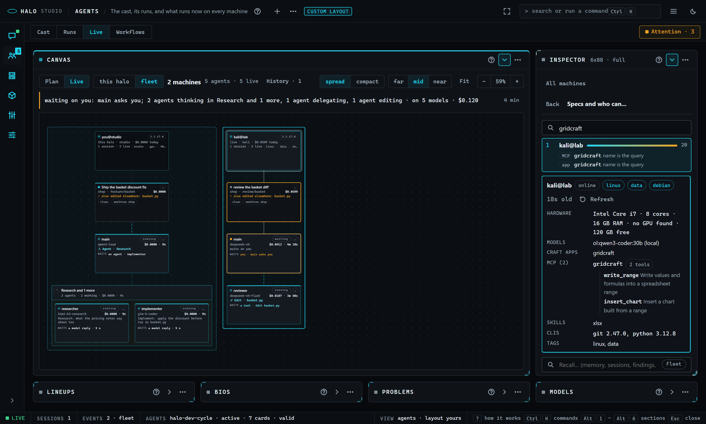
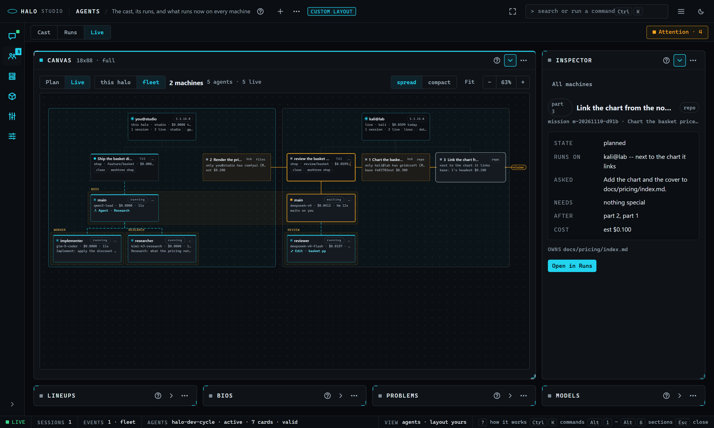
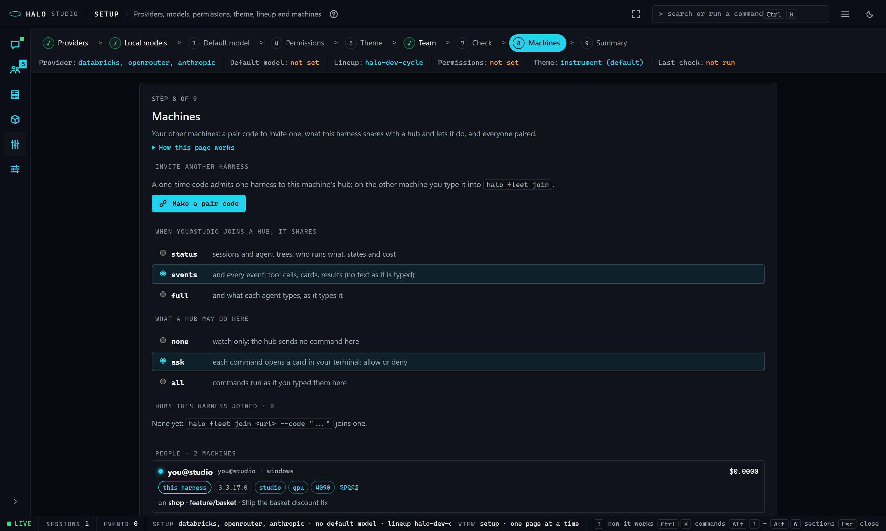
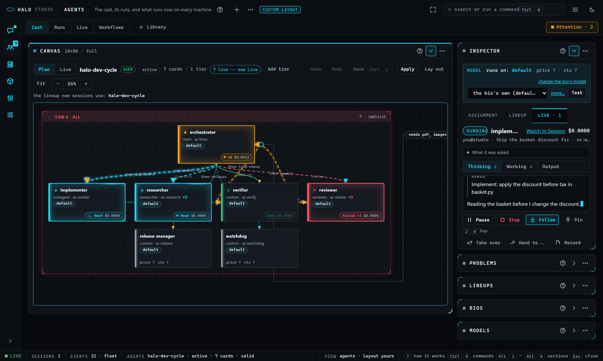

# Studio: Fleet in Agents, Setup and Local

Read this when you watch or steer every harness and agent from Studio: Agents -> Live on the fleet, the Attention queue, missions, pairing and the machines' models.

> **The fleet pack (3.4.0.0).** The fleet left Halo's core for the shipped `fleet` pack: `halo pack install fleet`, then `halo pack enable fleet --grant-all` (a halo that had a fleet gets it on its first run after the update). With it off, `halo fleet`, `halo mission`, `/fleet`, `/mission` and `halo studio --fleet` say so in one line and Studio shows no Fleet door. Another machine's models (`halo host serve`, the pool, Local -> Hosts) and this machine's own sessions live are the core's and work without it.

Part of [Halo Studio](STUDIO.md), which lists every part.

## Fleet in Agents, Setup and Local

3.3.16.0 R2 folded the Fleet section into the three places its pieces belong; Studio has six sections. A machine's
**agents** are Agents -> Live with the fleet scope, its **pairing, sharing and people** are Setup -> Machines, its
**models** are Local. `?mode=fleet` (`halo studio --mode fleet`, `/studio fleet`) still works: it lands on Agents ->
Live on the fleet and says so once ("Fleet is in Agents -> Live now"). The CLI did not change ([FLEET.md](FLEET.md)).

| Was in Fleet | Is now |
|---|---|
| the Map, the Tree panel, the Agent panel | Agents -> Live, scope **fleet**: machine > session > agent on one canvas; a pick fills the inspector |
| People, Health, Costs (glances) | Live's inspector with nothing picked (the glance) and a machine's summary |
| Capabilities, the recall box | a machine's summary -> **Specs and who can...** |
| Costs' caps editor | a machine's summary -> **Spend caps**, and Settings -> Fleet (`fleet.caps.*`) |
| Attention | the **Attention** chip in Agents' bar (`A`), a queue over the page |
| Activity | an optional panel of Live (the header's **+**, the palette) |
| Mission | Agents -> Live (3.4.0.0 D: its panel, `M`; **Run it across the fleet** in the goal panel) and its plan drawn on Live |
| the Start view, the pair dialog, the share / control rows, kick | Setup -> **Machines** (the pair card, the rows, the People table with **Forget**) |
| the Ollama panel (cards, traffic, fit plan, steward) | Local -> Hosts and Local -> Steward ([STUDIO-local.md](STUDIO-local.md)) |

**Session is still these pieces scoped to this box.** `Alt+1` draws the same agent tree for one session (the Map
panel, now the Live canvas as a thumbnail), the same agent inspector in its Agent strip, the same Activity and
Attention, plus its own Cost and **Live** column ([Session](STUDIO-sections.md#session)).

### Live on the fleet

Agents -> Live has a scope switch in its bar, **this halo | fleet** (`F`, Shift+F, on the canvas switches; `f` still
fits). On **this halo** the canvas is one session's agent tree, as before. On **fleet** it is every machine you run or
joined, live: one labelled box per machine (this one first; its name, the Halo version chip with "halo update" when it
differs from this one, its capability chips), a card per session in it (title, kind chip, project and branch, cost,
status dot, the git chips, a **mission** chip on a mission worker, a `!` chip on a conflict) and the session's agents as
a tree under it (name and role, what it does now, the model, the tool and its clock while a tool runs, a cost ticker,
`...`). A mission's parts are drawn in their machines' boxes (below). The page opens on **this halo** unless a door asks
for the fleet (`?mode=fleet`, `&scope=fleet`, the palette's **Agents: the fleet on Live**, the rail's away dot).

**Motion** (the shell's vocabulary): a working agent's outline flows, one that waits on you or is paused pulses amber,
one that just finished gets one green sweep, a failed one flashes red and keeps a red edge, a queued or stopped one
breathes slowly. When an agent spawns another (or sends it a message), the edge between them lights for three seconds.

**The inspector follows the pick**, summary first, one thing at a time:

- **Nothing picked: the glance.** "While you were away" when it applies, then one line each: the machines (live / idle
  / away), the agents working, what waits on you (amber; a click opens Attention), what the fleet spent today against
  its cap, the provider balances, the caps reached (**Lift for today**); then one row per machine.
- **A machine: its summary.** Who it is (host, OS, Halo version, what it shares and lets you do, the project and
  session it is on, spend today, **Message** for a member), its health (all good / check it / needs you, providers,
  versions, free disk, sockets, **Refresh**), and one Edit row per block: **Specs and who can...** (its spec card under
  the Who can... box and the recall box), **Spend caps**, and on this halo **Sharing and control** (Setup -> Machines).
  A block opens alone with **Back** (or Esc) to the summary.
- **An agent: the one agent inspector.** Harness, session, role, model, cost, elapsed, state; **What it was asked**;
  **Thinking** / **Working** / **Output** (tabbed or side by side, Settings); **Pause** / **Resume**, **Stop** (asks
  first), **Follow**, **Pin**; **Take over**, **Hand to...**, **Record**, **Replay** (this harness); the **Steer**
  box. The same inspector is Session's Agent strip and Cast's Live tab.
- **A mission part: its card.** Its number, title and kind, the machine and why, what it owns (its claims), what it
  waits for, its state, **Open the part's agent**.

**Click, double-click, `...`.** A click picks (the inspector strip opens and follows; the keyboard stays where it
was); a double-click on an agent opens its inspector focused; `...` on an agent is **Steer**, **Pause** / **Resume**,
**Pin**, **Stop...**, **Take over...**, **Hand to...**, **Record this agent**, and on a session card **Record the
session**, **Shut the session down...** and **Open its run** for an Orchestra worker (its lane on Live, 3.4.0.0 D). Hovering a node shows a
**steer** chip (3.1.7.0): it opens the inspector's Steer box with the keyboard in it.

**Steer.** Type in the Steer box and press Enter (or Send): **nudge** is a note the agent reads before its next model
call, **redirect** gives it a new task. Only that agent hears it, its stream shows your words marked "you", and its
transcript records who sent it. A steer never widens a permission or answers a card. To a member's agent it goes
through the hub: that harness's `fleet.allow_control` decides (`ask` opens an allow / deny card for its owner, and
Studio says it is waiting), `none` takes no commands, `all` runs it.

**Stop, Pause, Shutdown.** Pause holds the agent at its next tool or model call (Resume releases it). Stop asks first,
then the agent stops at its next step with its own sub-agents, and the agent that spawned it gets the stopped
hand-back and carries on. Shutdown ends the whole session after its current tool call. The palette also has
**Agents: pause all** and **resume all**.

**Activity** (optional, closed on load: the header's **+** or the palette's **Agents: Activity**) is the timeline, one
lane per live agent over the last 5, 15 or 60 minutes (a bar per state, each tool call a tick; a click picks that
agent), over the merged live log of every machine, session and agent with filters by harness, session, agent and kind,
and Follow. A log line is one row (time, kind, who, then the text); under 440 px the text takes its own row.

### How this works: Attention

One queue holds every decision a human has to make on any harness: permission, question, plan and approval cards, a
fleet command a member's owner has to allow, an agent that waits or is paused, an Orchestra gate, a spend cap reached,
two agents on one file, the Ollama steward's finding. The **Attention** chip in Agents' bar shows the count (amber, and
it blinks once when a new row arrives); a click or `A` opens the queue over the page, `A` or Esc closes it. Each row
answers with one key, through the route that already handles that kind (`GET /api/fleet/attention`, `POST
/api/fleet/attention/answer`): **A** accepts, allows or resumes, **R** denies, redoes or answers with the text you type
(a deny reason is optional), **S** stops the agent, **O** opens where the row belongs (the agent on Live, the machine's
spend, the run on Live or its report, Local on that host) and sends nothing. Click a row (or move with `J` / `K` or the arrows), then press the
key; every decision is journaled with who made it. The count is live on the Agents icon in the rail in every section
(a `fleet` frame with action `attention` each time it changes). With the phone bridge enabled and paired, new rows go to
the phone too ([FLEET.md](FLEET.md)).

### How this works: Costs and caps

The glance and a machine's summary read `GET /api/fleet/costs` every ten seconds while they show. A cap is
`fleet.caps.per_harness_usd_per_day`, `per_project_usd_per_day` or `fleet_usd_per_day` (`POST /api/fleet/caps` from a
machine's **Spend caps** page, or Settings -> Fleet; saved in the hub's config.json). When today's spend reaches one,
the sessions in its scope pause at their next step and an attention row says so; **Lift for today** (on the glance or
the row's `A`) resumes them and holds that cap off until tomorrow.

### How this works: Conflicts and project rooms

The hub watches what each agent is editing (its current Edit / Write, and the Orchestra claims). When two agents of
different sessions, on any harnesses, edit the same file of the same repo, Live on the fleet joins them with an amber
dashed edge (hover it for who and which file), both session cards carry a `!` chip with the file, and an attention row
names both; its `O` opens Live on the fleet. Each session card shows its git chips: clean or dirty, ahead / behind, the
worktree (`GET /api/fleet/conflicts`, polled with the queue).

### How this works: Hand-offs

On an agent (its inspector, the node's `...`, the palette): **Take over** asks for your brief; the agent reads it before
its next step in place of its task, and both transcripts record the hand-off and who made it. **Hand to...** asks which
harness picks the work up (and a note for them): the task, the last hand-back and the files it touched go into a
markdown hand-off note in the repo (`.halo/handoffs/`). Then the agent stops. The dialog shows the note's path (Open
copies it). `POST /api/fleet/<harness>/<sid>/agents/<aid>/handoff`.

### How this works: Recordings

**Record** in an agent's inspector (one agent) or a session card's `...` (the whole session) writes one self-contained
HTML file: the three streams, a timeline you can scrub, every tool call, the cost curve; no network, so it opens in any
browser and can be sent to anyone. The dialog's **Download** fetches it with Studio's token and saves it (`POST
/api/fleet/<harness>/<sid>/recording[?agent=]`, then `GET /api/fleet/recordings/<name>`; `halo fleet record` in a
terminal).

### How this works: Replay

A finished session plays back on the **Cast** canvas: the cards light up in the order the agents worked (glowing while
they run, amber while they wait, a green sweep when they finish). Start it from a card's Live tab history (the
**replay** button on a run), an agent's inspector (**Replay**) or the palette. A scrub bar along the bottom of the
canvas has play / pause, the speed (1x to 960x; it starts at a speed that plays the session in about forty seconds),
the clock, the cost so far, who works at that moment, and `x` (or `Esc`) to go back to what runs now; live updates
wait while it plays. The shell reads `GET /api/fleet/replay` into the Roles store and the canvas plays it.

### How this works: Who can do what

Every harness gathers its own capability catalog in code: its MCP servers and their tools (from their tool caches; a
server that does not answer in time is listed without tools and fills in on the next gather), skills, models, craft
apps, ComfyUI, hardware, command-line tools, projects and the tags its owner set (`fleet.tags`). Names only: no full
path, server command or key ever leaves the machine, and `fleet.capabilities.hide` keeps a server, tool, skill or pack
capability off it. A member's announce carries a one-line summary and the catalog's hash; the hub asks for the whole
catalog once per hash and a `fleet` frame with action `capabilities` refreshes it (`GET /api/fleet/capabilities`).
**Who can...** (a machine's **Specs and who can...** page) ranks the fleet for what you type, in code: an exact name
beats a word of a name, which beats a word of a description, and a tag counts double; each result shows what matched
and why (`GET /api/fleet/who?q=`, `halo fleet who`). Click a result and that machine is picked on Live: its box lights
up and the inspector shows its specs. The machine boxes carry the same chips. The palette has **Agents: who can...**
and **Agents: specs of** each machine. See [FLEET.md](FLEET.md#capabilities-3060-r6).

**The recall box (3.1.8.0 R4)**, under Who can... on the same page, searches what this harness remembers -- memory
topics, past sessions, the coach library, findings, decisions and your own notes ([RECALL.md](RECALL.md)) -- as you
type (`GET /api/recall?q=&k=8`): each hit's kind chip (`memo`, `sess`, `lib`, `finding`, `decision`, `note`), title,
score and excerpt, and a finding or decision its id, who wrote it, the day and its confidence
([KNOWLEDGE.md](KNOWLEDGE.md)). Its **Fleet** switch (3.1.2.0 R3) asks `GET /api/recall?q=&fleet=1`: the hub fans the
query out to every online member, each answering from its own index, and the hits merge by score, labelled with their
harness, with a line for every harness that did not answer. The index never leaves a box; a member keeps out with
`fleet.recall.share: false` ([FLEET.md](FLEET.md) "Recall across the fleet").

### How this works: Missions

One goal, every harness, nobody stepping on anyone ([MISSIONS.md](MISSIONS.md)). 3.4.0.0 D: a running mission's
parts draw on Agents -> Live's fleet scope and a finished one is a row of History (Runs' mission rows went with
Runs); **Run it across the fleet** is in Live's Run a goal panel when more than one harness is here. `M` (or `?mode=fleet&mission=<id>`)
opens the Mission panel on Live (3.4.0.0 D):

1. **Goal**: type it in the Mission panel (or the palette's **Agents: new mission**), with constraints, **prefer** (a
   chip per machine, in your order: the planner breaks ties with it), a budget and the **Lineup**, and press **Plan
   it** (`POST /api/fleet/missions`). The hub's lead splits it into parts with every machine's capability catalog in
   front of it; a part that needs what only one machine has is pinned there (a lock, the reason on hover), a tie goes to
   your **prefer** order then the least busy machine, and a part nobody can run gets a red **unassignable** chip.
2. **The plan on Live**: each part is a node in its machine's box, dashed while planned; an edge for each part it waits
   for, amber with a **claims** chip where two repo parts claim the same files and so run one after the other, and on
   every other edge a chip naming what it hands on; a repo part shows its base. Each part's row in the panel says what
   it **owns**. The panel's table is the same plan.
3. **Edit by hand**: drag a part's node into another machine's box to move it there (`POST .../parts/<n> {harness}`,
   checked in code: a machine that lacks what the part needs answers 422, the toast says why and the node snaps back);
   **Drop** takes a part out; **Plan again** asks the lead anew. Attention has the plan as a row too: `A` approves and
   runs, `R` edits with a text ("part 2 to kali", "drop 3"), `S` drops the mission.
4. **Approve, Run**: Run approves first. Parts start by their dependencies: a part on this harness runs here, a part on
   a member goes to it as the `run_task` command. Under `fleet.allow_control: ask` that member's owner gets a card, and
   the node and its row pulse amber, "waiting on <harness>'s owner"; on the member's own Studio the card is a **mission
   part** row in Attention (`O` opens the Mission panel on that mission). A running part is solid, its row shows the
   line its agent is on, and its `mission-worker` session shows on Live with a **mission** chip. A part held for its
   pack capability's slot is `waiting` and pulses amber with the hub's line; a part the hub re-planned after a pack
   refusal moves to its new machine's box. Picked, a part that needs a pack capability shows the pack's **inspector**
   lines (a member's come with its catalog, the file's first 8 KB).
5. **Report**: when the last part is over (or you **Stop** it, with a reason) the panel turns to the report: who did
   what on which machine, the cost per machine and per part, the decisions, the edits refused outside a part's claims,
   the merge, and the artifacts to open; once it ended, the post-run **Coach** cards.

The palette has **Agents: new mission**, **approve mission**, **stop mission** and **mission report**.

### How this works: While you were away

When the tab comes back after more than ten minutes (or Studio opens after that long), a card sums up what happened
since you last looked, computed in code per harness: sessions started and ended, cost, decisions made and by whom,
files touched, errors, hand-offs (`GET /api/fleet/digest?since=`; `halo fleet digest` in a terminal). It is the first
block of Live's glance; meanwhile the Agents icon in the rail carries an amber dot, and a click on it opens Live on the
fleet with the glance. When you last looked is the browser's `halo.fleet.lastSeen`, refreshed every minute while the
tab shows; **Dismiss** sets it to now. The palette's **Agents: while you were away** shows it on demand.

### Setup -> Machines

Setup's **Machines** page (the step before Summary) is where a machine joins: the **pair card** (a one-time six-word
code, the `halo fleet join <url> --code "..."` line for the other machine and its QR, which carries the hub's address
and fingerprint; **Start the hub here** when none runs: it listens on the LAN port, so Windows asks once about its
firewall); the share and control rows (`fleet.share`: status | events | full; `fleet.allow_control`: none | ask | all);
the hubs this harness joined; and the **People** table, one row per harness with its Halo version chip, what it shares,
and **Forget** (asks first; it pairs again with a new code). While only this harness is here the page leads with what a
fleet is in five lines. Setup's Summary has a Machines line ([STUDIO-setup.md](STUDIO-setup.md)).

### Keys: hop around

| Key | Where | What |
|---|---|---|
| `Alt+2` | everywhere | Agents (then `L` for Live; 3.3.16.0 R2: six sections, the fleet is Live's scope) |
| `F` (Shift+F) | Agents -> Live, the canvas focused | the scope: this halo / fleet |
| `A` | Agents | open or close the Attention queue |
| `J` / `K` | Live, the Session map, the Cast canvas | the next / previous live agent (across the fleet on fleet scope) |
| `f` | Live's canvas; an agent watched on Agents; Session | Live's canvas: fit the tree; else follow: the stream scrolls with the agent |
| `Space` | an agent watched on Agents; Session | pin the stream: a **mini stream** floats over whatever you look at, in every section |
| `Esc` | everywhere | unpin the mini stream (once the palette, a menu or the inspector is closed) |
| `P` | an agent watched on Agents; Session | pause or resume the agent |
| `K` | inside Session's Agent strip | stop the agent (asks first; on the canvases `K` is previous) |
| `A` / `R` / `S` / `O` | inside the Attention queue; an ask card in Session's Live column | answer the selected row (or that card): accept, deny or redo (with a text), stop, open |
| click a tag / `Esc` | Session's Live column | show only that agent's lines, with the Steer box for it / everyone again |
| `J` / `K`, arrows | inside the Attention queue | the next / previous row |
| `M` | Agents | the Mission panel on Live: one goal for the whole fleet |
| `Esc` | Cast during a replay | close the replay, back to what runs now |

**The mini stream** (picture in picture) shows the pinned agent's state, cost, what it does now and the newest lines of
its stream; drag it by its bar, its arrow opens the agent on Live, `x` or `Esc` unpins. It hides while the inspector
already shows that agent.

**The palette's Agents group**: the fleet on Live, Attention, answer next, Activity, follow / steer / pause / stop the
picked agent, take it over, hand it to..., record it, replay its session, while you were away, who can... and the specs
of each machine, new / approve / stop mission and mission report, follow any live agent by name, pause all, resume all,
open the session's run; **Setup: pair a machine** and **Setup: forget** each member; **Local: the Ollama steward**.

### Live Roles: the lineup lights up

On the **Cast** canvas the cards whose agents work right now glow. Every live agent (any harness, any session) is
matched to the card it runs under: the lineup must be the open one, then its alias, else its bio, else a role only one
card has (a session's main agent on the main card). The glow is in the state's colour and follows what the agent does:
**working** cyan (a steady flow along the top while it types, one pulse per **tool call** and the tool on the card's
badge); **waiting on you** amber, three pulses then steady; **done** green, fading over ten seconds; **failed** red,
staying until you click the card. A queued agent shows its badge with no glow. Hover the card's state glyph or its badge
and the card explains its glow ([Agents](STUDIO-sections.md#agents)). A badge counts the agents when several share a
card (`×2`) and ticks their cost. The edge into a card takes its colour, and the tier box takes the strongest state of
its cards.

Select a card with a live agent and the inspector opens its **Live** tab: a chip per agent when several run on the card,
then the one agent inspector above. A card nobody runs right now shows its track record instead: the last runs under
that role or bio on this harness (`GET /api/fleet/history`: when, which bio, the outcome, the cost, the task), each with
**replay**.

### Where it reads and writes

`GET /api/fleet` once, then the live feed keyed by harness, session and agent (`agent_state` rows in place,
`agent_event` entries of a followed agent, the raw `text_chunk` / `tool_use_start` / `tool_result` frames, a member's
`fleet` frames with action `sessions`); polling every 4 s only while the feed is down. Live re-reads `GET /api/fleet`
when an agent ends, on the turn-end marker, when the tab is shown again, and while any agent runs at least every 5 s
(a lost end frame never leaves a stopped agent `running`). Commands: `POST
/api/fleet/<harness>/<sid>/agents/<aid>/command` (`local` for this harness) and `.../<sid>/command` for a session; a
backlog is `GET /api/sessions/<sid>/agents/<aid>/tail` here, the `tail` command through the hub for a member. Setup ->
Machines uses `POST /api/fleet/pair`, `GET` / `POST /api/fleet/settings`, `POST /api/fleet/kick` and `POST
/api/fleet/hub`. The glance, the summaries and the queue read `GET /api/fleet/attention`, `costs`, `caps`, `health`,
`conflicts`, `digest`, `replay` and `history`, and post to `attention/answer`, `caps`, `.../handoff`, `.../recording`
and a session's `command` (`note`); [FLEET.md](FLEET.md) has every shape.
