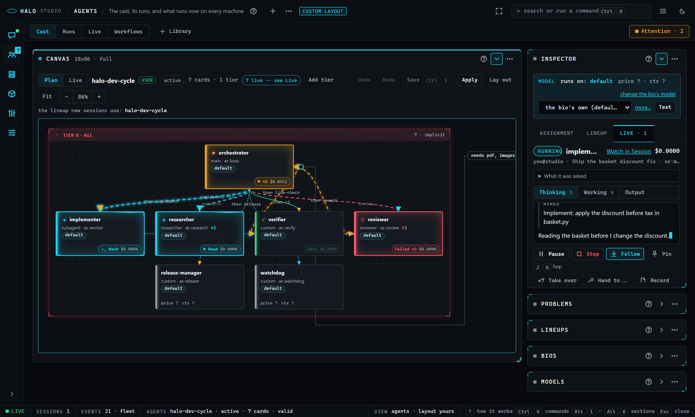

# Studio: Attention, costs, hand-offs and recordings

Read this when you answer what waits on you from Studio, watch what your sessions spend, hand an agent's work on, record a session, hop between agents with the keys, or want to know what Studio reads and writes for them.

Part of [Halo Studio](STUDIO.md), which lists every part.

### How this works: Attention

One queue holds every decision a human has to make on this machine's sessions: permission, question, plan and approval
cards, an agent that waits or is paused, an Orchestra gate, a spend cap reached, two agents on one file, the Ollama
steward's finding. The **Attention** chip in Agents' bar shows the count (amber, and it blinks once when a new row
arrives); a click or `A` opens the queue over the page, `A` or Esc closes it. Each row answers with one key, through the
route that already handles that kind (`GET /api/live/attention`, `POST /api/live/attention/answer`): **A** accepts,
allows or resumes, **R** denies, redoes or answers with the text you type (a deny reason is optional), **S** stops the
agent, **O** opens where the row belongs (the agent on Live, the run on Live or its report, Local on that host) and
sends nothing. Click a row (or move with `J` / `K` or the arrows), then press the key; every decision is journaled with
who made it. The count is live on the Agents icon in the rail in every section (a `live` frame with action `attention`
each time it changes).

### How this works: Costs and caps

Live's inspector with nothing picked (this halo at a glance) reads `GET /api/live/costs` every ten seconds while it
shows. A cap is `caps.per_harness_usd_per_day` or `caps.per_project_usd_per_day` (`POST /api/live/caps`, or Settings ->
Remote; saved in config.json). When today's spend reaches one, the sessions in its scope pause at their next step and an
attention row says so; **Lift for today** (on the glance or the row's `A`) resumes them and holds that cap off until
tomorrow.

### How this works: Conflicts

Studio watches what each agent is editing (its current Edit / Write, and the Orchestra claims). When two agents of
different sessions edit the same file of the same repo, an attention row names both; its `O` opens Live on them. Each
session's git state (clean or dirty, ahead / behind, the worktree) comes with it (`GET /api/live/conflicts`, polled with
the queue).

### How this works: Hand-offs

On an agent (its inspector, the node's `...`, the palette): **Take over** asks for your brief; the agent reads it before
its next step in place of its task, and both transcripts record the hand-off and who made it. **Hand to...** writes the
task, the last hand-back and the files it touched into a markdown hand-off note in the repo (`.halo/handoffs/`), with a
note for whoever picks it up. Then the agent stops. The dialog shows the note's path (Open copies it). `POST
/api/live/<harness>/<sid>/agents/<aid>/handoff`.

### How this works: Recordings

**Record** in an agent's inspector (one agent) or a session's `...` (the whole session) writes one self-contained HTML
file: the three streams, a timeline you can scrub, every tool call, the cost curve; no network, so it opens in any
browser and can be sent to anyone. The dialog's **Download** fetches it with Studio's token and saves it (`POST
/api/live/<harness>/<sid>/recording[?agent=]`, then `GET /api/live/recordings/<name>`).

### Keys: hop around

| Key | Where | What |
|---|---|---|
| `Alt+2` | everywhere | Agents (then `L` for Live) |
| `A` | Agents | open or close the Attention queue |
| `J` / `K` | Live, the Session map, the Cast canvas | the next / previous live agent |
| `f` | Live's canvas; an agent watched on Agents; Session | Live's canvas: fit the tree; else follow: the stream scrolls with the agent |
| `Space` | an agent watched on Agents; Session | pin the stream: a **mini stream** floats over whatever you look at, in every section |
| `Esc` | everywhere | unpin the mini stream (once the palette, a menu or the inspector is closed) |
| `P` | an agent watched on Agents; Session | pause or resume the agent |
| `K` | inside Session's Agent strip | stop the agent (asks first; on the canvases `K` is previous) |
| `A` / `R` / `S` / `O` | inside the Attention queue; an ask card in Session's Live column | answer the selected row (or that card): accept, deny or redo (with a text), stop, open |
| click a tag / `Esc` | Session's Live column | show only that agent's lines, with the Steer box for it / everyone again |
| `J` / `K`, arrows | inside the Attention queue | the next / previous row |

**The mini stream** (picture in picture) shows the pinned agent's state, cost, what it does now and the newest lines of
its stream; drag it by its bar, its arrow opens the agent on Live, `x` or `Esc` unpins. It hides while the inspector
already shows that agent.

**The palette's Agents group**: Attention, answer next, Activity, follow / steer / pause / stop the picked agent, take
it over, hand it to..., record it, replay its session, follow any live agent by name, pause all, resume all, open the
session's run; **Local: the Ollama steward**.

### Live Roles: the lineup lights up

On the **Cast** canvas the cards whose agents work right now glow. Every live agent is matched to the card it runs
under: the lineup must be the open one, then its alias, else its bio, else a role only one card has (a session's main
agent on the main card). The glow is in the state's colour and follows what the agent does: **working** cyan (a steady
flow along the top while it types, one pulse per **tool call** and the tool on the card's badge); **waiting on you**
amber, three pulses then steady; **done** green, fading over ten seconds; **failed** red, staying until you click the
card. A queued agent shows its badge with no glow. Hover the card's state glyph or its badge and the card explains its
glow ([Agents](STUDIO-sections.md#agents)). A badge counts the agents when several share a card (`×2`) and ticks their
cost. The edge into a card takes its colour, and the tier box takes the strongest state of its cards.

Select a card with a live agent and the inspector opens its **Live** tab: a chip per agent when several run on the card,
then the one agent inspector above. A card nobody runs right now shows its track record instead: the last runs under
that role or bio on this harness (`GET /api/live/history`: when, which bio, the outcome, the cost, the task), each with
**replay**.

### Where it reads and writes

`GET /api/live` once (this harness and its live sessions), then the live feed keyed by harness, session and agent
(`agent_state` rows in place, `agent_event` entries of a followed agent, the raw `text_chunk` / `tool_use_start` /
`tool_result` frames, a session's `registry` frames); polling every 4 s only while the feed is down. Live re-reads `GET
/api/live` when an agent ends, on the turn-end marker, when the tab is shown again, and while any agent runs at least
every 5 s (a lost end frame never leaves a stopped agent `running`). Commands: `POST
/api/live/<harness>/<sid>/agents/<aid>/command` (`local` for this harness) and `.../<sid>/command` for a session; a
backlog is `GET /api/sessions/<sid>/agents/<aid>/tail`. Another harness's id answers 404: Studio drives this machine's
sessions (another machine's models are Local's). The glance and the queue read `GET /api/live/attention`, `costs`,
`caps`, `conflicts`, `replay` and `history`, and post to `attention/answer`, `caps`, `.../handoff`, `.../recording`
and a session's `command`.
