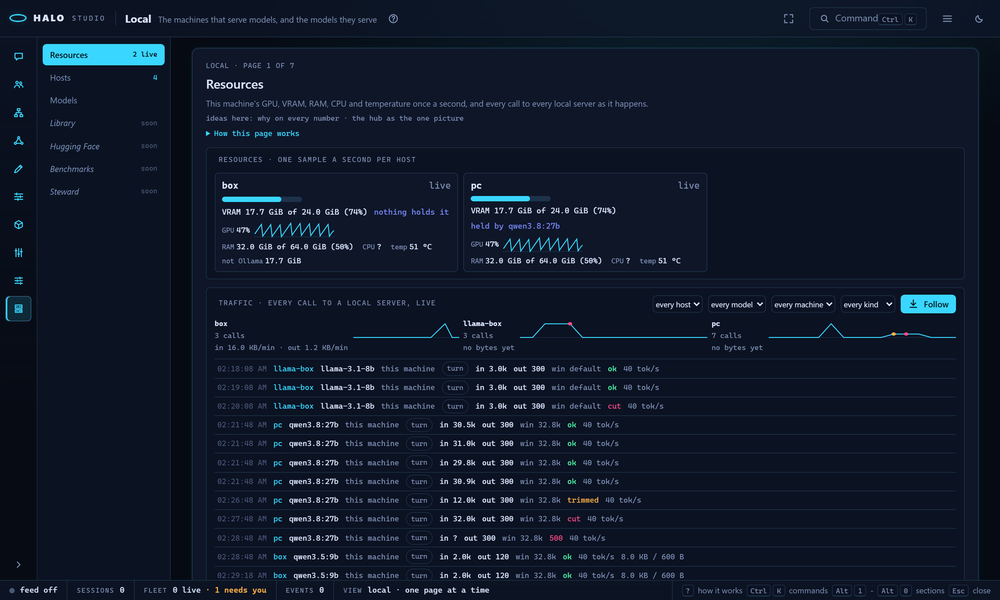

# Studio: the Local section

Read this when you watch the machines that serve your local models and what they serve: the live resources and traffic, every host with its controls, every model with its fit, and the library of models you could install.

Part of [Halo Studio](STUDIO.md), which lists every part.

## Local: the machines and the models (3.3.5.0)

**Local** is Studio's tenth section, on `Alt+0` (the tenth slot; a pack's own section has no key and is reached by
its rail row or the palette). It holds everything Halo knows about local models in one tab, paged like Settings: a
page rail on the left, one page on the right, a head on each page that says what it holds, which of Local's five ideas
it carries, and its help behind **How this page works**. Nothing opens on its own; the page last open in this browser
comes back (`halo.studio.local.page`). The seven pages, in the rail's order:

| Page | What it holds | Filled in |
|---|---|---|
| Resources | a live strip per host (GPU, VRAM and what holds it, RAM, CPU, temperature) and the traffic view | 3.3.5.0 R1 |
| Hosts | every server Halo knows as a card, with Load, Unload, keep-alive, Make it fit and Add to hosts | 3.3.5.0 R1 |
| Models | every installed model per host with its card, its fit meter, its roles and the intent filter | 3.3.5.0 R1 |
| Library | Ollama's library and the Hugging Face Hub to browse, each row with a fit badge | 3.3.5.0 R2 |
| Hugging Face | Hugging Face local models downloaded, served, stopped and deleted | 3.3.5.0 R4 |
| Benchmarks | a measured battery per model (the speed card), tuning scans, changes that revert | 3.3.5.0 R5 |
| Steward | the steward's chat, and several local models scheduled on one card | 3.3.5.0 R6 |

The doors: `halo local` opens Studio on Local (a Studio already running for this home takes it in its open page),
`halo local hosts` on the Hosts page (`?mode=local&page=hosts`), `halo studio --edit local:models` the same from the
studio command, `halo studio --mode local`, `/studio local` in the TUI, and the palette's **Local: <page>** rows. Fleet's
Ollama panel stays the short form of the same data; each of its model rows has **open in Local**, which opens Models
on that host ([MODELS-ollama-steward.md](MODELS-ollama-steward.md)).

## Resources

**The strips.** One per host this machine serves (the `ollama.hosts` entries whose address is this machine; "this
machine" when none is), sampled **once a second** while the page is open, and while the Ollama steward's job runs (it
starts with Studio and the fleet hub). The page holds the sampler on with a 45-second lease it renews every 15 seconds
(`POST local/resources/watch {on}`), so a closed tab lets it stop. Each strip shows:

- **VRAM** used of total as a bar, and **what holds most of it**: the model `/api/ps` has loaded (read every five
  seconds), or the process `nvidia-smi --query-compute-apps` names when the driver gives per-process bytes. Under
  Windows' WDDM driver every process reads `[N/A]`, so the holder there is always a model from `/api/ps`.
- **GPU use** as a number and a line of the last minute.
- **RAM** used of total, **CPU** (the whole machine, between two reads) and the **temperature** when the tool reports one.
- **not Ollama**: the bytes on the card that Ollama's own models do not account for (another program, the desktop).

Every number's title says where it came from, or why there is none. The readers, per OS:

| Figure | Linux | Windows | macOS |
|---|---|---|---|
| GPU use, VRAM, temperature | `nvidia-smi --query-gpu=utilization.gpu,memory.used,memory.total,temperature.gpu`, else `rocm-smi --json` | the same | `ioreg -r -d 1 -w 0 -c IOAccelerator` (the GPU's memory in use; its utilization when the registry gives it) over `sysctl -n hw.memsize` (unified memory) |
| GPU use when not reported | -- | -- | `powermetrics` when it runs without sudo, else **n/a** |
| Who holds the card | `nvidia-smi --query-compute-apps`, else `/api/ps` | `/api/ps` (WDDM gives no bytes per process) | `/api/ps` |
| RAM | `/proc/meminfo` (MemTotal minus MemAvailable) | `GlobalMemoryStatusEx` | `memory_pressure`'s free share of `hw.memsize` |
| CPU | `/proc/stat` | `GetSystemTimes` | `ps -A -o %cpu` over the core count |
| Temperature | nvidia-smi, rocm-smi | nvidia-smi | not read (it needs sudo) |

Nothing here needs sudo, and the readers are the standard library and those tools only. A host another machine serves
has a strip here when that machine is a fleet member and its own sampler runs: the member's newest samples ride its
ledger push to the hub (`fleet.ollama.share`), and the hub keeps the last five minutes per host, under its own name for
the host when one of its `ollama.hosts` entries points at the member's address. The strip then says **via <member>**.

The fit planner reads the newest sample too: when a sample is newer than a host's hardware card, its **not Ollama**
bytes are what the planner counts as held by other programs, so a ComfyUI that starts now shrinks the budget at once.

**The traffic view.** Under the strips, the Live display's cousin: every call to a local server as it happens, newest at
the foot. One row per call (the ledger's line, [MODELS-ollama-steward.md](MODELS-ollama-steward.md)): the time, the host,
the model, the machine that called (the ledger's `from`), the kind (turn, compaction, small, repair, calibrate), the
prompt tokens in and the reply tokens out, the window sent (its source as the title), trimmed / cut / the status, the
reply's tok/s, the request and reply bytes, and the `fitted` and `from <model>` marks of a switch. The steward's server
events (loaded, unloaded, reloaded, spilled, trimmed) sit between them as muted rows. Above the list a sparkline per
host counts the calls per minute of the last 15 minutes, a trim or a cut marked on its minute, with the bytes in and out
of the newest minute. Filters narrow it by host, model, machine and kind; **Follow** keeps the newest row in view, and
scrolling up pauses it (a pill counts what came since).

A row arrives the moment its call ends: the ledger writer publishes each line (`ollama_steward/ledger_tap.py`). In
Studio's own process (and on a hub, the lines its members forward) that is a `traffic` frame at once; a session in
another process posts the line to the Studio running for its home (`POST /api/local/traffic`). A page that opens later
reads the last 15 minutes (`GET local/traffic?since=15m`); a row is never shown twice (its id is the line's own text
hashed).

## Hosts

Every host Halo knows, as a card, grouped: the configured `ollama.hosts` entries, the Hugging Face local servers
(`huggingface.local_servers`), the hosts fleet members serve (their samples reached this hub), and the servers Setup's
Find or Scan found that are not added yet. A card shows the URL, the kind (Ollama, an OpenAI-dialect gateway, a local
server), the server's version, who serves it, what is loaded now (each model's VRAM share and when it unloads), the
hardware card's lines, the steward profiles for it, **who calls it** (the ledger's `from` over the last 24 hours), and the
steward's newest open finding.

The controls its kind allows:

- **Load** warms an installed model the way Ollama documents it, a `POST /api/generate` with no prompt, at the steward
  profile's window (else the host's `max_ctx`, else the server's default) and kept for the **keep-alive** you pick (the
  profile's by default). Nothing is generated.
- **Unload** sends `keep_alive: 0`.
- **Make it fit** (idea 4): when the models the halos ask for do not fit the card together, the fit planner's chosen
  option (a window per model, one model at a time, another host) is applied as steward profiles through the steward's
  own guards (`ollama/steward/apply`), and **Undo** beside it takes them back. A server-side option is never applied:
  Fleet's Ollama panel shows its exact line to copy.
- **Add to hosts** on a found server writes the `ollama.hosts` entry through Setup's own Ollama writer.

A host this machine serves is controlled from here. A host another machine serves is controlled **through the fleet
member that serves it** when this Studio runs the hub: the command (`ollama_load`, `ollama_unload`) goes to that member's
live session and runs under its `fleet.allow_control`, like a steer (`ask` puts a card in its owner's TUI, `all` applies
it, `none` refuses). When that cannot happen the buttons are off and the card says why: the member's control is `none`,
it has no live session, this Studio is not its hub, or no member serves the host. Nothing here writes a server's
settings.

## Models

Every model each host has installed (Ollama's `/api/tags` with `/api/show`; a local server's `/v1/models`), one row each:
the card's chips (think, tools, vision, the purpose, the window: [MODELS-cards.md](MODELS-cards.md)), the **fit meter** on
that host's card (idea 1), its size, whether it is loaded, the steward profile's window and reserve, the roles it can
hold (a role it cannot hold says why as its title) and, unfolded on click, **how Halo calls it**. **Use as default** saves
it as the model a session starts on (Setup's save, `setup/config`); **Make it the coder lane** appears on a model that
cannot orchestrate here but can code, and writes the `local-coder` lineup with the best local orchestrator as main
(`models/lane`, the same offer `/model` makes).

**Intents, not model names** (idea 3): the filter on top ranks the rows for what you want a model for -- **code** (coding
models first, then instruct models that call tools), **chat** (instruct, then reasoning, then coders), **read long
documents** (the largest window this card runs), **look at images** (models that see) and **embed** (embedding models
only) -- each band ordered by the fit meter, a model that is not for the intent left out, and one line under the filter
saying why this order.

**The actions** (3.3.5.0 R3): each installed Ollama model's `...` menu (`local-model-acts`), every item titled with
the `halo models` line that does the same:

- **Show**: `/api/show`'s facts -- family, parameters, quantization, format, the parent model, the trained context,
  the capabilities, the Modelfile's `PARAMETER` lines, the licence's first line and the template's length (its start
  as the title) -- beside the model card.
- **Load now** / **Unload**: R1's warm generate at the profile's window, and `keep_alive: 0`.
- **Make a tuned twin**: pick the window; the card names the twin (`qwen3.5:9b` -> `qwen3.5-halo:9b`), its plan line
  and what it costs (a second name on disk: a manifest of a few KB pointing at the original's layers, no new blobs, no
  download), then **Make it** creates it through `/api/create` and records it in the tune store
  ([MODELS-ollama-tuning.md](MODELS-ollama-tuning.md)).
- **Copy** / **Rename**: a new name for the same layers (`/api/copy`); a rename is a copy, then the old name deleted.
- **Delete**: first the **uses card** -- what names the model: your lineups (the role it holds in each), the `roles`
  table, the default `model`, `compactionModel`, the steward profiles (`ollama.profiles`) and the live sessions on it,
  in one line ("qwen3-coder:30b is the coder in `local-coder` and the model of 2 profiles; 1 live session is on it").
  Nothing uses it: **Delete**. Something does: **Delete anyway**, which always works while no session is on the model;
  a live session keeps the button disabled with the reason until it ends or moves to another model.

On top of the page, **Loaded now** (`local-loaded-row`): every model a host holds in memory (`/api/ps`), its share on
the GPU, its window, when it unloads, and **Unload**; under it the **Jobs** list. A host another machine serves goes
through its fleet member (below); a control that cannot run from here is disabled with the reason as its title.

The page reads each host's catalog through one cache keyed by the catalog's mtime: `/api/tags` alone is read (at most
every 15 seconds), and the per-model `/api/show` calls run again only when a model was pulled, deleted or changed. Fleet's
Ollama panel reads its catalogs the same way since this round (it used to read every host's whole catalog each minute).

## Library

**What could be installed** (3.3.5.0 R2), from the two sites that list it, every row with its model card and a **fit
badge** for the host and the window you pick. **Pull** (3.3.5.0 R3) puts it on the host picked above the list (its
title is the line, `halo models pull gemma3:4b --host box`): a progress bar on the row while it runs -- the percent of
the layers' bytes, the speed over the last 5 seconds and the time left, each titled with where it comes from -- with
**Cancel**, then "installed on <host>" (the host's own `/api/tags` has it, so the Models page lists it too). A GGUF file
of a hub repo pulls through Ollama as `hf.co/<repo>:<quant>`; an MLX repo runs outside Ollama, so its Pull is disabled
and its line is `halo local download <repo>`. **Pull by name** above the list takes any name Ollama can pull (a library
tag or `hf.co/<repo>:<quant>`). **Copy** puts a row's pull line on the clipboard.

- **Ollama's library**: one row per model and size chip (`qwen3.5:9b`, `qwen3.5:27b`), from ollama.com/library (the
  name, its one-line description, the capability chips, the pulls, when it was updated) and each model's tags page
  (the size, the context, the input). A size chip's bytes come from the registry's own manifest (the model layer and a
  vision projector apart) and its config blob (family, parameters, quantization). Until ollama.com is read the list is
  the **snapshot** Halo ships (`models_library/snapshot_ollama.json`: the 150 most pulled models, dated): the source line
  says "Ollama: snapshot from <date>" with **Refresh** beside it.
- **The Hugging Face Hub**: one row per GGUF or MLX repo from the hub's search (most downloaded first; its size an
  estimate until it is opened, marked `≈`), with its downloads, licence and a **gated** mark. Opening a repo lists its
  files with their sizes (a GGUF repo one row per quant, shards summed; an MLX repo its weights as one), and its
  `config.json` gives the exact shape. A gated repo's files are read with your `HF_TOKEN`.

**The fit badge** (ideas 1 and 2): fits (every layer on the GPU with room), tight (only with every layer forced on),
spill (part on the CPU), no (not on this machine), or `?` (no hardware card read for the host yet). Its title is the
numbers: the weights plus the KV cache at the window picked (and a projector) against the card's free memory, other
programs taken off (the newest Resources sample when it is newer than the card). For a model that is not installed
the shape is the family's published one or a typical one for its size, so the badge says "an estimate until pulled";
a hub repo's `config.json` makes it exact. The arithmetic is the steward's ([LOCAL-MODELS.md](LOCAL-MODELS.md)).

**The controls**: a search box; the source switch (Both, Ollama, Hugging Face); **fit on** (the host) and **at window**
(4,096 to 262,144, default the host's `max_ctx`, else 32,768): every badge follows both; the intent filter (R1's code,
chat, long documents, images, embed; long documents ranks by the window that runs here, not the longest trained one);
and the filters: fits this host (fits or tight), size at most N GB, family, capability, quantization, licence.

**A row**: the name and tag (or repo and file), its source, the card's chips, the badge, the size on disk, then the
parameters, quantization, context, downloads, updated, licence and gated mark; every number's title says where it came
from. A click on the name unfolds the card's `how` lines (each "once pulled") and the model's other tags or files, each
with its own badge and pull line. The list draws every row (a long one a window at a time, R0's `WindowedRows`).

The cache is `<state>/cache/models-library.json`: the catalog, a model's tags and a manifest a day, a hub search an
hour, a repo's files a day; Refresh (`POST local/library/refresh`, `halo models browse --refresh`) reads them again.
`halo models browse` prints the same rows from a terminal ([COMMANDS-local.md](COMMANDS-local.md)).

## Jobs

A pull is the server's job (3.3.5.0 R3, `studio/local_pull_job.py`): Studio runs one per host and name (a second Pull of
the same name joins it), and it goes on when the page closes. The **Jobs** list on the Library and Models pages shows
every pull running and the last ended ones, each with its bar and **Cancel**; a page that opens later reads them
(`GET local/pulls`) and follows the `pull` frames. A cancel closes the connection: Ollama stops and keeps the layers it
already has in its own blob folder, so pulling the same name again starts from them. When a pull ends well every model
list drops its cached catalog, so the next read shows the new model. A host a fleet member serves pulls on that member
(its own job); its progress reaches the hub with the member's ledger push, every 30 seconds
([FLEET.md](FLEET.md)).

## The pages still to come

Hugging Face, Benchmarks and Steward are framed: each says in one paragraph what it will hold and lists the
commands that do that work today, each copyable (`halo local --terminal`,
`halo local import`, `halo ollama calibrate`, `halo ollama steward status`, ...). Steward also shows the steward job's
status line and its last note, read the way Fleet's Ollama panel reads them.

## Local's five ideas

Every page names which of them it carries (its head's "ideas here" line), and the section's help lists all five:

1. **The fit meter**: a small green-to-red bar wherever a model is named -- will this run here at this window
   (Hosts, Models, the Library's badge; the Hugging Face rows next).
2. **Why on every number**: each figure carries its source and a one-line cause as its title (every strip number, every
   traffic figure, the profiles, the Library's sizes and badges).
3. **Intents, not model names**: code, chat, long documents, images, embed rank the models by fit for this card (Models
   and the Library).
4. **Make it fit**: the fit planner's chosen option in one click, Undo beside it (Hosts).
5. **The hub as the one picture of the network**: every machine sees the same hosts, profiles, traffic and samples
   through the fleet hub (a member's samples and lines reach the hub; Hosts lists the hosts members serve).

## The routes

Studio's API under `/api/local/` (`halo_harness/studio/local_api.py`), the same loopback / origin / token guard as every
Studio route; never a model call:

| Route | What it answers |
|---|---|
| `GET local/hosts` | every host as a card (`studio/local_hosts_view.py`) |
| `POST local/host/<name>/load {model, num_ctx?, keep_alive?}` | a load from here or through the member; 409 with the reason when neither can |
| `POST local/host/<name>/unload {model}` | the same with `keep_alive: 0` |
| `POST local/host/add {url, name}` | the entry written through Setup's Ollama writer |
| `GET local/resources?host=` | the last five minutes of samples and the sampler's state |
| `POST local/resources/watch {on}` | the page's lease on the sampler |
| `GET local/traffic?host=&since=15m` | the ledger's rows, the server events, the per-host minute buckets |
| `POST local/traffic {lines, events}` | another process's ledger tap: `traffic` frames on the live feed |
| `GET local/models?host=` | every model per host with its card, its meter and its intent scores |
| `GET local/library?source=ollama\|hf\|all&q=&host=&window=&fits=1&intent=&family=&quant=&cap=&max_gb=&license=&page=` | the library's rows with their card, fit badge and intent scores, the total, and where each source came from (`studio/models_library_api.py`) |
| `GET local/library/<source>/<id>?host=&window=` | one Ollama model's tags or one hub repo's files, each with its badge |
| `POST local/library/refresh` | the library's cache dropped: the next read is live |
| `POST local/host/<name>/pull {name}` | a pull job (a second ask joins it); its view and `cli` |
| `POST local/pull/<id>/cancel` | stop it (Ollama keeps the layers it has) |
| `GET local/pulls` | every pull running and the last ended ones |
| `POST local/host/<name>/delete {name, force?}` | 422 with the uses card when something uses it (`force`: delete anyway); 409 while a live session is on it |
| `GET local/host/<name>/uses?model=` | the uses card alone (`studio/local_uses.py`) |
| `GET local/host/<name>/show?model=` | `/api/show`'s facts |
| `POST local/host/<name>/copy {src, dst}`, `.../rename {src, dst}` | a copy; a copy then the delete of the old name |
| `POST local/host/<name>/twin {name, window?, dry?}` | the tuned twin (`dry`: the plan, its name and cost); recorded in the tune store |
| `GET local/host/<name>/loaded` | `/api/ps` (a member's host: its newest resources sample) |

Every R3 answer carries `cli`, the `halo models` line that does the same (`studio/local_control_api.py`). A host a
fleet member serves goes through that member (`ollama_pull`, `ollama_delete`, `ollama_copy`, `ollama_twin`, under its
`fleet.allow_control`); `none` answers 403 with the reason.

Live frames: `resources` (one sample), `traffic` (`{rows}`) and `pull` (a job's view: host, name, status, digest,
total, completed, percent, speed, eta, done, error), beside the steward's own `steward` frames. From a terminal,
`halo local hosts`, `halo local models [--host H]` and `halo local resources` print what the first three pages show, and
`halo models browse` what the Library shows
([COMMANDS-local.md](COMMANDS-local.md)).
