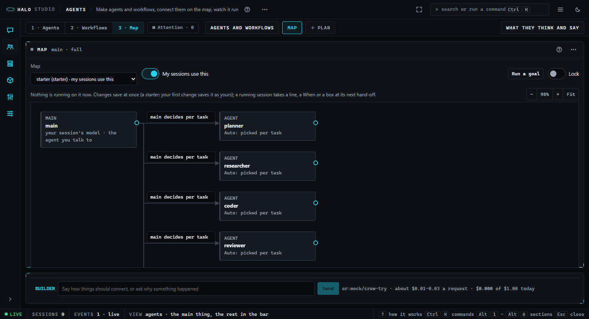
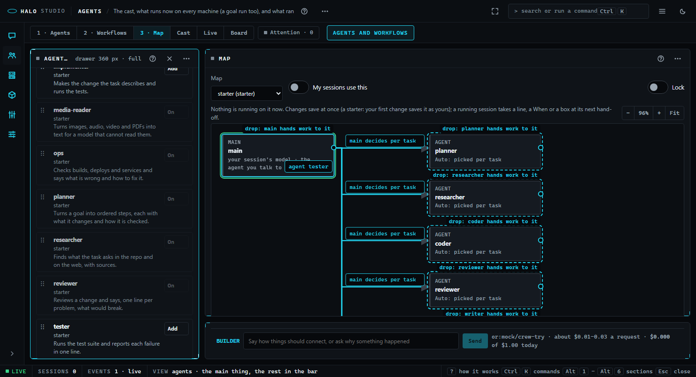
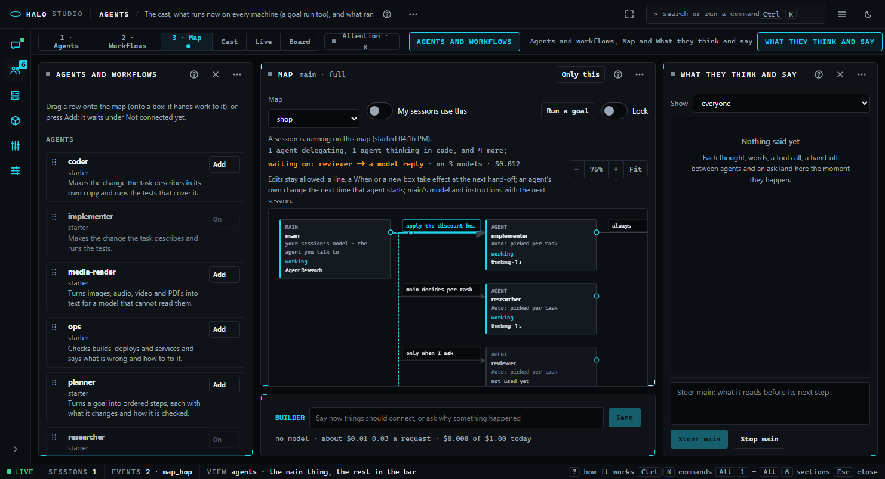
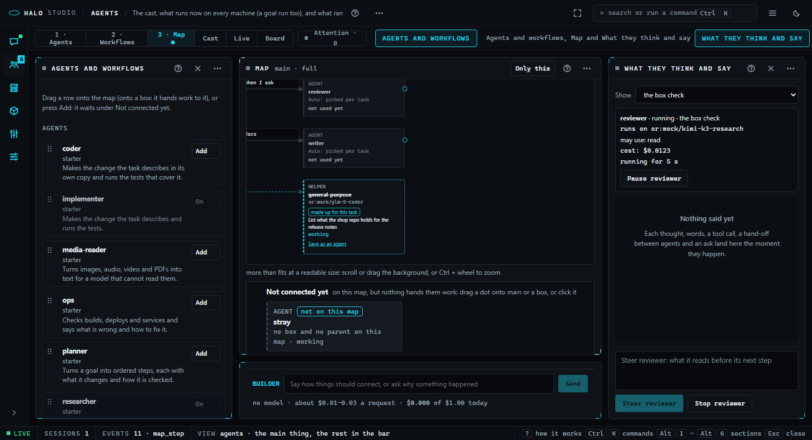
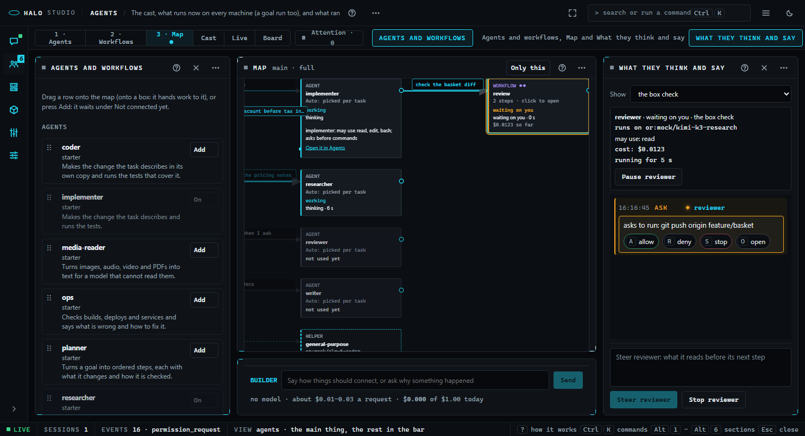
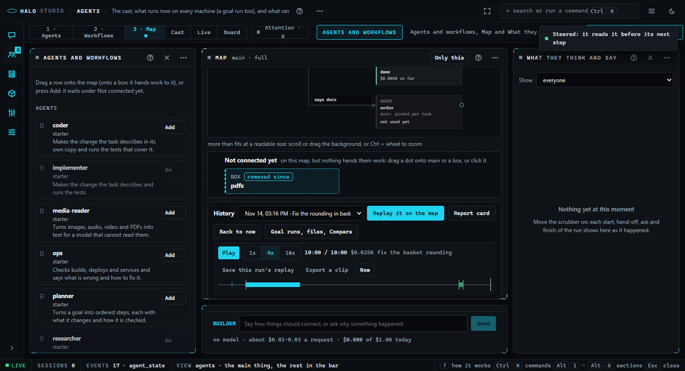

# Studio: Agents -> 3 · Map (3.6.0.0)

Read this when you connect your agents and workflows on Studio's Map tab, add a box, draw a line and say when it hands work on, keep more than one map, pick the map your sessions run on, lock a map, watch a session light the map up, or replay a past run on it.

Part of [Halo Studio](STUDIO.md); the agents are made in [1 · Agents](STUDIO-builder.md), the workflows in
[2 · Workflows](STUDIO-workflows.md); what a session does with a map is [How a session runs on a map](CREW-sessions.md),
and the file is a `map/1` [crew file](CREW-FORMATS.md#a-map-format-map1).

## The tab

Agents (`Alt+2`), then **3 · Map** (the `3` key). The switch reads **1 · Agents | 2 · Workflows | 3 · Map | Cast | Live |
Board** (Cast, Live and Board are the older views, still there in this version). It opens on the starter map, or the
map you opened last, a link's `&map=<name>`, this project's map, or the one your sessions use. Nothing opens by itself:
the list to add from is a drawer you open from the bar ("Agents and workflows"), the builder is a box docked below.

**What you see.** **main** -- the agent you talk to -- is always at the left. Every other box is an agent (its name and
model; Auto: "picked per task") or a workflow (its name, its steps as dots, "click to open"). There is one kind of line,
"hands work to", and each line's **When** is a label in the lane between the columns, never over a box. A box's column
is its longest chain of lines from main, so every line runs left to right; many lines from one box share one trunk.
Hovering a box lifts its lines and dims the rest; a box grows with its text and is never cut.

**Reading it bigger or smaller.** Ctrl (Cmd on a Mac) + wheel or a pinch zooms; `-` / `%` / `+` / Fit on the canvas;
`0` or a double-click on the background fits. Fit never goes under 75 %: past that the map pans, from main. A zoom you
made by hand stays when you open or close the list drawer; Fit makes it automatic again.

## Adding

Open **Agents and workflows** from the bar: a slim list, your agents (this project's, then the starters) and then the
workflows. Every row has a grip and **Add**; Enter on a row adds it.

- **Add** (or Enter) puts it under **Not connected yet**, the strip under the map: on this map, but nothing hands it
  work yet. It costs nothing until it is connected.
- **Drag** a row over the map: the drop places light up and say what a drop does -- a box says "drop: main hands work
  to it" (or "drop: <box> hands work to it"), the strip says "drop: add, connect later". Dropped on a box, it is added
  with a line from that box and its When card opens at once.

## Connecting

Every box has a **connect dot** on its right edge (a box under Not connected yet: on its left). Drag the dot to another
box, or click it (Enter on it) for a list of the boxes it may hand work to. A box's dot dropped on another box means
"this hands work to that"; a waiting box's dot dropped on main (or any box) means "main hands work to it".

The **When card** opens at the new line:

| When | It means |
|---|---|
| Always | every task this box finishes (from main: every task main hands on) goes there first |
| When the task needs: a PDF, an image, audio, video, code, a review | the task (and its files) needs one of them -- the router's own reading of a task |
| When the task says: words | the task says one of the words (a whole word) |
| Only when I ask | only when the person names it |
| Main decides per task | no rule: main picks among everything it can hand to (the old Auto pool) |

**Save** writes it; **Cancel** on a line you just made takes it back out. Click a line's label to change its When or
**Take the line out** (the box then waits under Not connected yet). Chains are allowed (main -> plan -> code -> reviewer):
the runtime follows them itself ([Chains](CREW-sessions.md#chains)). A line that would make a circle is refused in
one sentence, on the page and by the route: a loop lives inside a workflow as "repeat until".

**A workflow box** opens in place when you click it: its steps (the same read-out as the Workflows tab) and a link,
"open it in Workflows", to change them; nothing is wired inside it here. An agent box opens to what it may use and how
careful it is, with a link to its form.

## Every change saves, with Undo

Each change -- a box, a line, a When, a line taken out, a new map -- is saved at once, and a receipt line says what
changed with **Undo**. It is the builder's own undo store (`~/.halo/crew/.undo/`, the last 20): Undo puts the file back
byte for byte. A starter map is saved as yours, under its name, on its first change; a trusted project's map stays the
project's.

## More than one map

The switcher at the top left lists your maps, this project's first ("this project's", a trusted folder's
`.halo/crew/maps/`), then the starters (`starter`: main decides per task among seven agents; `ship-it`: main -> plan ->
code -> review), and **+ New map** (a name, then main alone). Beside it is the one switch, **My sessions use this**:
new sessions run on that map (config `crew.map`; `halo maps use <name>` writes the same). A running session keeps the
map it started with. **Lock** (off by default, kept in this browser) stops every change: no dot, no Add, no label card.

## The builder on this tab

The box at the foot: "Say how things should connect, or ask why something happened". "send anything touching auth to
my-reviewer after the code workflow" comes back as one preview -- a line for the box, a line for the line with its When
in words (and, on a starter, the copy that makes it yours) -- drawn on the map as a dashed ghost box and a dashed line
with its label. Untick what you do not want, **Apply**, **Undo**. One request may touch agents, workflows and the map:
it is one preview. "what is my map?", "show me my workflows" or "why did reviewer run?" are answered from `studio_show`
with no change lines ([STUDIO-builder.md](STUDIO-builder.md#on-the-map-tab)).

## While a session runs

The same map lights up: there is no second drawing. The tab shows a dot while a session of this Studio runs on a map,
and the map it started with (its row's `map`) is the one lit.

- **The top line**: "A session is running on this map (started 14:02)", then one sentence of what goes on -- who
  works, who waits on what or on you, how many models, the dollars so far (the same sentence Live used, computed from
  the session's rows; no model call) -- and when an edit takes effect: a line, a When or a new box at the next
  hand-off; an agent's own change the next time that agent starts; main's model and instructions with the next session.
  Edits stay allowed while it runs.
- **Each box** says its state (working, waiting on you, done, failed, not used yet), what it does now in a few words
  and its cost so far: a row per fact, and the box grows. Hover a box for its summary; a click opens what its agents
  think and say in the drawer (never a pop-up by itself).
- **A hand-off moves along the line you drew**: the line the runtime's receipt named lights, a dot travels it and its
  label shows the task for a few seconds, then its When again. A chain is seen box to box. With reduced motion there
  is no travel: the line lights and the label says the task. A hand-off sent to the background says "in the background:
  its chain is not followed" on its line while it runs (the runtime follows a chain only for a hand-off it waits for).
  A line not taken keeps its label; its hover says why.
- **An opened workflow box** lists its steps lit as the step runner reports them: the step running, the agents in it,
  a repeat's round and its checks.
- **Helpers the session made up** (main handed a task that no line's When claimed, so it made a helper for it, with
  main's own tools and mode) show beside the box that started them, dashed, tagged "made up for this task", with
  **Save as an agent**: the Agents form opens with an agent built from that helper (its task's first line as what it
  does, main's uses and careful mode), not saved; nothing is written until you press Save there.

- **What they think and say**, a drawer on the right that pushes the map: THINK, SAY, TALK (one agent to another, its
  own label), tool and ask rows, newest at the bottom, following as Session's Live does (scroll up to stop, the pill to
  follow again); filtered by the box you clicked, or everyone. At its foot: **Steer** (a few words the agent reads
  before its next step; Ctrl + Enter sends) and **Stop** (it asks first: the agent stops at its next step), to the
  agent of the clicked box (main for everyone). An ask shows its answers as buttons there, on its box ("waiting on
  you") and in Attention, as before.

- **Another map than the one shown is running**: the top line says so in amber, with **Show the running map**; the map
  shown is not lit. More than one session running: a small picker in the top line, one lit at a time.
- **A session that did not start on a map** (still possible in this version) is not drawn over your map: the top line
  offers it ("1 session running, not on a map: Show it"), and shown it is main and every helper beside it as made-up
  helpers, with "This session did not start on a map" -- no invented lines.
- **An agent that matches no box** (its box was taken off the map, or it hangs from nothing on it) is never dropped: it
  shows under **Not connected yet**, tagged "not on this map" with why.
- A box that lands under Not connected yet while the strip is below the fold is said in the top line ("1 new, not
  connected yet"), with a link that brings the strip into view. A Builder card the session is waiting on (main asked
  to change this map) draws its changes as the builder's dashed ghosts, with "answer it in the session" and a link.

Session's **Map** panel shows the same lit map, compact and read-only, with **Open it on the Map tab**, while a
session runs on a map ([STUDIO-session.md](STUDIO-session.md)).

### What Live did, on the Map (3.6.0.0 R4b)

- **A clicked box's facts and controls.** The drawer's head, a row per fact for the box's agent: the model it runs on
  and **why** (Auto's reason line), what it may use, its tokens, its cost, how long it has run. Beside Steer and Stop:
  **Pause** / **Resume** (the same route as Live's node menu) and, on a failed agent, **Dismiss**.
- **Clocks and the wait.** A working or waiting box shows the seconds on what it does now ("Bash pytest -q · 12 s",
  "waiting on you · 40 s"), from the same waits Live's nodes used. The box the whole session waits on is outlined;
  the top sentence's wait is a link that brings that box into view and opens it in the drawer.
- **Agents talking.** One agent's words to another (a TALK) light a short dashed pulse between their boxes for a few
  seconds, with the first words on a small label; no line is added to the map. With reduced motion nothing travels:
  the two boxes are marked. The row is in the drawer as before.
- **Depth.** A helper that started helpers says "+N under it"; a click lists them in the drawer with who started
  whom, each a row that filters the drawer to it. No second level is drawn.
- **The plan.** When main keeps a todo plan, the top line says "plan: 3 of 7 done"; a click lists it in the drawer.
- **Goal runs.** A goal run going is named in the top line ("A goal run is going: <its goal>", **Open**: its pages --
  lanes, the gate, the merge, its report -- in the drawer). **Run a goal** is on the Map's bar (the goal form, in the
  drawer). Under the map, **Goal runs, files, Compare** opens Live's whole History in the drawer: sessions, goal runs
  and saved replay files, each opening what it opened on Live, and **Compare** when two are ticked.
- **A replay's words.** While a run replays on the map, the drawer shows its starts, hand-offs, asks, failures and
  finishes up to the scrubber's moment, filtered by the clicked box.
- **Other machines.** Another machine's running session is listed in the top line's picker, "on <machine>: open it on
  that machine": its map frames travel on that machine's feed, so it is not lit here.
- **Keys and the empty state.** `J` / `K` move between the working boxes. With nothing running and a finished run in
  History, the top line offers **Replay the last session**.
- **Hover is a summary card** on a lit box (what it is, what it does now, its model, its cost): it opens only on a
  pointer's move, never over the box's own controls; the keyboard reaches the same facts in the drawer.

**Not carried over from Live:** "Hand to another machine"; levels (`LevelSwitch`); the plan drawn as blocks under the
tree (the todo plan is listed instead); a second level of helpers drawn on the map (it is "+N under it"); a goal run's
lanes drawn on the canvas (its pages open in the drawer); a session on another machine lit on this map (listed, opened
on that machine); a session row in Live's History replayed on the map from that list (it replays on Live, as before:
the Map's own History picker replays sessions on the map).

## History

Under the map: a picker of finished runs, newest first, **Replay it on the map**, and **Report card** (from the
record, no model call). A replay lights the map the run ran on (it opens that map when it is another), in quiet
colours, and the scrubber under it moves it: drag, Play at 1x / 4x / 16x, Now (the same scrubber Live had). A box the
run used that the map no longer has shows dashed under Not connected yet, "removed since". A run that did not start
on a map replays as main and its helpers. **Back to now** returns to what runs.

## Routes

| Route | Answer |
|---|---|
| `GET crew/maps` | `{maps: [{name, scope, in_use, boxes, lines, problems}], in_use, source}` -- one row per name, nearest first |
| `GET crew/map/<name>` | `{map, scope, path, writable, in_use, problems, boxes: {id: {kind, names, facts}}, main}` |
| `PUT crew/map/<name> {map}` | save (a new name makes a map): `{undo_id, map, ...}`; 422 with the problem lines (a circle named) |
| `POST crew/map/<name>/use {on}` | config `crew.map`: `{undo_id, in_use}` |
| `DELETE crew/map/<name>` | yours only (a starter or the project's: 409) |
| `POST crew/from-live {session, agent_id}` | Save as an agent: `{agent, from, problems, line}`, an unsaved agent body built from a session's helper; writes nothing |
| `GET live/replay?session=<id>` | the replay's time axis, plus `map` (the map it ran on) and `map_events` (its hand-offs and steps, from its log) |
| `GET fleet` session rows, `/api/events` | `map` on each row; the frames `map_hop`, `map_step`, `map_card` ([CREW-sessions.md](CREW-sessions.md#what-a-session-on-a-map-says-as-it-runs)) |

Every write is owner-only and keeps its before-image (`POST builder/undo {undo_id}` puts it back); `crew/from-live` is owner-only too, though it writes nothing (it reads a session's agent).
