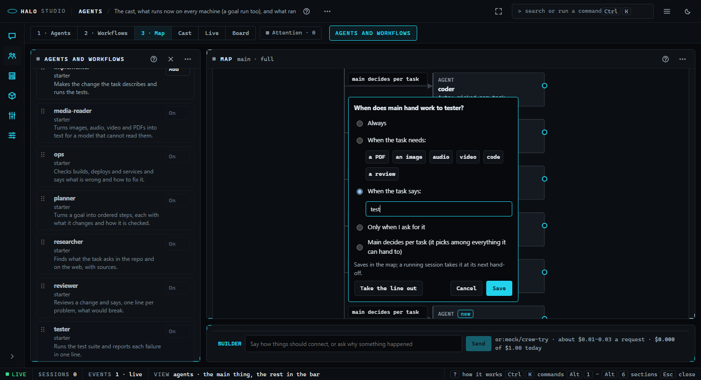

# Studio: Agents -> 3 · Map and 4 · Live (3.6.0.2)

Read this when you connect your agents and workflows on Studio's Map tab, add a box, draw a line and say when it hands work on, keep more than one map, pick the map new sessions run on, lock a map, or watch a session's run in 4 · Live.

Part of [Halo Studio](STUDIO.md); the agents are made in [1 · Agents](STUDIO-builder.md), the workflows in
[2 · Workflows](STUDIO-workflows.md); what a session does with a map is [How a session runs on a map](CREW-sessions.md),
and the file is a `map/1` [crew file](CREW-FORMATS.md#a-map-format-map1).

## The tab

Agents (`Alt+2`), then **3 · Map** (the `3` key). The switch reads **1 · Agents | 2 · Workflows | 3 · Map | 4 · Live**,
one word each:

- a **map** is who hands work to whom (main, agents, workflows, lines and their When); it is built here, on 3 · Map, and
  a session runs on one map;
- a **workflow** is a fixed list of steps, each done by one agent; it runs from a box or when main calls it
  (2 · Workflows, whose head line says "Workflows are fixed lists of steps. A session runs a map, and a box on a map can
  run a workflow: see Map.", with Map a link here);
- **Live** is what a session is doing now, drawn on the map it really follows (4 · Live, and Session's left drawer);
- the **Feed** is what the agents say and do, line by line (Session's main panel, and Live's drawer).

3 · Map is the plan: it opens on Auto (the default), or the map you opened last, a link's `&map=<name>`, this project's
map, or the one new sessions use. Nothing opens by itself: the list to add from is a drawer you open from the bar
("Agents and workflows"), the builder is a box docked below.

## Adding

Open **Agents and workflows** from the bar: a slim list, your agents (this project's, then the ones that ship with Halo) and then the
workflows. Every row has a grip and **Add**; Enter on a row adds it.

- **Add** (or Enter) puts it under **Not connected yet**, the strip under the map: on this map, but nothing hands it
  work yet. It costs nothing until it is connected.
- **Drag** a row over the map: the drop places light up and say what a drop does -- a box says "drop: main hands work
  to it" (or "drop: <box> hands work to it"), the strip says "drop: add, connect later". Dropped on a box, it is added
  with a line from that box and its When card opens at once.

## Connecting

Every box has a **connect dot** on its right edge (a box under Not connected yet: on its left). Drag the dot to another
box, or click it (Enter on it) for a list of the boxes it may hand work to. A box's dot dropped on another box means
"this hands work to that"; a waiting box's dot dropped on main (or any box) means "main hands work to it".

The **When card** opens at the new line:

| When | It means |
|---|---|
| Always | every task this box finishes (from main: every task main hands on) goes there first |
| When the task needs: a PDF, an image, audio, video, code, a review | the task (and its files) needs one of them -- the router's own reading of a task |
| When the task says: words | the task says one of the words (a whole word) |
| Only when I ask | only when the person names it |
| Main decides per task | no rule: main picks among everything it can hand to (the old Auto pool) |

**Save** writes it; **Cancel** on a line you just made takes it back out. Click a line's label to change its When or
**Take the line out** (the box then waits under Not connected yet). Chains are allowed (main -> plan -> code -> reviewer):
the runtime follows them itself ([Chains](CREW-sessions.md#chains)). A line that would make a circle is refused in
one sentence, on the page and by the route: a loop lives inside a workflow as "repeat until".

**A workflow box** opens in place when you click it: its steps (the same read-out as the Workflows tab) and a link,
"open it in Workflows", to change them; nothing is wired inside it here. An agent box opens to what it may use and how
careful it is, with a link to its form.

## Every change saves, with Undo

Each change -- a box, a line, a When, a line taken out, a new map -- is saved at once, and a receipt line says what
changed with **Undo**. It is the builder's own undo store (`~/.halo/crew/.undo/`, the last 20): Undo puts the file back
byte for byte. A map that ships with Halo is saved as yours, under its name, on its first change (Auto stays as it is: a change names a new map); a trusted project's map stays the
project's.

## More than one map

The switcher at the top left lists Auto (the default: main decides per task among seven agents) first, then your
maps, then this project's ("this project's", a trusted folder's `.halo/crew/maps/`), then the others that ship with
Halo (`ship-it`: main -> plan -> code -> review), and **+ New map** (a name, then main alone). Each row says two facts in plain words: "· running in
{session}" (or "· running in {n} sessions") for a map open sessions run on, "· new sessions" for the map new sessions
use. Beside it is the one switch, **New sessions run on this**: new sessions run on that map (config `crew.map`; `halo
maps use <name>` writes the same). A running session keeps the map it started with: turned on while one runs on
another map, the receipt says "{session} keeps running on {A}, as it started. Start a new session to run on {B}.", with
none open "New sessions run on {B}.", and **Undo** beside it. A map main makes in a session comes with its row "New
sessions run on <name>" ticked. **Lock** (off by default, kept in this browser) stops every change: no dot, no Add, no
label card.

## The builder on this tab

The box at the foot: "Say how things should connect, or ask why something happened". "send anything touching auth to
my-reviewer after the code workflow" comes back as one preview -- a line for the box, a line for the line with its When
in words (and, on one that ships with Halo, the copy that makes it yours) -- drawn on the map as a dashed ghost box and a dashed line
with its label. Untick what you do not want, **Apply**, **Undo**. One request may touch agents, workflows and the map:
it is one preview. "what is my map?", "show me my workflows" or "why did reviewer run?" are answered from `studio_show`
with no change lines ([STUDIO-builder.md](STUDIO-builder.md#on-the-map-tab)).

## While a session runs: 4 · Live

A session's run is drawn in **4 · Live**, not on the Map: the Map stays the plan you edit. Live opens on the session
Session chose (the newest open session here when none was chosen), and its first line says, in one true sentence, which
map that session runs on: the map it started with, which it keeps ("This session keeps running on X, as it started.
Start a new session to run on Y." when new sessions now use another). While a session runs, Agents opens on Live.

- **Which session.** With two or more open, a picker lists each as "{title} · {map}", this machine's first, then every
  other machine's open session. A pick here is Session's pick too. Another machine's session shows only where its
  drawing is (that machine's Studio); nothing is fetched for it.
- **The drawing.** The map that session really follows, left to right, with the Map's columns and When labels, lit by
  what runs: a workflow box is its block ("workflow review · step 2 of 2", a row per step); the agents in a box are
  named rows ("implementer · {model} · working"); a helper main made for a task no line claimed is a row "made up:
  {task} · {state}" with **Save as an agent** (the Agents form opens with it, not saved). Every hand-off lights its line
  and leaves a trace; a hand-off outside the lines is dashed in its own colour; a label shows the task for a few
  seconds, then its When again.
- **Step in from a box.** A click on a box, a step row, a line or a label opens the step-in card: Pause, Stop and a few
  words to steer.
- **Held still.** Live is read-only (no connect dot, no When card, nothing dragged) and never amber. While the pointer
  is on the drawing or a card is open, new rows and hand-offs change words in place; a box that would move waits until
  the pointer leaves. It fits only when first drawn and when the map changes.
- **Feed**, Live's right drawer (its button on Live's bar): what the agents of that session say and do, line by line --
  thoughts, words, tools, hand-offs, asks -- newest at the bottom, with Steer, Stop, Pause / Resume and Dismiss at its
  head. A click on a box sets the Feed to that box; it opens only by its button or a door ("Agents: follow agent
  {name}" in the palette lands on Live's Feed for that agent). An ask shows its answers there and in Attention.

**On 3 · Map, a running session is one quiet line** in a row kept from the first draw (the drawing never moves when it
comes or goes), each with **Watch it in Live**:

- "{session} runs on this map now."
- "{session} runs on {A}, as it started; new sessions run on this map." (several: "{n} sessions run on other maps, as
  they started; new sessions run on this map.")
- "{session} is running the workflow {W} from this map. It runs on {A}, as it started." -- and that workflow's box is
  marked "running now in {session}".
- A map a session builds while you are elsewhere opens the next time you open 3 · Map; while you are on the Map with
  another map, the draft or a When card open, the row says "{B} was just built in {session} at {t}." with **Open it**.
  The map you have open, changed by a build, is re-read in place, keeping your When card, your pick and your zoom.

The Map keeps its own right drawer for **Run a goal** and a goal run's pages (**Goal run**: its plan review, its
lanes, and once it ended its report); a goal run going is named in its top line ("A goal run is going: <its goal>",
**Open**). The Map draws the plan and what runs now; it never draws the past. A finished goal run's report is its own
page, **Goal run** (from the palette or the run's link); a finished session is exported from Session's LAST SESSIONS
rows (**export**) or with `halo session export <id>`.

Session's left drawer is **Live** too, the same drawing in Session ([STUDIO-session.md](STUDIO-session.md)), with
**Open in Agents -> Live**.

## Routes

| Route | Answer |
|---|---|
| `GET crew/maps` | `{maps: [{name, scope, in_use, boxes, lines, problems}], in_use, source}` -- one row per name, nearest first |
| `GET crew/map/<name>` | `{map, scope, path, writable, in_use, problems, boxes: {id: {kind, names, facts}}, main}` |
| `PUT crew/map/<name> {map}` | save (a new name makes a map): `{undo_id, map, ...}`; 422 with the problem lines (a circle named) |
| `POST crew/map/<name>/use {on}` | config `crew.map`: `{undo_id, in_use}` |
| `DELETE crew/map/<name>` | yours only (one that ships with Halo or the project's: 409) |
| `POST crew/from-live {session, agent_id}` | Save as an agent: `{agent, from, problems, line}`, an unsaved agent body built from a session's helper; writes nothing |
| `GET live/report?ref=session:<id>` (or `run:<id>`) | a finished run's report card: `{card, markdown, story_all}`; 404 when the ref names nothing (an old saved file too) |
| `GET fleet` session rows, `/api/events` | `map` on each row; the frames `map_hop`, `map_step`, `map_card` ([CREW-sessions.md](CREW-sessions.md#what-a-session-on-a-map-says-as-it-runs)) |

Every write is owner-only and keeps its before-image (`POST builder/undo {undo_id}` puts it back); `crew/from-live` is owner-only too, though it writes nothing (it reads a session's agent).
