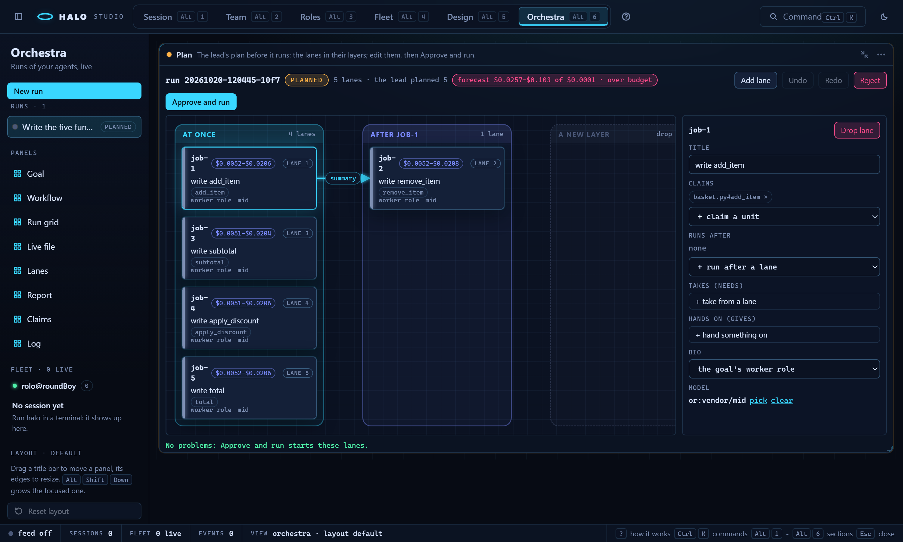
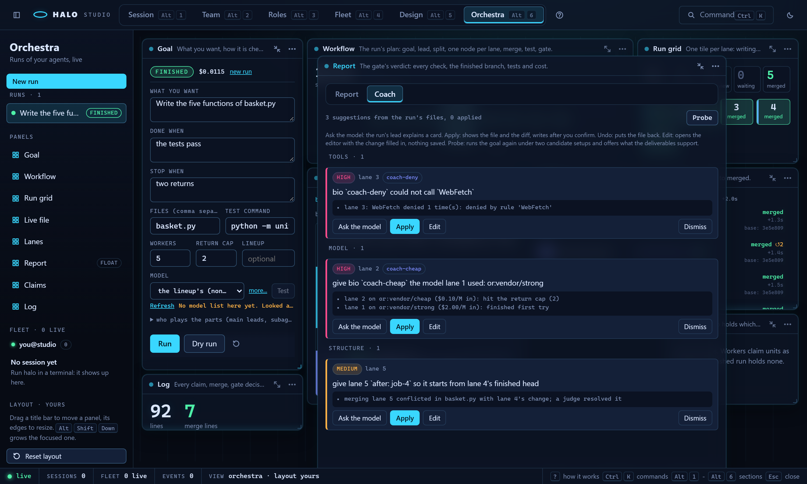

# Studio: the Orchestra console

Read this when you run an Orchestra goal from Studio: the run console, the plan canvas and the coach.

Part of [Halo Studio](STUDIO.md), which lists every part.

## Orchestra: the run console

`Alt+6` (or `?mode=orchestra`) is the console for [Orchestra](ORCHESTRA.md)
runs in the git repo that holds Studio's folder (`halo studio` started
there, or `--cwd`). It opens on the newest run.

**Before a run (3.0.4.0)** the section is one centered **Start** view, not
eight empty panels: the goal form (WHAT YOU WANT, DONE WHEN, STOP WHEN with
examples, the files and the test command, the budget: workers and return
cap, the lineup, the **MODEL** select, and who plays the parts under a
disclosure) with **Run** and **Dry run**, what a run does in five numbered steps, and the
past runs to open. 3.1.4.0: the MODEL select shows without opening the
disclosure; its first option, "the lineup's (<model>)", is what the lead
resolves to without one (the role table, else the default model, `GET
models/resolve`). Starting or opening a run brings up the panels; **open the
workspace anyway** does too. **New run** (the header's **+**, or the palette's
**Orchestra: new run**) returns to the Start view. An Orchestra goal has no
dollar budget: its budget is how many workers and how many times the gate may
send a part back. **Review the plan before it runs** (beside Run; on the Goal
panel under the disclosure) sends `review: true`: the run stops after the
lead's split and the plan canvas below takes the console's place. 3.2.1.0
R1: a LINEUP whose `acceptance` names a test (and `review: true`) gives the
run that test when TEST COMMAND is empty, and the plan review, as `halo
orchestra new --lineup` does; the form then says "test from the lineup:
<command>" under the test field (a test you type wins).

**A pack's workflow (3.2.1.0 R2).** Under the goal form, **or run a pack's
workflow** is a select of the workflows of the packs that run here (`GET
pack/manager`, read once and again on each `pack_changed`), by their
`<pack>/<name>` and description. A pick fills in the workflow's form in the
goal form's place -- the same form the Pack Manager's **Run <workflow>** opens
([STUDIO-packs.md](STUDIO-packs.md)): its ref, its stages, one field per input
at its default, the MODEL select, **Run** (`POST orchestra/run {workflow,
inputs, model}`, compiled as `halo workflow run` does; a compile problem shows
under the form) and **a blank goal instead**, which brings the goal form and
the picker back. With no running pack that has a workflow there is no select.

Its eight panels sit on the same movable workspace as everything else, each
on its full face with its one-line about and its `?` help (Workflow, Run grid
and Log open on their compact face, which shows the whole graph, every tile
and the newest lines at the default size). The Goal panel's default height
shows every field and **Run** without scrolling. The header's **+** lists the runs of
the repo under the panels, newest first (click one to open it; 3.3.2.0 R2, the expanded rail before).

| Panel | Compact face | Full face | Motion |
|---|---|---|---|
| **Goal** | WHAT YOU WANT / DONE WHEN / STOP WHEN as a card, the workers, the cost, the run state badge | the open run in one line (state, cost, **stop** while it runs, **new run**) over its goal form (as on the Start view) with **Run** and **Dry run** | the badge follows the run: flowing while it runs, a green sweep when it finishes, red when it stops, amber when it was interrupted |
| **Workflow** | steps finished, the running step, the graph | the graph and the step list | the designed graph laid out in SVG: goal, lead, split, one node per lane, merge, test, the gate diamond, done; pending steps are faint, the running step's outline flows, the diamond lights when the gate acts, a failed step is red, and the gate's return arrow turns amber once a piece has been sent back |
| **Run grid** | the counters (joined, writing, in review, waiting, merged) and one tile per lane, 5 to 50 | larger tiles with each lane's title | a tile that is writing flows, a waiting one pulses amber, a merged one turns green; click a tile to focus that lane in Lanes and Live file |
| **Lanes** | joined, writing, merged, one strip per lane | the timeline: one trace per worker on the run's clock from "joined" to "merged", a node at each state change, a diamond where the gate sent the piece back; hover a node for its time and text; 3.0.9.0: an arc from a lane to each lane that starts after it, a chip on the later lane naming what it takes (`summary`, `all`, an artifact, or `after`) and a "base: <sha7>" line on every lane | the running lane's trace flows, a waiting lane pulses amber |
| **Live file** | units being written, units merged, a minimap of the bands | the goal file in mono with each lane's claimed unit as a band in its lane colour, labelled claimed, writing, written or merged, holding the lane's current text (its worktree copy); a picker when the goal has several files | a band being written shimmers; a claimed band is hatched |
| **Report** | checks passing, cost, one pip per check | the checks with ticks and crosses, the finished branch and sha, the tests, the cost and time; **Copy** puts the report text (as `halo orchestra report` prints it) on the clipboard; a dry run shows the lead's jobs here; 3.0.9.0: the **Coach** tab beside it (below) | one green sweep when the report lands |
| **Log** | line count, the last lines | the run log with each line's elapsed time, a lane filter, kind filters and **follow** | new lines slide in |
| **Claims** | live claims, writing, the lead | each live claim with its holder, state and expiry, with **Release** and **Steal** (the lead takes the unit) | a claim being written flows; one that expires within a minute pulses amber |

The lanes take their colours from a ten-step ramp mixed from the theme's
accent, accent-2, ok and text tokens. Amber and red are never used for a
lane, because they mean "needs you" and "failed". Settings: Lanes shows
times as elapsed (`+12.5s`) or clock (`14:02:09`); Live file picks the file
and can fold every unclaimed line; Log keeps its filters; Workflow can
label the worker lanes; Goal switches the open run. These options are kept
in your browser (`halo.studio.orchestra.opts`).

The panels update from the live feed. A run started here publishes every
state, claim, merge, gate and report line as an `orchestra_*` event (the
session id is `orchestra:<run id>`). A line for the open run refreshes the
panels within a quarter second; a claim or merge refetches the file view.
When the feed is not connected and a run is live, the panels poll every
5 s instead. Palette commands (`Ctrl`/`Cmd`+`K`): **Orchestra: new run**
(the Start view), **stop run**, **open run <id>** and **focus lane N**.

### The plan canvas (3.0.9.0)

While the open run is `planned` (its goal has `plan: review`) one panel,
**Plan** (`orchestra-plan`), takes the console's place. Its toolbar names
the run, how many lanes there are and how many the lead planned, and has
**Add lane**, **Undo** / **Redo** (`Ctrl+Z` / `Ctrl+Shift+Z` on the canvas),
**Reject** and **Approve and run**. The canvas (`plan-canvas`) draws the
lanes as cards (`plan-lane`) in one labelled box per layer (`plan-layer`):
the first runs at once, each next box runs after the lanes it names, and an
empty box at the end opens a new layer. An `after` edge (`plan-edge`) joins
a lane to each lane it waits for, with a chip naming what it takes
(`summary`, `all`, an artifact) or `after`. Drag a card into another box:
the first box clears what it runs after (and what it takes), box *k* makes
it run after every lane of box *k-1*. Click a card: the inspector edits its
title, its claims (chips; add one from the goal's units, which names the
lane that already claims it), what it runs after, what it takes (needs:
from a lane, `summary`, `all` or one of that lane's gives), what it hands on
(gives: a name, a kind, paths), its bio (the Roles bios) and its model (the
Roles model picker with **Test this model**), and **Drop lane**. Every edit
is one undo step and is sent as the draft (`PUT orchestra/<run>/plan`); the
answer's problems show under the canvas (`plan-problem`, click one to select
its card) and on each card they name (a red outline and the text). **Approve
and run** (`plan-approve`) stays disabled while a problem remains and its
tooltip names them; it sends the plan and the console comes back as the run
goes on. **Reject** opens a card that asks for the reason; the run stops with
it.

The cost forecast (3.1.2.0, [ORCHESTRA.md](ORCHESTRA.md#the-forecast)): each
card carries its lane's cost chip in its header (`plan-cost`: the low-high
band, `? $` dashed when its model has no catalog price; its tooltip names
the tokens and whether the lead estimated them), and the toolbar the total
against the goal's `budget_usd` (`plan-forecast`: "forecast $0.03-$0.10 of
$0.50"), red with "over budget" when its high end passes the budget. Every
edit's `PUT` answers the new forecast. **Approve and run** over the budget
still runs, with a toast that says so. In the run console a lane whose
upstream the gate sent back shows a STALE badge (`lane-stale`) until it is
re-based, then the re-base line (`lane-rebase`).

### The Coach tab (3.0.9.0; the loop since 3.1.3.0)

Once a run has its report, the Report panel has two tabs: **Report** and
**Coach** (`report-tab-coach`). Coach reads the run's files through `GET
orchestra/<run>/coach` (kept in the run's `coach.json`) and shows the
suggestions as cards (`coach-card`, with `data-kind`, `data-severity` and
`data-applied`) grouped by kind: TOOLS, MODEL, PROMPT, STRUCTURE,
COORDINATION. The head line counts them and how many are applied
(`coach-summary`); under it one help line names the buttons (`coach-help`).
Each card has its severity chip (high, medium, low), the lane and the bio it
is about, the suggestion, and its evidence in mono (`coach-why`), then:

- **Ask the model** (`coach-ask`): the run's lead explains the card in one
  paragraph (`POST orchestra/<run>/coach/ask`; one model call, kept in the
  run's `coach.ask.json`). The paragraph shows under THE LEAD
  (`coach-paragraph`) with **Ask again** (`coach-ask-again`, a new call); a
  model error is one amber line on that card (`coach-paragraph-error`).
- **Apply** (`coach-apply`, on the cards that name a change) first opens the
  confirm card under the card (`coach-confirm`): the kind of change and its
  value, the file Apply writes (`coach-confirm-file`; "new" when Apply
  creates it) and the before -> after diff in mono (`coach-diff`: added
  lines cyan, removed amber), with **Cancel** (`coach-confirm-cancel`,
  nothing written) and **Apply** (`coach-confirm-apply`), which writes the
  change through the same writer the bio form, the Lineup tab or the plan
  editor uses (`POST .../coach/apply {id, confirm: true}`). The card then
  shows **APPLIED** (`coach-applied`, its apply id and file in the tooltip).
- **Undo** (`coach-undo`, on an applied card) puts the file back as it was
  before Apply when nothing changed it since (`POST .../coach/undo`); the
  chip reads **UNDONE**. A file changed after the apply is left as it is
  and the toast names the reason.
- **Edit** (`coach-edit`, the 3.0.9.0 Apply) opens the editor that owns the
  field with the change filled in, and saves nothing:

- a bio change opens Roles on that bio's form with the field filled in and
  marked, under a note naming it (`bio-coach-note`); nothing is saved until
  you press **Save bio**, and **Undo the change** reads the bio again;
- a lineup change opens the lineup with that role's model changed in the
  draft and the Inspector on its Lineup tab (Save keeps it);
- a plan change opens the plan editor on the run's plan with the edit
  staged as one undo step: the bar says STAGED and names the card, the run
  already ran so nothing is sent, **Copy the plan** puts the jobs on the
  clipboard (for `halo orchestra approve --file` on a run started with
  Review the plan before it runs) and **Back to the run** returns to the
  console.

**Dismiss** (`coach-dismiss`) hides a card for that run in this browser
(localStorage); **Show dismissed (n)** brings them back. A mission that
ended has a **Coach** face
beside Plan, Running and Report, and the Team run bar has **Coach** once
the run is done or stopped (the cards in a dialog); each has the same Ask
the model, Apply, Undo and Edit (routes: the kind's coach path plus `/ask`,
`/apply`, `/undo`). The rules, the record file and the Undo rule:
[ORCHESTRA.md, "The coach"](ORCHESTRA.md#the-coach).

One run goes at a time. **Run** is disabled while a run is live, and
**stop** (the Goal panel's run line, or its compact face) asks the runner to
stop at its next step. Routes:
[ORCHESTRA.md, "In Studio"](ORCHESTRA.md#in-studio).
