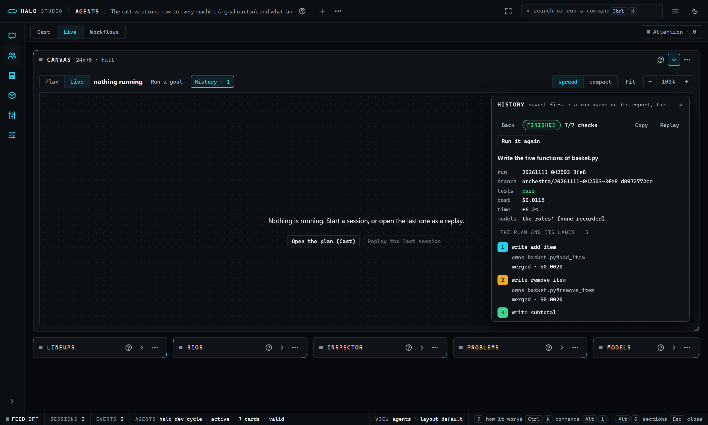

# Studio: a goal run on Live and in History

Read this when you run an Orchestra goal from Studio: Run a goal on Agents -> Live, the run as a job on Live, its plan review, its lanes in the inspector, and its report in History.

Part of [Halo Studio](STUDIO.md), which lists every part.

## One place for what runs, one for what ran (3.4.0.0 D)

The owner, 2026-11-10: "I always see unused older versions of orchestrations ... I'd love to see what is actually happening."
Agents' third view, **Runs**, and its Start screen are gone. The [Orchestra](ORCHESTRA.md) engine is unchanged (the
worktrees, the merge, the test gate, the supervisor, outcomes, replanning; `halo orchestra` and `halo supervise` run on
it); what changed is where you look at it: a goal run that runs is a job on **Live**, and one that ended is a row of
**History** (Live's bar), opening on its report. Nothing finished is drawn on Live.

Every old door lands there: `R` (Runs' key), `?mode=orchestra`, `?mode=team`, `?mode=agents&view=runs`, `halo studio
--mode orchestra` and `/studio orchestra` open Agents on Live (with "Runs is gone: ..." once in this browser); a door that
names a run (`?mode=agents&run=<id>`, an attention row's `o`, the palette's run lines) opens it where it is: its lead
on Live while it runs or waits on you, its report in History once it ended.

## Run a goal

**Run a goal** on Live's bar (this halo's scope; the palette's **Agents: Run a goal**) opens the goal form as a panel
beside the canvas (`run-goal-drawer`), closed on load, closed again by its `x`, Esc, the button, or a run that started:

- **WHAT YOU WANT**, **DONE WHEN** (what the gate checks), **STOP WHEN**, the **SHARED FILES** and **THE GATE'S TEST**
  (empty: the lineup's acceptance test, when it names one: "test from the lineup: ..." under the field once it ran);
  **WORKERS** (lanes, 1 to 50), **RETURN CAP** (how often the gate may send one part back), the **LINEUP** and the
  **MODEL** select (its first option "the lineup's (<model>)"); who plays the parts under a disclosure;
- **Review the plan first**: the run stops after the lead's split and waits on you;
- under it, the form says **what it does**, **what it may cost** (one call for the lead's split, one worker session per
  lane, again for each part sent back; a goal run has no dollar cap: its budget is the lanes and the return cap) and
  **where it writes** (the run's record in `.halo/orchestra/<run>/`, one worktree and branch per lane, the finished
  branch `orchestra/<run>`; your checkout is not touched) -- `run-goal-says`;
- **Run** starts it (it is on Live at once); **Dry run** asks the lead for the split alone (one call): its jobs open as
  the dry run's report page in History.

With more than one machine paired (the fleet pack on), **Run it across the fleet** opens the Mission panel on Live. Under
the form, **or run a pack's workflow** lists the workflows of the packs that run here; a pick (or the Pack Manager's
**Run <workflow>**) fills in that workflow's form in the goal form's place (its inputs, the MODEL, what it does, costs
and writes, Run), compiled as `halo workflow run` does; **a blank goal instead** brings the goal form back.

## The run as a job on Live

While a run runs (or waits for its plan) Live draws it beside the session's agents
([STUDIO-live.md](STUDIO-live.md)): its **lead** (`agents-live-lead`) and its **lanes** (`agents-live-lane`) in the run's
block under it (with the plan under it on, the block titled "goal run: <goal>"; on the tree, a group box of kind `run`).
Each box has a row per fact and grows to hold them, never squished: a lane's **STATE**, **MODEL**, **COST**, **OWNS**
(the claim ledger's keys it holds, else the units the plan gave it; `lane-owns`), its worktree, and what it waits on;
the lead's goal, state, model and cost. The merge and the gate are steps on the waiting path (a lane written waits on
the merge, one in review on "the gate: <test>", the lead on the lane at work, the merge or the gate), and the sentence
under the bar covers the run. Hover a box for its summary card; nothing opens on its own.

**A click is the inspector**, summary first (`run-inspector`): a lane's goal, what it owns, its state, its last output,
its cost, its model and worktree; the lead's goal, done when, state, lanes by state, cost and the gate's test. Then one
Open row per page, each with Back (or Esc): **Plan** (the jobs, each lane's owns line, what it runs after and takes),
**Claims** (the ledger's rows: key, holder, state, with **Release** and **Steal** while the run is live), **Diff** (each
unit the lane writes: the base lines, then the lane's text), **Test result** (the gate's lines, the re-base's test, the
report's tail) and **Log** (the timed lines; a lane's own). The controls: **Stop the run** (one confirm, then the runner
stops at its next step), **Review the plan** while it waits on you, **Steer its worker** (the lane's worker as an agent in
the inspector: Steer, Pause, Stop, Take over), **Watch in Session**.

## Review the plan

A run started with Review the plan first stops after the lead's split: its lead on Live says the plan waits on you, the
sentence asks first, and **Review the plan** on the lead (or in its inspector, the palette, the supervisor's "open the
plan") opens the **Plan** panel (`orchestra-plan`) on Live, the canvas folded to its strip while it is open. The panel is
the 3.0.9.0 plan canvas: the lanes as cards in one labelled box per layer, an `after` edge with a chip naming what it
takes, drag a card into another box to change what it runs after, click one to edit its title, claims, what it runs
after and takes, what it hands on, its bio and its model; every edit is one undo step and is checked, a problem
outlines its card and holds **Approve and run**; each card carries its cost chip and the toolbar the forecast against
the goal's `budget_usd`. **Approve and run** hands the plan to the run, the panel closes and the canvas opens again with
the lanes on it; **Reject** asks for a reason and the run stops with it.

## History: a finished run's report

History (Live's bar, `live-history`) lists the past newest first; a goal run's row says how it ended (and why), its wall
time, its cost and the models its lanes ran on. A click opens its **report** as a page of the drawer
(`history-report`): how it ended, the goal, the facts (run, branch and sha, tests, cost, time, models), **the plan and
its lanes** (what each owned, how it ended, how often the gate sent it back, its model and cost), **the gate** (done
when, the test, its tail), **the merge** (the order, what merged, the conflicts), **outcomes** (every check with a tick
or a cross), a workflow run's **artifacts**, and a dry run's jobs. **Copy** puts the report text (`halo orchestra
report`) on the clipboard, **Replay** draws it on Live as it ended, **Run it again** opens the goal panel with this goal
filled in (nothing runs until Run), **Back** returns to the list.

## Routes

The panel reads and writes the same routes the console did ([ORCHESTRA.md, "In Studio"](ORCHESTRA.md#in-studio)):
`GET orchestra/runs` (3.4.0.0 D: each row also carries `models`, `elapsed_s`, `ended`, `stop_reason`), `GET
orchestra/<run>`, `GET .../events`, `GET .../file`, `POST orchestra/run`, `POST .../stop`, `.../release`, `.../steal`,
`GET|PUT .../plan`, `POST .../approve|reject`. One run goes at a time: Run is disabled while one is live.
