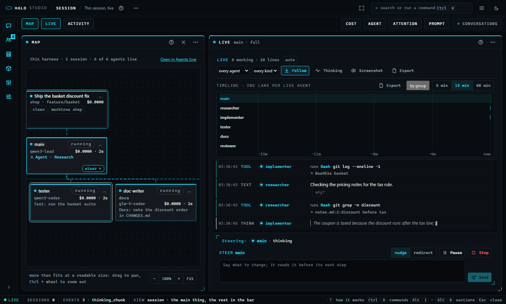
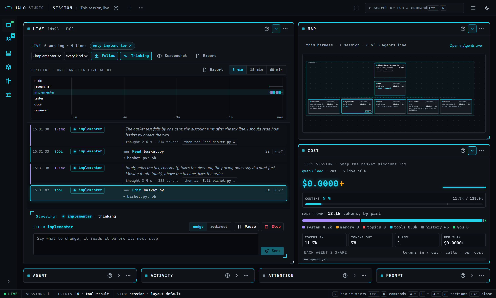
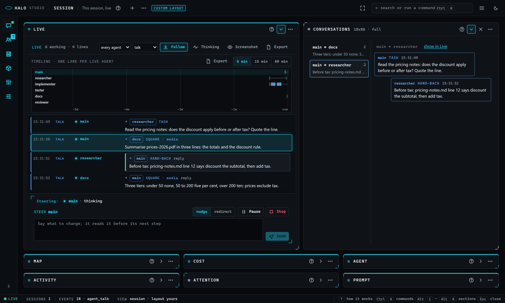
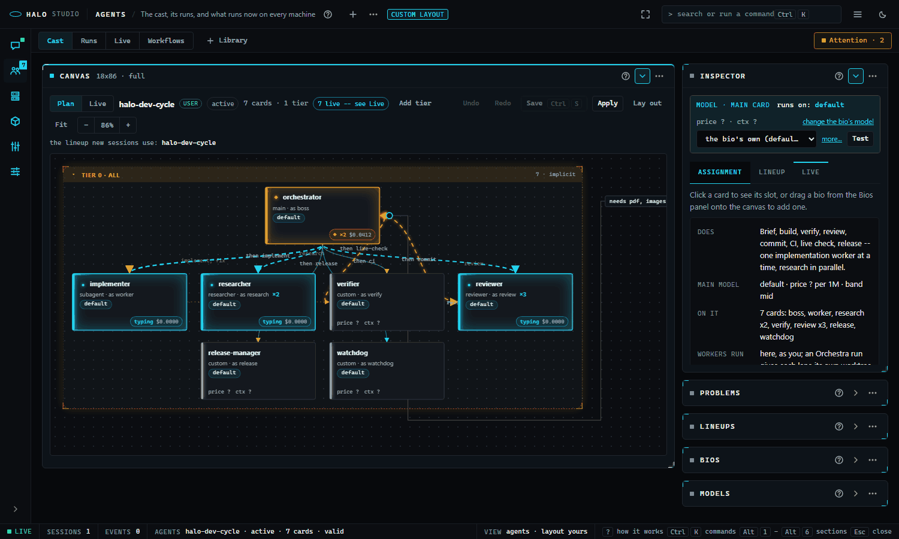
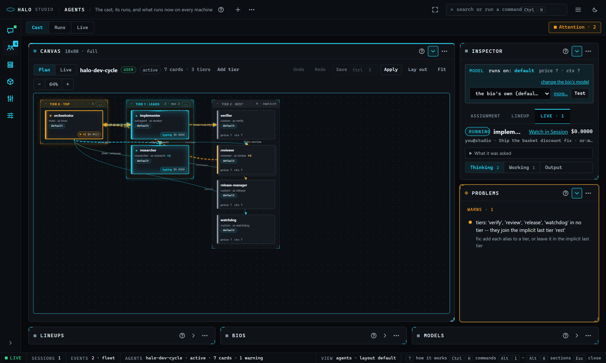

# Studio: how each section works

Read this when you want the one-screen story of a section (Session, Agents, Local, Packs, Setup, Settings).

Part of [Halo Studio](STUDIO.md), which lists every part.

## How each section works

The same copy as Studio's **How this works** card (`ui/src/routes/sectionHelp.ts` for the steps,
`routes/help.ts` and `routes/help-<section>.ts` for the panels' about lines and help).

**What a model takes, wherever a model is picked** (3.3.15.0 R2). Every place a model is chosen shows the same tags
(`routes/shared/ModelTakes.tsx`, `data-testid="model-takes"`, one line of fixed-height tags): what the model reads
(vision, audio, video, pdf), image when it makes images, then tools and think when stated or measured, at most six
then `+n`; a text-only model reads `text in` and one whose catalog states no inputs `?` -- the words of the terminal
`/model` picker's `takes=` column, from the `takes` key the model rows carry. The group's title is the model's honest
line (the best-at cache's). They show under the model select (Orchestra's goal and workflow forms, Roles' Assignment,
the MODEL strip, the tier menu and the bio form), beside Session's new-session select, in Settings' model rows, and as
the TAKES column of Roles' picker table and Setup's default model, where a row is one line with fixed columns: the
ranked kinds (code, research, design, bulk, fast, local) stay the "best" sort, and the honest line, those kinds, the
effort word and the card's chips sit on the detail line under the list for the highlighted row (else the picked one),
as the terminal picker's subtitle does. An option's title carries the takes words too. Local's Library rows keep
their own capability chips with each one's truth (verified, declared, expected).

### Session

**What it is.** Your own session, live (3.1.4.0, `Alt+1`, "This session,
live"; 3.1.5.0 made it the dashboard; 3.3.2.0 opens it on Live): one live
column of everything every agent here does, as it happens, fills the stage;
the map of this harness's agents and what the chosen session costs wait as strips.
The fleet's agent tree, timeline, log, attention queue and agent inspector, narrowed
to this harness and the session you chose, plus two panels of its own,
Live and Cost; Agents -> Live on the fleet keeps everything (3.3.16.0 R2). They are the same
components (one implementation each) reading the fleet stores through one
scope, `{harness, session}`, which the section sets while it shows.

Until this harness has a live session the section is its Start view, with **New session** (3.3.11.0 R2: the model, the folder, a session with no terminal at all: [A session without a terminal](STUDIO-session.md#a-session-without-a-terminal-33110-r2)); when a
supervisor's pulse is live (Halo 3.1.8.0 R1, `halo supervise`,
[SUPERVISE.md](SUPERVISE.md)) that view shows one line -- "N goals done, M
waiting on you, $X" -- and the decisions that wait are the Attention queue's
`goal_*` rows.

**How to use it.**

1. **Open it**: `/studio` in a terminal session opens Studio here on that
   session (`halo studio --session` from a shell); `Alt+1`, the palette,
   **Watch in Session** on the Roles Live tab or on a live Orchestra run's
   line and **Open in Session** in a node's `...` menu land here too. With nothing saved for the browser,
   Studio opens here while a session of this harness is live.
2. **Watch everything at once (Live)**: every agent's text, each tool call
   and its result, what it hands back and what it asks you land in one
   column in the order they happen. Each line leads with the fleet log's
   columns (3.1.7.0): the time, the kind (`TOOL`, `TEXT`, `THINK`, `OUT`,
   `ASK`, `SPAWN`, `STATE`, `YOU`, `ERR`) and the agent's tag: its own
   colour, its name and its state glyph (cyan works, amber waits, green
   done, red failed). In a narrow column the time, the kind and the tag
   share one row and the line runs under them. A tool call is one compact
   row, "runs Bash", what it runs on and its time ticking while it runs,
   then the first line of its result; click the row and its whole result
   opens under it. An output or a hand-back is a block; an ask is an amber
   card with its `A` / `R` / `S` / `O` answers. Above the lines sits Activity's
   timeline strip for this session, one lane per live agent over 5, 15 or
   60 minutes (a lane click shows only that agent); the header has an
   agent pick and a kind pick (tools, text, states, asks; your own steers
   always show) beside Follow, and **Export** (the session as one Markdown trace). Follow is on: scroll up (or type a steer) and the view
   holds, **N new rows · follow** brings you back. Click a tag (or pick the agent) and the
   column shows only that agent; the tag again (or `Esc`) shows everyone.
   Hover a line and that agent's node lights on the map. The newest 500
   lines stay in the column; the full log is in Activity.
   **Thinking you can see** (3.3.16.2): a model's reasoning is its own kind,
   `THINK`, one row per thought however many pieces it streams in: muted
   italic on a thin violet rule, a caret while it grows, four lines with
   **show all** for the rest (the row grows), and once the agent acts, a small
   suffix with how long it thought and, when the provider reports them, its
   tokens (`thought 4.2 s · 812 tokens`). A model with no thinking shows no
   THINK row; nothing is made up. Thought, then act: the row's chip says what
   it led to (`then ran Edit basket.py`, `then answered`) and jumps there, and
   **why?** on that action row opens the thought that preceded it right under
   the row (with **what the model saw** beside it, the turn's postmortem).
   **Thinking** beside Follow shows only the thoughts and what each led to,
   for everyone or the agent you pinned: one mind read as a column. The
   timeline's lanes are drawn by phase: thinking (violet), running a tool
   (cyan), writing (green), waiting on you (amber), idle (a thin line); hover
   a segment for its length, click a thinking one and the column scrolls to
   that thought. The kind pick has **think** and **talk** too.
   **Agents talking** (3.3.16.2): one agent's words to another are a `TALK`
   row: the speaker's tag, an arrow, the listener's tag and why it was said,
   `TASK` (a parent hands a child its task; the SPAWN row keeps its one line),
   `HAND-BACK` (a child's last words to its parent), `STEER` (one agent steering
   another; your own steer stays `YOU`), `SQUARE` (a Workflow square's hand-off
   and what came back, the square named) or `HAND-OVER` (Hand to... another
   machine, the machine named); the words clamp at four lines like a thought.
   A hand-back is one row: when the agent's OUT block ("done, its last words")
   is already there with nothing of its own after it, that block becomes the
   TALK row; an OUT that would land after a TALK hand-back is not added. The
   edge between the two agents on the map lights once, from the speaker to
   the listener. The optional **Conversations** panel (the header's **+**;
   never open on load, its strip counts threads and messages) shows them as
   threads: the pairs that have talked on the left, newest first, with the
   count and the last line; the chosen pair's messages on the right, each on
   its speaker's side with its reason and time, a reply under what it
   answers. Click a message to see its row in Live; **show in Live** narrows
   Live to that pair (its chip in Live's header shows everything again).

   

   
3. **Steer from the column**: the Steer box is always at its foot. It talks
   to the agent you pinned, or, with none pinned, to the chosen session's
   main agent; its header says who (**STEER main**) and its target line what that agent runs now (`Steering: coder · Bash (pytest -q), 12 s`), and Pause and Stop
   (which asks first) sit beside it for that agent. Click a row or a node, `s` on a row or `Tab` in the field to change the target (outlined);
   a steer you send there lands at once right under its target row (`↳ steer to coder: ...`) and reaches the agent's next
   step ([Studio: steering and exporting a session](STUDIO-session.md)). Hover any tag in the column, or any node on the map, and click
   **steer**: that agent is pinned and the box has the keyboard. When the
   agent has finished, the box says so in one line and takes no text.
4. **Read the map as one picture**: one card per session on this machine,
   its agents drawn as a tree under it, each agent under the one that
   spawned it and its children fanned out side by side, sized to fit the
   panel. A node shows its model (3.3.15.0: without the provider prefix; the
   full id in its tooltip and the Agent panel), what it has cost and, while a tool runs,
   its name and time (`Bash 12s`). Its state is a 2 px rule across its top
   and its edge (3.3.15.0, the Instrument look): working cyan, with a dash moving
   along the edge toward it, waiting amber (three pulses, then steady), done green
   that fades over ten seconds, failed red that stays until you click the node. Entering selects the newest working agent; click
   another and its session becomes the chosen one (its card is marked).
5. **Read the cost**: the spend ticks up beside its sparkline (the spend
   since the page opened); the context bar fills with what the model holds
   (amber past 80 %, red past 95 %); the figures add the tokens in and out,
   the turns and the cost per turn, the time and the model; the stacked bar
   is each agent's share of the spend, its rows its own tokens in / out, its
   model calls and its own spend. The figures move with the terminal
   (3.1.8.0): the session's own `message_end` (the end of each model call:
   the running spend, the token totals, the context) and `status` (a turn's
   start and end: the phase, the model, the turn) frames are the ones the
   terminal's status bar moves on, and Cost moves on the same frame; a frame
   that leaves a figure empty leaves it as it was, a sub-agent's frames
   never move the session's figures, and a GET fleet answer read before the
   frame never pulls a figure back. **Turns** are your turns in the session,
   the terminal's count (the turn a frame belongs to); per turn is the spend
   over them. An agent's own count on its line is its model **calls**. The spend is what the priced calls cost (3.3.3.1): when a model reports no price the figure and per turn carry a `+` whose title names the model ("main's model databricks-glm-5-3 reports no price: this is what the priced agents spent"), and main's line says "no price", never $0.0000, when main's own model is the unpriced one. A
   sub-agent's spend joins its parent's total when it finishes (the
   terminal's figure works the same way), so the bar counts each agent's own
   share: main's is the session total less its finished sub-agents', a
   finished sub-agent's sits on its own line once, and a running sub-agent's
   own spend shows on its line until it finishes and joins the total.
6. **Open what you need**: Map, Cost, Agent (the inspector: its three streams, Steer,
   Pause, Stop, Follow, Pin), Activity (a lane per live agent over the full
   log), Attention (what waits on you, one key each) and Prompt (3.3.11.0 R1: type into the session) wait as strips at
   the foot; one click opens each beside Live (or the header's **+**), Reset layout (its **...**) puts the arrangement back, a
   layout you made is kept. `J` / `K` hop between this harness's live agents; `Alt+Enter` opens Prompt, the keyboard in its box ([the Prompt panel](STUDIO-session.md#the-prompt-panel-33110-r1)).

**Panels.** Live (`session-live`): every agent here at once, what it types,
runs, hands back and asks, in the fleet log's columns under this session's
timeline strip, with the Steer box at its foot. Map (`session-map`): your
sessions on this machine as cards, each one's agents as a tree -- since 3.3.11.0 R2 the thumbnail of the tree Roles Live draws full size (**Open in Roles Live** on its bar). Cost
(`session-cost`): the chosen session's spend and sparkline, the context bar, the tokens, your turns and cost
per turn, elapsed, the model, each agent's own share, tokens and calls, moving with the terminal; under the context
bar (Halo 3.3.5.0 R4, `session-cost-composition`) the last request's parts as one stacked bar in tokens -- system,
memory, topics, tools, history, you -- each in its own token colour with its count, the same line `/cost` prints
([MODELS-prompt-budget.md](MODELS-prompt-budget.md#the-composition)). When the session holds a local request that
will not fit its window, the Live column's Steer box shows the preflight line with three buttons above it:
Compact (`preflight-compact`), the bigger-window model on the host (`preflight-switch`, disabled when none fits)
and Send anyway (`preflight-send`), answering the same card the terminal shows. Agent (`session-agent`):
the selected agent, its streams and controls (3.3.16.2: its Thinking tab draws a thought the way Live's THINK row
does, with what it led to). Conversations (`session-conversations`, 3.3.16.2, optional): agents talking, one thread
per pair. Activity (`session-activity`):
the chosen session's timeline lanes and full live log. Attention
(`session-attention`): what waits on you in this harness's sessions. Prompt (`session-prompt`, 3.3.11.0 R1): the
session read like the terminal, a box to type into it (the slash list, Queue it / Steer; 3.3.15.0 R3: three lines at the least, it grows with the draft and takes the panel's free height while the conversation is short) and each turn's receipt marks; with no session here it offers New session, and a session with no terminal (chip **no terminal**) has **Open in terminal** and **End session** in its header (3.3.11.0 R2).

### Agents

**What it is** (3.3.16.0 R1). Your agents in one place (`Alt+2`, "The cast, its runs, and what runs now"): Team, Roles and
Orchestra folded into one section with three views on one switch, first on its bar -- **Cast** (`C`: the lineup and
its bios, Roles as it was), **Runs** (`R`: Orchestra as it was -- a goal, the lead's plan, the lanes in their
worktrees, the merge, the tests, the report and the coach -- with each lane's owns line and **Test this lineup**) and
**Live** (`L`: the session's agents as a tree, a running Orchestra run's lanes under its lead; 3.3.16.0 R2: a
**this halo | fleet** switch, the fleet being every machine you run or joined, and the Attention chip). It opens on Live (3.3.18.0: only what
runs now, the past in History, [STUDIO-live.md](STUDIO-live.md)) with nothing else open. The old doors land on their views: `?mode=roles` on Cast (`&view=live` on Live), `?mode=orchestra`
and `?mode=team` on Runs; `?mode=agents&view=cast|runs|live` is the door itself. The whole story:
[STUDIO-agents.md](STUDIO-agents.md).

**Panels.** Cast and Live draw Roles' six (Lineups, Canvas, Inspector, Problems, Bios, Models); Runs draws
Orchestra's eight (Goal, Workflow, Run grid, Live file, Lanes, Report, Claims, Log). The header's `+` and `...` menus,
the palette's panel rows and the status bar follow the view.

#### Roles

Moved: Roles is Agents' **Cast** (and its Plan | Live switch is Agents' Cast | Live) since 3.3.16.0 R1;
everything below is as it was, reached by `Alt+2` then `C`, or the old door `?mode=roles`.

**What it is.** A lineup says which agent, on which model, plays each part in
your sessions, and in which tier it sits. Studio shows it as cards in tier
boxes you can arrange and edit; the files are `~/.halo/teams/<name>.yaml` and
`~/.halo/agents/<name>.yaml`.

**How to use it.**

1. **Pick a lineup**: Lineups lists yours and the shipped ones (the active
   one is marked); New makes your own copy. Each card on the canvas is one
   slot: an agent bio in a role, with the model that resolves for it, its
   price and its context.
2. **Give each card its bio**: Bios, click one to edit it -- its model from
   the table (sort by price or context, search, best for), **Test this
   model**, its tools, limits and output. Drag a bio onto the canvas to add a card.
3. **Stack the tiers**: each box is a tier; a member spawns only into the
   next tier down, and main sits alone in tier 0. Drag a card into another
   box to move it (the lineup saves); a box's label strip collapses it.
4. **Fine-tune the sections**: the Inspector's Assignment edits the selected
   card's slot; Lineup has delegation, routing, budget, escalation, context,
   permissions, pipeline, acceptance and tiers, each as a form with a
   YAML toggle. Each field's one-line help is in the tab's `?` (3.3.15.0 R3), not under the field.
5. **Fix what Problems lists**: every edit is checked at once; blocks stop a
   save or a run start (a model id its catalog does not know, a bio with no
   tool), warns are worth a look. Click one to select its card.
6. **Save, then Apply**: Save writes the YAML to your scope (a shipped
   lineup becomes your copy); Apply makes it the lineup new sessions use.
   `Ctrl+Z` undoes any edit.
7. **Watch it work**: while a session runs, the cards whose agents work
   glow; click one and the Live tab shows exactly what it types, with
   Steer, Pause and Stop ([Live Roles](STUDIO-fleet.md#live-roles-the-lineup-lights-up)). A
   finished session's replay plays back on the canvas.
8. **Read the glow**: hover a glowing card's state glyph or its live badge
   and the card explains its glow (below). The tier box takes the strongest
   state of its cards, and the edges into a card take that card's colour.
9. **See what really runs: Plan | Live** (3.3.11.0 R2; the switch first on the canvas bar, `L`, the palette's "Roles: Live", `?mode=roles&view=live[&session=<id>]`; 3.3.16.0 R1: Agents' Live view, `?mode=agents&view=live`). Plan is the lineup above; **Live** is the session's actual agent tree on the whole page -- one node per agent, live or finished and still in the frames, an edge from each parent, NOTHING dropped (an agent whose parent is not in the session hangs under "unknown parent"), so every agent Auto spawns is there even when it matches no card, 1:1 with the terminal's `/agents live`. A node shows its name, role, state, model (3.3.15.0: without the provider prefix, the full id in the Inspector), cost and time, its state as the Session Map's nodes show it, and an `auto` pick's reason ("picked at spawn: coder on <model> -- <why>"); the lineup card a node matches is a faint dashed group behind it. Layered layout (the Session Map's own), spread or compact, `+` / `-` and Fit (`F`; the first draw fits a tree wider than the page); a click selects the agent and the Inspector's Live tab follows it; `steer` and `...` on a node are the Map's. The session picker lists every session the fleet carries, this harness first. All of it reads the frames through one adapter, `ui/src/lib/work/record.ts`.

**The glow, and when it comes and goes (3.1.5.0).**

| State | Colour | What it looks like | When it goes |
|---|---|---|---|
| working | cyan | the card's band and border turn cyan, a light flows along its top while the agent types, one pulse per tool call; the badge names the tool | comes on with the agent's first running state (a queued agent shows its badge only) |
| waiting | amber | an amber pulse three times, then a steady amber edge; the badge is a diamond | when you answer (a question, a permission, a plan, a pause) |
| done | green | the card turns green and fades back to plain | over the ten seconds after it finished |
| failed | red | the card turns red, the badge says failed | stays until you click the card |

A lineup with one tier lays its members out as a fan under main; a lineup
with no cards (or none open) shows "Drag a bio here, or New lineup" on the canvas.

**Panels.** Lineups: your lineups and the shipped ones; the active one is
marked. Canvas: the open lineup as cards, one box per tier: who plays each
part, on which model (on Live: the session's agent tree). Inspector: the selected card's slot, every section of
the lineup, and what runs on the card now. Problems: what is wrong with the
lineup as you edit it, each with its fix. Bios: the agent bios: who each
card is, on which model, with which tools. Models: the model catalog the
pickers read, per provider, and why it is empty when it is.

**Keys.** Agents `Alt+2`, then `C` Cast; `L` Plan | Live (3.3.11.0 R2; Agents' Live); on the canvas (click it first) `A` lays out, `F` fits, `+` / `-` zoom, the arrows nudge the selected card (`Shift`: further),
`Del` removes it (asks first); `Ctrl+Z` / `Ctrl+Shift+Z` undo / redo a lineup edit, `Ctrl`/`Cmd`+`S` saves; `J` / `K` the next / previous card whose agent works (on Live: the next / previous working agent of the tree),
its Live tab open; `Space` pins that agent's mini stream, with the Live tab open `F` follows and `P` pauses; `Esc` unpins (or closes a replay).

#### Orchestra

Moved: Orchestra is Agents' **Runs** since 3.3.16.0 R1 (`Alt+2` then `R`, or the old door
`?mode=orchestra`); everything below is as it was, plus the owns line and Test this lineup
([STUDIO-orchestra.md](STUDIO-orchestra.md#orchestra-the-run-console), [STUDIO-agents.md](STUDIO-agents.md#who-owns-what-the-owns-line)).

**What it is.** Several agents write to the same files at once and nothing is
lost: a lead splits your goal into lanes, one worker per lane writes its part
in its own git worktree, and a gate checks the result before it lands.

**How to use it.**

1. **Write the goal**: WHAT YOU WANT, how Halo knows it is done (DONE WHEN)
   and when to give up (STOP WHEN), plus the files the workers share and the
   test the gate runs.
2. **Press Run**. Dry run asks the lead for the split only: nothing is
   claimed or written.
3. **The lead splits it into lanes**. Each lane claims a part of the files;
   one worker per lane builds its part in its own git worktree.
4. **How this works: the plan** (3.0.9.0). With **Review the plan before it
   runs** on, the lead's lanes open on the plan canvas before any worker
   starts: one box per layer, drag a lane into another box to change what it
   runs after, click it to edit its title, claims, bio, model and hand-offs.
   Every edit is checked; **Approve and run** starts the lanes, **Reject**
   stops the run with your reason
   ([ORCHESTRA.md](ORCHESTRA.md#review-the-plan)).
5. **Hand-offs**: a lane can wait for another (after) and take its summary,
   its units or a file it saved (needs); it then starts from that lane's
   finished head, and a lane that takes nothing sees only the goal. Lanes
   draws each edge with what it carries and every lane's base
   ([ORCHESTRA.md](ORCHESTRA.md#hand-offs)).
6. **The gate checks DONE WHEN**. The parts merge one at a time, your test
   runs, and a part that fails goes back to its worker (up to the return cap).
7. **Read the report**: every check with a tick or a cross, the finished
   branch and its sha, the tests, the cost and the time.
8. **How this works: Coach** (3.0.9.0). The report's Coach tab reads the
   run's files and suggests what to change: a bio's prompt, model or tools,
   a lane's after, a gate that looped. Each card shows its evidence; Apply
   opens the bio, the lineup or the plan with the change filled in, and you
   save it there. Dismiss hides a card for that run
   ([ORCHESTRA.md](ORCHESTRA.md#the-coach)).

**Panels.** Goal: what you want, how it is checked and when to give up; then
Run. Plan (only while a run waits for review): the lead's lanes in their
layers, to edit before Approve and run. Workflow: the run's plan: goal, lead, split, one node per lane, merge,
test, gate. Run grid: one tile per lane: writing, in review, waiting or
merged. Live file: the shared file, each lane's claimed part a band in its
colour. Lanes: each worker's timeline on the run's clock, from joined to
merged. Report: the gate's verdict: every check, the finished branch, tests
and cost. Claims: who holds which part of the files right now, and until
when. Log: every claim, merge, gate decision and note, with its time.

#### Team

Moved: Team's board went in 3.3.16.0 R1. Who owns what is a run plan's detail in Agents' **Runs** (each
lane's owns line, a lane's claims); `?mode=team` lands there with one line the first time. The team file and
`halo team` left in 3.4.0.0.

#### Fleet

Moved: the Fleet section went in 3.3.16.0 R2; its pieces live where they belong. A machine's agents are Agents ->
**Live** with the scope on **fleet** (`F` on the canvas, `?mode=fleet`): every machine as a box, its sessions as cards,
each session's agents as a tree; the inspector follows the pick (the glance, a machine's summary with its specs and
spend caps, one agent, a mission part). Attention is the chip in Agents' bar (`A`); Activity is an optional panel of
Live; missions are runs (Agents -> Runs, `M`); pairing, sharing and the people are Setup -> **Machines**; the Ollama
panel's card, traffic, fit plan and steward are Local -> **Hosts** and **Steward**. The whole story:
[STUDIO-fleet.md](STUDIO-fleet.md).

### Local

**What it is** (3.3.5.0). Local (`Alt+3`, the third core section since 3.3.16.0 R2; 3.3.16.0 R2 also gave it the Fleet section's Ollama panel) holds everything about the machines that serve your local models
and the models they serve, paged like Settings: a page rail on the left (Resources, Hosts, Models, Library, Hugging Face, Logs,
Benchmarks, Steward, Pool and Voice), one page on the right. **Resources** is the live view: a strip per host sampled once a second while
the page is open (GPU use, VRAM and what holds it, RAM, CPU, the temperature, each number titled with its source) and the
traffic view under it, every call to a local server as it happens with the steward's events inline. **Hosts** is every
server Halo knows as a card with Load, Unload, keep-alive and Make it fit; **Models** is every installed model with its card,
its fit meter and an intent filter; **Library** is what could be installed, each row with a fit badge; **Hugging Face** is
the model folders, what is on disk, downloads and the local servers Halo starts for them. Benchmarks and Steward say what the
next rounds put there and the commands that do it today. Nothing opens on its own; `halo local` opens it on Hugging Face,
`halo local library` on Library. The pages:
[STUDIO-local.md](STUDIO-local.md).

### Packs

**What it is** (3.2.0.0 R6). The Pack Manager, `Alt+4`: install, grant, enable, set up, update and remove
packs from the places you trust (`packs.sources`, then the packs Halo ships); every button runs the code
`halo pack` runs. Its panels, actions and routes, and the sections a pack you enable adds after it:
[STUDIO-packs.md](STUDIO-packs.md) (what a pack draws in Studio: [PACKS.md](PACKS.md) "In Studio").

### Setup

**What it is** (3.3.0.0; pages since 3.3.1.0). This box's setup, `Alt+5`: the wizard's step rail over one block per page
(its own Save, Back / Next, a Summary last; 3.3.16.0 R2: **Machines**, pairing, sharing and the people, before it), nothing opening on its own. `halo init` opens it (`?first=1`), `halo setup team`
on the Team page (`?block=team`); `halo init --terminal` is the terminal wizard. **Done starts halo** (3.3.3.0): the Summary's
"Done: start halo" goes to Session and the terminal that ran `halo init` starts halo. The pages: [STUDIO-setup.md](STUDIO-setup.md).

### Settings

**What it is** (3.3.3.0). Settings (`Alt+6`) is every key of `~/.halo/config.json`: a group rail on the left (General, Studio
(3.3.16.1: the hover cards), Agents and roles ... the Local group), one group's page on the right, one row per key with its help line, its control, a **default** marker while it is unset,
Reset to default and the exact `halo config set` line as its footer. A change saves at once and says when it takes effect (now,
the next session, the next launch); the search box finds a row across every group, and the palette lists every row as `Settings:
<title>`. All of it comes from one catalog, `halo_harness/settings_catalog.py` (docs/CONFIG.md's key table names each row's
page); nothing opens on its own. `halo settings fleet` opens the Fleet page (`?mode=settings&group=fleet`), `halo settings
--terminal` lists a group's keys in the terminal.

**The Ollama page** (3.3.4.0) carries the steward's block above its rows: the job's status line, the model that writes
its notes (automatic, none, or one of this machine's local models: `ollama.steward.model`), the mode (auto, review, off:
`ollama.steward.apply`), the job switch and **Open Local -> Hosts**; the thresholds stay ordinary rows below it.

**The Themes page** (3.3.12.0, after General on the rail; `?mode=settings&page=themes`, `halo settings themes`) draws the `theme` key as the eleven palettes of the registry (3.3.15.0: + `instrument`): one row each with its swatch row (surface, text, accent, accent-2, ok, warn, bad, in the colours `GET settings/themes` sends, never hard-coded), its posture and its one-line label, the current one marked **CURRENT** (3.3.15.0 R4: with the key unset, instrument, Halo's default), and **Follow the system** above them (instrument on a dark system, paper on a light one; since R4 a choice that writes `theme: auto`, no longer the unset key).
Pointing at a row previews it on the page itself (the key untouched); Esc or moving away puts the saved one back, a click saves it. The modifiers are two toggles, **Daltonized** (blue and orange for the accents and the status colours, never red against green) and **ANSI** (a terminal's 16 colours; Studio stays in full colour), one at a time; the footer is the `halo config set theme <name>` line. `/theme`, `halo config set theme` and the header's theme menu move the same value. 3.3.12.0 R2: an enabled pack's palettes follow the eleven in a group under the pack's id (and its name), drawn the same way (swatches, hover preview, Daltonized), each saved as `<pack-id>/<id>`; the group says that turning the pack off puts the palette before it back ([EXTENSION_API.md](EXTENSION_API.md#themes)).
