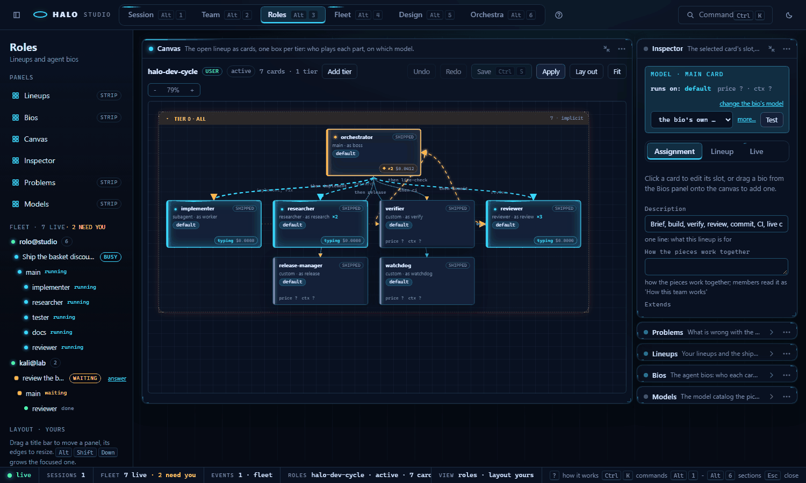
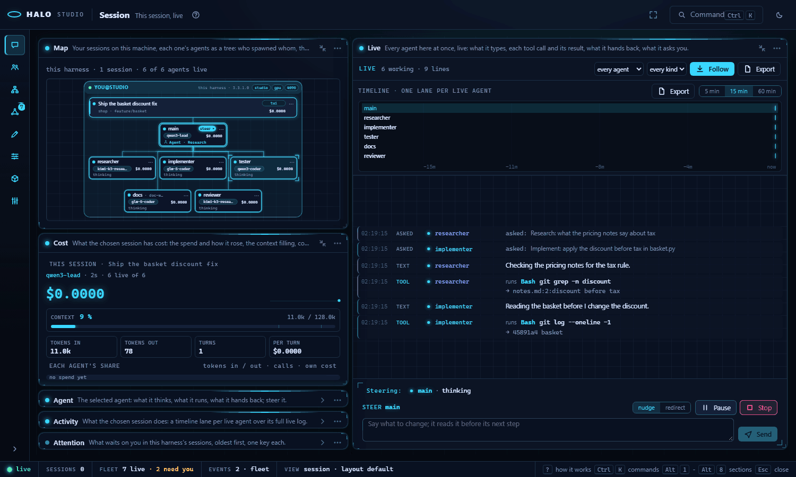
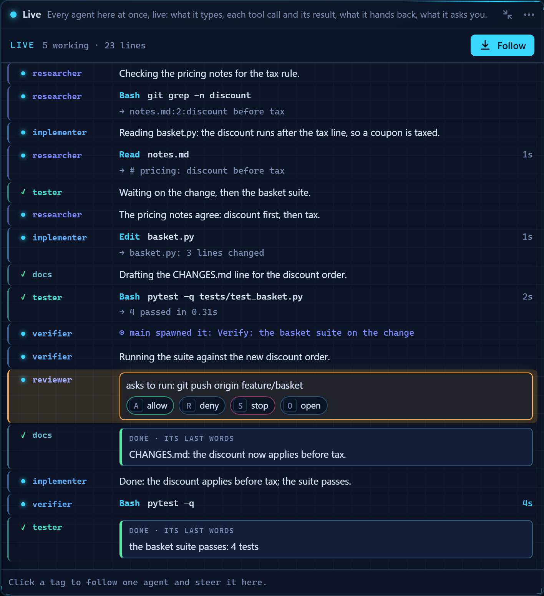

# Studio: how each section works

Read this when you want the one-screen story of a section (Orchestra, Roles, Design, Fleet, Team, Session) and the live feed.

Part of [Halo Studio](STUDIO.md), which lists every part.

## How each section works

The same copy as Studio's **How this works** card (`ui/src/routes/sectionHelp.ts`
for the steps, `routes/help.ts`, `routes/help-orchestra.ts` and
`routes/help-design.ts`, `routes/help-roles.ts` and `routes/help-session.ts`
for the panels' about lines and help).

### Orchestra

**What it is.** Several agents write to the same files at once and nothing is
lost: a lead splits your goal into lanes, one worker per lane writes its part
in its own git worktree, and a gate checks the result before it lands.

**How to use it.**

1. **Write the goal**: WHAT YOU WANT, how Halo knows it is done (DONE WHEN)
   and when to give up (STOP WHEN), plus the files the workers share and the
   test the gate runs.
2. **Press Run**. Dry run asks the lead for the split only: nothing is
   claimed or written.
3. **The lead splits it into lanes**. Each lane claims a part of the files;
   one worker per lane builds its part in its own git worktree.
4. **How this works: the plan** (3.0.9.0). With **Review the plan before it
   runs** on, the lead's lanes open on the plan canvas before any worker
   starts: one box per layer, drag a lane into another box to change what it
   runs after, click it to edit its title, claims, bio, model and hand-offs.
   Every edit is checked; **Approve and run** starts the lanes, **Reject**
   stops the run with your reason
   ([ORCHESTRA.md](ORCHESTRA.md#review-the-plan)).
5. **Hand-offs**: a lane can wait for another (after) and take its summary,
   its units or a file it saved (needs); it then starts from that lane's
   finished head, and a lane that takes nothing sees only the goal. Lanes
   draws each edge with what it carries and every lane's base
   ([ORCHESTRA.md](ORCHESTRA.md#hand-offs)).
6. **The gate checks DONE WHEN**. The parts merge one at a time, your test
   runs, and a part that fails goes back to its worker (up to the return cap).
7. **Read the report**: every check with a tick or a cross, the finished
   branch and its sha, the tests, the cost and the time.
8. **How this works: Coach** (3.0.9.0). The report's Coach tab reads the
   run's files and suggests what to change: a bio's prompt, model or tools,
   a lane's after, a gate that looped. Each card shows its evidence; Apply
   opens the bio, the lineup or the plan with the change filled in, and you
   save it there. Dismiss hides a card for that run
   ([ORCHESTRA.md](ORCHESTRA.md#the-coach)).

**Panels.** Goal: what you want, how it is checked and when to give up; then
Run. Plan (only while a run waits for review): the lead's lanes in their
layers, to edit before Approve and run. Workflow: the run's plan: goal, lead, split, one node per lane, merge,
test, gate. Run grid: one tile per lane: writing, in review, waiting or
merged. Live file: the shared file, each lane's claimed part a band in its
colour. Lanes: each worker's timeline on the run's clock, from joined to
merged. Report: the gate's verdict: every check, the finished branch, tests
and cost. Claims: who holds which part of the files right now, and until
when. Log: every claim, merge, gate decision and note, with its time.

### Roles

**What it is.** A lineup says which agent, on which model, plays each part in
your sessions, and in which tier it sits. Studio shows it as cards in tier
boxes you can arrange and edit; the files are `~/.halo/teams/<name>.yaml` and
`~/.halo/agents/<name>.yaml`.

**How to use it.**

1. **Pick a lineup**: Lineups lists yours and the shipped ones (the active
   one is marked); New makes your own copy. Each card on the canvas is one
   slot: an agent bio in a role, with the model that resolves for it, its
   price and its context.
2. **Give each card its bio**: Bios, click one to edit it -- its model from
   the table (sort by price or context, search, best for), **Test this
   model**, its tools, limits and output. Drag a bio onto the canvas to add
   a card.
3. **Stack the tiers**: each box is a tier; a member spawns only into the
   next tier down, and main sits alone in tier 0. Drag a card into another
   box to move it (the lineup saves); a box's label strip collapses it.
4. **Fine-tune the sections**: the Inspector's Assignment edits the selected
   card's slot; Lineup has delegation, routing, budget, escalation, context,
   permissions, pipeline, acceptance and tiers, each as a form with a
   YAML toggle.
5. **Fix what Problems lists**: every edit is checked at once; blocks stop a
   save or a run start (a model id its catalog does not know, a bio with no
   tool), warns are worth a look. Click one to select its card.
6. **Save, then Apply**: Save writes the YAML to your scope (a shipped
   lineup becomes your copy); Apply makes it the lineup new sessions use.
   `Ctrl+Z` undoes any edit.
7. **Watch it work**: while a session runs, the cards whose agents work
   glow; click one and the Live tab shows exactly what it types, with
   Steer, Pause and Stop ([Live Roles](STUDIO-fleet.md#live-roles-the-lineup-lights-up)). A
   finished session's replay plays back on the canvas.
8. **Read the glow**: hover a glowing card's state glyph or its live badge
   and the card explains its glow (below). The tier box takes the strongest
   state of its cards, and the edges into a card take that card's colour.

**The glow, and when it comes and goes (3.1.5.0).**

| State | Colour | What it looks like | When it goes |
|---|---|---|---|
| working | cyan | the card's band and border turn cyan, a light flows along its top while the agent types, one pulse per tool call; the badge names the tool | comes on with the agent's first running state (a queued agent shows its badge only) |
| waiting | amber | an amber pulse three times, then a steady amber edge; the badge is a diamond | when you answer (a question, a permission, a plan, a pause) |
| done | green | the card turns green and fades back to plain | over the ten seconds after it finished |
| failed | red | the card turns red, the badge says failed | stays until you click the card |

A lineup with one tier lays its members out as a fan under main; a lineup
with no cards (or none open) shows "Drag a bio here, or New lineup" on the
canvas.

**Panels.** Lineups: your lineups and the shipped ones; the active one is
marked. Canvas: the open lineup as cards, one box per tier: who plays each
part, on which model. Inspector: the selected card's slot, every section of
the lineup, and what runs on the card now. Problems: what is wrong with the
lineup as you edit it, each with its fix. Bios: the agent bios: who each
card is, on which model, with which tools. Models: the model catalog the
pickers read, per provider, and why it is empty when it is.

**Keys.** `Alt+2` Roles; on the canvas (click it first) `A` lays out, `F`
fits, `+` / `-` zoom, the arrows nudge the selected card (`Shift`: further),
`Del` removes it (asks first); `Ctrl+Z` / `Ctrl+Shift+Z` undo / redo a
lineup edit, `Ctrl`/`Cmd`+`S` saves; `J` / `K` the next / previous card
whose agent works (its Live tab opens), `Space` pins that agent's mini
stream, with the Live tab open `F` follows and `P` pauses; `Esc` unpins (or
closes a replay).

### Design

**What it is.** Prototypes, pages, decks and logos made by your own apps and
models. A project is a folder of artboards under `~/.halo/design/<slug>/`, and
every turn saves a new version.

**How to use it.**

1. **Make or open a project**: the Start view names the first one; then
   Projects lists them all, and New project makes another.
2. **Say what to design**: write it in Thread and press Enter: the reply
   streams in as the turn works; **Cancel turn** stops it. **3 directions**
   sends it as three different artboards side by side.
3. **Look and compare**: Artboards: drag a card by its title (the places are
   saved with the project), slide back through its versions, Restore one;
   the device select draws prototypes at phone, tablet or desktop size.
4. **Change it by hand**: double-click a text in a prototype to edit it in
   place; a card's **Knobs** move its spacing and colours; the Design system
   panel edits the tokens or syncs them from a codebase or a web page.
5. **Ask for notes**: pick **Comment** and click a frame to pin a comment;
   Critique has a second model pin notes on an artboard; Contrast checks its
   text against its background; Send comments turns the pins into a turn.
6. **Tidy up**: Rename or Delete an artboard, or Download its file.
7. **Hand it off**: Export writes a folder, HTML, PNG, SVG or PDF; Handoff
   bundles it for the next Halo or Claude Code session.
8. **Use your own files**: Assets: add or drop logos and photos; click one to
   put its path in the message.
9. **Render pictures**: the palette's Media commands add the ComfyUI panels
   to the section.

**Panels.** Projects: your design projects: pick one, or make a new one.
Design system: the tokens every turn designs with. Assets: files a turn can
use. Artboards: every artboard of the project, with its versions, pins and
knobs. Thread: the project's turns: what you asked and what the model did.
From the palette: Media status, Media models, Workflows and Render (see
[Media](STUDIO-design.md#media-the-comfyui-panels)).

**Keys.** `Alt+3` Design; `Enter` in the message box sends (`Shift+Enter`: a
new line); in the text editor and the comment box `Enter` saves and `Esc`
cancels; `Esc` puts the Comment tool down; `Mod+K`: Design: send, Design: 3
directions, Design: pin a comment, Design: cancel turn, Design: export,
Design: new project.

### Fleet

**What it is.** Every Halo harness you run or joined, its sessions and every
agent in them, live: what each one thinks, runs and writes, every decision
that waits on you, what it all costs, and the controls to steer, pause,
stop, take over or hand off any one agent.

**How to use it.**

1. **See every harness**: this harness is the first box. Another machine
   joins with a pair code: Make a pair code on the Start view (or the
   palette), then `halo fleet join` on the other machine. People lists them
   all.
2. **Answer what waits on you**: Attention is one queue of every card,
   gate, paused agent, spend cap and file conflict on every harness. `A`
   accepts, `R` denies or redoes with your text, `S` stops, `O` opens where
   it belongs.
3. **Read the map**: each session is a card, its agents a tree under it: a
   flowing outline works, amber waits on you, green just finished, red
   failed. By project shows each repo's dirty / ahead / behind; an amber
   dashed edge joins two agents editing one file.
4. **Open an agent**: click it (or `J` / `K`): Agent shows what it thinks as
   it types, each tool call with its result and diff, and what it hands
   back. Steer it with a nudge or a new task.
5. **Pause, stop, hand off**: Pause holds it at its next step, Stop asks
   first. Take over gives it your brief; Hand to... passes it to another
   harness (a hand-off note in its repo) and stops it.
6. **Know who can do what**: Capabilities has a spec card per harness:
   hardware, models, craft apps, MCP servers and their tools, skills, tags.
   Who can... ranks the fleet for what you need (gridcraft, a 4090, make a
   video) and picks the best one on the map.
7. **Give the fleet one goal**: Mission (`M`): type the goal and Plan it;
   the hub's lead splits it into parts and gives each to the harness that
   can do it. The plan draws on the map, drag a part to another harness to
   move it, then Approve and Run; the report says who did what and what it
   cost per harness.
8. **Hand-offs**: a part that depends on another reads that part's outputs
   and hand-back (`take: all` for everything it left), and a repo part
   starts from the earlier part's finished branch. The map labels each edge
   with what it carries and each repo part with its base
   ([MISSIONS.md](MISSIONS.md#hand-offs)).
9. **Watch the whole fleet**: Activity draws a lane per live agent (5, 15
   or 60 minutes, tool calls as ticks) over the merged live log. Costs
   ticks today's spend and holds the caps; Health is a doctor summary per
   harness.
10. **Record and replay**: Record saves a session or one agent as a single
   HTML file that plays anywhere. Replay plays a finished session on the
   Roles canvas: the cards light up in the order they worked.
11. **Come back**: after ten minutes away, While you were away sums up what
   happened: sessions, cost, decisions and who made them, files, errors,
   hand-offs.

**Panels.** People: who is in the fleet, what each shares, what it is on,
live or away. Costs: what the fleet spends today, and the caps. Health: a
doctor summary per harness. Attention: every decision that waits on you,
one key each. Map: every harness as a box, its sessions as cards, each
session's agents as a tree. Activity: a timeline lane per live agent and
the merged live log. Agent: the selected agent: what it thinks, what it
runs, what it hands back; steer it, take it over, hand it on, record it.
Capabilities (3.0.6.0): what every harness can do, and who can do what.
Mission (3.0.6.0): one goal for the whole fleet, planned, approved, run and
reported.

### Team

**What it is.** Your project's team file as one board: who works on it
(members, each a part of a lineup, here or on a fleet harness), where their
work lands (blocks: a file, a folder or a git tree, each with its claim
ledger) and in which order (stages: an agent turn or an Orchestra run).
The steps are those of
[How this works: Team](STUDIO-team-roles.md#how-this-works-team).

**Panels.** Board: the team as one board, members as columns, stages as
boxes, blocks underneath. Inspector: the selected stage (its row, Run, the
gate card), block (holders, changes) or member. Change feed: every move of
the run, newest last.

### Session

**What it is.** Your own session, live (3.1.4.0, `Alt+6`, "This session,
live"; 3.1.5.0 made it the dashboard): on the left the map of this
harness's agents over what the chosen session costs, and the whole right
side one live column of everything every agent here does, as it happens.
Fleet's map, timeline, log, attention queue and agent inspector, narrowed
to this harness and the session you chose, plus two panels of its own,
Live and Cost; Fleet keeps everything. The Fleet panels are the same
components (one implementation each) reading the Fleet stores through one
scope, `{harness, session}`, which the section sets while it shows.

**How to use it.**

1. **Open it**: `/studio` in a terminal session opens Studio here on that
   session (`halo studio --session` from a shell); `Alt+6`, the palette,
   **Watch in Session** on the Roles Live tab or on a live Orchestra run's
   line, **Open in Session** in a map node's `...` menu and this harness's
   nodes in the rail land here too. With nothing saved for the browser,
   Studio opens here while a session of this harness is live.
2. **Watch everything at once (Live)**: every agent's text, each tool call
   and its result, what it hands back and what it asks you land in one
   column in the order they happen. Each line is tagged with its agent: its
   own colour, its name and its state glyph (cyan works, amber waits, green
   done, red failed). A tool call is one compact row: the tool, what it runs
   on, its time ticking while it runs, then the first line of its result;
   an output or a hand-back is a block; an ask is an amber card with its
   `A` / `R` / `S` / `O` answers. Follow is on: scroll up and it pauses,
   **↓ N new** brings you back. Click a tag and the column shows only that
   agent, with the Steer box at the bottom; the tag again (or `Esc`) shows
   everyone. Hover a line and that agent's node lights on the map. The
   newest 500 lines stay in the column; the full log is in Activity.
3. **Read the map as one picture**: one card per session on this machine,
   its agents drawn as a tree under it, each agent under the one that
   spawned it and its children fanned out side by side, sized to fit the
   panel. A node shows its model, what it has cost and, while a tool runs,
   its name and time (`Bash 12s`). Working is a cyan pulse on the node and
   the edge into it, waiting amber, done green that fades over ten seconds,
   failed red that stays. Entering selects the newest working agent; click
   another and its session becomes the chosen one (its card is marked).
4. **Read the cost**: the spend ticks up beside its sparkline (the spend
   since the page opened); the context bar fills with what the model holds
   (amber past 80 %, red past 95 %); the figures add the tokens in and out,
   the turns and the cost per turn, the time and the model; the stacked bar
   is each agent's share of the spend, its rows its own tokens in / out and
   its cost.
5. **Open what you need**: Agent (the inspector: its three streams, Steer,
   Pause, Stop, Follow, Pin), Activity (a lane per live agent over the full
   log) and Attention (what waits on you, one key each) wait as strips under
   Cost; one click opens each, Reset layout puts the arrangement back, a
   layout you made is kept. `J` / `K` hop between this harness's live agents.

Until this harness has a live session the section is its Start view: three
lines, "start a session in a terminal (`halo`), it appears here the moment
it registers", and open the workspace anyway. `?mode=session&session=<id>`
opens it with that session chosen.

| Panel | Face | x y w h (24 columns, 8 px rows) |
|---|---|---|
| Map (`session-map`) | detail | 0 0 10 46 |
| Live (`session-live`) | detail | 10 0 14, the full height |
| Cost (`session-cost`) | detail | 0 46 10, to the bottom less the strips |
| Agent (`session-agent`) | strip | 0, under Cost, 10 |
| Activity (`session-activity`) | strip | 0, under Agent, 10 |
| Attention (`session-attention`) | strip | 0, under Activity, 10 |

**Panels.** Live (`session-live`): every agent here at once, what it types,
runs, hands back and asks. Map (`session-map`): your sessions on this machine
as cards, each one's agents as a tree. Cost (`session-cost`): the chosen
session's spend and sparkline, the context bar, the tokens, turns and cost
per turn, elapsed, the model, each agent's share. Agent (`session-agent`):
the selected agent, its streams and controls. Activity (`session-activity`):
the chosen session's timeline lanes and full live log. Attention
(`session-attention`): what waits on you in this harness's sessions.

## The live feed

`GET /api/events?t=<token>&sessions=all|<session id>` is a Server-Sent
Events stream. Studio watches the live-session registry
(`~/.halo/run/sessions.json`) every 2 s and attaches to each running
session's control socket (`subscribe`, 1 s timeouts, off the request
threads); every frame is `{session_id, event, data, turn, agent_id, ts}`
under `event: <kind>`, a `sessions` frame lists the attached sessions (title,
mode, kind, cwd, started, pid; never an endpoint or token) whenever one
attaches or detaches, and `: ping` keeps the stream open every 15 s. Each
browser gets its own queue of 512 frames (the oldest dropped first). The
shell's status bar, the Orchestra panels and the rail read it. Studio's own
Orchestra runner publishes its run log here too (`orchestra_*` frames).
