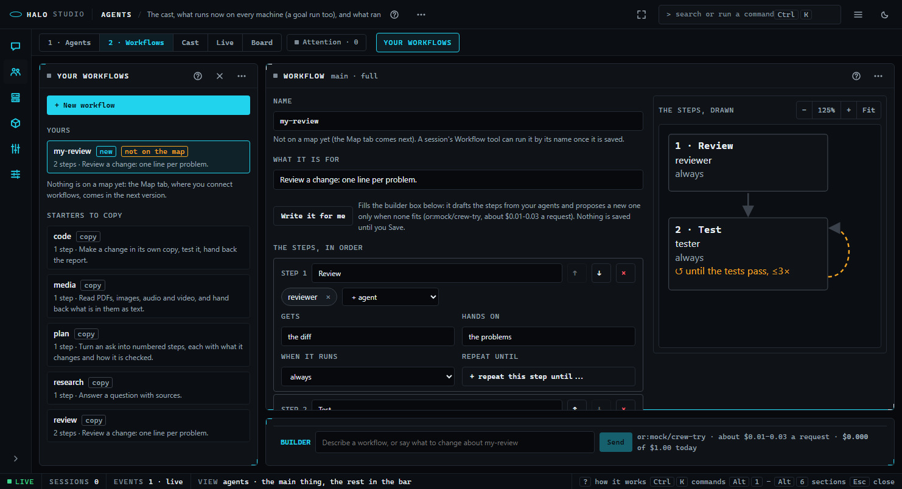
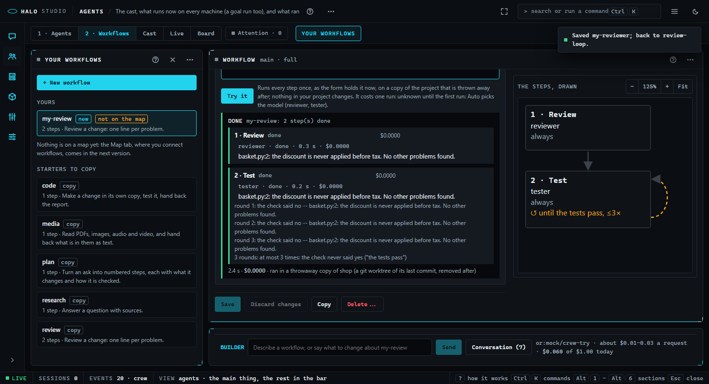

# Studio: Agents -> 2 · Workflows and the step runner (3.6.0.0)

Read this when you make or change a workflow in Studio's Workflows tab, ask the builder box to draft one, try a workflow once before you use it, run one from a session, or want to know what runs underneath, what a repeat costs and what stops a run.

Part of [Halo Studio](STUDIO.md), which lists every part; the agents a workflow uses are made in [1 · Agents](STUDIO-builder.md), and the file format is [Crew files](CREW-FORMATS.md).

## The tab

Agents (`Alt+2`), then **2 · Workflows** (the `2` key). The switch reads **1 · Agents | 2 · Workflows | Cast | Live |
Board**: Board is the old Workflows board of squares, still there in this version (`W`) and gone in a later one.
`?mode=agents&view=flows` opens this tab; `&workflow=<name>` opens one workflow.

- **The list** (a drawer on the left, open with the tab): **+ New workflow**, then **Yours** (yours and this project's,
  each tagged `on the map` or `not on the map`; maps come with the Map tab, so in this version nothing is on one and a
  line under the list says so), then **Starters to copy** (code, plan, review, research, media): a click copies one
  into the form as yours, not saved yet.
- **The form**, in the order you think:
  1. **Name**, and where it is used.
  2. **What it is for**, in your words, with **Write it for me**: it fills the builder box with "Draft the steps from what
     it is for"; the builder drafts the steps from your agents and proposes a new agent only when none fits.
  3. **The steps, in order.** A row per step: its name; up / down; take it out; its agents as chips (several chips work
     at the same time; **+ agent** adds one of yours or a starter; a chip naming an agent you do not have says so);
     **Gets**; **Hands on**; **When it runs** (always / only when the task needs ... / only when the task says ... / only
     when I ask); **Repeat until** with "at most N times" (10 at most). **+ Add a step** picks one of your agents, or
     **Make a new agent for it**: the agent form opens filled in; Save there brings you back with the step added.
  4. **What it costs and writes**: a band per run from the catalog prices ("about $0.01 to $0.08 a run"; "unknown until
     the first run: Auto picks the model" for an agent on Auto), and what Save and a run write.
  5. **Try it on a throwaway copy** (below).
  6. **Save**, **Discard changes**, **Copy**, **Delete...** (it asks on the page; a workflow on a map is not deleted).
- **The steps, drawn**, beside the form: a box per step, an arrow between, a loop mark for a repeat. It reads the form
  and draws itself; you never wire it. Zoom the house way (Ctrl / Cmd + wheel, pinch, - % + Fit, `0`, a double-click);
  when its box gets wider or narrower it fits again unless you zoomed it by hand. It never fits below the zoom where
  its text is 12 px: then it scrolls, and a line under it says so.

## Try it

A test request runs **every step once, as the form holds it now** (saved or not):

1. The band is said before you send ("It costs one run: about ..."). A step naming an agent you do not have is said
   too, and the run does not start until it is made.
2. The run is its own process (`python -m halo_harness.crew.try_flow`) in a **throwaway copy** of the project (a
   detached git worktree of its last commit, removed after), as an agent's Try it: a print-mode session whose agents
   are the workflow's, each spawned as a child. An ask is answered no and listed.
3. As it runs: each step's state, the agents that ran with their time, cost and what they handed on, each repeat's
   check ("round 1: the check said no -- 1 test fails"), and how many rounds and why it stopped. **Stop** ends it.
4. A run that ends while you are elsewhere is an **Attention** row ("Try it finished: workflow <name>"); open lands on
   the workflow and its run.

## The builder on this tab

The box docked at the foot is the same builder as on 1 · Agents ([the builder](STUDIO-builder.md#the-builder)) with
its own conversation. Type "make a review workflow: my-reviewer, then tester, repeat until the tests pass, at most 3
times": **one preview** -- a create line for the workflow, a line per step, and, for an agent you do not have, a
**proposal card** with **make it** (the agent form, filled in; Save there brings you back and takes that agent's lines
out of the preview). The steps show as dashed **ghost steps** in the form and in the drawing, and a new workflow as a
dashed row in the list. One request may touch agents and workflows: one preview, one Apply, one Undo.

A line that lets an agent do more is amber and never ticked for you, a step's agent included; **a workflow line widens
nothing by itself** (what its agents may use is in each agent's own file). The tools here are `workflow_make`,
`workflow_change`, `workflow_copy`, `workflow_remove`, `step_add`, `step_change`, `step_move`, `step_remove`, plus
`try_agent` / `try_workflow`, which start the same throwaway run as the Try it button and write nothing (that run's
cost is the run's, not the builder's). The builder's daily cap covers its calls on every tab.

## What runs underneath: the step runner

`halo_harness/crew/runner.py` (with `runner_text.py`, `runner_when.py`; the session side in `runner_session.py`):

- **A step** spawns each of its agents as a child through `agent/subagent.py`, the Agent tool's own path, with the
  spec `crew/spec.py` builds from the agent's file. Several agents of one step run at the same time. Each child shares
  the session's permission engine and is never more permissive than the session.
- **The hand-on**: each agent's reply under its name is the next step's input, with that step's "Gets" words.
- **When it runs**: `always`; `{needs: [...]}` -- the request and its files need it (the router's needs: a PDF, an
  image, audio, video, a plan, a review, research; another word must be in the request); `{says: [...]}` -- the request
  says one of the words; `ask` -- only when the request names the step or one of its agents. A skipped step says why.
- **Repeat until**: after the step, ONE yes/no call by the step's last agent ("Is this true now: <until>?"); its first
  word decides. No: the step runs again with what it handed on, up to `max` rounds (default 3, never more than 10).
  The receipt says how many rounds and why it stopped. **What a repeat costs**: up to `max` times the step, plus one
  check per round -- the band's high end counts them.
- **The caps**: before every call the run checks the workflow's own `max_usd` (when its file sets one) and the
  session's cap (the lineup's budget left). Reaching either stops the run with one plain line and what was done so far;
  a child still running is stopped when its cost passes what is left.
- **Before any model call**, a step naming an agent that does not exist, or one whose file has a problem, stops the run
  with the problem line.
- **What Live sees**: the workflow is a node under the agent that ran it, each child is drawn as the workflow's, the
  hand-off and the result are talk between them (the frames Live draws for every sub-agent); a Try it run also writes
  `crew` frames for its record.
- `own_copy: true` does not yet move a workflow onto the run engine: each agent with `more.worktree` gets its own
  worktree, as anywhere else.

## A session runs a workflow

A session's **Workflow** tool takes a saved workflow by name (`Workflow(name: "ship-a-fix", task: ...)`): yours or a
trusted project's (a starter is copied first). A crew workflow's name wins over a square of the same name, it runs on
the step runner, and the receipt's first line says so: `crew workflow ship-a-fix · ran on the step runner · done ·
$0.0123 -- ...`, then a line per step. The tool is offered when you have one, even with no square enabled.

## Routes

Every write is owner-only (the owner proof, [the shell](STUDIO-shell.md)); the write routes are in
`tests/fixtures/studio_write_routes.txt`.

| Route | What |
|---|---|
| `GET crew/workflows` | `{workflows, starters}`: name, for, steps, own_copy, max_usd, scope, new, problems, maps |
| `GET crew/workflow/<name>` | `{workflow, scope, path, problems, maps, writable, cost, writes, missing}` |
| `POST / PUT / DELETE crew/workflow/<name>` | make, save, delete one of yours (422 with the lines; 409 for a starter, a name in use, a workflow on a map) |
| `POST crew/workflow-cost {workflow}` | the band, what it writes and the missing agents for the form as it stands |
| `POST crew/try {kind: workflow, body, request}` | starts a Try it on the step runner: `{try}`; progress on `/api/events` |
| `POST builder/ask {tab: workflows, ...}` | the builder on this tab (the rest as on 1 · Agents) |

Tests: `tests/test_step_runner.py` (side by side, hand-on, when, repeat-until, a check that never says yes, the caps,
a bad step), `tests/test_builder_workflows.py`, `tests/test_builder_injection.py`, `tests/test_crew_flow_api.py`
(the routes, the band, Try it on the mock upstream, the Workflow tool), `tests/test_studio_flows.py` (Chrome), and the
room rules over this tab in `tests/test_studio_room.py`.
