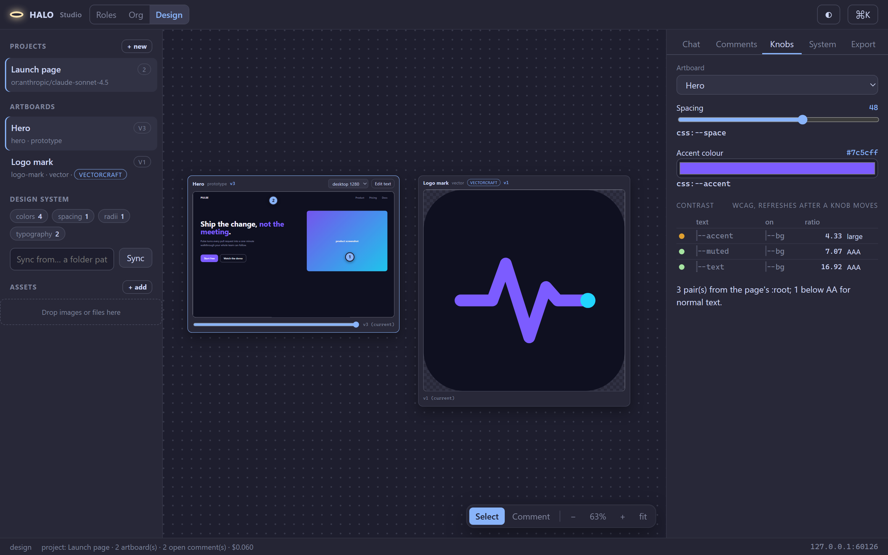

# Halo Studio

`halo studio` opens your lineups and agent bios as an editable graph in the
browser. It is the visual front door to the same files the wizard and the
CLI edit: a lineup is `~/.halo/teams/<name>.yaml` (or `.halo/teams/` in a
project), a bio is `~/.halo/agents/<name>.yaml`, and Studio reads and writes
them through the exact functions `halo teams` and `halo agents` use. Nothing
is a second source of truth.

```sh
halo studio                 # starts a local server, opens the browser in the mode you used last
halo studio --mode roles    # straight into Roles (lineups and bios), --mode org, --mode design
halo studio --no-open       # prints the URL only (SSH, a headless box)
halo studio --port 8765     # a fixed port instead of a free one
halo studio --stop          # stop the Studio running in the background
halo studio --legacy        # the classic page (/legacy/) instead of the shell
```

One Studio per machine (3.0.2.0): while it serves, `~/.halo/studio.json`
holds its pid, port and token (private), and a second `halo studio` reuses
that instance (prints its URL, opens the browser) instead of starting
another. The wizard's **Open Studio (Roles)** and **Open Studio (Org)**
buttons start it detached, so it outlives `halo init`; `halo studio --stop`
ends it. `halo_harness/studio/launch.py` is the small module behind both.

Inside the TUI, `/roles`, `/org` and `/design` open Studio straight into that
mode from the live session; `/studio [roles|org|design]` is the long form and
`/studio url` prints the URL without opening a browser. A model running in a
Halo session knows this too: the system prompt names Studio, its three modes
and the command, so "open the GUI for roles" runs `halo studio --mode roles`.

## The shell (3.0.3.0)

`halo studio` opens a React shell with four sections in the top bar:
**Orchestra | Roles | Org | Design** (`Alt+1`..`Alt+4`, or `?mode=` in the
URL). Orchestra is the live run console (see [Orchestra](#orchestra-the-run-console)
below); Roles, Org and Design are the
classic pages described below, framed inside the shell from `/legacy/`, so
everything in them works as before. `halo studio --legacy` opens the classic
page on its own.

- **A movable workspace.** Every section is a set of panels on a 24-column
  grid (8 px rows). Drag a panel's title bar to move it, an edge or corner to
  resize it; the others make room and everything snaps to the grid. Each
  title bar has **Expand / Glance**, **Collapse** (to a one-line strip),
  **Pop out** (float over the grid; dock it back the same way) and a **gear**.
  With a panel focused, `Alt`+arrows move it and `Alt+Shift`+arrows resize
  it. The arrangement is remembered per section in your browser
  (`localStorage` key `halo.studio.layout.<section>`); **Reset layout** (the
  rail, or the palette) returns to the defaults, which follow the window size
  until you rearrange something.
- **Three depths per panel.** The **Glance** face says what the panel is,
  shows one live indicator and one or two big numbers, readable from across
  the room; **Expand** shows the details; the **gear** opens the Inspector on
  the right with that panel's settings (face, strip, float, exact grid
  position, reset, and the panel's own options).
- **The rail** (left) lists the section's panels (click one to bring it back
  and focus it), the live sessions, and the layout actions.
- **The palette** (`Ctrl`/`Cmd`+`K`): a mono prompt with fuzzy matching and
  grouped results (Go to, View, Layout, Open), keyboard first: arrows,
  `Enter`, `Esc`. Every shortcut is shown next to its command.
- **The status bar** shows the live feed (a dot that is green when
  connected, amber while connecting or reconnecting, red when unreachable,
  and ticks once per event), the session and event counts and the section's
  layout state. `Esc` closes the palette, then the Inspector.

**Visual language.** The dark theme ("holo", the default) is a near-black
navy with glass panels: a translucent surface, a 1 px luminous edge, a soft
glow and small corner brackets (`--bracket-alpha`, 0 turns them off). Cyan is
the one accent for "live" and "do this", amber means "needs you", magenta-red
an error, green done. Data labels and numbers are monospaced next to a clean
sans for prose. The light theme is Catppuccin Latte; the theme menu offers
dark, light and "follow the system". Every colour is a token in
`ui/src/styles/tokens.css` (`--bg`, `--surface`, `--surface-glass`,
`--line`, `--glow`, `--accent`, `--accent-2`, `--warn`, `--bad`, `--ok`,
`--text`, `--muted`, `--mono`, `--sans`, `--radius`, `--ease`, ...).
Motion is short (150-250 ms, ease-out) and always means the same state,
through `data-motion` on any element:

| `data-motion` | Looks like | Means |
|---|---|---|
| `idle` | a slow breathing glow on the border (4 s) | present, nothing running |
| `working` | a thin light flowing along the top edge | something is running |
| `waiting` | a soft amber pulse (1.2 s) | it needs you |
| `done` | one brief green sweep, then still | it just finished |
| `error` | one red flash, then a steady red edge | it failed |
| `live` | a small dot that ticks once per event | a feed is connected |

Under `prefers-reduced-motion` none of it moves; each state keeps its colour
cue. A section tab "works" while that section has fresh activity, toasts
sweep green or flash red once, and nothing loops except `idle`, `working`
and `waiting`, which describe an ongoing state.

## The live feed

`GET /api/events?t=<token>&sessions=all|<session id>` is a Server-Sent
Events stream. Studio watches the live-session registry
(`~/.halo/run/sessions.json`) every 2 s and attaches to each running
session's control socket (`subscribe`, 1 s timeouts, off the request
threads); every frame is `{session_id, event, data, turn, agent_id, ts}`
under `event: <kind>`, a `sessions` frame lists the attached sessions (title,
mode, kind, cwd, started, pid; never an endpoint or token) whenever one
attaches or detaches, and `: ping` keeps the stream open every 15 s. Each
browser gets its own queue of 512 frames (the oldest dropped first). The
shell's status bar, the Orchestra panels and the rail read it. Studio's own
Orchestra runner publishes its run log here too (`orchestra_*` frames).

## Orchestra: the run console

`Alt+1` (or `?mode=orchestra`) is the console for [Orchestra](ORCHESTRA.md)
runs in the git repo that holds Studio's folder (`halo studio` started
there, or `--cwd`). It opens on the newest run. Its eight panels sit on the
same movable workspace as everything else. Each panel has a **Glance** face
(what it is, one live indicator, one or two big numbers), an **Expand** face
(the details) and the **gear**, which opens the panel's options in the
Inspector.


| Panel | Glance | Expand | Motion |
|---|---|---|---|
| **Goal** | WHAT YOU WANT / DONE WHEN / STOP WHEN as a card, the workers, the cost, the run state badge | the goal form (workers, return cap, test, files, lineup, lead and worker roles, model) with **Run** and **Dry run**; the runs of this repo, click one to open it | the badge follows the run: flowing while it runs, a green sweep when it finishes, red when it stops, amber when it was interrupted |
| **Workflow** | steps finished, the running step, the graph | the graph and the step list | the designed graph laid out in SVG: goal, lead, split, one node per lane, merge, test, the gate diamond, done; pending steps are faint, the running step's outline flows, the diamond lights when the gate acts, a failed step is red, and the gate's return arrow turns amber once a piece has been sent back |
| **Run grid** | the counters (joined, writing, in review, waiting, merged) and one tile per lane, 5 to 50 | larger tiles with each lane's title | a tile that is writing flows, a waiting one pulses amber, a merged one turns green; click a tile to focus that lane in Lanes and Live file |
| **Lanes** | joined, writing, merged, one strip per lane | the timeline: one trace per worker on the run's clock from "joined" to "merged", a node at each state change, a diamond where the gate sent the piece back; hover a node for its time and text | the running lane's trace flows, a waiting lane pulses amber |
| **Live file** | units being written, units merged, a minimap of the bands | the goal file in mono with each lane's claimed unit as a band in its lane colour, labelled claimed, writing, written or merged, holding the lane's current text (its worktree copy); a picker when the goal has several files | a band being written shimmers; a claimed band is hatched |
| **Report** | checks passing, cost, one pip per check | the checks with ticks and crosses, the finished branch and sha, the tests, the cost and time; **Copy** puts the report text (as `halo orchestra report` prints it) on the clipboard; a dry run shows the lead's jobs here | one green sweep when the report lands |
| **Log** | line count, the last lines | the run log with each line's elapsed time, a lane filter, kind filters and **follow** | new lines slide in |
| **Claims** | live claims, writing, the lead | each live claim with its holder, state and expiry, with **Release** and **Steal** (the lead takes the unit) | a claim being written flows; one that expires within a minute pulses amber |

The lanes take their colours from a ten-step ramp mixed from the theme's
accent, accent-2, ok and text tokens. Amber and red are never used for a
lane, because they mean "needs you" and "failed". Settings: Lanes shows
times as elapsed (`+12.5s`) or clock (`14:02:09`); Live file picks the file
and can fold every unclaimed line; Log keeps its filters; Workflow can
label the worker lanes; Goal switches the open run. These options are kept
in your browser (`halo.studio.orchestra.opts`).

The panels update from the live feed. A run started here publishes every
state, claim, merge, gate and report line as an `orchestra_*` event (the
session id is `orchestra:<run id>`). A line for the open run refreshes the
panels within a quarter second; a claim or merge refetches the file view.
When the feed is not connected and a run is live, the panels poll every
5 s instead. Palette commands (`Ctrl`/`Cmd`+`K`): **Orchestra: new run**,
**stop run**, **open run <id>** and **focus lane N**.

One run goes at a time. **Run** is disabled while a run is live, and the
glance's **stop** asks the runner to stop at its next step. Routes:
[ORCHESTRA.md, "In Studio"](ORCHESTRA.md#in-studio).

## What you see (Roles)

- **The lock on a card** (`🔒 shipped`) is a badge, not a switch: the agent
  bio behind that slot ships with Halo and is read-only. Click it (or open
  the Agent tab) and press **Duplicate** to get an editable copy in your
  scope, which then shadows the shipped one. A card without the lock is
  yours already.
- **The rail (left):** every lineup you can reach (shipped, user, project; the
  active one marked), and every agent bio. Drag a bio onto the canvas to add
  an assignment to the open lineup.
- **The canvas:** one card per assignment -- the agent name, its role and
  alias, the model that resolves for it with price and context from the
  catalog, its tool count, a scope badge and a status dot (green valid, amber
  a warning, red a problem; hover reads the text). Edges are **delegation**
  from `main` (labelled with the routing keys that reach a member), **reports
  to** lines from the org section (dashed) and **pipeline** stage order
  (dotted). Pan by dragging, zoom with the wheel, `Shift`-drag to marquee-
  select, `A` lays the graph out again, `F` fits it. Positions are remembered
  per lineup under `~/.halo/studio/layouts/` (an Org company's layout is
  `_pc-<company id>.json` there, a name every file system accepts).
- **The inspector (right):** *Assignment* (agent, role, alias, instances,
  `use_for`, a per-assignment model override), *Agent* (the bio behind the
  card: every section as typed fields, with the "about N turns at this
  price" hint next to the budget), *Lineup* (description, about, and each
  top section -- delegation, routing, budget, escalation, context,
  permissions, org, pipeline, acceptance -- as a YAML body with its
  enforcement badge), *YAML* (the whole file as it will be written; edits go
  both ways).
- **The command palette:** `Ctrl`/`Cmd`+`K` lists every action and every
  lineup and bio; `?` replays the tour.
- **Run view:** overlays the newest session's sub-agents on the cards (which
  node is running, cost so far) and a timeline strip of them. Read-only.

## Org mode: the company in Paperclip

**Off by default.** The header's **Org mode: off/on** button is the switch
(`paperclip.enabled`; also `halo paperclip on|off` and `/org on|off`). While
it is off the canvas explains who orchestrates what (your session in Roles,
Paperclip's heartbeats in Org) and nothing runs on a heartbeat; on, the
company's Halo agents resume. See [PAPERCLIP.md](PAPERCLIP.md).

The **Roles | Org** toggle in the top bar (`R` / `O`) swaps the canvas to
your company in [Paperclip](PAPERCLIP.md). Agents are cards (title, role,
adapter, status, spend against budget), reporting lines are the edges, and
dragging a card onto another makes it report there (a confirm, then a
`PATCH` of the agent's `reportsTo`). The rail lists the agents and the
company's goals and projects; the inspector has **Agent** (title, role,
reports-to, budget; Wake, Pause / Resume, Terminate; the adapter it runs),
**Issues** (the agent's issues, or all of them; create one, which wakes
its assignee), **Paperclip** (the agent's own Paperclip page embedded, with
"open" for a full tab) and **Company** (stats, **Sync lineup -> company**,
**Pull reporting lines -> lineup**, "Open Paperclip").

Studio talks to Paperclip through its own server (`/api/pc/...`), which adds
the board token from `~/.halo/paperclip.json` server-side; the page never
holds it. When Paperclip is not installed the Org canvas explains it and
offers **Install Paperclip** with the install log streamed into the page
(Node 24+ required); when it is installed but not running it says how to
start it.


## Design mode: prototypes, pages and decks on your own apps

The third button in the top bar, `Roles | Org | Design` (keys `R` / `O` / `D`,
or `?mode=design`; the choice is remembered). It is the page for `halo design`
projects under `~/.halo/design/<slug>/`.


**What you see.** The left rail lists projects (with a New project form that
opens its model picker on the design ranking, capability chips included), the
open project's artboards (id, kind, app, latest version) and its design system
(token groups with counts, plus a "Sync from..." box that takes a folder path
or a URL). The canvas is a dot-grid of frame cards: title row (title, kind,
app, `v<n>`), the frame itself (a sandboxed iframe for an HTML artboard, an
image for a `render.png` / `render.svg`, a link card for a PDF or MP4), a
device select (phone 390, tablet 820, desktop 1280 wide; the frame scales to
fit the card) and a version slider. Drag a card by its title row; positions
are kept in your browser per project. Pan with space-drag, the middle button
or a drag on the empty background; zoom with `Ctrl`+wheel; `F` fits.

**The panel** replaces the inspector tabs: Chat, Comments, Knobs, System,
Export.

- **Chat**: the prompt box (`Enter` sends, `Shift+Enter` adds a line), a model
  override and a budget, the turn's events as they stream (assistant text,
  compact tool cards, the result with its cost), the project's running cost and
  the history. One turn runs per project at a time; the page polls the turn
  every 500 ms.
- **Comments**: press `C` (the Comment tool) and click a frame to pin a note
  (the position is kept as a percentage of the frame). Open pins are grouped by
  artboard with Resolve; **Send comments** turns every open pin into one prompt
  ("Address these comments: ...") and runs a turn, then resolves them when it
  succeeds.
- **Knobs**: the artboard's `controls.json` as sliders, colour inputs and
  selects. A `css:--name` knob rewrites that variable in the page's `:root`
  block in place, with no model call, and makes a new version; a `craft:` knob
  is saved and applied by the next turn. Ask for knobs in a turn: "add knobs for
  spacing and the accent colour".
- **System**: the design system's tokens by group, editable, saved with Save
  tokens; sources and components below.
- **Export**: folder, HTML, PNG, SVG or PDF (optionally for one artboard) with
  the returned lines, and **Handoff bundle**, which shows the bundle's path
  with a Copy button.

**Direct text edits.** "Edit text" on an HTML card reloads the frame with
`?edit=1`: the page becomes editable, and `Ctrl+S` or leaving the text posts
the page back to Studio, which saves it as a new version ("direct edit"). The
helper script is wrapped in `<!--halo-edit-->` markers and never reaches the
saved file.

**Versions.** Every turn, knob move, direct edit and restore is a version.
The slider under a card swaps the frame to `v<n>/...`; at an older version,
**Restore this version** makes it the newest one.

**The raw file route and its sandbox.** Artboard files are served at
`GET /design-files/<slug>/<artboard>/<file>` (and `.../v<n>/<file>`), loopback
only and confined to that artboard's folder (`..` is a 404). They carry their
own `Content-Security-Policy: default-src 'self' 'unsafe-inline' data: blob:`
and `nosniff`, not Studio's, because a prototype has inline CSS and JS. HTML
and SVG responses add `; sandbox allow-scripts` to that policy, so the
document gets an opaque origin even when it is framed without a sandbox
attribute or opened on its own; renders (PNG, PDF, MP4) keep the plain policy.
The page embeds them as `<iframe sandbox="allow-scripts">` without
`allow-same-origin`, so a prototype runs but cannot reach Studio's API or its
token. An artboard folder that is a symlink is never served.

**Plus more.**

- **Explore directions**: the **3 directions** button beside Run turn (or `V`)
  wraps the prompt as "Make 3 directions of: ..." with artboards named
  `<name>-a`, `-b`, `-c` (the name box beside the button, the selected artboard
  by default). It is one turn; afterwards the canvas tiles the new artboards
  side by side and selects the first. `POST design/<slug>/run` takes
  `{"variants": N, "base": "<id>"}`, and the CLI takes `--variants N --base ID`.
- **Critique**: **Critique <artboard>** (or `K`) starts a read-only turn (Read
  and Glob, no MCP servers) where a second model, the project's or the one picked,
  reviews the artboard. Its notes land as comment pins with a `critique` badge and
  a `[high]` / `[medium]` / `[low]` prefix; Send comments includes them.
  `POST design/<slug>/critique {artboard, model?}`.
- **Contrast**: the Knobs tab ends with a table of text-on-background pairs with
  ratio and AA / AAA verdicts (failing pairs first, red / amber / green dots),
  refreshed after every knob move. `GET design/<slug>/artboard/<id>/contrast`.
- **Assets**: the rail's Assets list (name, size, thumbnail) with a drop zone.
  Drop files from the desktop onto the rail or the canvas to upload them; the
  Chat box gets "Use assets/<name> ...". An image dropped on a frame card adds
  "Place assets/<name> on <artboard>". Click an asset to insert its path.
  `GET` / `POST design/<slug>/assets`, 15 MB at most.
- **Run view**: History shows "12 tool calls · 48 s · $0.03" per turn.



| Key | Action (Design mode) |
|---|---|
| `D` / `R` / `O` | switch mode |
| `N` | new project |
| `Enter` in the Chat box | run the turn |
| `C` | toggle the comment tool (`Esc` returns to select) |
| `V` | explore 3 directions of the Chat prompt |
| `K` | critique the selected artboard |
| `X` | check contrast (opens Knobs) |
| `S` | send comments |
| `Y` | sync the design system |
| `U` | add assets |
| `E` / `H` | export folder / handoff bundle |
| `F` | fit the canvas |
| `Ctrl`+wheel, space-drag | zoom, pan |
| `Ctrl`/`Cmd`+`K` | the palette lists every Design command with its key |

Shortcuts are inactive while you type in a box. The tour (`?`) shows five Design
steps when the page is in Design mode.

## Connecting boxes (3.0.2.0)

Every member hangs off the starting box (the `main` assignment) until you
connect it elsewhere. Two ways, both writing the lineup's own
`org.positions[].reports_to` (a title is the assignment's alias, else its
role, else its agent):

- **Drag a card onto another card.** The dragged member now reports to
  the card you dropped it on, and its edge moves there; drop it on the
  starting box to hang it off main again.
- **The Reports-to field** in the Assignment tab: pick any other box, or
  blank for the starting box.

The canvas redraws the tree as you connect (a member that reports to
another member no longer gets the main -> member delegation edge), Save
writes it like any other change, and `halo teams show` prints the same
org positions. Runtime: `reports_to` addresses the member's one-line
completion report (docs/AGENTS.md, "org").

## Validate, save, apply

**Validate** runs `teams_yaml.validate_team_template` (the CLI's own checks)
and redraws the graph. **Save** validates, then writes the YAML to your user
scope (or the project, with the scope toggle in the top bar). A shipped
lineup or bio is never edited in place: saving it writes a copy under the
same name into your scope, which then shadows the shipped one -- exactly
what the wizard's Duplicate does. **Apply** shows the role table it will
write and, on confirm, does what `halo teams use <name>` does: `roles.*`
and `team:` in `~/.halo/config.json`, with custom roles switched on.

Errors are the validator's own lines, shown under the field they name and
in the Lineup tab; a save that fails leaves the file untouched.

## Security model

- The server binds `127.0.0.1` only and refuses any request from a non-
  loopback peer.
- Every API call carries a per-launch token (the `#t=` fragment in the URL
  `halo studio` prints; the page keeps it in session storage and sends it as
  a bearer header). A request without it is a 401.
- A request carrying an `Origin` header that is not this server's own is a
  403, so a page on another site cannot drive Studio even with the port.
- **One exception to the bearer header: `/api/events`.** A browser's
  `EventSource` cannot send headers, so the live feed takes the same
  per-launch token in the query (`?t=`), compared in constant time; a
  missing or wrong token is a 403, and the loopback, Host and Origin checks
  are the same as for every other call. The token never leaves the machine
  and the response is `Cache-Control: no-store`.
- No CDN, no fonts fetched, no analytics: the page is a handful of static
  files served from the package, under a strict content-security policy.
  The shell (`static/dist/`) gets `default-src 'self'; connect-src 'self'`
  with no inline styles or scripts; the classic page (`static/legacy/`)
  keeps its `style-src 'unsafe-inline'`. The built bundle contains no
  `http://` or `https://` URL at all (a CI test checks).
- Writes go only to `~/.halo` (and a project's `.halo/` when you choose that
  scope); shipped files under the package are never written or deleted.

## Over SSH

On a box you reach over SSH (the usual Kali case), run `halo studio
--no-open` there, then on your machine:

```sh
ssh -L 48761:127.0.0.1:48761 <host>
```

using the port Studio printed, and open the printed URL (token included)
in your own browser.

## Shortcuts

| Key | Action |
|---|---|
| `Ctrl`/`Cmd`+`K` | command palette |
| `Ctrl`/`Cmd`+`S` | save |
| `Ctrl`/`Cmd`+`Enter` | validate |
| `Ctrl`/`Cmd`+`N` | new lineup |
| `A` / `F` | auto-layout / fit |
| `Del` | remove the selected assignment |
| `[` / `]` | hide the rail / the inspector |
| `?` | the tour |

## Files

`halo_harness/studio/server.py` (the server, the guard, the command),
`events.py` (the live feed: the registry watcher and `/api/events`),
`ui/` (the React shell's sources; see docs/DEVELOPMENT.md "Studio UI"),
`static/dist/` (its committed build), `static/legacy/` (the classic page),
`api.py` (the routes), `design_api.py` / `design_api_io.py` / `design_api_turns.py` / `design_files.py` (Design mode), `model.py` (the graph, the catalog rows, the session
reader). Tests: `tests/test_studio_api.py`,
`tests/test_studio_model.py`, `tests/test_studio_dist.py` (the build and
its routes), `tests/test_studio_live.py` (the live feed),
`tests/test_studio_ui.py` (headless Chrome over both pages).
