# Halo Studio

`halo studio` opens your lineups and agent bios as an editable graph in the
browser. It is the visual front door to the same files the wizard and the
CLI edit: a lineup is `~/.halo/teams/<name>.yaml` (or `.halo/teams/` in a
project), a bio is `~/.halo/agents/<name>.yaml`, and Studio reads and writes
them through the exact functions `halo teams` and `halo agents` use. Nothing
is a second source of truth.

```sh
halo studio                 # starts a local server, opens the browser in the mode you used last
halo studio --mode roles    # straight into Roles (lineups and bios), --mode org, --mode design
halo studio --mode fleet    # 3.0.5.0: every harness and agent, live (also orchestra, flow)
halo studio --mode team     # 3.0.8.0: the project's team on one board
halo studio --no-open       # prints the URL only (SSH, a headless box)
halo studio --port 8765     # a fixed port instead of a free one
halo studio --stop          # stop the Studio running in the background
```

One Studio per machine (3.0.2.0): while it serves, `~/.halo/studio.json`
holds its pid, port and token (private), and a second `halo studio` reuses
that instance (prints its URL, opens the browser) instead of starting
another. The wizard's **Open Studio (Roles)** and **Open Studio (Org)**
buttons start it detached, so it outlives `halo init`; `halo studio --stop`
ends it. `halo_harness/studio/launch.py` is the small module behind both.

Inside the TUI, `/roles`, `/org` and `/design` open Studio straight into that
mode from the live session; `/studio [roles|org|design|orchestra|flow|fleet|team]` is the long form and
`/studio url` prints the URL without opening a browser. A model running in a
Halo session knows this too: the system prompt names Studio, its three modes
and the command, so "open the GUI for roles" runs `halo studio --mode roles`.

## The shell (3.0.3.0)

`halo studio` opens a React shell with seven sections in the top bar:
**Orchestra | Roles | Org | Design | Flow | Fleet | Team** (`Alt+1`..`Alt+7`, or `?mode=` in
the URL; Flow since 3.0.4.0, Fleet since 3.0.5.0, Team since 3.0.8.0). Orchestra is the live run console (see [Orchestra](#orchestra-the-run-console)
below), Flow the workflow console (see [Flow](#flow-the-workflow-console)),
Fleet every harness and every agent, live (see [Fleet](#fleet-every-harness-every-agent)),
Team the project's team file as one board (see [Team](#team-people-blocks-and-stages-on-one-board));
Roles, Org and Design are React sections since 3.0.7.0 (see
[What you see (Roles)](#what-you-see-roles),
[Org mode](#org-mode-the-company-in-paperclip) and
[Design mode](#design-mode-prototypes-pages-and-decks-on-your-own-apps)).
The classic plain-JS page (`/legacy/`, `halo studio --legacy`) is gone since
3.0.7.0 R2: every section is part of the shell.

- **One header.** Every section is drawn by the shell itself: one top bar,
  one status bar, no page framed inside another (3.0.7.0 R2 removed the last
  framed page, Roles).
- **A movable workspace.** Every section is a set of panels on a 24-column
  grid (8 px rows). **Click anywhere on a panel to work in it**: a ring
  marks the panel you are on, and an open Inspector follows it. Drag a
  panel's title bar to move it, an edge or corner to resize it; the others
  make room and everything snaps to the grid. The title bar is the title,
  the panel's one-line **about** (what it is), ONE **Compact / Expand**
  toggle (on a collapsed strip: the chevron that opens it) and ONE **...**
  menu: **Float** over the grid (or dock it back),
  **Collapse** to a one-line strip (or open it), **Reset this panel**,
  **Settings** and **Help**. With a panel focused, `Alt`+arrows move it and
  `Alt+Shift`+arrows resize it. The arrangement is remembered per section in
  your browser (`localStorage` key `halo.studio.layout.<section>`, version 2:
  an arrangement saved by 3.0.3.0 keeps its places, not its faces);
  **Reset layout** (the rail, or the palette) returns to the defaults, which
  follow the window size until you rearrange something.
- **Two faces and the settings.** Every panel opens on its **full face**,
  ready to use with no button to press first; **Compact** is its summary (what
  it is, one live indicator, one or two big numbers, readable from across the
  room) and is the default only where a section says so (Orchestra's
  Workflow, Run grid and Log, where it is the whole graph, every tile and the
  newest lines). **Settings** opens the Inspector on the right: what the
  panel is and how to use it, the face, strip, float, the exact grid
  position, reset, and the panel's own options.
- **Help where you are.** `?` on a focused panel (or Help in its ... menu)
  opens a small popover with its `about` line and a few lines on how to use
  it; `?` again, `?` away from a panel, the **?** beside the section tabs and
  the palette's **Help: how <section> works** open **How this works** for the
  section: what it is, five to eight numbered steps, every panel with its
  about line, and the keys (the copy is below, in
  [How each section works](#how-each-section-works)). The first time a
  section shows in a browser the same card comes up as its welcome, with
  **Got it** (`halo.studio.seen.<section>`; `?tour=off` in the URL keeps it
  shut).
- **The rail** (left) has the section's own block (Orchestra and Flow: **New
  run** and the runs), lists the section's panels (click one to bring it back
  and focus it), the **Fleet tree** (3.0.5.0; it replaced the plain list of
  live sessions): every harness, its sessions and their agents with a status
  dot each, the live and need-you counts on top, a click opens Fleet on that
  node, and a session that waits on you keeps its inline answer; then the
  layout actions.
- **The palette** (`Ctrl`/`Cmd`+`K`): a mono prompt with fuzzy matching and
  grouped results (Go to, Help, Orchestra, Roles, Org, Design, Flow, Fleet, Team, Media,
  View, Layout), keyboard first: arrows,
  `Enter`, `Esc`. Every shortcut is shown next to its command.
- **The status bar** shows the live feed (a dot that is green when
  connected, amber while connecting or reconnecting, red when unreachable,
  and ticks once per event), the session count, the fleet (agents at work
  and how many wait on you), the team (3.0.8.0: its stages running now, when
  the repo has a team file), the event count, the section's own status
  line (Roles: the open lineup, its cards and problems, saved or not; Org's company and
  Design's project) and the section's layout
  state. `Esc` closes the palette, a menu or a help card, then the Inspector.

**Visual language.** The dark theme ("holo", the default) is a near-black
navy with glass panels: a translucent surface, a 1 px luminous edge, a soft
glow and small corner brackets (`--bracket-alpha`, 0 turns them off). Cyan is
the one accent for "live" and "do this", amber means "needs you", magenta-red
an error, green done. Data labels and numbers are monospaced next to a clean
sans for prose. The light theme is Catppuccin Latte; the theme menu offers
dark, light and "follow the system". Every colour is a token in
`ui/src/styles/tokens.css` (`--bg`, `--surface`, `--surface-glass`,
`--line`, `--glow`, `--accent`, `--accent-2`, `--warn`, `--bad`, `--ok`,
`--text`, `--muted`, `--mono`, `--sans`, `--radius`, `--ease`, ...).
Motion is short (150-250 ms, ease-out) and always means the same state,
through `data-motion` on any element:

| `data-motion` | Looks like | Means |
|---|---|---|
| `idle` | a slow breathing glow on the border (4 s) | present, nothing running |
| `working` | a thin light flowing along the top edge | something is running |
| `waiting` | a soft amber pulse (1.2 s) | it needs you |
| `done` | one brief green sweep, then still | it just finished |
| `error` | one red flash, then a steady red edge | it failed |
| `live` | a small dot that ticks once per event | a feed is connected |

Under `prefers-reduced-motion` none of it moves; each state keeps its colour
cue. A section tab "works" while that section has fresh activity, toasts
sweep green or flash red once, and nothing loops except `idle`, `working`
and `waiting`, which describe an ongoing state.

## How each section works

The same copy as Studio's **How this works** card (`ui/src/routes/sectionHelp.ts`
for the steps, `routes/help.ts`, `routes/help-orchestra.ts` and
`routes/help-org-design.ts` and `routes/help-roles.ts` for the panels' about
lines and help).

### Orchestra

**What it is.** Several agents write to the same files at once and nothing is
lost: a lead splits your goal into lanes, one worker per lane writes its part
in its own git worktree, and a gate checks the result before it lands.

**How to use it.**

1. **Write the goal**: WHAT YOU WANT, how Halo knows it is done (DONE WHEN)
   and when to give up (STOP WHEN), plus the files the workers share and the
   test the gate runs.
2. **Press Run**. Dry run asks the lead for the split only: nothing is
   claimed or written.
3. **The lead splits it into lanes**. Each lane claims a part of the files;
   one worker per lane builds its part in its own git worktree.
4. **The gate checks DONE WHEN**. The parts merge one at a time, your test
   runs, and a part that fails goes back to its worker (up to the return cap).
5. **Read the report**: every check with a tick or a cross, the finished
   branch and its sha, the tests, the cost and the time.

**Panels.** Goal: what you want, how it is checked and when to give up; then
Run. Workflow: the run's plan: goal, lead, split, one node per lane, merge,
test, gate. Run grid: one tile per lane: writing, in review, waiting or
merged. Live file: the shared file, each lane's claimed part a band in its
colour. Lanes: each worker's timeline on the run's clock, from joined to
merged. Report: the gate's verdict: every check, the finished branch, tests
and cost. Claims: who holds which part of the files right now, and until
when. Log: every claim, merge, gate decision and note, with its time.

### Roles

**What it is.** A lineup says which agent, on which model, plays each part in
your sessions, and in which tier it sits. Studio shows it as cards in tier
boxes you can arrange and edit; the files are `~/.halo/teams/<name>.yaml` and
`~/.halo/agents/<name>.yaml`.

**How to use it.**

1. **Pick a lineup**: Lineups lists yours and the shipped ones (the active
   one is marked); New makes your own copy. Each card on the canvas is one
   slot: an agent bio in a role, with the model that resolves for it, its
   price and its context.
2. **Give each card its bio**: Bios, click one to edit it -- its model from
   the table (sort by price or context, search, best for), **Test this
   model**, its tools, limits and output. Drag a bio onto the canvas to add
   a card.
3. **Stack the tiers**: each box is a tier; a member spawns only into the
   next tier down, and main sits alone in tier 0. Drag a card into another
   box to move it (the lineup saves); a box's label strip collapses it.
4. **Fine-tune the sections**: the Inspector's Assignment edits the selected
   card's slot; Lineup has delegation, routing, budget, escalation, context,
   permissions, org, pipeline, acceptance and tiers, each as a form with a
   YAML toggle.
5. **Fix what Problems lists**: every edit is checked at once; blocks stop a
   save or a run start (a model id its catalog does not know, a bio with no
   tool), warns are worth a look. Click one to select its card.
6. **Save, then Apply**: Save writes the YAML to your scope (a shipped
   lineup becomes your copy); Apply makes it the lineup new sessions use.
   `Ctrl+Z` undoes any edit.
7. **Watch it work**: while a session runs, the cards whose agents work
   glow; click one and the Live tab shows exactly what it types, with
   Steer, Pause and Stop ([Live Roles](#live-roles-the-lineup-lights-up)). A
   finished session's replay plays back on the canvas.

**Panels.** Lineups: your lineups and the shipped ones; the active one is
marked. Canvas: the open lineup as cards, one box per tier: who plays each
part, on which model. Inspector: the selected card's slot, every section of
the lineup, and what runs on the card now. Problems: what is wrong with the
lineup as you edit it, each with its fix. Bios: the agent bios: who each
card is, on which model, with which tools. Models: the model catalog the
pickers read, per provider, and why it is empty when it is.

**Keys.** `Alt+2` Roles; on the canvas (click it first) `A` lays out, `F`
fits, `+` / `-` zoom, the arrows nudge the selected card (`Shift`: further),
`Del` removes it (asks first); `Ctrl+Z` / `Ctrl+Shift+Z` undo / redo a
lineup edit, `Ctrl`/`Cmd`+`S` saves; `J` / `K` the next / previous card
whose agent works (its Live tab opens), `Space` pins that agent's mini
stream, with the Live tab open `F` follows and `P` pauses; `Esc` unpins (or
closes a replay).

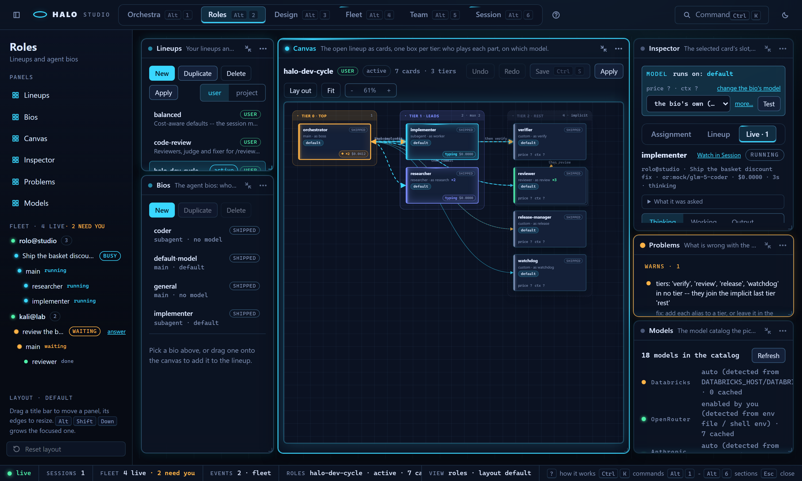

### Org

**What it is.** Your company of agents in Paperclip: an org chart with goals,
issues, heartbeats and budgets. Halo's lineups become its agents, and Studio
shows the company live.

**How to use it.**

1. **Get Paperclip running**: the Start view's **Install Paperclip** runs
   `npx paperclipai onboard` (Node 24 or newer); an installed one starts with
   `npx paperclipai run`.
2. **Link a company**: **Link a company** picks the one Studio shows (or make
   one from a lineup); Company says what is installed, running and linked.
3. **Turn Org mode on**: Company's switch (or `/org on`, `halo paperclip on`).
   Off is the default: no agent runs on a heartbeat.
4. **Read the boxes**: Org chart: each card is an agent (role, adapter,
   status, spend against its budget); a box holds one manager's reports
   ("<manager>'s team", or the agent's `metadata.team`), the top box is
   **Leadership**.
5. **Change who reports to whom**: drop a card into another box or onto a
   card; Studio asks first, then updates Paperclip. Drag a box's label strip
   to move the team.
6. **Work with an agent**: double-click a card: the Inspector edits its
   title, role, manager and budget, and Wakes, Pauses or Terminates it.
7. **Follow the work**: Issues, goals, projects lists them live (every 3 s
   while Org shows); New issue assigns one and Paperclip wakes that agent.

**Panels.** Company: Paperclip here: installed, running, which company, and
Org mode. Org chart: your company as cards, one box per team: who reports to
whom. Issues, goals, projects: the company's issues, goals and projects, live
from Paperclip. Inspector: the agent, issue, goal or project you clicked, and
what you can do with it.

**Keys.** `Alt+3` Org; on the chart (click it first) `A` lays it out, `F`
fits it, `+` / `-` zoom; `Mod+K`: Org: sync, Org: pull, Org: link company.

### Design

**What it is.** Prototypes, pages, decks and logos made by your own apps and
models. A project is a folder of artboards under `~/.halo/design/<slug>/`, and
every turn saves a new version.

**How to use it.**

1. **Make or open a project**: the Start view names the first one; then
   Projects lists them all, and New project makes another.
2. **Say what to design**: write it in Thread and press Enter: the reply
   streams in as the turn works; **Cancel turn** stops it. **3 directions**
   sends it as three different artboards side by side.
3. **Look and compare**: Artboards: drag a card by its title (the places are
   saved with the project), slide back through its versions, Restore one;
   the device select draws prototypes at phone, tablet or desktop size.
4. **Change it by hand**: double-click a text in a prototype to edit it in
   place; a card's **Knobs** move its spacing and colours; the Design system
   panel edits the tokens or syncs them from a codebase or a web page.
5. **Ask for notes**: pick **Comment** and click a frame to pin a comment;
   Critique has a second model pin notes on an artboard; Contrast checks its
   text against its background; Send comments turns the pins into a turn.
6. **Tidy up**: Rename or Delete an artboard, or Download its file.
7. **Hand it off**: Export writes a folder, HTML, PNG, SVG or PDF; Handoff
   bundles it for the next Halo or Claude Code session.
8. **Use your own files**: Assets: add or drop logos and photos; click one to
   put its path in the message.
9. **Render pictures**: the palette's Media commands add the ComfyUI panels
   to the section.

**Panels.** Projects: your design projects: pick one, or make a new one.
Design system: the tokens every turn designs with. Assets: files a turn can
use. Artboards: every artboard of the project, with its versions, pins and
knobs. Thread: the project's turns: what you asked and what the model did.
From the palette: Media status, Media models, Workflows and Render (see
[Media](#media)).

**Keys.** `Alt+4` Design; `Enter` in the message box sends (`Shift+Enter`: a
new line); in the text editor and the comment box `Enter` saves and `Esc`
cancels; `Esc` puts the Comment tool down; `Mod+K`: Design: send, Design: 3
directions, Design: pin a comment, Design: cancel turn, Design: export,
Design: new project.

### Flow

**What it is.** A brief goes through your roles and a marketing org, ComfyUI
renders the Art Director's prompt, you confirm the picture, then the posts go
out and their metrics come back, all in one design project.

**How to use it.**

1. **Write a brief** on the Start view: the brief, the platforms, the budget
   and the design project; drop assets if you have them.
2. **Press Run**: Run waits for your OK on the render, Run with --yes accepts
   every gate, Dry run keeps the posts dry.
3. **The roles and the org work**: a planner and a researcher plan it; a
   strategist, a copywriter and an art director write the campaign and the
   image prompt.
4. **Confirm the render**: ComfyUI renders it; the run waits in Renders until
   you Confirm, Redo with an instruction, or Stop.
5. **Posts and metrics**: one post per platform through Postiz (dry runs
   unless the flow says `live: true`); Metrics samples how they do.
6. **Read the report**: Report sums it up; New run in the rail goes back to
   the Start view.

**Panels.** Intake, Workflow, Renders, Step, Posts, Metrics, Log, Report and
the four Media panels; what each shows is in the [Flow](#flow-the-workflow-console)
table below.

### Fleet

**What it is.** Every Halo harness you run or joined, its sessions and every
agent in them, live: what each one thinks, runs and writes, every decision
that waits on you, what it all costs, and the controls to steer, pause,
stop, take over or hand off any one agent.

**How to use it.**

1. **See every harness**: this harness is the first box. Another machine
   joins with a pair code: Make a pair code on the Start view (or the
   palette), then `halo fleet join` on the other machine. People lists them
   all.
2. **Answer what waits on you**: Attention is one queue of every card,
   gate, paused agent, spend cap and file conflict on every harness. `A`
   accepts, `R` denies or redoes with your text, `S` stops, `O` opens where
   it belongs.
3. **Read the map**: each session is a card, its agents a tree under it: a
   flowing outline works, amber waits on you, green just finished, red
   failed. By project shows each repo's dirty / ahead / behind; an amber
   dashed edge joins two agents editing one file.
4. **Open an agent**: click it (or `J` / `K`): Agent shows what it thinks as
   it types, each tool call with its result and diff, and what it hands
   back. Steer it with a nudge or a new task.
5. **Pause, stop, hand off**: Pause holds it at its next step, Stop asks
   first. Take over gives it your brief; Hand to... passes it to another
   harness (a Paperclip issue with Org mode on, a hand-off note without)
   and stops it.
6. **Know who can do what**: Capabilities has a spec card per harness:
   hardware, models, craft apps, MCP servers and their tools, skills, tags.
   Who can... ranks the fleet for what you need (gridcraft, a 4090, make a
   video) and picks the best one on the map.
7. **Give the fleet one goal**: Mission (`M`): type the goal and Plan it;
   the hub's lead splits it into parts and gives each to the harness that
   can do it. The plan draws on the map, drag a part to another harness to
   move it, then Approve and Run; the report says who did what and what it
   cost per harness.
8. **Watch the whole fleet**: Activity draws a lane per live agent (5, 15
   or 60 minutes, tool calls as ticks) over the merged live log. Costs
   ticks today's spend and holds the caps; Health is a doctor summary per
   harness.
9. **Record and replay**: Record saves a session or one agent as a single
   HTML file that plays anywhere. Replay plays a finished session on the
   Roles canvas: the cards light up in the order they worked.
10. **Come back**: after ten minutes away, While you were away sums up what
   happened: sessions, cost, decisions and who made them, files, errors,
   hand-offs.

**Panels.** People: who is in the fleet, what each shares, what it is on,
live or away. Costs: what the fleet spends today, and the caps. Health: a
doctor summary per harness. Attention: every decision that waits on you,
one key each. Map: every harness as a box, its sessions as cards, each
session's agents as a tree. Activity: a timeline lane per live agent and
the merged live log. Agent: the selected agent: what it thinks, what it
runs, what it hands back; steer it, take it over, hand it on, record it.
Capabilities (3.0.6.0): what every harness can do, and who can do what.
Mission (3.0.6.0): one goal for the whole fleet, planned, approved, run and
reported.

### Team

**What it is.** Your project's team file as one board: who works on it
(members, each a part of a lineup, here or on a fleet harness), where their
work lands (blocks: a file, a folder or a git tree, each with its claim
ledger) and in which order (stages: an agent turn, an Orchestra run or a
flow). The steps are those of
[How this works: Team](#how-this-works-team) below.

**Panels.** Board: the team as one board, members as columns, stages as
boxes, blocks underneath. Inspector: the selected stage (its row, Run, the
gate card), block (holders, changes) or member. Change feed: every move of
the run, newest last.

## The live feed

`GET /api/events?t=<token>&sessions=all|<session id>` is a Server-Sent
Events stream. Studio watches the live-session registry
(`~/.halo/run/sessions.json`) every 2 s and attaches to each running
session's control socket (`subscribe`, 1 s timeouts, off the request
threads); every frame is `{session_id, event, data, turn, agent_id, ts}`
under `event: <kind>`, a `sessions` frame lists the attached sessions (title,
mode, kind, cwd, started, pid; never an endpoint or token) whenever one
attaches or detaches, and `: ping` keeps the stream open every 15 s. Each
browser gets its own queue of 512 frames (the oldest dropped first). The
shell's status bar, the Orchestra panels and the rail read it. Studio's own
Orchestra runner publishes its run log here too (`orchestra_*` frames).

## Orchestra: the run console

`Alt+1` (or `?mode=orchestra`) is the console for [Orchestra](ORCHESTRA.md)
runs in the git repo that holds Studio's folder (`halo studio` started
there, or `--cwd`). It opens on the newest run.

**Before a run (3.0.4.0)** the section is one centered **Start** view, not
eight empty panels: the goal form (WHAT YOU WANT, DONE WHEN, STOP WHEN with
examples, the files and the test command, the budget: workers and return
cap, the lineup, and who plays the parts and the model under a disclosure)
with **Run** and **Dry run**, what a run does in five numbered steps, and the
past runs to open. Starting or opening a run brings up the panels; **open the
workspace anyway** does too. **New run** (the rail, or the palette's
**Orchestra: new run**) returns to the Start view. An Orchestra goal has no
dollar budget: its budget is how many workers and how many times the gate may
send a part back.

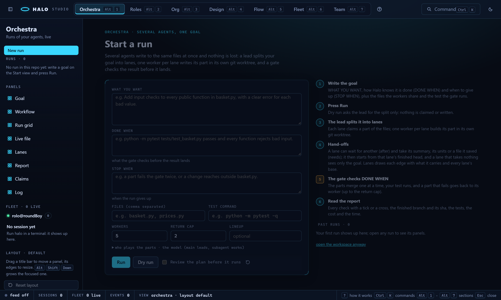

Its eight panels sit on the same movable workspace as everything else, each
on its full face with its one-line about and its `?` help (Workflow, Run grid
and Log open on their compact face, which shows the whole graph, every tile
and the newest lines at the default size). The Goal panel's default height
shows every field and **Run** without scrolling. The rail lists the runs of
the repo (click one to open it).

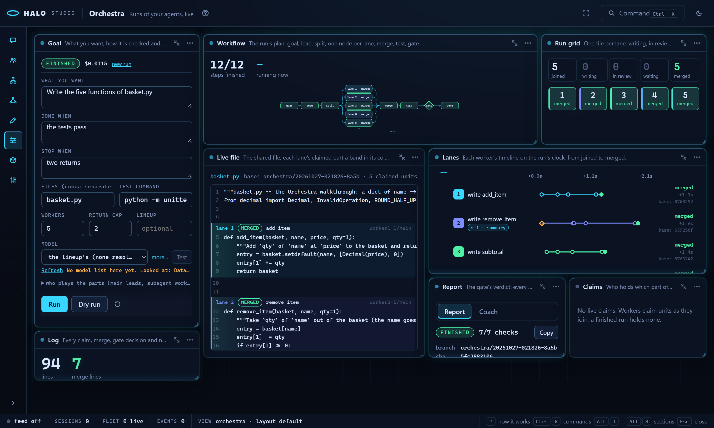

| Panel | Compact face | Full face | Motion |
|---|---|---|---|
| **Goal** | WHAT YOU WANT / DONE WHEN / STOP WHEN as a card, the workers, the cost, the run state badge | the open run in one line (state, cost, **stop** while it runs, **new run**) over its goal form (as on the Start view) with **Run** and **Dry run** | the badge follows the run: flowing while it runs, a green sweep when it finishes, red when it stops, amber when it was interrupted |
| **Workflow** | steps finished, the running step, the graph | the graph and the step list | the designed graph laid out in SVG: goal, lead, split, one node per lane, merge, test, the gate diamond, done; pending steps are faint, the running step's outline flows, the diamond lights when the gate acts, a failed step is red, and the gate's return arrow turns amber once a piece has been sent back |
| **Run grid** | the counters (joined, writing, in review, waiting, merged) and one tile per lane, 5 to 50 | larger tiles with each lane's title | a tile that is writing flows, a waiting one pulses amber, a merged one turns green; click a tile to focus that lane in Lanes and Live file |
| **Lanes** | joined, writing, merged, one strip per lane | the timeline: one trace per worker on the run's clock from "joined" to "merged", a node at each state change, a diamond where the gate sent the piece back; hover a node for its time and text | the running lane's trace flows, a waiting lane pulses amber |
| **Live file** | units being written, units merged, a minimap of the bands | the goal file in mono with each lane's claimed unit as a band in its lane colour, labelled claimed, writing, written or merged, holding the lane's current text (its worktree copy); a picker when the goal has several files | a band being written shimmers; a claimed band is hatched |
| **Report** | checks passing, cost, one pip per check | the checks with ticks and crosses, the finished branch and sha, the tests, the cost and time; **Copy** puts the report text (as `halo orchestra report` prints it) on the clipboard; a dry run shows the lead's jobs here | one green sweep when the report lands |
| **Log** | line count, the last lines | the run log with each line's elapsed time, a lane filter, kind filters and **follow** | new lines slide in |
| **Claims** | live claims, writing, the lead | each live claim with its holder, state and expiry, with **Release** and **Steal** (the lead takes the unit) | a claim being written flows; one that expires within a minute pulses amber |

The lanes take their colours from a ten-step ramp mixed from the theme's
accent, accent-2, ok and text tokens. Amber and red are never used for a
lane, because they mean "needs you" and "failed". Settings: Lanes shows
times as elapsed (`+12.5s`) or clock (`14:02:09`); Live file picks the file
and can fold every unclaimed line; Log keeps its filters; Workflow can
label the worker lanes; Goal switches the open run. These options are kept
in your browser (`halo.studio.orchestra.opts`).

The panels update from the live feed. A run started here publishes every
state, claim, merge, gate and report line as an `orchestra_*` event (the
session id is `orchestra:<run id>`). A line for the open run refreshes the
panels within a quarter second; a claim or merge refetches the file view.
When the feed is not connected and a run is live, the panels poll every
5 s instead. Palette commands (`Ctrl`/`Cmd`+`K`): **Orchestra: new run**
(the Start view), **stop run**, **open run <id>** and **focus lane N**.

One run goes at a time. **Run** is disabled while a run is live, and
**stop** (the Goal panel's run line, or its compact face) asks the runner to
stop at its next step. Routes:
[ORCHESTRA.md, "In Studio"](ORCHESTRA.md#in-studio).

## Flow: the workflow console

`Alt+5` (or `?mode=flow`, `halo studio --mode flow`, `/studio flow`) is the
console for [flows](FLOWS.md): a brief goes through your roles and a
marketing org, ComfyUI renders the Art Director's prompt, you confirm the
picture, then the posts go out (dry runs unless the flow says `live:
true`) and their metrics come back, all in one design project.

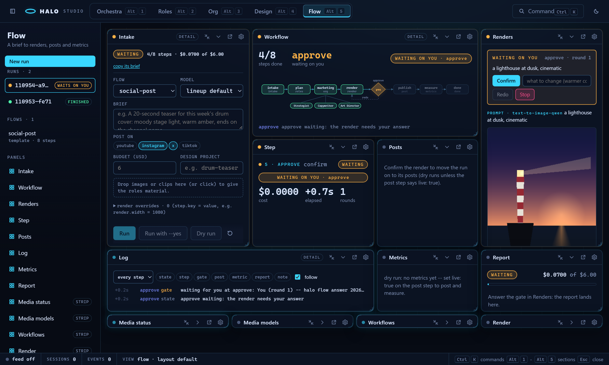

**Before a run is open** the section is one centered **Start** view, not a
grid of empty panels: the intake form (the flow, the model, the brief, the
platforms to post on, the budget, the design project, a drop zone for
assets, the render overrides under a disclosure), what a flow does in six
numbered steps, whether ComfyUI answers, and the past runs to open.
**Run** waits for your OK on the render, **Run with --yes** accepts every
gate, **Dry run** goes through every step but keeps the posts dry. Files
dropped on the form make the run without starting it, upload each file
into the project's `assets/`, then resume it. Starting or opening a run
brings up the panels; **open the workspace anyway** does too. **New run**
(the rail, or the palette's **Flow: new run**) returns to the Start view.

**The panels.** Every Flow and Media panel opens on its full face (the
compact face is the summary a strip keeps); its one-line `about` shows in
the title bar and its few lines of `help` behind `?`.

| Panel | What it shows | Motion |
|---|---|---|
| **Intake** | the open run in one line (state, steps done, cost against the budget, **copy its brief**) over the intake form, sized so Run is always in view | the run's state: flowing while it runs, amber while it waits on you, a green sweep when it finishes, red when it stops |
| **Workflow** | steps done and what runs now (or **WAITING ON YOU**), the steps as nodes in order, the org step's positions as a sub-row, the last log line | pending nodes are faint, the running one's outline flows, done is green, failed red; a `confirm` step is a diamond (`gate-diamond`) that lights amber while it waits on you; the dashed redo arrow runs back to the render and turns amber once a render was sent back |
| **Renders** | the gate card while the confirm gate is open (the prompt, **Confirm**, an instruction field with **Redo**, **Stop**), the Art Director's prompt, every artboard inline (an image, or a video with controls) with its version badges | amber while the gate waits; after the answer a band says **ACCEPTED** (or sent back, or stopped) |
| **Step** | the selected step (click a node; by default the one waiting on you, else the running one, else the last done): cost, elapsed, rounds, the error, and its output -- per role for a roles step, per position for the org with the Art Director's prompt marked, the render's prompt and settings; the org's live positions from the run session's `subagent_*` frames; an org approval waiting on you is answered here | the step's state |
| **Posts** | one row per post: the platform, a grey **DRY RUN** or red **LIVE** badge, the text, the media count, the Postiz post id, the scheduled time, a failure's reason | flowing while the publish step runs |
| **Metrics** | per post and platform the latest views, likes, comments and shares, with a sparkline over the run's metrics tail; a dry run says "dry run: no metrics yet" | flowing while the measure step runs |
| **Log** | the run's `events.jsonl` with each line's elapsed time (or the clock), a step filter, kind filters and **follow** | new lines slide in |
| **Report** | the status, the cost against the budget, the steps table, the artboards, the posts and the metrics summary; **Copy** puts the text `halo flow report` prints on the clipboard | one green sweep when the report lands |

**The gate.** A `confirm` step (and an org position marked
`requires_approval`) waits for an answer file; Studio's Confirm / Redo /
Stop posts it through `flow/runs/<id>/answer`, the same file `halo flow
answer` writes, so a gate opened by a CLI run can be answered here and the
other way round. The palette offers **Flow: answer gate: accept**,
**redo...** (opens the gate card for the instruction) and **stop** while a
gate is open.

**The rail** shows **New run**, the runs (newest first; one that waits on
you pulses amber) and the flows a run can start from (click one to load it
into the Start view's form), above the panel list. The live sessions in the
rail carry their status (`waiting`, `busy`, `idle`); a session that waits on
you gets an inline **answer**: an org approval card takes Accept, an
instruction (Send) or Stop, a permission card Allow once or Deny, a plan
Approve or Send back, all through `sessions/<sid>/command`.

The panels refetch the open run within a quarter second of each `flow_*`
frame for it; when the feed is not connected and the run is live they poll
every 5 s. Palette (`Ctrl`/`Cmd`+`K`): **Flow: new run**, **open run
<id>**, **answer gate**, **stop run**, **resume run**. The panels' options
(log filters, times, the intake defaults) are kept in your browser
(`halo.studio.flow.opts`).

## Media

The ComfyUI panels. In Flow they sit as four strips along the bottom (open
one with its chevron); in Design the palette (**Media: status**, **scan**,
**models**, **quick render**) pops them out over the canvas, and the
Inspector's **Remove from Design** takes one away again.

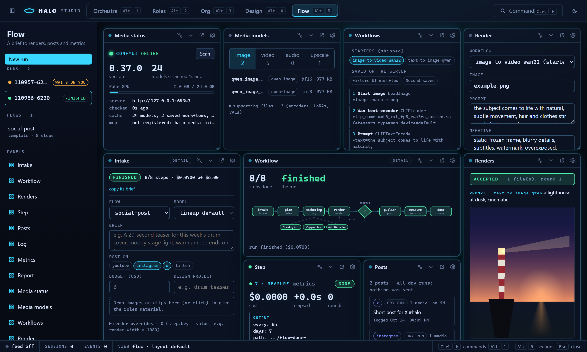

| Panel | What it shows |
|---|---|
| **Media status** | a dot that ticks green on every check (every 15 s while a Media panel is open), the ComfyUI version, the GPU's VRAM bar, the model count and the cache's age, **Scan** (reads the server's model folders and saved workflows into the cache) |
| **Media models** | tabs image / video / audio / upscale; each row is a file with its family, precision and size (and a note: a 4-step LoRA, the high- or low-noise expert); encoders, LoRAs and VAEs of the same families sit under **supporting files** |
| **Workflows** | Halo's starters and the workflows saved on the server; click one for the inputs a render can set (`*` marks a named input) |
| **Render** | the workflow, its named inputs (prompt, negative, size, seed, steps) and every node input under a disclosure, the design project and the artboard; **Render** queues it (`202`), the `media_render` frames show its progress, and the result shows inline (it is also an artboard in Design; a render over an existing artboard is its next version) |

While ComfyUI does not answer, the group is one card instead of four
panels: where Studio looked, the error, and the fix (start ComfyUI, then
`halo media init --url <its address>` or `COMFY_URL`, then **Check
again**). The models tab is remembered in your browser
(`halo.studio.media.tab`).

## Flow and Media routes (3.0.4.0)

The JSON routes behind the Flow and Media panels. Every one sits behind the
same loopback, Host, Origin and bearer-token guard as the rest of `/api/`.
Flow runs are `~/.halo/flows/runs/<id>/` ([FLOWS.md](FLOWS.md)); renders go
to ComfyUI at `COMFY_URL`, the config's `comfy.url`, or
`http://127.0.0.1:8188` ([COMFYUI.md](COMFYUI.md)).

| Route | Answer |
|---|---|
| `GET flow/templates` | `[{name, source: template\|user\|project, steps: [{id, kind}], form, budget_usd, version, path}]` |
| `GET flow/runs` | `[{run, name, status, created, cost_usd, project, budget_usd, live, waiting_step?}]`, newest first |
| `POST flow/runs {template, intake: {brief, platforms, budget_usd, project}, model?, set?, yes?, start?}` | `201 {run, started, warnings}`; 422 with the validator's lines; 409 naming the live run. `set` is `{"render.width": 64}` or `{"render": {"width": 64}}`; `start: false` makes the run without starting it |
| `GET flow/runs/<id>` | `{flow, steps, gate, report, posts, metrics_tail, artboards: [{id, kind, step, url, version, versions, file}], events, live, project}` |
| `GET flow/runs/<id>/events?since=N` | `{events, next}` |
| `POST flow/runs/<id>/assets {name, data_base64}` | `201 {name, size, kind, path, rel, project, intake}` into the project's `assets/` (15 MB); a run not started yet also gets the file in its intake |
| `POST flow/runs/<id>/stop {reason?}` / `resume {model?, yes?}` | `{ok, live}` / `{run, started}`; resuming a finished run is a 409 |
| `POST flow/runs/<id>/answer {step, action: accept\|redo\|stop, instruction?, round?}` | `{ok, message, gate}`; 422 when no gate is open at that step or the round is stale |
| `GET flow/runs/<id>/report` / `posts?all=1` / `metrics?limit=N` | report.json (404 until it exists) / `{posts}` / `{metrics}` |
| `GET media/status` | `{url, reachable, version, python, pytorch, gpus, registered, cache: {scanned, age_s, rows, workflows}, checked, age_s, checking}` |
| `GET media/models?kind=image-gen\|video-gen\|audio-gen\|upscale\|all` | `{kind, rows, scanned, url}` from the cached inventory |
| `POST media/scan` | `{rows, workflows, scanned, url}`: reads the server into the cache |
| `GET media/workflows` | `{workflows: [{name, source: starter\|saved}], reachable, url}` (the cache's names when the server is down) |
| `GET media/workflows/<name>/inputs?source=starter\|saved` | `{workflow, source, label, nodes}`: each node's settable inputs |
| `POST media/render {workflow, set, project, artboard}` | `202 {prompt_id, project, artboard, workflow, source}`; the render goes on in the background |
| `GET media/renders/<prompt id>` | the render's last state |

A run started from Studio runs on a background thread with the real
adapters. Its log reaches the live feed as `flow_state`, `flow_step`,
`flow_gate`, `flow_post`, `flow_metric` and `flow_report` frames
(`session_id: "flow:<run id>"`, data = the log line plus `run`). One flow
run is live per Studio at a time. A render publishes `media_render` frames
(`session_id: "media:<prompt id>"`, data `{prompt_id, state:
queued|progress|done|error, text, project, artboard, workflow, artboards?,
error?}`) and saves each output as an artboard of the design project. A
render over an existing artboard becomes that artboard's next version.
`media/status` refreshes in the background every 15 s and never holds a
request for more than 2 s. An artboard's `url` is a `/design-files/` path.
A `.mp4` is served as `video/mp4` with no sandbox directive.

## Fleet: every harness, every agent

`Alt+6` (or `?mode=fleet`, `halo studio --mode fleet`, `/studio fleet`) is
every Halo harness you run or joined, live: this machine's sessions (each
opens its control socket by default, [FLEET.md](FLEET.md)) and every harness
joined to this machine's hub, each session with its agents at every depth.
Watch what any agent thinks, runs and writes, and steer, pause or stop that
one agent, not only the main one.

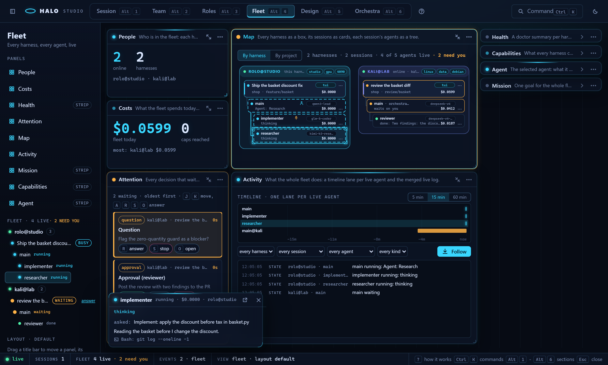

**The Start view.** While only this harness is here and nothing runs on it,
the section is one Start view instead of an empty map: what Fleet is in five
lines; "Start a session in a terminal, it appears here"; **Make a pair code**
(a one-time six-word code, the `halo fleet join <url> --code "..."` line for
the other machine and its QR, which carries the hub's address and
fingerprint; **Start the hub here** when none runs: it listens on the LAN
port, so Windows asks once about its firewall); the share and control
settings as radio rows (`fleet.share`: status | events | full;
`fleet.allow_control`: none | ask | all); the hubs this harness joined and
the members of this machine's hub, each with **kick**; and "open the
workspace anyway". The panels come up by themselves the moment a session
registers or a member joins (`?view=start` / `?view=workspace` force one).

Nine panels on a 24-column grid (seven from 3.0.5.0 R4, Capabilities from
3.0.6.0 R6, Mission from 3.0.6.0 R8): People, Costs and Health along the
top on their compact faces; under them Attention with Activity under it on
the left, Map with Mission under it in the middle (a mission's plan is drawn
on the map, so its table sits right under the drawing), Capabilities on the
right on its compact face (the Who can... box) with Agent under it. Every panel has its one-line
about in its title bar and `?` for how to use it.

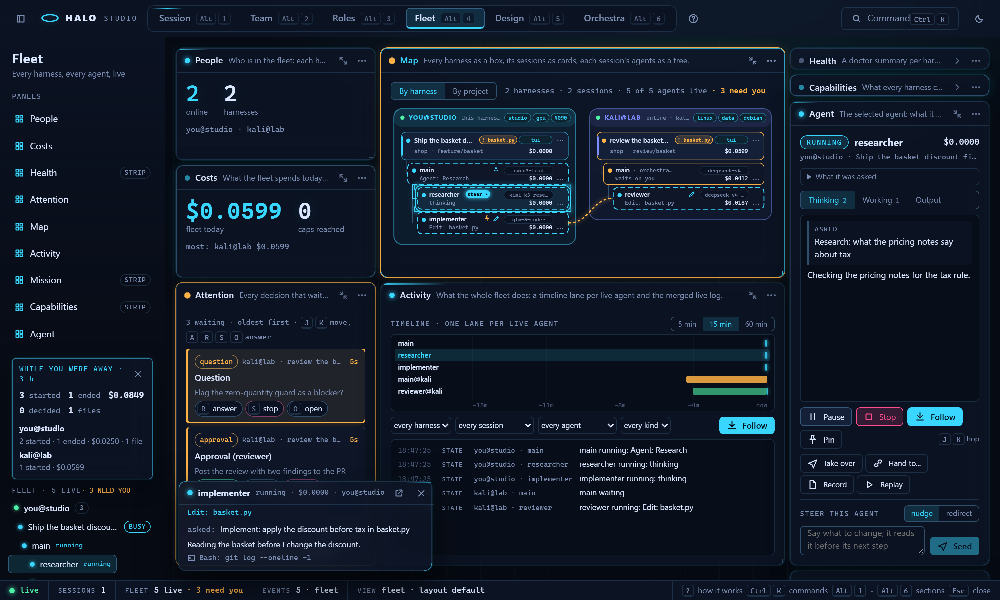

| Panel | What it shows |
|---|---|
| **People** (`fleet-people`) | One row per harness: name, host and OS, the Halo version (a chip with "halo update" when it differs from this one), what it shares and what it lets you do there, the project and top session it is on, **live** (an agent of it works now) / **idle** / **away** (the hub has not heard from it for two minutes), spend today. **Message** sends its owner a note in that session (the `note` command; the model never reads it); **Kick** (this machine's hub only) asks first. Compact face: how many are online and their names. |
| **Costs** (`fleet-costs`) | Today's spend (sessions started today, local day) as a ticker for the whole fleet, then per harness, per project and per session; the provider balances the balances workers last read, when there are any; the **spend caps** editor (per harness, per project, the whole fleet, dollars per day; empty is no cap) and every cap reached, with **Lift for today**. Compact face: the fleet's spend and the caps reached. |
| **Health** (`fleet-health`) | A doctor summary per harness: all good / check it / needs you, the providers set up and whether they answer, the Halo, Studio and Python versions, free disk, how many sessions have their control socket open, and how old the reading is; **Refresh** asks again now. Compact face: healthy and to check. |
| **Attention** (`fleet-attention`) | Every decision that waits on you, across the fleet, oldest first: who (harness, session, agent), what, for how long, and its one-key answers. Compact face: the count and the oldest row. |
| **Activity** (`fleet-activity`) | The **timeline**: one lane per live agent over the last 5, 15 or 60 minutes, a bar per state (cyan working, amber waiting or paused, green done, red failed), each tool call a tick; hover for who and since when, a click selects that agent. Under it the merged **live log** of every harness, session and agent (state changes, tool calls, the text they write, the cards they open, errors, harnesses joining and leaving), with filters by harness, session, agent and kind, and Follow. Compact face: agents live and the newest line. |
| **Map** (`fleet-map`) | One labelled box per harness (this one first; the group-box look of the Roles and Org canvases), a card per session (title, kind chip, project and branch, cost, status dot) and its agents as a tree under it (name and role, what it does now, the model pill, the tool's icon while a tool runs, a cost ticker that counts up, `...`), an edge from each parent to its children. **By project** regroups the cards into one box per repo, the harness colour on each card. Compact face: harnesses, agents live, need you. |
| **Capabilities** (`fleet-capabilities`) | 3.0.6.0 R6. The **Who can...** box on top (see below), then one spec card per harness: its chips (the owner's tags, the GPU, the OS, craft apps), the hardware (CPU, cores, RAM, GPUs and VRAM, free disk), the models it is best with and its local ones, its craft apps and ComfyUI models, every MCP server with its tool count (click one for its tools and what each does), skills, command-line tools, tags, the catalog's age and **Refresh**. The map's harness boxes carry the same chips; People has a **specs** link per harness. Compact face (the default, so Agent keeps its height): the Who can... box and its best three, else each harness's chips; Expand for the spec cards. |
| **Mission** (`fleet-mission`) | 3.0.6.0 R8. One goal for the whole fleet. **Start**: "What should the fleet do?", constraints, **prefer** (a chip per harness, clicked in the order you prefer them: the planner breaks ties with it), a budget, **Plan it**; under it every mission (goal, state, parts by state, harnesses, cost, **Open**), or five lines on how it works. **Plan**: a row per part (its number, title and kind, the harness with the reason on hover and a lock when it was pinned by capability, needs, claims, what it waits for, the estimate, **Drop**), the notes, the merge order, **Plan again**, **Approve**, **Run** (approves first) and what still stops an approval. **Running**: each part live (asked: waiting on that member's owner; running: the line its agent is on; then done / failed / stopped / skipped) with **Open the part's agent**, the cost per harness ticking, the merge queue, **Stop the mission...** (asks for a reason). **Report**: who did what on which harness, cost per harness and per part, decisions, refused edits, failures, the merge, the artifacts and hand-backs with **Open**. Compact face: the running mission's goal and its parts by state, else "no mission". |
| **Agent** (`fleet-agent`) | The selected agent: harness, session, role, model, cost, elapsed, state; **What it was asked**; its three streams, tabbed or side by side (Settings): **Thinking** (what it writes and reasons, the newest text typing out character by character; steers, notes, the cards it opened), **Working** (one row per tool call with its arguments, the file it touches, its result, and for Edit / Write the diff as it grows), **Output** (its hand-back, else the text after its last tool call); **Pause** / **Resume**, **Stop** (asks first), **Follow**, **Pin**; **Take over**, **Hand to...**, **Record**, **Replay** (this harness); the **Steer** box. With no agent picked, the last sessions on this harness with **replay** and **record**. Compact face: the agent, its state and cost, what it does now and its last words. |

**Motion** (the shell's vocabulary): a working agent's outline flows (a
dashed light running round it), one that waits on you or is paused pulses
amber, one that just finished gets one green sweep, a failed one flashes red
and keeps a red edge, a queued or stopped one breathes slowly. When an agent
spawns another (or sends it a message), the edge between them lights for
three seconds.

**Click, double-click, `...`.** A click selects (the Agent panel and an open
Inspector follow, the agent is followed so its stream is pushed, its backlog
is read once); a double-click opens Agent expanded and focused; `...` on an
agent is **Steer**, **Pause** / **Resume**, **Pin**, **Stop...**, **Take over...**,
**Hand to...**, **Record this agent**, and on a session card **Record the
session** and **Shut the session down...**; **Open in Orchestra** /
**Open in Flow** when the session is an Orchestra worker or a flow run.

**Steer.** Type in the Steer box and press Enter (or Send): **nudge** is a
note the agent reads before its next model call, **redirect** gives it a new
task. Only that agent hears it, its stream shows your words marked "you",
and its transcript records who sent it. A steer never widens a permission or
answers a card. To a member's agent it goes through the hub: that harness's
`fleet.allow_control` decides (`ask` opens an allow / deny card for its
owner, and Studio says it is waiting), `none` takes no commands, `all` runs it.

**Stop, Pause, Shutdown.** Pause holds the agent at its next tool or model
call (Resume releases it). Stop asks first, then the agent stops at its next
step with its own sub-agents, and the agent that spawned it gets the stopped
hand-back and carries on. Shutdown ends the whole session after its current
tool call. The palette also has **Fleet: pause all** and **resume all**.

### How this works: Attention

One queue holds every decision a human has to make on any harness:
permission, question, plan and approval cards, a fleet command a member's
owner has to allow, an agent that waits or is paused, a Flow gate, an
Orchestra gate, a spend cap reached, two agents on one file. Each row
answers with one key, through the route that already handles that kind
(`GET /api/fleet/attention`, `POST /api/fleet/attention/answer`): **A**
accepts, allows or resumes, **R** denies, redoes or answers with the text
you type (a deny reason is optional), **S** stops the agent, **O** opens the
panel the row belongs to (the agent in Agent, Costs, the map, Flow,
Orchestra) and sends nothing. Click a row (or move with `J` / `K` or the
arrows while the panel has the focus), then press the key; every decision
is journaled with who made it. The count is live in the status bar and the
rail in every section (a `fleet` frame with action `attention` each time it
changes); a click on the rail's count opens Attention. With the phone
bridge enabled and paired, new rows go to the phone too ([FLEET.md](FLEET.md)).

### How this works: Costs and caps

Costs reads `GET /api/fleet/costs` every ten seconds while it shows. A cap
is `fleet.caps.per_harness_usd_per_day`, `per_project_usd_per_day` or
`fleet_usd_per_day` (`POST /api/fleet/caps`, saved in the hub's
config.json). When today's spend reaches one, the sessions in its scope
pause at their next step and an attention row says so; **Lift for today**
(in Costs or the row's `A`) resumes them and holds that cap off until
tomorrow.

### How this works: Conflicts and project rooms

The hub watches what each agent is editing (its current Edit / Write, and
the Orchestra claims). When two agents of different sessions, on any
harnesses, edit the same file of the same repo, the map joins them with an
amber dashed edge (hover it for who and which file), both session cards
carry a `!` chip with the file, and an attention row names both; its `O`
opens the map. **By project** groups the cards by repo and shows each
card's git chips: clean or dirty, ahead / behind, the worktree
(`GET /api/fleet/conflicts`, polled with the queue).

### How this works: Hand-offs

On an agent (the Agent panel, the map's `...`, the palette): **Take over**
asks for your brief; the agent reads it before its next step in place of
its task, and both transcripts record the hand-off and who made it.
**Hand to...** asks which harness picks the work up (and a note for them):
with Org mode on, Paperclip gets an issue for that harness's company agent
with the task, the last hand-back and the files it touched; with it off,
the same goes into a markdown hand-off note in the repo (`.halo/handoffs/`).
Then the agent stops. The dialog shows the issue id (Open goes to Org) or
the note's path (Open copies it). `POST /api/fleet/<harness>/<sid>/agents/<aid>/handoff`.

### How this works: Recordings

**Record** on the Agent panel (one agent) or a session card's `...` (the
whole session) writes one self-contained HTML file: the three streams, a
timeline you can scrub, every tool call, the cost curve; no network, so
it opens in any browser and can be sent to anyone. The dialog's
**Download** fetches it with Studio's token and saves it
(`POST /api/fleet/<harness>/<sid>/recording[?agent=]`, then
`GET /api/fleet/recordings/<name>`; `halo fleet record` in a terminal).

### How this works: Replay

A finished session plays back on the **Roles** canvas: the cards light up
in the order the agents worked (glowing while they run, amber while they
wait, a green sweep when they finish). Start it from a card's Live tab
history (the **replay** button on a run), the Agent panel (**Replay**, or
the last sessions when no agent is picked) or the palette. A scrub bar
along the bottom of the canvas has play / pause, the speed (1x to 960x;
it starts at a speed that plays the session in about forty seconds), the
clock, the cost so far, who works at that moment, and `x` (or `Esc`) to
go back to what runs now; live updates wait while it plays. The shell
reads `GET /api/fleet/replay` into the Roles store (3.0.7.0 R2) and the
React canvas plays it.

### How this works: Who can do what

Every harness gathers its own capability catalog in code: its MCP servers
and their tools (from their tool caches; a server that does not answer in
time is listed without tools and fills in on the next gather), skills,
models, craft apps, ComfyUI, hardware, command-line tools, projects and the
tags its owner set (`fleet.tags`). Names only: no full path, server command
or key ever leaves the machine, and `fleet.capabilities.hide` keeps a
server, tool or skill off it. A member's announce carries a one-line summary
and the catalog's hash; the hub asks for the whole catalog once per hash and
a `fleet` frame with action `capabilities` refreshes the panel
(`GET /api/fleet/capabilities`). **Who can...** ranks the fleet for what you
type, in code: an exact name beats a word of a name, which beats a word of a
description, and a tag counts double; each result shows what matched and
why (`GET /api/fleet/who?q=`, `halo fleet who`). Click a result and that
harness is picked: its card opens, its box on the map lights up, its
session's main agent is selected. The palette has **Fleet: who can...** and
**Fleet: specs of** each harness. See [FLEET.md](FLEET.md#capabilities-3060-r6).

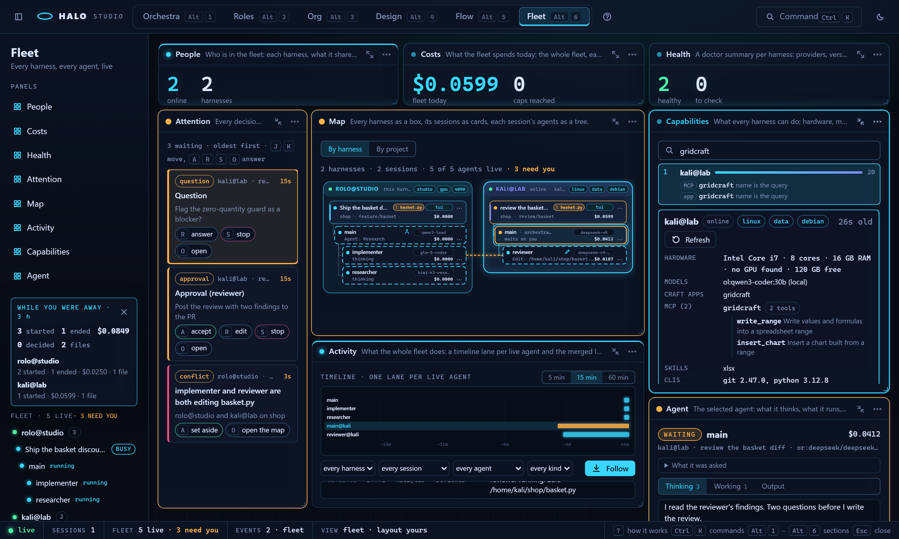

### How this works: Missions

One goal, every harness, nobody stepping on anyone ([MISSIONS.md](MISSIONS.md)):

1. **Goal**: type it in the Mission panel (`M`, or the palette's **Fleet:
   new mission**) and press **Plan it** (`POST /api/fleet/missions`). The
   hub's lead splits it into parts with every harness's capability catalog
   in front of it; a part that needs what only one harness has is pinned
   there (a lock, the reason on hover), a tie goes to your **prefer** order
   then the least busy harness, and a part nobody can run gets a red
   **unassignable** chip.
2. **The plan on the map**: each part is a node in its harness box's lane,
   dashed while planned; an edge for each part it waits for, amber with a
   **claims** chip where two repo parts claim the same files and so run one
   after the other. The table under the map is the same plan.
3. **Edit by hand**: drag a part's node into another harness box to move it
   there (`POST .../parts/<n> {harness}`, checked in code: a harness that
   lacks what the part needs answers 422, the toast says why and the node
   snaps back); **Drop** takes a part out; **Plan again** asks the lead anew.
   Attention has the plan as a row too: `A` approves and runs, `R` edits
   with a text ("part 2 to kali", "drop 3"), `S` drops the mission.
4. **Approve, Run**: Run approves first. Parts start by their dependencies:
   a part on this harness runs here, a part on a member goes to it as the
   `run_task` command. Under `fleet.allow_control: ask` that member's owner
   gets a card ("hub asks to run mission ... part 1 here: ... (claims:
   ...)"), and the node and its row pulse amber, "waiting on <harness>'s
   owner"; on the member's own Studio the card is a **mission part** row in
   Attention (`A` allow, `R` deny, `O` opens the Mission panel on that
   mission). A running part is solid, its row shows the line its agent is
   on, and its `mission-worker` session shows on the map and in the rail
   with a **mission** chip.
5. **Report**: when the last part is over (or you **Stop** it, with a
   reason) the panel turns to the report: who did what on which harness, the
   cost per harness and per part, the decisions, the edits refused outside a
   part's claims, the merge, and the artifacts to open.

The status bar's FLEET cell counts the missions running; the palette has
**Fleet: new mission**, **approve mission**, **stop mission** and **mission
report**.

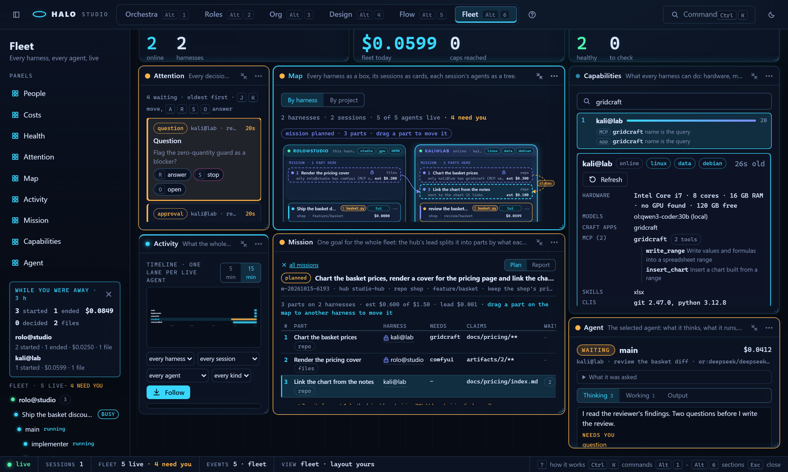

### How this works: While you were away

When the tab comes back after more than ten minutes (or Studio opens after
that long), a card sums up what happened since you last looked, computed
in code per harness: sessions started and ended, cost, decisions made and
by whom, files touched, errors, hand-offs (`GET /api/fleet/digest?since=`;
`halo fleet digest` in a terminal). It shows on the Fleet Start view, else
in the rail. When you last looked is the browser's
`halo.fleet.lastSeen`, refreshed every minute while the tab shows;
**Dismiss** sets it to now. The palette's **Fleet: while you were away**
shows it on demand.

### Keys: hop around

| Key | Where | What |
|---|---|---|
| `Alt+6` | everywhere | Fleet |
| `Alt+7` | everywhere | Team (3.0.8.0) |
| `J` / `K` | Fleet map, the Roles canvas, Orchestra lanes | the next / previous live agent (Orchestra: the next lane at work) |
| `F` | Fleet; Roles with the Live tab open; Orchestra | follow: the stream scrolls with the agent (Orchestra: the Log follows) |
| `Space` | Fleet; Roles with a card's agent watched | pin the stream: a **mini stream** floats over whatever you look at, in every section |
| `Esc` | everywhere | unpin the mini stream (once the palette, a menu or the Inspector is closed) |
| `P` | Fleet; Roles with the Live tab open | pause or resume the agent |
| `K` | inside the Agent panel | stop the agent (asks first; on the map and the canvases `K` is previous) |
| `A` / `R` / `S` / `O` | inside the Attention panel | answer the selected row: accept, deny or redo (with a text), stop, open |
| `J` / `K`, arrows | inside the Attention panel | the next / previous row |
| `M` | Fleet | the Mission panel: one goal for the whole fleet (3.0.6.0) |
| `Esc` | Roles during a replay | close the replay, back to what runs now |

**The mini stream** (picture in picture) shows the pinned agent's state, cost,
what it does now and the newest lines of its stream, typing as they arrive;
drag it by its bar, its arrow opens the agent in Fleet, `x` or `Esc` unpins.
It hides while the Agent panel already shows that agent.

**The rail and the palette.** The Fleet tree in every section's rail
(harness > session > agent, a status dot each, the live and need-you counts)
opens Fleet on the node you click, and a session that waits on you keeps its
inline answer there (for a member too); its need-you count opens Attention,
and "While you were away" shows above it; a mission part's session carries a
**mission** chip and its **part** link opens the Mission panel on it. The palette's **Fleet** group: pair a
harness, kick a member, group the map by project, follow / steer / pause /
stop the selected agent, take it over, hand it to..., record it, replay its
session, answer next (Attention, the oldest row), while you were away,
who can... and the specs of each harness (3.0.6.0), new mission, approve
mission, stop mission, mission report (3.0.6.0),
follow any live agent by name, pause all, resume all, open the session in
Orchestra or Flow.

### Live Roles: the lineup lights up

On the **Roles** canvas the cards whose agents work right now glow (3.0.7.0
R2: the React canvas; the React Org chart shows each agent's Paperclip
status instead). Every live agent (any harness, any session) is matched to
the card it runs under: the lineup must be the open one, then its alias,
else its bio, else a role only one card has (a session's main agent on the
main card). The glow is in the card's band colour and follows what the agent
does: **typing** a steady flow along the top, a **tool call** one pulse per
call and the tool on the card's badge (✎ Edit, ›_ Bash, ▤ Read, ◉ Agent ...),
**waiting on you** the amber pulse and the gate's diamond, **done** one sweep
then still, **failed** one flash. A badge counts the agents when several
share a card (`×2`) and ticks their cost. The edge into a card whose agent
runs flows while it runs.

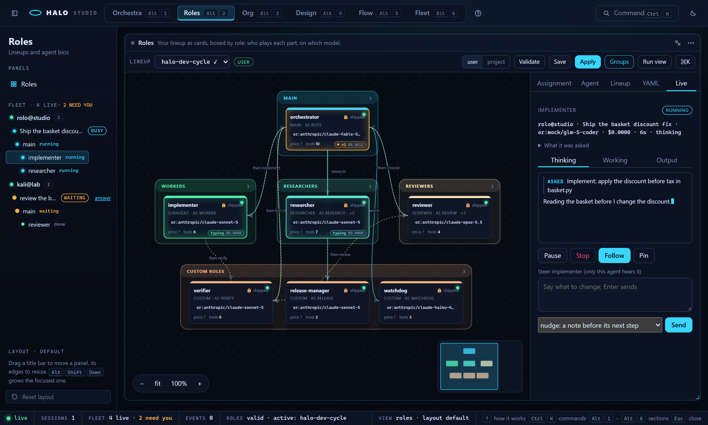

Select a card with a live agent and the Inspector opens its **Live** tab:
a chip per agent when several run on the card, then the agent's header,
what it was asked, its Thinking / Working / Output streams (the text typing
as it arrives, one row per tool call with its result), Pause / Resume, Stop
(asks first), Follow, Pin, and the Steer box. A card nobody runs right now
shows its track record instead: the last runs under that role or bio on this
harness (`GET /api/fleet/history`, from the sessions' transcripts: when,
which bio, the outcome, the cost, the task), each with **replay**. The
canvas reads the live agents from the Fleet store (`routes/fleet/frames.ts`
writes them into the Roles store) and the Live tab uses the Fleet
section's own streams, Steer box and commands.

**Where it reads and writes.** `GET /api/fleet` once, then the live feed
keyed by harness, session and agent (`agent_state` rows in place,
`agent_event` entries of a followed agent, the raw `text_chunk` /
`tool_use_start` / `tool_result` frames, a member's `fleet` frames with
action `sessions`); polling every 4 s only while the feed is down. Commands:
`POST /api/fleet/<harness>/<sid>/agents/<aid>/command` (`local` for this
harness) and `.../<sid>/command` for a session; a backlog is `GET
/api/sessions/<sid>/agents/<aid>/tail` here, the `tail` command through the
hub for a member. The Start view uses `POST /api/fleet/pair`, `GET` / `POST
/api/fleet/settings`, `POST /api/fleet/kick` and `POST /api/fleet/hub`. The
R4 panels read `GET /api/fleet/attention`, `costs`, `caps`, `health`,
`conflicts`, `digest`, `replay` and `history`, and post to
`attention/answer`, `caps`, `.../handoff`, `.../recording` and a session's
`command` (`note`); [FLEET.md](FLEET.md) has every shape.

## Team: people, blocks and stages on one board

`Alt+7` (or `?mode=team`, `halo studio --mode team`, `/studio team`) is the
project's team file ([TEAM.md](TEAM.md)) as one board, live: who works on
the repo that holds Studio's folder, where their work lands, in which order,
and every gate that waits on you. Nothing in it calls a model by itself: Run
starts a stage the way `halo team run` does, on a runner thread of Studio's
own (with the block watchers armed), and every move comes back as a `team`
frame on the live feed.

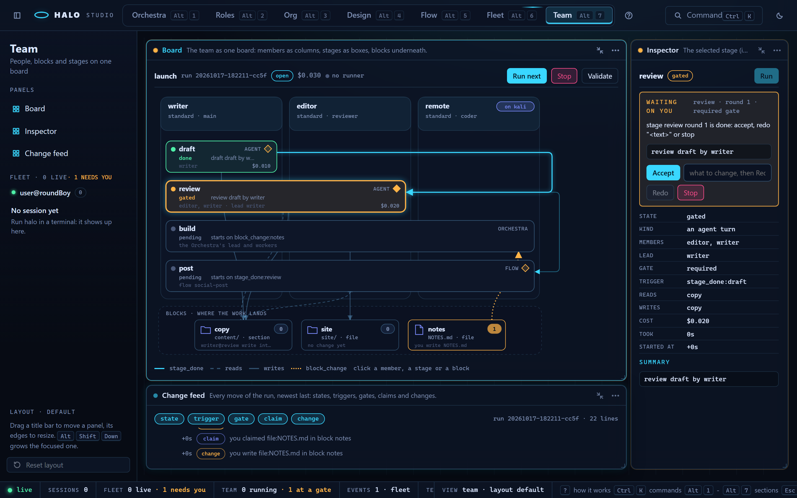

**The Start view.** While the repo has no team file the section is one Start
view instead of three empty panels: what a team is in three sentences (next
to a lineup, an Orchestra run, a flow and a mission), the six steps below,
and one button, **Make my first team** (`POST /api/team/init`: the shipped
template in `<repo>/.halo/team.yaml` and a starter `docs/BRIEF.md`, the same
code as `halo team init`; a 409 when a file exists). A file that does not
load, or has problems, shows the **Problems** list there instead, with
**Validate**. "open the board anyway" (or `?view=workspace`) goes straight to
the panels.

Three panels: the Board at 0,0 (18 columns, 78 rows: a small team's whole
board without scrolling; it scales down to 75% before it scrolls), the
Inspector the whole right-hand column (its gate card and change list are
long), the Change feed under the board. Each has its about line and `?`.

| Panel | What it shows |
|---|---|
| **Board** (`team-board`) | The **run bar**: the team, the run id, its state (not started, open, done, stopped), its cost, the runner dot (live: Studio drives the run now), **Run next** (`POST team/run` with no stage: the first pending manual stage), **Stop** (asks for a reason on a card) and **Validate** (the file's problems and every member's lineup preflight in a dialog). Under it the board: one labelled column per **member** (`team-member`: name, lineup and role, a harness chip when it runs on a fleet member, a live chip per stage it works in right now); one box per **stage** (`team-stage`) in the columns of its members (an Orchestra or flow stage spans the team), coloured by state: pending grey, ready a cyan outline, running a cyan pulse, gated amber with its gate diamond filled, done green, failed red, skipped dim; each box has its kind, the line that matters (waiting, error, summary or trigger), its members and lead, its cost; the **blocks** (`team-block`) in the band underneath as document, folder or git nodes with their path, claims mode, last change and a claim badge (how many hold a part; amber while someone writes). **Edges** (`team-edge`): `stage_done:` triggers down the right-hand gutter (lit once the stage they wait on is done), reads dashed and writes solid between a stage and its blocks (lit while the stage runs), `block_change:` triggers dotted amber from a block to its stage. A click selects a member, a stage or a block and the Inspector opens on it. Compact face: members, stages, running, at a gate. |
| **Inspector** (`team-inspector`) | Three faces by the selection. **Stage**: its board row (state, kind, members, lead, gate, trigger with its settle window, reads, writes, cost, time), its summary, error and `waiting` (a delegated member: asked or running on its harness), **Run** (`POST team/run {stage}`: a problem in the file or a blocking preflight finding is listed right there, the preflight with **Run anyway** = `force`), and while it waits at its gate the **gate card**: the gate's text, the stage's summary, the acceptance's ok and note, **Accept**, **Redo** with your instruction, **Stop** (`POST team/answer`). **Block**: path, kind, claims mode, the ledger, every holder with its key, state and expiry, and its change lines newest first (`GET team/blocks/<id>/changes`, **More** pages back with `next`). **Member**: lineup (a link that opens Roles on that lineup), role, harness and the stages it is in. With nothing selected the stage at a gate shows first. Compact face: the selection and how many stages wait at a gate. |
| **Change feed** (`team-feed`) | Every line of the run's `events.jsonl`, newest last: the time since the run started, the kind, the stage, the text. A chip row hides or shows **state**, **trigger**, **gate**, **claim** and **change** lines (report and note lines always show); a click on a line selects its stage; at the bottom it follows the live run. Compact face: the line count and the last line. |

**Live.** The section reads `GET /api/team` once, then `GET team/board`,
`GET team/blocks` and `GET team/events?since=0`. Each `team` frame (`action`
stage, gate, claim or change) moves its stage's box at once (a stage frame
carries the board row) and opens the gate card (a gate frame carries
gate.json), and asks for the catch-up 150 ms later (the board, the blocks'
holders and the new event lines from `next`), so a line is never counted
twice. While the live feed is down and a run is open it polls every 2.5 s.

**Attention and the status bar.** A stage held at a required gate is a
**team gate** row in Fleet's Attention queue (`kind: team_gate`,
fleet/team_attention.py): `A` accepts, `R` redoes with your text, `S` stops
the run, `O` opens the Team section on that stage with its gate card. The
status bar's **TEAM** cell (with a team file) counts the stages running now
and the ones at a gate, in every section.

### How this works: Team

1. **The team file**: `<repo>/.halo/team.yaml` (else
   `~/.halo/teams/<project>.team.yaml`): the brief every agent reads first,
   the members, the blocks and the stages. Make my first team writes it from
   the template; Validate checks it and runs the lineup preflight.
2. **The blocks**: each keeps a ledger: who holds which part (a section, a
   file) and one change line per write. While a stage runs its members write
   only inside its write blocks; a part another member holds comes back
   naming the holder.
3. **The stages**: each reads and writes blocks and starts on a trigger:
   manual (Run), `stage_done:<stage>` (the edges down the right) or
   `block_change:<block>` (after a quiet settle window).
4. **Run**: Run next (or Run on a stage in the Inspector) starts it: its box
   pulses cyan, its members' columns show who is at work, the blocks it
   writes count their holders and the feed fills.
5. **The gate**: a stage with a required gate stops at amber; the
   Inspector's gate card (and a Fleet Attention row) has its summary and the
   acceptance. Accept, Redo with an instruction, or Stop the run.
6. **The next stage**: Accept marks it done: the `stage_done` edges light
   and the stages waiting on it start; a block that changes and settles
   starts its `block_change` stage. Stop ends the run; every stage not done
   is skipped.

**Keys.** `Alt+7` opens Team; `Tab` moves between the stage and block boxes
and `Enter` selects one; `?` and the panel keys work as everywhere.
**Palette** (`Ctrl`/`Cmd`+`K`): **Team: run next stage**, **Team:
validate**, **Team: stop** (asks for a reason), **Team: open file** (the
team file's path in a dialog with **Copy**), and **Team: open stage
<id>** for every stage.

**Files.** `ui/src/routes/team/` (`Team.tsx` the panels, `Start.tsx` the
Start view, `store.ts` + `sync.ts` the store and its feed, `actions.ts`,
`layout.ts` the board's geometry, `Board.tsx` + `BoardParts.tsx` +
`RunBar.tsx`, `Inspector.tsx` + `InspectorStage.tsx` + `InspectorBlock.tsx`,
`Feed.tsx`, `Dialogs.tsx`, `commands.ts`), `routes/help-team.ts`,
`styles/team.css` + `team-panels.css`; the routes are
`studio/team_api.py` and `team_init_api.py`, the runner thread
`team_live.py`, the Attention rows `fleet/team_attention.py`. Pictures:
`python tools/capture_studio.py --mode team` (tools/capture_team.py).

## What you see (Roles)

Roles (`Alt+2`, 3.0.7.0 R2) is six panels; until you have a lineup of your
own (only the shipped ones, none active) it is one **Start view** instead:
what a lineup is, the steps, and **Make my first lineup** (a copy of a
shipped one, opened on the canvas); "open the panels anyway" (or
`?view=workspace`) goes straight to the panels.

| Panel | What it holds |
|---|---|
| **Lineups** (`roles-lineups`) | every lineup (shipped, user, project; the active one marked, the open one highlighted); **New** and **Duplicate** ask for a name on a card, **Delete** asks first (a shipped lineup stays), **Apply** asks first, showing the role table it writes; **user / project** says where New, Save and Delete write |
| **Canvas** (`roles-graph`, the drawn canvas `roles-canvas`) | the open lineup: one card per assignment, in one labelled column box per tier; the edges; the toolbar (scope, unsaved, Undo, Redo, Save, Apply, Lay out, Fit, zoom); the replay bar along its bottom |
| **Inspector** (`roles-inspector`) | **Assignment** (the selected card's bio, role, alias, instances, the words that route a task to it, reports-to, a model override, what resolves for it; Edit bio, Duplicate, Remove; with no card: the lineup's description, about and extends), **Lineup** (every top section as a small form with a **YAML** toggle and its enforcement badge), **Live** (the agents on the card now, or its last runs) |
| **Problems** (`roles-problems`) | everything wrong with the lineup as it stands in the editor, saved or not, in **Blocks** and **Warns**, each with its fix; a click selects its card |
| **Bios** (`roles-bios`) | every bio (drag one onto the canvas to add a card); a click opens the **bio form** (`bio-form`): description, kind, extends, the preferred model in the **model picker table**, fallback, effort, thinking, the tools it may and may not call (from the real registry, `GET /api/tools`), limits and output; **Save bio**, New, Duplicate, Delete |
| **Models** (`roles-models`) | the catalog: its row count, each provider (enabled, key, models cached), why it is empty when it is, **Refresh** (`POST /api/models/refresh`), and **Test a model** by any ref |

- **A card** shows the agent, its role and alias, a **scope badge**
  (shipped, user, project: a shipped bio is read-only, Duplicate it in Bios
  for your copy), the **instances stack** (a slot with `instances: 3` is
  three stacked cards and `×3`), the **model pill** with the price in / out
  per 1M tokens and the context from the catalog, the **gym score** when
  `halo gym` measured that model on this machine (`GET /api/gym`), and a
  **warnings badge** with the count of its problems (hover reads them). Its
  band is its role's colour (main amber, workers cyan, researchers violet,
  reviewers green, judges red).
- **The tier boxes.** One labelled column box per tier from the lineup's
  `tiers:` (tier 0 on the left, holding the main agent alone; the implicit
  last tier dashed; a lineup without tiers is one box, `all`). The strip
  says `Tier N · name`, the count, `max_parallel` and whether it is
  implicit; a click on it collapses the box to its strip (the cards hide)
  or expands it. Drag a card into another box: the alias moves to that
  tier's `members` and the lineup saves at once (`PUT /api/lineup/<name>`;
  a shipped lineup saves as your copy). The main agent cannot leave tier 0
  and nothing else may join it: that drop snaps back with a toast naming
  the rule. Positions and each box's collapsed state go to `PUT
  /api/layout/<name>` (`{nodes, tiers}`) 500 ms after the last move; a
  layout saved before the boxes existed is laid out once.
- **The edges**: **delegation** from main (cyan; its routing words show
  while one of its cards is selected), **reports to** from the org section
  (violet, dashed) and **pipeline** stage order (amber, dotted, `then
  <stage>`).
- **The model picker table** (in the bio form): every catalog row with its
  price in / out, context, **best for** (`capabilities.score`: visual,
  audio, video, image, design; `GET /api/models/best-for`) and gym score;
  sort by name, price or context, search across all of it; a click picks
  the row; a ref the catalog lacks can be typed below. **Test this model**
  (`POST /api/models/test {ref}`) sends one short request and shows `ok in
  N ms`, or the error, right under it, never a dialog.
- **Problems** come from `POST /api/validate` 250 ms after every edit (and
  from `GET /api/lineup/<name>` on open): `findings` merges the validator's
  lines (blocks: Save answers 422 for these), the run-start preflight on
  the edited mapping (a model id its catalog does not know, a dead fallback,
  a bio with `tools.allow: []`, aliases in no tier), three tiers or more
  without the `delegation.max_depth` to reach the bottom one, and each
  card's own warnings (`studio/roles_findings.py`).
- **Undo and redo.** Every edit (a field, a drop, a removed card, a YAML
  apply) joins a history of 50; `Ctrl+Z` undoes, `Ctrl+Shift+Z` (or
  `Ctrl+Y`) redoes; inside a text box the box keeps its own undo. A save
  that answers 422 lists the validator's lines in the Inspector and keeps
  your edit.
- **The palette's Roles group**: Roles: new lineup, Roles: apply lineup,
  Roles: new bio, Roles: test model (the open bio's model, or the selected
  card's), Roles: save lineup, Roles: undo / redo, and every lineup and bio
  by name.
- **No browser dialogs**: names, confirmations (delete, apply, remove a card,
  leave unsaved edits) and results are cards and toasts inside Studio.

## Org mode: the company in Paperclip

Org (`Alt+3`, `halo studio --mode org`, `/org`) is a React section of the
shell since 3.0.7.0: four panels on the workspace grid, or one **Start view**
while there is no company to show (Paperclip not installed or not running, or
no company linked): what Org mode is, the steps, where Paperclip stands, and
the two buttons **Install Paperclip** (the install log streams under it; Node
24+ required) and **Link a company** (with no company in Paperclip yet:
**Make a company from a lineup**). "open the panels anyway" skips it.

| Panel | What it is |
|---|---|
| **Company** (`org-company`) | Installed, running (version, URL, deployment mode), linked company, budget; the **Org mode** switch; Install, Link, Sync a lineup into the company (or into a new one), Pull the reporting lines back into a lineup, each with its one line; "open Paperclip" |
| **Org chart** (`org-chart`) | The agents as cards (title, role, adapter, status, spend against budget) in labelled group boxes, one per manager's reports ("CEO's team", or the agent's `metadata.team`), the top level in **Leadership**; the reports-to lines between them |
| **Issues, goals, projects** (`org-work`) | One tab each, live from Paperclip; with an agent selected, "only <agent>" narrows the issues; New issue (assigned or not: Paperclip wakes an assigned agent) |
| **Inspector** (`org-inspector`) | What you clicked: an agent (title, role, reports-to, monthly budget with Save; Wake, Pause / Resume, Terminate (asks first); the adapter, its command and cwd, the Halo bio and lineup), an issue (status and assignee changed in place), a goal or a project; each with a link to its Paperclip page |

**Off by default.** Company's switch is `paperclip.enabled` (also `halo
paperclip on|off` and `/org on|off`); while it is off the chart says so and
offers to turn it on, and nothing runs on a heartbeat. See
[PAPERCLIP.md](PAPERCLIP.md).

**The chart.** Drag a card to move it: the places are saved on the server
(`PUT /api/layout/pc:<company id>`, 500 ms after the last move), so they
follow you to any browser. Drop a card into another box (into Leadership: it
reports to nobody), or onto a card, and Studio asks first, then `PATCH`es
the agent's `reportsTo`; Cancel puts the card back. A move that would make a
loop is refused in the dialog. Drag a box by its label strip to move the
whole team. Click a card to select it, double-click to open the Inspector on
it. Click the chart, then `A` lays it out by level, `F` fits it, `+` / `-`
zoom.

**Live, without flicker.** One poller reads `pc/status` and the company's
agents, issues, goals and projects every 3 s while Org is on screen (the tab
visible); it keeps every unchanged row, so only what changed redraws (the
classic page redrew everything every 8 s). The status bar's ORG cell says
the company, its agents and its open issues.

Studio talks to Paperclip through its own server (`/api/pc/...`), which adds
the board token from `~/.halo/paperclip.json` server-side; the page never
holds it. The palette's Org group: **Org: sync**, **Org: pull**, **Org: link
company**, Org mode on / off, read Paperclip again, and every agent by name.

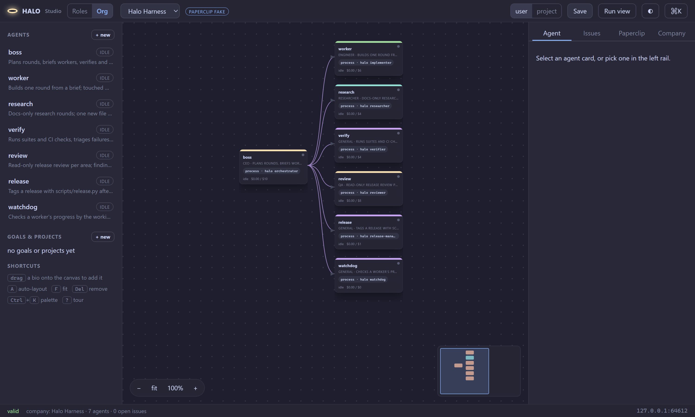

## Design mode: prototypes, pages and decks on your own apps

Design (`Alt+4`, `halo studio --mode design`, `/design`) is a React section of
the shell since 3.0.7.0, over `halo design` projects under
`~/.halo/design/<slug>/`. With no project yet it is one **Start view**: what
Design mode is, the steps, and one button: name the first project and
**Create project** (a project made elsewhere shows up within 4 s).

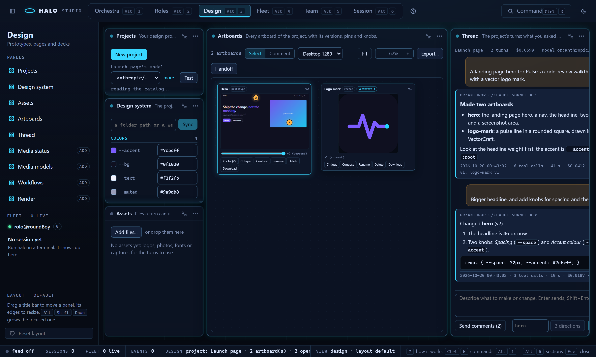

| Panel | What it is |
|---|---|
| **Projects** (`design-projects`) | Every project with its artboards and model; click one to open it; **New project** (a dialog: a name and, if you like, its model) |
| **Design system** (`design-system`, 3.0.7.0 R3b) | The project's token sheet (`system.json`): the tokens by group (colours, type, spacing, radii), a colour with its swatch, each value editable with **Save tokens**; the components and the sources; **Sync** from a folder path or a web page |
| **Assets** (`design-assets`) | The project's `assets/`: **Add files...** or drop files on the panel (uploaded as base64, 15 MB each); click a row to put its path in the message; **Download** saves it through `/design-files/<slug>/_assets/<name>` |
| **Artboards** (`design-artboards`) | The artboards as cards on a canvas: the frame (a prototype in `<iframe sandbox="allow-scripts">`, a render as an image, a video, else a link), its open comment pins (click one: its text and **Resolve**), the version slider with **Restore**, then **Knobs (N)**, **Critique**, **Contrast**, **Rename**, **Delete** (asks first) and **Download**; double-click a prototype's text to edit it; the toolbar has **Select / Comment**, the device select, zoom, Fit, **Export...** and **Handoff**; its settings face (the title bar's ... menu, Settings) holds the device and the knobs |
| **Thread** (`design-thread`) | The project's turns as one thread: what you asked, the model's reply as markdown, cost, tool calls, seconds and the versions it made; the running turn streams at the bottom with a chip per tool call; the **Send** box (`Enter` sends, `Shift+Enter` a new line) and **3 directions** beside it, while a turn runs **Cancel turn**; **Send comments (N)** when pins are open |

**Turns over the live feed.** Every step of a turn is a `design_turn` frame
on `/api/events` (`session_id: "design:<slug>"`, data `{slug, turn, state:
started|event|done, n, event, result}`; a tool call's input is cut to one
line). While the feed is not open the page polls `turn/<id>?since=N` every
500 ms instead (the classic page's way); both fill the same slots, so nothing
shows twice. One turn runs per project at a time. **Cancel turn** is `POST
design/<slug>/turn/<id>/cancel`: the turn's child is killed, the turn ends
with code 130 and `cancelled: true`, and what it wrote so far is kept as
versions. The history keeps each turn's reply text (8000 characters).

**A safe markdown subset.** The thread renders headings, paragraphs, lists,
block quotes, code blocks, inline code, bold, italic and links (only
`http(s)` and `mailto`, opened with `rel="noopener noreferrer"`). Nothing is
parsed as HTML and no image is fetched: an image shows as its alt text.

**Artboards.** Drag a card by its title; the places are saved on the server
(`PUT /api/layout/design:<slug>`, stored as `_design-<slug>.json`, 500 ms after
the last move). **Rename** is `POST design/<slug>/artboard/<id>/rename
{name}` (the title changes; the id, files and versions stay); **Delete** is
`DELETE design/<slug>/artboard/<id>` (its folder and versions go, its open
pins are resolved; refused while a turn runs). **Critique** starts a
read-only turn (Read and Glob, no MCP servers) whose notes land as pins with a
`critique` badge (`POST design/<slug>/critique {artboard, model?}`);
**Contrast** opens the text-on-background table with ratio and AA / AAA
verdicts (`GET design/<slug>/artboard/<id>/contrast`). **Export...** asks for
folder, HTML, PNG, SVG or PDF and one artboard or all, then shows what it
wrote; **Handoff** shows the bundle's path and the command that continues
from it.

**Versions.** Every turn, knob move, direct edit and restore is a version.
The slider swaps the frame to `v<n>/...`; at an older version **Restore**
makes it the newest one.

**Knobs.** An artboard's `controls.json` knobs are sliders, colour pickers
and selects in the Artboards panel's settings face (a card's **Knobs (N)**
opens it on that artboard; a select there picks another). A change is posted
150 ms after the last move (`POST design/<slug>/control {artboard, name,
value}`): a `css:` knob rewrites the variable in the page at once and is
saved as a version (the chip says `made v3`, the frame reloads), any other
knob is kept for the next turn (`saved for the next turn`).

**Direct text edits.** A prototype's current version is framed with
`?edit=pick`: a small picker in the sandboxed frame posts `halo-design-pick`
to Studio on a double-click (the text, its element path from `<body>`, the
text node, its box). Studio opens its own inline editor on the card at that
text; **Enter** or Save reads the page's source, changes that one text node
(found by its path, else by its text when that is unique) and posts the page
to `POST design/<slug>/text-edit {artboard, html}`, saved as a new version
with the note `direct edit`; **Esc** or Cancel drops it. A text the page's
own script draws is not in its source: Studio says so, and a turn changes it.
A card's frame takes the pointer once the card is selected (click its
title).

**Comments.** Pick **Comment** in the toolbar and click a frame: a small
comment box opens at that point; **Enter** pins it (`POST design/<slug>/comment
{artboard, text, x, y}`, x and y in percent of the frame, on the newest
version). Pins are numbered per artboard; click one for its text and
**Resolve** (`POST design/<slug>/comments/resolve {ids}`). **Esc** or Select
puts the tool down. **Send comments (N)** in the Thread turns the open pins
into one turn and resolves them when it succeeds.

**The design system.** The Design system panel lists the token sheet; edit a
value and **Save tokens** (`PUT design/<slug>/system`, the whole sheet with
its components and sources kept). **Sync** reads tokens from a codebase
folder or a web page (`POST design/<slug>/sync {source}`) and merges them;
a dialog says how many tokens there are, by group, and where they came from.

**3 directions.** The Thread's **3 directions** sends the message box's text
through the same turn path as Send, with `variants: 3` and `base` (the box
beside it, the selected artboard's id by default) in the `run` body; the
server writes the prompt ("Make 3 directions of: ... named <base>-a,
<base>-b, <base>-c"), so it is not a prefix the page adds. When the turn ends
the new artboards are laid out in one row under the others (their places
saved like a drag) and the first is selected.

**Device size.** The Artboards toolbar's device select draws every prototype
at **Phone 390** (390 x 844), **Tablet 820** (820 x 1100) or **Desktop 1280**
(1280 x 800, the default), scaled to the card. The same select is in the
panel's settings face, and the choice is kept as the panel's setting in the
browser (`halo.studio.design.panel.design-artboards`).

**The raw file route and its sandbox.** Artboard files are served at
`GET /design-files/<slug>/<artboard>/<file>` (and `.../v<n>/<file>`), the
project's assets at `/design-files/<slug>/_assets/<name>`, loopback only and
confined to that folder (`..` is a 404). They carry their own
`Content-Security-Policy: default-src 'self' 'unsafe-inline' data: blob:`
and `nosniff`, not Studio's, because a prototype has inline CSS and JS. HTML
and SVG responses add `; sandbox allow-scripts` to that policy, so the
document gets an opaque origin even when it is framed without a sandbox
attribute or opened on its own; renders (PNG, PDF, MP4) keep the plain policy.
The page embeds them as `<iframe sandbox="allow-scripts">` without
`allow-same-origin`, so a prototype runs but cannot reach Studio's API or its
token. An artboard folder that is a symlink is never served.

The palette's Design group: **Design: new project**, **Design: send** (the
message box's text; with an empty box it moves the focus there), **Design:
cancel turn** (while one runs), **Design: 3 directions**, **Design: pin a
comment** (the Comment tool), **Design: preview at Phone 390 / Tablet 820 /
Desktop 1280**, **Design: export**, **Design: handoff bundle**, **Design:
send comments**, and every project by name.


## Connecting boxes (3.0.2.0)

Every member hangs off the starting box (the `main` assignment) until you
connect it elsewhere. Two ways, both writing the lineup's own
`org.positions[].reports_to` (a title is the assignment's alias, else its
role, else its agent):

- **Drag a card onto another card.** The dragged member now reports to
  the card you dropped it on, and its edge moves there; drop it on the
  starting box to hang it off main again. (Dropped into another **tier
  box** instead, away from any card, it moves to that tier: 3.0.7.0 R2,
  see [What you see (Roles)](#what-you-see-roles); in Org, a box is a
  manager's team and the drop asks to change who it reports to.)
- **The Reports-to field** in the Inspector's Assignment tab: pick any other
  card, or "the main card" for the starting box.

The canvas redraws the tree as you connect (a member that reports to
another member no longer gets the main -> member delegation edge), Save
writes it like any other change, and `halo teams show` prints the same
org positions. Runtime: `reports_to` addresses the member's one-line
completion report (docs/AGENTS.md, "org").

## Validate, save, apply

Every edit is validated as you make it (`teams_yaml.validate_team_template`,
the CLI's own checks, plus the preflight: the Problems panel). **Save** validates, then writes the YAML to your user
scope (or the project, with the user / project toggle in Lineups). A shipped
lineup or bio is never edited in place: saving it writes a copy under the
same name into your scope, which then shadows the shipped one -- exactly
what the wizard's Duplicate does. **Apply** shows the role table it will
write and, on confirm, does what `halo teams use <name>` does: `roles.*`
and `team:` in `~/.halo/config.json`, with custom roles switched on.

Errors are the validator's own lines, listed in the Inspector and in
Problems; a save that fails leaves the file untouched.

## Security model

- The server binds `127.0.0.1` only and refuses any request from a non-
  loopback peer.
- Every API call carries a per-launch token (the `#t=` fragment in the URL
  `halo studio` prints; the page keeps it in session storage and sends it as
  a bearer header). A request without it is a 401.
- A request carrying an `Origin` header that is not this server's own is a
  403, so a page on another site cannot drive Studio even with the port.
- **One exception to the bearer header: `/api/events`.** A browser's
  `EventSource` cannot send headers, so the live feed takes the same
  per-launch token in the query (`?t=`), compared in constant time; a
  missing or wrong token is a 403, and the loopback, Host and Origin checks
  are the same as for every other call. The token never leaves the machine
  and the response is `Cache-Control: no-store`.
- **The sessions routes (3.0.4.0).** `GET /api/sessions` lists the live
  sessions in `~/.halo/run/sessions.json`: `[{session_id, title, cwd, mode,
  kind, started, pid, status: idle|busy|waiting|unknown, busy, pending,
  model, status_age_s}]`. The status comes from each session's control
  socket (1 s timeouts, asked side by side, cached 2 s; the request waits
  at most 1.5 s). The endpoint and token are never returned. `POST
  /api/sessions/<sid>/command {cmd: answer|interrupt|steer|submit, kind?,
  request_id?, action?, instruction?, text?}` forwards one control-protocol
  request ([REMOTE.md](REMOTE.md)) to that session over its socket, using
  the token from the registry. That lets Studio answer a permission,
  question, plan or org approval card in a running TUI session, steer it,
  send it a prompt or interrupt it. The answers: `{ok, result}`, 404 for a
  session not in the registry, 422 for another `cmd`, and 502 with the
  socket's own error text (for example "no pending approval request"). It
  sits behind the same bearer-token guard as every other route, so only the
  page `halo studio` opened can use it.
- **The agent routes (3.0.5.0 Fleet, `studio/fleet_api.py`).** The session
  rows also carry `harness`, `project`, `parent` and `agents` (how many
  sub-agents are working right now; the rail shows it), and a private
  session is never listed. `GET /api/sessions/<sid>/agents` is the
  session's agent tree, `GET /api/sessions/<sid>/agents/<aid>/tail?n=&kinds=`
  one agent's last entries, `POST /api/sessions/<sid>/agents/<aid>/command
  {cmd: steer|stop|pause|resume|follow, text?, mode?, reason?, on?}` acts
  on one agent, and `POST /api/sessions/<sid>/command` also takes `shutdown`
  (`reason`), `pause` and `resume` (optional `agent_id`). Studio sends `by`
  = `fleet.name` and `via` = `Studio`. The live feed passes `agent_state`,
  `agent_event` and `fleet` frames with each frame's `harness`. Shapes and
  rules: [REMOTE.md](REMOTE.md#agent-level-commands-3050-fleet),
  [SUBAGENTS.md](SUBAGENTS.md), [FLEET.md](FLEET.md).
- **The fleet routes (3.0.5.0 R2, `studio/fleet_hub_api.py`).** `halo studio
  --fleet` (or `halo fleet serve` while Studio runs) starts the fleet hub
  inside Studio's process, on its own LAN port that serves only the fleet
  protocol; this API stays on loopback. `GET /api/fleet` is every harness
  (this one first, then each member of the hub) with its sessions and agent
  trees; `POST /api/fleet/<harness>/<sid>/command` and `POST
  /api/fleet/<harness>/<sid>/agents/<aid>/command` act on this harness
  directly and on a member through the hub, as that member's owner allows
  (200, 202 `asked`, 403 refused with the reason); `GET
  /api/fleet/commands/<id>` and `POST /api/fleet/hub {action: start|stop}`.
  Member frames reach the live feed with their `harness`. See
  [FLEET.md](FLEET.md#studio-get-apifleet-and-the-commands).
- No CDN, no fonts fetched, no analytics: the page is a handful of static
  files served from the package, under a strict content-security policy.
  The shell (`static/dist/`) gets `default-src 'self'; connect-src 'self'`
  with no inline styles or scripts (a checkout without a build answers `/`
  with one line saying how to build the UI). The built bundle contains no
  `http://` or `https://` URL at all (a CI test checks).
- Writes go only to `~/.halo` (and a project's `.halo/` when you choose that
  scope); shipped files under the package are never written or deleted.

## Over SSH

On a box you reach over SSH (the usual Kali case), run `halo studio
--no-open` there, then on your machine:

```sh
ssh -L 48761:127.0.0.1:48761 <host>
```

using the port Studio printed, and open the printed URL (token included)
in your own browser.

## Shortcuts

The shell's keys: `Alt+1`..`Alt+7` sections, `Ctrl`/`Cmd`+`K` the palette,
`?` the focused panel's help (again, or away from a panel: How this works),
`Alt`+arrows / `Alt+Shift`+arrows move / resize the focused panel, `Esc`
closes. Roles (3.0.7.0 R2): on the canvas `A` lays out, `F` fits, `+` / `-`
zoom, the arrows nudge the selected card, `Del` removes it (asks first);
`Ctrl+Z` / `Ctrl+Shift+Z` undo / redo a lineup edit, `Ctrl`/`Cmd`+`S`
saves. The hop keys (3.0.5.0, [Fleet](#keys-hop-around)): `J` / `K` the
next / previous live agent (Fleet map, Roles cards, Orchestra lanes), `F`
follow, `Space` pin the mini stream, `Esc` unpin, `P` pause or resume, `K`
in the Agent panel stop (asks first).

## Files

`halo_harness/studio/server.py` (the server, the guard, the command),
`events.py` (the live feed: the registry watcher and `/api/events`),
`ui/` (the React shell's sources; see docs/DEVELOPMENT.md "Studio UI"),
`static/dist/` (its committed build; the only page since 3.0.7.0 R2),
`api.py` (the routes), `roles_api.py` (`GET gym`, `GET models/best-for`), `roles_findings.py`
(the Problems panel's findings), `models_api.py` (the catalog status, Refresh, the probe), `flow_api.py` / `flow_model.py` / `flow_runs.py` (the Flow
routes and the one live flow run), `media_api.py` / `media_render.py` (the ComfyUI
routes and a render's background thread), `sessions_api.py` (the live sessions and
their commands), `design_api.py` / `design_api_io.py` / `design_api_more.py` / `design_api_turns.py` / `design_files.py` (Design mode), `paperclip_api.py` (Org mode), `model.py` (the graph, the catalog rows, the session
reader). Tests: `tests/test_studio_api.py`,
`tests/test_studio_model.py`, `tests/test_studio_dist.py` (the build and
its routes), `tests/test_studio_live.py` (the live feed),
`tests/test_studio_flow_api.py` and `tests/test_studio_media_sessions.py` (the 3.0.4.0 routes),
`tests/test_studio_ui.py` (headless Chrome over the shell; the Flow section
through `tools/capture_studio.py --mode flow --dom`, the Orchestra Start
view and grid through `--mode orchestra --dom` (tools/capture_orchestra.py),
and clicks and keys through `tests/helpers/studio_clarity.py` over the
DevTools protocol, `tests/helpers/cdp.py`). The Flow and Media
panels are `ui/src/routes/flow/` and `ui/src/routes/media/`; the Orchestra
Start view `ui/src/routes/orchestra/Start.tsx`; the help copy
`ui/src/routes/sectionHelp.ts`, `help.ts`, `help-orchestra.ts` and
`help-org-design.ts`. Org and Design (3.0.7.0 R3) are `ui/src/routes/org/`
(the store `store.ts`, the diffed poller `sync.ts`, `actions.ts`, the chart
`Canvas.tsx` + `CanvasParts.tsx` + `layout.ts`, `Company.tsx`, `Work.tsx`,
`Inspector.tsx`, `Start.tsx`, `Dialogs.tsx`, `commands.ts`) and
`ui/src/routes/design/` (`store.ts`, `sync.ts`: the turns over the live
feed, `actions.ts`, `Projects.tsx`, `Thread.tsx` + `ThreadParts.tsx`,
`Artboards.tsx` + `ArtboardCard.tsx`, `Assets.tsx`, `Start.tsx`,
`Dialogs.tsx`, `commands.ts`), the safe markdown `ui/src/lib/markdown.tsx`,
`styles/org.css`, `design.css` and `design-thread.css`; tests
`tests/test_studio_design_live.py` and the Chrome checks in
`tests/helpers/studio_org_design.py`. Roles (3.0.7.0 R2) is
`ui/src/routes/roles/` (the store `store.ts`, `sync.ts`, the edits and the
undo history `actions.ts`, `bioActions.ts`, the canvas `Canvas.tsx` +
`CanvasParts.tsx` + `CanvasBar.tsx` + `layout.ts`, Live Roles `live.ts` +
`LiveTab.tsx`, `Replay.tsx`, the Inspector `Inspector.tsx` + `Assignment.tsx`
+ `LineupTab.tsx` + `SectionForm.tsx` + `sections.ts` + `controls.tsx`,
`Problems.tsx`, `Lineups.tsx`, `Bios.tsx` + `BioForm.tsx` +
`ModelPicker.tsx`, `Models.tsx`, `Start.tsx`, `Dialogs.tsx`, `keys.ts`,
`commands.ts`), `styles/roles.css` and `roles-panels.css`, the help
`routes/help-roles.ts`; tests: the DOM counts in `tests/test_studio_modes.py`
(`tools/capture_studio.py --mode roles --dom`, tools/capture_roles.py) and the
Chrome clicks in `tests/helpers/studio_roles.py`. Fleet (3.0.5.0) is
`ui/src/routes/fleet/` (the store and the feed: `store.ts`, `sync.ts`,
`streams.ts`; the panels `Map.tsx` + `MapNode.tsx` + `layout.ts`,
`Agent.tsx` + `StreamViews.tsx` + `Steer.tsx`; `FleetRail.tsx`, `Start.tsx` +
`Pair.tsx`, `Pip.tsx`, `hop.ts`, `frames.ts`, `commands.ts`, `Dialogs.tsx`),
`styles/fleet.css` and `fleet-agent.css`, the help `routes/help-fleet.ts`;
Live Roles is `frames.ts` (the live rows into the Roles store), `hop.ts`
and `replay.ts` with the Roles section's `live.ts`, `LiveTab.tsx` and
`Replay.tsx`; the
routes `fleet_hub_api.py` (R2), `fleet_pair_api.py` and `fleet_api.py`
(`get_history`). 3.0.6.0 R6 adds `Capabilities.tsx` + `Who.tsx` + `caps.ts` +
`MapChips.tsx`, `styles/fleet-caps.css` and `fleet_capabilities_api.py`
(tests: `tests/test_fleet_capabilities*.py`, the `caps` Chrome scenario in
`tests/helpers/studio_fleet_caps.py`). 3.0.6.0 R8 adds the Mission panel:
`Mission.tsx` + `MissionStart.tsx` + `MissionPlan.tsx` + `MissionRun.tsx` +
`MissionReport.tsx` + `MissionDialogs.tsx`, the map overlay `MapMission.tsx`,
the store `mstore.ts`, the loader `mload.ts`, the palette `mcommands.ts`,
`styles/fleet-mission.css` + `fleet-mission2.css` over R7's
`fleet_mission_api.py` (the `mission` Chrome scenario in
`tests/helpers/studio_fleet_mission.py`, its fakes in
`tests/helpers/studio_fleet_mseed.py`). Tests: `tests/test_fleet_studio_routes.py` and the Fleet
tests in `tests/test_studio_ui.py` (`tests/helpers/studio_fleet.py` over
`tests/helpers/studio_fleet_rig.py`); captures `tools/capture_studio.py
--mode fleet` (tools/capture_fleet.py).
