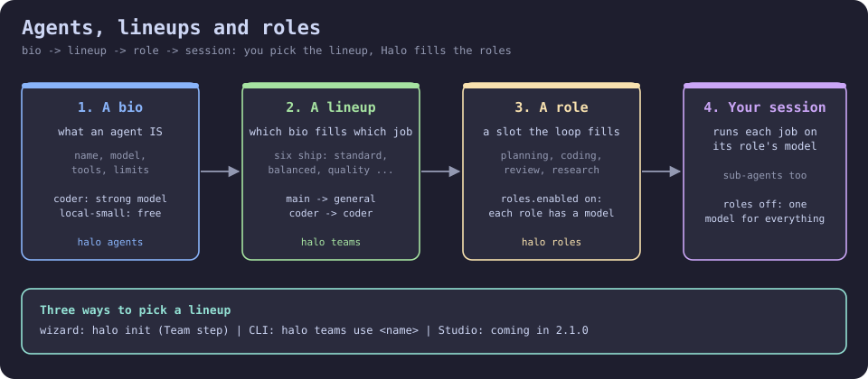

# The wizard interaction model

Read this when you change or add a wizard screen: the ten rules every screen follows.

Halo 2.0.5 round 2c (`plans/ROADMAP.md` "ADDED 2026-10-06 ~10:05": "the
wizard stops being clunky"). Ten rules, followed by every wizard screen --
`halo init`, `halo setup`, `/setup`, `/agents`, `/teams`, every editor
(`OrgEditor`, `RolesEditor`) and every view (`AgentBioView`, `LineupView`)
they open. 3.1.1.0: bios and lineups are edited in Studio; the terminal shows
them read-only and `e` opens Studio on them (see "The Team step" below).
Verified against `halo_harness/tui/dialogs/init_wizard.py`, `wizard_ux.py`,
`step_rail.py`, `autocomplete.py`, `setup_mode.py`, and `team_step.py`.

3.3.0.0: Setup in Studio holds the same blocks (R4 makes it the door).

## The 90-second version

Four words, in this order: **bio -> lineup -> role -> session**.

- A **bio** says what an agent IS: its name, its model, its tools, its
  limits. `coder` is a bio; so is `local-small`. (`halo agents`.)
- A **lineup** hands bios to jobs: "planning goes to this bio, coding to that
  one". Seven ship with Halo -- `auto` (the default), `standard`,
  `balanced`, `quality`, `local-first`, `code-review`, `halo-dev-cycle` --
  and you can write your own. (`halo teams`.)
- A **role** is one job slot the session fills: main, planner, coder,
  reviewer, researcher and so on. A lineup gives every role an agent and a
  model. (`halo roles`.)
- Your **session** runs each job on the model its role names, and the
  sub-agents Halo spawns do the same. Until you pick a lineup the **auto**
  lineup runs (3.1.9.0: a pool whose models are picked for each task); with
  roles off, **one model for everything**, the default model you picked.



Three ways to pick a lineup, all writing the same two config keys (`team`
and `roles.enabled`):

1. **The wizard** -- `halo init` (Quick setup includes the Team step) or
   `halo init --step team`. The first row, "One model for everything", is
   the off state; every other row previews its `role -> agent -> model`
   tree with prices before you apply it.
2. **The command line** -- `halo teams use <name>` points the active
   lineup at one; `halo roles on|off` flips the switch.
3. **Studio** -- coming in 2.1.0.

Everything below is the field-by-field reference; nothing in it changed.

## The ten rules

1. **Highlight is selection** for a one-of choice (default model,
   permission mode, theme, a lineup): the highlighted row IS the chosen
   one, marked with a check (`✓`); Next moves on -- no confirm button.
2. **Enter does the obvious thing** on a highlighted row: show a bio or a
   lineup (`e` there opens Studio on it), pick a picker row, use the
   highlighted lineup. Space
   toggles an on/off row. Buttons stay for the mouse, but are never the
   only path.
3. **Autocomplete inside a model field**: typing filters the enumerated
   rows in a dropdown under the field; Enter picks, Escape closes the
   dropdown (never the screen underneath it). Ctrl+P still opens the full
   picker, with its price/context/speed columns.
4. **A step rail** across the top of every step (Providers, Local models,
   Default model, Permissions, Theme, Team, Summary): the current
   step highlighted, done steps ticked. Ctrl+Left/Ctrl+Right are Back/Next
   from anywhere.
5. **Quick setup by default**: the first screen offers "Quick setup" (a
   provider key, your default model, and which lineup of agents runs your
   work -- the Team step, with the default `auto` lineup preselected since 3.1.9.0) and
   "Full setup" (every step). Quick is the highlighted default; the Summary
   names the lineup that was applied.
6. **One sentence at the top of each step**: what it decides and the
   current choice -- "Default model: `<ref>`. Enter to change."
7. **Focus lands on the content** (the list, or the first field) the
   instant a screen opens -- never on a button. The focused control and
   the highlighted row look different.
8. **At most two levels deep** (a list, then its editor). Save shows a
   one-line toast; a problem stays inline, next to the field it's about.
   Escape is always Back, and never destructive -- it never writes a
   partial/unsaved edit over a file that already had something in it.
9. **The footer reads the same everywhere**: Enter choose, Space toggle,
   Ctrl+N new, Ctrl+E edit, Del delete, Ctrl+S save, Esc back -- a screen
   that doesn't offer one of these simply doesn't show it.
10. **The Summary has "Change" jumps**: one row per step this run actually
    used, jumping straight back into it.

## The step rail

```
Providers  >  Local models  >  [Default model]  >  Permissions  >  Theme  >  Team  >  Summary
```

Current step bold+reversed, done steps prefixed with `✓` and dimmed,
steps still ahead plain. `halo init --step <key-or-number>` jumps straight
to one step (`docs/COMMANDS.md`'s own `--step STEP` row); Ctrl+Left/
Ctrl+Right walk it one step at a time from inside any step, including one
with a text field focused (both chords are priority bindings for exactly
this reason).

## Quick setup vs. Full setup

The very first screen of a genuine `halo init` (never a `--step .../
/setup .../halo setup ...` entry, which already knows where it's going):

| Choice | What runs | What it leaves |
|---|---|---|
| **Quick setup** (default, highlighted) | Providers -> Default model -> Team -> Summary | Whatever the Team step applied: since 3.1.9.0 the preselected row is the default `auto` lineup, which writes no `team:` and keeps roles on (main on the default model, a pool whose models are picked for each task -- `docs/ROLES.md`'s "The Auto lineup"); "One model for everything" turns roles off and clears `team:`; picking another lineup applies it and turns roles on. |
| **Full setup** | Every step: Providers, Local models, Default model, Permissions, Theme, Team, Linux fixes (Linux only, only when needed), Summary | Whatever each step's own section of this doc/`docs/AGENTS.md`/`docs/ROLES.md` says it writes. |

Nothing is ever permanently closed off by picking Quick: `halo init --step
team` (or `halo setup`/`/setup`) reaches Full setup's own steps any time
afterward.

## The Team step (rule 11)

One screen, titled "Team" (Halo 2.1.0 round B1 rebuilt it; Quick setup now
includes it). Top to bottom:

- **A plain-words header** (3.1.9.0): "Halo runs the auto lineup (the
  default) unless you pick a lineup of your own: main hands each sub-task to
  an agent whose model is picked for it. A lineup gives each job (planning,
  coding, reviewing, research) its own agent and model; One model for
  everything runs every job on one."
- **A Custom roles switch** (3.0.2.0): off is one model for everything,
  on is a lineup. The switch and the list below are one choice: switching
  on highlights the first lineup (or the active one), switching off
  highlights the first row, and highlighting a lineup turns the switch on.
- **The lineup list.** The FIRST row is always **"One model for
  everything"** -- applying it writes `roles.enabled: false` and (3.1.9.0)
  clears `team:` (it used to write `team: standard`). Then every
  reachable lineup (shipped, user, project) with its role count, its
  one-line description and a scope badge. The active one carries the check
  mark; while no `team:` is set that is the `auto` row, marked "(default)",
  and a fresh install highlights it -- Next on it writes no `team:` (a
  future default follows), Next on another lineup applies it.
- **A live preview** of the highlighted row (beside the list from 100
  columns up, below it otherwise): a tree `role -> agent -> model` with the
  model's price and context window when the catalog knows them, the
  lineup's `about:` text, any warnings, and one cost line -- "Roughly $X per
  turn at these prices", or "price unknown for `<model>`" when a model has
  no price (never a blank that reads as free). For the first row it is the
  sentence "Halo uses `<default model>` for everything, including the
  sub-agents it spawns on its own, and still asks you questions when it
  needs to." `tui/dialogs/team_preview.py` (`preview_lines`, `cost_hint`)
  builds the same text for the command line.
- **Buttons**: **Use this lineup** (apply now), **Edit in Studio**
  (3.1.1.0; also Ctrl+E) and **Open Studio (Roles)**. Edit in Studio opens
  Studio on the highlighted lineup's inspector (`halo studio --edit
  lineup:<name>`): a Studio already running for this home switches its open
  page to it, else one starts in the background and opens your browser; the
  line under the buttons says which, with the URL (over SSH that URL is the
  way in). Open Studio (Roles) opens the Roles canvas the same way. Studio
  keeps running after setup until `halo studio --stop` or until the halo
  session quits (3.2.2.0: a quit ends the Studio; `halo studio` starts it
  again). Editing lineups and
  bios happens there; the terminal shows them: Enter on a row opens the
  read-only lineup view (its `e` opens Studio too, `t` tests a row's
  model), Ctrl+N writes a new lineup and opens it in Studio, Ctrl+A lists
  the bios (Enter shows one, `e` edits it in Studio).

A plain Next applies whichever row is highlighted (rule 1) and always
writes `roles.enabled` explicitly: off for the first row, on for any
lineup. With roles off the main agent still spawns sub-agents for big
jobs and hands surveys and mechanical steps to cheaper models (the system
prompt and the Agent tool both say so). Keys: Esc back, Ctrl+Left/Ctrl+Right
step. The body scrolls, so every control is reachable at 80x24. The Summary step then names what was
applied: the lineup with one line per resolved role ("Lineup: auto (the
default; change it with `halo config set team <name>` or Studio Roles ->
Apply)" while no `team:` is set), or "One model for everything: `<model>`".

`halo init --step team` reaches it directly; `--step agents` and `--step
roles` are kept as plain aliases (so is the pre-existing `/setup roles`/
`halo setup roles`, and the new, equally-spelled `/setup team`/`halo setup
team`) -- all four land on the exact same screen.

## The Ollama tab: found servers (3.2.3.0)

The Providers step's Ollama tab (and `halo init`'s tabbed view) opens with
two buttons above the typed fields: **Find Ollama servers** asks this
machine's doors at once (`OLLAMA_HOST`, loopback on
`ollama.discover.ports`, this machine's LAN address, Docker, WSL; a few
seconds) and **Scan this network** also sweeps the network, with a
progress line ("scanning <subnet> ... N s", about 10 s). Each server found
is one row with a tick: its name, address, version and the models it
serves. A configured one is ticked and dimmed; a new one starts unticked.
Save adds the ticked new rows as `ollama.hosts` entries (never
repointing an existing host; the first entry stays the default), and the
typed fields still work for a host the scan cannot reach. When the Save
added hosts, a one-line offer follows: "Calibrate the found models now
(loads each model once; about N minutes: Enter runs it, Esc skips)".
Enter runs the calibration in a worker, one progress line per model
("qwen3:30b on gpubox: 32k fits, 65k does not (2 min 10 s)"); Esc skips
it, or once it runs closes the view while the measuring carries on in the
background as long as setup stays open, recording each model as it ends
(rule 8: Esc never undoes anything). When the measuring ends with models
that fit, the view asks "make tuned twins of the models that fit? (Enter
/ n)": Enter makes a tuned twin of each (`halo ollama tune`, one line
each), n or Esc skips. The
Local models step shows the same rows read-only above its detection
lines, which now list every local Ollama found ("Ollama at
127.0.0.1:11434: 3 models", "Ollama at 127.0.0.1:11435: 1 model, not
added"). With `--no-live` the offer is not made.

## The Summary's checks (3.2.2.0)

Under the lineup lines, the Summary lists the checks Halo offers after
setup, one row each: its title, then in muted text what it does, what it
costs, how long it takes and what it writes. The rows and their defaults:
**Doctor** (on), **Model catalog** (on), **Hello**, one one-turn call to
your default model (on), **Model gym, quick** (off; the models it would
run on are listed under the rows, local ones ticked: the gym does not run
cloud models) and **The guided first run** (off; `halo start`, one real
Orchestra run on your models). Focus lands on the rows; Space or Enter
ticks one (rule 2). Finish runs the ticked ones in order, printing each
one's title, `[OK]` or `[!!]` and its result lines on the Summary, then the
written-files lines; Finish again closes setup. With nothing ticked, or only
the guided first run, Finish closes at once; the guided first run starts
after the wizard closes, and Esc while the checks run closes setup without
it. A `/setup` Summary has the first four rows. `halo check` runs the same
list from a shell (`docs/COMMANDS-init.md`).

## Autocomplete field sites (rule 3)

| Site | Field | Suggests |
|---|---|---|
| Role template editor (`/roles edit`) | A quick filter above the role list | Every enumerated model ref, assigned to the role currently highlighted below it |

(3.1.1.0: a bio's and a lineup's model fields are Studio's -- its model
picker table on the bio form, a model choice on a lineup card.)

Typing narrows the dropdown (prefix matches first, then substring, same
ranking `model_picker.autocomplete_suggestions` uses); Enter picks the highlighted suggestion;
Escape closes the dropdown without leaving the screen underneath it
unless the dropdown was already closed, in which case Escape does
whatever it always does there (rule 8).

## The chrome every step shares

`tui/dialogs/wizard_ux.py` (the mixin/helper deliverable 2 names):
`mark_checked` (rule 1's check mark), `focus_first` (rule 7), `one_sentence`
(rule 6), `toast` (rule 8's save confirmation), `footer_hint` (rule 9's
sentence, built only from the chords a screen actually offers).
`tui/dialogs/step_rail.py` carries the rail text and the Ctrl+Left/
Ctrl+Right chords; `tui/dialogs/autocomplete.py` carries the dropdown
widget pair. All three are plain, Textual-free-at-the-top-level helper
modules reused by every step and editor named above -- never re-
implemented per screen.

## See also

- `docs/HANDBOOK.md`'s 10-minute walkthrough for the step-by-step flow in
  prose.
- `docs/COMMANDS.md`'s `halo init`/`halo setup` sections for every flag.
- `docs/AGENTS.md`'s "Editing bios and lineups" section for Studio's bio form
  and lineup inspector, field by field, and the terminal's views.
- `docs/ROLES.md` for `roles.enabled`, the `standard` lineup, and the
  role-table resolution chain the Team step's "off" state relies on.
