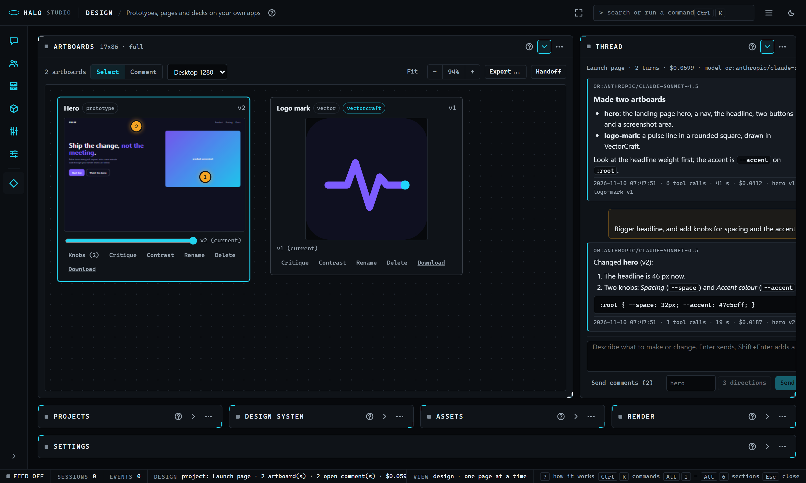

# Studio: the Design section

Read this when you make prototypes, pages or decks with Studio's Design section, the design pack's page.

The design pack's section of Halo Studio (Halo's docs/STUDIO.md lists every part of Studio). Since Halo 3.3.13.0 it is
the pack's own page: Studio draws it with the pack's module (`studio/design.js`, `mount(el, api)` on the section's
whole page, the shell's own React and parts through `api.lib`) and the pack's Python answers its routes
(`server/routes.py`, under `/api/packs/design/design/`). [DESIGN.md](DESIGN.md) is what Design does.

## The section

Design (the rail's Design row; `Alt+0` while it is the first pack section; `halo studio --mode design--design`;
`/design`; `?mode=design` opens it while the pack is on, and Session with one line saying how to turn the pack on while
it is off) is a page over the projects in the pack's data folder (`~/.halo/packs/.data/design/projects/<slug>/`). With
no project yet it is one **Start view**: what Design is, the steps, and one button: name the first project and
**Create project** (a project made elsewhere shows up within 4 s). Until you grant the pack `studio-script` the page is
one line naming `halo pack enable design --grant studio-script`; its routes answer once you grant `studio-routes`.

| Panel | What it is |
|---|---|
| **Projects** (`design-projects`) | Every project with its artboards and model; click one to open it; **New project** (a dialog: a name and, if you like, its model from the model select); the open project's model on top, in the same select, saved at once (`PUT <slug>/model {model}`; its first option keeps the default model) |
| **Design system** (`design-system`) | The project's token sheet (`system.json`): the tokens by group (colours, type, spacing, radii), a colour with its swatch, each value editable with **Save tokens**; the components and the sources; **Sync** from a folder path or a web page |
| **Assets** (`design-assets`) | The project's `assets/`: **Add files...** or drop files on the panel (uploaded as base64, 15 MB each); click a row to put its path in the message; **Download** saves it through the pack's `_files/<slug>/_assets/<name>` |
| **Artboards** (`design-artboards`, the primary) | The artboards as cards on a canvas: the frame (a prototype in `<iframe sandbox="allow-scripts">`, a render as an image, a video, else a link), its open comment pins (click one: its text and **Resolve**), the version slider with **Restore**, then **Knobs (N)**, **Critique**, **Contrast**, **Rename**, **Delete** (asks first) and **Download**; double-click a prototype's text to edit it; the toolbar has **Select / Comment**, the device select, zoom, Fit, **Export...** and **Handoff**; its settings face holds the device and the knobs |
| **Thread** (`design-thread`) | The project's turns as one thread: what you asked, the model's reply as markdown, cost, tool calls, seconds and the versions it made; the running turn streams at the bottom with a chip per tool call; the **Send** box (`Enter` sends, `Shift+Enter` a new line) and **3 directions** beside it, while a turn runs **Cancel turn**; **Send comments (N)** when pins are open |
| **Render** (`design-render`, a strip at the foot) | A ComfyUI workflow into an artboard: the workflow (the core's `media/workflows`: a starter or one saved on ComfyUI), its named inputs and every node input under a disclosure, the project and the artboard; **Render** queues it (`POST render`, `202`), its `render` frames show the progress, and the result shows inline and as an artboard (a render over an existing artboard is its next version) |
| **Settings** (`design-settings`, a strip at the foot) | The pack's settings form (`PackForm` over its `config.schema`): `model`, the model a new project starts with; `budget_usd`, what one turn may spend (0: no cap of the pack's own); also in the Pack Manager's Settings |

**Turns over the live feed.** Every step of a turn is the pack's live frame (`pack_live`, kind `turn`; the routes'
`ctx.publish`) with data `{slug, turn, state: started|event|done, n, event, result}` (a tool call's input cut to one
line). While the feed is not open the page polls `<slug>/turn/<id>?since=N` every 500 ms instead; both fill the same
slots, so nothing shows twice. One turn runs per project at a time. **Cancel turn** is `POST <slug>/turn/<id>/cancel`:
the turn's child is killed, the turn ends with code 130 and `cancelled: true`, and what it wrote so far is kept as
versions. The history keeps each turn's reply text (8000 characters).

**A safe markdown subset.** The thread renders headings, paragraphs, lists, block quotes, code blocks, inline code,
bold, italic and links (only `http(s)` and `mailto`, opened with `rel="noopener noreferrer"`), with the shell's own
`Markdown`. Nothing is parsed as HTML and no image is fetched: an image shows as its alt text.

**Artboards.** Drag a card by its title; the places are saved on the server (`PUT /api/layout/design:<slug>`, 500 ms
after the last move). A card dropped on another makes room: the cards it lands on step aside, live while you drag.
**Rename** is `POST <slug>/artboard/<id>/rename {name}` (the title changes; the id, files and versions stay); **Delete**
is `DELETE <slug>/artboard/<id>` (its folder and versions go, its open pins are resolved; refused while a turn runs).
**Critique** starts a read-only turn (Read and Glob, no MCP servers) whose notes land as pins with a `critique` badge
(`POST <slug>/critique {artboard, model?}`); **Contrast** opens the text-on-background table with ratio and AA / AAA
verdicts (`GET <slug>/artboard/<id>/contrast`). **Export...** asks for folder, HTML, PNG, SVG or PDF and one artboard
or all, then shows what it wrote; **Handoff** shows the bundle's path and the command that continues from it.

**Versions.** Every turn, knob move, direct edit and restore is a version. The slider swaps the frame to `v<n>/...`;
at an older version **Restore** makes it the newest one.

**Knobs.** An artboard's `controls.json` knobs are sliders, colour pickers and selects in the Artboards panel's settings
face. A change is posted 150 ms after the last move (`POST <slug>/control {artboard, name, value}`): a `css:` knob
rewrites the variable in the page at once and is saved as a version, any other knob is kept for the next turn.

**Direct text edits.** A prototype's current version is framed with `?edit=pick`: a small picker in the sandboxed frame
posts `halo-design-pick` to Studio on a double-click. Studio opens its own inline editor on the card at that text;
**Enter** or Save changes that one text node in the page's source and posts the page to `POST <slug>/text-edit
{artboard, html}`, saved as a new version with the note `direct edit`; **Esc** or Cancel drops it.

**Comments.** Pick **Comment** in the toolbar and click a frame: **Enter** pins it (`POST <slug>/comment {artboard,
text, x, y}`, x and y in percent of the frame). Pins are numbered per artboard; click one for its text and **Resolve**
(`POST <slug>/comments/resolve {ids}`). **Send comments (N)** in the Thread turns the open pins into one turn.

**The design system.** **Save tokens** is `PUT <slug>/system`; **Sync** is `POST <slug>/sync {source}`, merged; a dialog
says how many tokens there are, by group, and where they came from.

**3 directions.** The Thread's **3 directions** sends the message box's text with `variants: 3` and `base` in the
`run` body; the server writes the prompt. When the turn ends the new artboards are laid out in one row.

**Device size.** **Phone 390** (390 x 844), **Tablet 820** (820 x 1100) or **Desktop 1280** (1280 x 800, the default),
kept as the panel's setting in the browser (`halo.studio.design.panel.design-artboards`).

**The raw file route and its sandbox.** Artboard files are the pack's `GET _files/<slug>/<artboard>/<file>` (and
`.../v<n>/<file>`), the project's assets `_files/<slug>/_assets/<name>`, confined to that folder (`..` is a 404), with
Studio's token in `?t=` (an iframe sends no header). They carry their own `Content-Security-Policy: default-src 'self'
'unsafe-inline' data: blob:`, which Studio passes through for the pack's prefix, not the shell's, because a prototype
has inline CSS and JS. HTML and SVG responses add `; sandbox allow-scripts`, so the document gets an opaque origin even
when it is framed without a sandbox attribute or opened on its own. The page embeds them as `<iframe
sandbox="allow-scripts">` without `allow-same-origin`, so a prototype runs but its requests carry no origin Studio
answers. An artboard folder that is a symlink is never served.

**The palette** (while the page is up, group "pack design"): **Design: new project**, **Design: send**, **Design:
cancel turn** (while one runs), **Design: 3 directions**, **Design: pin a comment**, **Design: preview at Phone 390 /
Tablet 820 / Desktop 1280**, **Design: export**, **Design: handoff bundle**, **Design: send comments**, and every project
by name; **Design: open the Design section** always (pack.yaml's palette line).

## The pack's routes

Every route is `/api/packs/design/design/<path>`, behind Studio's token (and its loopback, Host and Origin guard), once
the pack is enabled with `studio-routes`; the body limit is 22 MB (`MAX_BODY`: an asset is 15 MB as base64).

| Route | Answer |
|---|---|
| `GET ping` | `{ok, pack, projects}` (`halo pack test`'s probe) |
| `GET crafts[?probe=1]` | the craft apps, registered here or not; with `probe`, each started and its tools counted |
| `GET projects`, `POST projects {name, model?}` | the projects (`moved`: the one-time line when a `~/.halo/design` was moved); a new one |
| `GET models[?media=1]` | the model select's rows, the best for design first (`ext.host.models`); ComfyUI's models |
| `GET <slug>`, `PUT <slug>/model`, `PUT <slug>/system` | the project; its model; its token sheet |
| `POST <slug>/run`, `GET <slug>/turn/<id>?since=N`, `POST <slug>/turn/<id>/cancel` | a turn, its events, its cancel |
| `POST <slug>/comment`, `POST <slug>/comments/resolve`, `POST <slug>/control`, `POST <slug>/text-edit` | pins, knobs, direct edits |
| `GET <slug>/artboard/<id>/versions`, `POST .../restore`, `POST .../rename`, `DELETE <slug>/artboard/<id>`, `GET .../contrast` | one artboard |
| `POST <slug>/critique`, `POST <slug>/sync`, `POST <slug>/export`, `POST <slug>/handoff` | the second opinion, the design system, what leaves the project |
| `GET <slug>/assets`, `POST <slug>/assets {name, data_base64}` | the assets folder |
| `GET _files/<slug>/<artboard>/<file>` | an artboard's raw file (above) |
| `POST render {workflow, set, project, artboard, source?}`, `GET renders/<prompt id>` | a ComfyUI render into the project |
